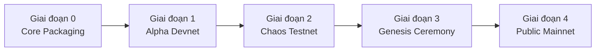

# Kế Hoạch Triển Khai Mainnet SkyNet (v1.0 Production Roadmap)

Tài liệu này đặc tả lộ trình kỹ thuật, kiến trúc vận hành và quy chuẩn nghi thức để đưa mạng lưới **SkyNet** từ môi trường mô phỏng cục bộ (`skynet-sim`) lên **Mạng lưới Công khai Phi tập trung (Production Mainnet)**.

---

## 1. Mục Tiêu & Các Bất Biến Bắt Buộc

Mọi giai đoạn triển khai Mainnet phải bảo đảm tuyệt đối 4 bất biến toán học:
1. **Tổng cung Genesis bất biến:** Cố định đúng $21{,}000{,}000{,}000{,}000\text{ SKN}$ ($2.1 \times 10^{22}\text{ nanoSKN}$, kiểu `u128`), không có hàm mint lạm phát.
2. **Kỷ luật Halving hàng năm:** Kho dự trữ tự động cắt giảm 50% sản lượng mỗi năm (`DEFAULT_EPOCHS_PER_YEAR = 525_600`).
3. **Cổng giao thức chuẩn:** Mặc định toàn mạng lắng nghe trên cổng **`8888`** (`8888/UDP` cho P2P Bầy đàn / Snowball và `8888/TCP` cho Dashboard / RPC).
4. **Chủ quyền Con người (`Soul–Body Custody`):** Ví lạnh của con người nắm quyền kiểm soát tối thượng, AI Agent chỉ hoạt động trong hạn mức ủy quyền (`max_voucher_allowance`).

---

## 2. Lộ Trình 5 Giai Đoạn Triển Khai



### Giai đoạn 0: Đóng Gói Nhị Phân & Daemon Dịch Vụ (Client Suite)
* **Tách Daemon `skynet-node`:** Xây dựng crate độc lập đóng gói dịch vụ chạy nền (Daemonize) hỗ trợ Linux systemd, macOS Launchd và Docker container.
* **Tầng Lưu trữ Bền vững (Persistence Engine):** Tích hợp `RocksDB` hoặc `Sled` để lưu trữ trạng thái gốc Merkle Utreexo (`~1 KB`), tập UTXO cục bộ và lịch sử nén Epoch (`Biological Autophagy`).
* **Bộ công cụ `skynet-cli`:** Cung cấp CLI bảo mật hỗ trợ tạo cụm từ khôi phục `HumanWallet`, xuất khóa nóng Agent, ký giao dịch ngoại tuyến (Air-gapped) và kiểm tra số dư.

### Giai đoạn 1: Mạng Thử Nghiệm Kín (Internal Alpha Devnet)
* **Triển khai Cụm Bootstrap Toàn cầu:** Dựng 12 Seed Nodes phân bổ tại 4 khu vực địa lý: Tokyo, Singapore, Frankfurt và Virginia.
* **Xác thực Đục lỗ NAT P2P:** Kiểm thử cơ chế trao đổi STUN/Hole Punching và chuyển tiếp `Ganglia Relay` cho các thiết bị IoT di động 4G/Wi-Fi (theo đặc tả [NODE_DISCOVERY_AND_BOOTSTRAP.md](file:///Users/pain/DATA/Projects/SkyNet/docs/NODE_DISCOVERY_AND_BOOTSTRAP.md)).
* **Đo lường Chỉ số Trễ:** Tối ưu hóa bảng định tuyến logarit `SynapticPeerTable` ($O(\log_2 N)$) đạt độ trễ UDP liên lục địa $< 120\text{ms}$.

### Giai đoạn 2: Mạng Thử Nghiệm Cộng Đồng Có Thưởng (Incentivized Chaos Testnet)
* **Chiến dịch "Chaos Testnet":** Mở cổng cho cộng đồng vận hành node đa dạng: từ Raspberry Pi 4 (`TinyPeripheral`) đến máy chủ cụm GPU H100/RTX4090 (`ColossalOrganism`).
* **Bơm Nhiễu Mất Gói Thực Tế (25%–40% UDP Loss):** Kiểm chứng tính hội tụ của đồng thuận xác suất **Snowball** khi xử lý xung đột chi tiêu kép (Double-Spend) trong điều kiện mạng quốc tế chập chờn.
* **Kiểm toán Mật mã & An ninh (Audit):**
  * Kiểm toán độc lập chữ ký Ed25519, hàm băm BLAKE3, và logic bảo toàn `nanoSKN`.
  * Rà soát quy tắc chống đánh cắp vốn gốc `HumanPrincipalDiversionBlocked`.

### Giai đoạn 3: Nghi Thức Khởi Nguyên Toàn Cầu (The Genesis Ceremony)
* **Khóa Bảng Phân Bổ Genesis (`genesis.json`):**
  * **85% ($17.85\text{T SKN}$):** Khóa vào `GenesisHalvingVault` hợp đồng thông minh lõi, phân phối qua khai thác sinh học trong 20+ năm.
  * **15% ($3.15\text{T SKN}$):** Cấp vốn lưu thông ban đầu (`seed_circulating`) cho Quỹ phát triển hệ sinh thái, Bootstrap Validators và tạo lập thanh khoản thị trường.
* **Đúc Khối Genesis (Genesis Minting):**
  * Sinh hàm băm khối khởi nguyên duy nhất: `GENESIS_HASH`.
  * **Hardcode `GENESIS_HASH`** vào mã nguồn bản phát hành chính thức `v1.0.0` để triệt tiêu vĩnh viễn nguy cơ fork ngầm.

### Giai đoạn 4: Kích Hoạt Mainnet & Mở Cổng Kinh Tế AI (Day-1 Launch)
* **Đồng bộ Giờ G ($T_0$):** Cụm Seed Nodes đồng loạt kích hoạt socket UDP tại cổng `8888`.
* **Phát hành Docker 1-Dòng lệnh:**
  ```bash
  docker run -d --restart=always --name=skynet-node \
    -p 8888:8888/udp -p 8888:8888/tcp \
    -v ~/.skynet:/data skynetnetwork/skynet-node:v1.0.0 \
    --seed seed.skynet.network:8888
  ```
* **Kích hoạt Kênh Thanh Toán Vi Mô M2M:** Cho phép các AI Agent bắt đầu mua bán xung suy luận qua `SynapticVoucher` và giao dịch DNA mô hình trên `Plasmid Market`.

---

## 3. Ma Trận Cấu Hình Mạng & Cổng Giao Thức

| Thông số | Môi trường Dev / Sim | Mạng Thử nghiệm (Testnet) | Mạng Chính thức (Mainnet) |
| :--- | :--- | :--- | :--- |
| **Cổng P2P UDP** | Ngẫu nhiên (`127.0.0.1:0`) | `8888/UDP` | `8888/UDP` |
| **Cổng Web Dashboard** | `127.0.0.1:8888` | `8888/TCP` | `8888/TCP` (sau Reverse Proxy) |
| **Kích thước MTU UDP** | $\le 1200\text{ bytes}$ | $\le 1200\text{ bytes}$ | $\le 1200\text{ bytes}$ |
| **Magic Header Giao thức** | `*b"SK"` (v1) | `*b"ST"` (Testnet v1) | `*b"SK"` (Mainnet v1) |
| **Tham số Snowball** | $k=5, \alpha=2, \beta=5$ | $k=10, \alpha=7, \beta=15$ | $k=20, \alpha=14, \beta=20$ |
| **Thời gian 1 Epoch** | 1 giây (mô phỏng) | 10 giây | 60 giây (`525,600` epochs/năm) |

---

## 4. Phân Cấp Hạ Tầng Nút Vận Hành

Mạng lưới Mainnet SkyNet hoạt động theo mô hình tế bào sinh học phân tầng:

```
                  ┌───────────────────────────────┐
                  │    DNS Seeds / Rendezvous     │
                  │   seed[1..4].skynet.network   │
                  └───────────────┬───────────────┘
                                  │
         ┌────────────────────────┴────────────────────────┐
         ▼                                                 ▼
┌─────────────────────────────────┐       ┌─────────────────────────────────┐
│       Colossal Organism         │       │          Standard Node          │
│   (GPU Cluster / Validator)     │◄─────►│    (Dedicated Server / VPS)     │
│   - Batch Tensor candle-core    │  UDP  │   - Kademlia XOR routing        │
│   - Utreexo Root Accumulator    │ 8888  │   - Ganglia Relay for Edge      │
└────────────────┬────────────────┘       └────────────────┬────────────────┘
                 │                                         │
                 │ UDP SynapticVouchers (≤ 1200B)          │
                 ▼                                         ▼
         ┌─────────────────────────────────────────────────────────┐
         │              Tiny Peripheral (IoT / Edge)               │
         │  - Smart Meters, Drones, Camera, Raspberry Pi           │
         │  - Xác thực phi trạng thái bằng Utreexo (~1 KB RAM)     │
         └─────────────────────────────────────────────────────────┘
```

1. **Bootstrap / DNS Seed Nodes:** Máy chủ có IP tĩnh công cộng, cấu hình băng thông cao, nhiệm vụ duy nhất là dẫn đường (Peer Discovery) cho các node mới gia nhập bảng băm Kademlia.
2. **Nút Sinh Học Khổng Lồ (`ColossalOrganism`):** Máy chủ nhiều GPU, thực thi lô nơ-ron `TissueBatch`, nhận thưởng `nanoSKN` khi hoàn thành bài toán suy luận nặng hoặc đột biến gen AI.
3. **Nút Ngoại Biên Tí Hon (`TinyPeripheral`):** Cảm biến IoT, máy tính mini chỉ cần $\sim 1\text{ KB}$ RAM để xác thực bằng chứng Merkle Utreexo, không cần tải lịch sử chuỗi.

---

## 5. Kế Hoạch Ứng Phó Khẩn Cấp & Quản Trị Rủi Ro

* **Bảo vệ Bất biến Tự động (Circuit Breaker):**
  * Tại mỗi mốc Epoch, nếu công thức $\text{Lưu thông} + \text{Dự trữ Vault} \neq 21\text{T SKN}$, toàn bộ node lập tức từ chối đào khối mới và chuyển sang chế độ tự đóng băng an toàn.
* **Quyền Thu Hồi Tối Thượng (`Sovereign Reclaim`):**
  * Người vận hành nếu phát hiện máy chủ chạy Node AI bị xâm nhập có thể dùng khóa lạnh `HumanWallet` ký lệnh rút 100% tiền ký quỹ về địa chỉ an toàn mà không cần sự xác nhận từ máy chủ bị hack.
* **Nâng Cấp Giao Thức (Hard Fork / Soft Fork Protocol):**
  * Mọi thay đổi logic tiến hóa tế bào hoặc cấu trúc gói UDP được biểu quyết thông qua chữ ký của các cụm Node có tỷ trọng `AgentBond` lớn trên mạng lưới.

---

## 6. Danh Mục Việc Cần Làm (Checklist Tiến Độ)

- [x] Thiết kế đơn vị tiền tệ `NanoSkn(u128)` và bộ tích lũy Merkle `Utreexo` $\sim 1\text{ KB}$ RAM.
- [x] Cố định cổng mặc định toàn mạng `DEFAULT_PORT = 8888`.
- [x] Triển khai giao thức đục lỗ UDP NAT và đồng thuận Snowball chịu rớt 25%–40% gói tin.
- [ ] Xây dựng crate `skynet-node` đóng gói nhị phân độc lập (CLI flags, daemon, RocksDB storage).
- [ ] Thiết lập tệp cấu hình khởi nguyên `genesis.json` và công cụ tạo `GENESIS_HASH`.
- [ ] Thiết lập hệ thống DNS Seeds `seed.skynet.network` trên 4 châu lục.
- [ ] Khởi chạy Testnet công khai và kích hoạt chương trình Bug Bounty.
- [ ] Đóng gói Docker image và phát hành bản cài đặt Mainnet v1.0.0.
