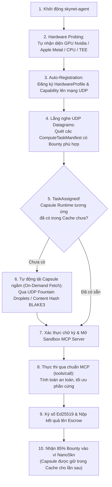

# Đặc Tả Kiến Trúc MCP Compute & Cơ Chế Zero-Touch Cho Worker

> **Phiên bản:** SkyNet Protocol v1.2  
> **Trạng thái:** Chuẩn Hóa Chính Thức (Standard Specification)  
> **Chủ đề:** Chuẩn hóa nhiệm vụ tính toán qua Giao thức **Model Context Protocol (MCP)**, Hệ thống **Phân cấp Mã Opcode**, và Cơ chế **Zero-Touch Provisioning** cho Thợ đào (Compute Worker).

---

## 1. Vấn Đề Cốt Lõi & Tầm Nhìn Đột Phá

### 1.1. Nghịch lý của Thợ Đào (Worker Paradox)
Trong thế giới tiền mã hóa truyền thống (Proof-of-Work), thợ đào chỉ cần mua card đồ họa hoặc máy ASIC, cắm điện, bật phần mềm miner (như Ethminer, T-Rex) là tiền tự chảy về ví. Họ không cần biết thuật toán Keccak hay Ethash hoạt động chi tiết ra sao.

Nếu một mạng lưới điện toán đám mây AI phi tập trung đòi hỏi thợ đào phải tự tay:
- Cài đặt Linux, cấu hình driver CUDA toolkit 12.4, Python 3.10, PyTorch, cuDNN;
- Tự clone các kho mã nguồn từ GitHub (Blender 4.2, Real-ESRGAN, Whisper, GROMACS, AutoDock Vina...);
- Tự xử lý xung đột dependency, biên dịch C++ phức tạp;

$\implies$ **99% người dùng và thợ đào sẽ lập tức từ bỏ!**

### 1.2. Giải pháp SkyNet: Zero-Touch Execution & Chuẩn Hóa MCP
SkyNet giải quyết triệt để vấn đề này bằng cách kết hợp hai trụ cột:
1. **Chuẩn hóa Giao thức qua Model Context Protocol (MCP):** Mọi tác vụ tính toán — từ upscale ảnh, render 3D, chạy LLM cho đến mô phỏng hạt — đều được đặc tả dưới dạng một **MCP Tool Call** tiêu chuẩn với JSON Schema nghiêm ngặt.
2. **Cơ Chế Tự Động Hóa Tuyệt Đối (Zero-Touch Provisioning):** Thợ đào chỉ chạy **DUY NHẤT một phần mềm gọn nhẹ: `skynet-agent`**. Mọi việc còn lại — từ phát hiện phần cứng, tìm kiếm nhiệm vụ phù hợp, tự động tải môi trường thực thi cô lập (**Capsule Runtime**), nạp trọng số, chạy tính toán trong sandbox đến nhận tiền — đều do `skynet-agent` thực hiện ngầm 100%.

---

## 2. Hệ Thống Phân Cấp Mã Opcode (Hierarchical Opcode Registry)

Để vừa đảm bảo tính cô đọng tuyệt đối của giao thức mạng UDP (`<= 1200 bytes`), vừa có khả năng phân loại hàng trăm nhiệm vụ chuyên biệt, SkyNet sử dụng cấu trúc **Mã Opcode 16-bit Phân Cấp (Hierarchical 16-bit Opcode)**:

$$\text{Opcode (16-bit)} = (\text{Domain Byte} \ll 8) \mid \text{Task Code Byte}$$

```
+-----------------------------------+-----------------------------------+
|     Domain Byte (High 8 bits)     |     Task Code (Low 8 bits)        |
|  Phân loại lĩnh vực / chuyên môn  |  Thuật toán / Mô hình / Biến thể  |
+-----------------------------------+-----------------------------------+
```

### Bảng Danh Mục Phân Cấp & MCP Tool URI Chuẩn

| Domain Byte | Lĩnh Vực Chuyên Môn | Task Code | Tác Vụ Cụ Thể | Chuẩn MCP Tool URI | Capsule Môi Trường Thực Thi |
| :--- | :--- | :--- | :--- | :--- | :--- |
| **`0x10`** | **Vision & Deep Learning** | `0x01`<br>`0x02`<br>`0x03` | Real-ESRGAN Upscale 4x<br>FLUX.1 Schnell Gen<br>YOLOv10 Object Detection | `skynet://vision.upscale.real_esrgan`<br>`skynet://vision.generate.flux`<br>`skynet://vision.detect.yolov10` | `capsule-vision-cuda`<br>`capsule-flux-fp8`<br>`capsule-vision-metal` |
| **`0x11`** | **Audio & Speech** | `0x01`<br>`0x02`<br>`0x03` | Whisper-v3 Transcription<br>Demucs-v4 Stem Separation<br>DeepFilterNet Audio Denoise | `skynet://audio.transcribe.whisper`<br>`skynet://audio.stem.demucs`<br>`skynet://audio.filter.denoise` | `capsule-whisper-candle`<br>`capsule-demucs-cuda`<br>`capsule-dsp-simd` |
| **`0x12`** | **LLM & Generative NLP** | `0x01`<br>`0x02`<br>`0x03` | Llama-3.3 8B/70B Inference<br>LoRA Fine-Tuning Adapter<br>BGE-M3 Dense Embeddings | `skynet://llm.generate.llama`<br>`skynet://llm.finetune.lora`<br>`skynet://llm.embed.bge` | `capsule-llama-metal`<br>`capsule-lora-cuda`<br>`capsule-embed-fast` |
| **`0x20`** | **3D & Spatial Computing** | `0x01`<br>`0x02`<br>`0x03` | Blender Cycles Frame Render<br>3D Gaussian Splatting<br>Instant-NGP NeRF Volumetric | `skynet://graphics.render.blender`<br>`skynet://graphics.splat.3dgs`<br>`skynet://graphics.nerf.instant` | `capsule-blender-headless`<br>`capsule-diffsplat-cuda`<br>`capsule-nerf-optix` |
| **`0x21`** | **Media Transcoding** | `0x01`<br>`0x02` | AV1 SVT-AV1 Video Encode<br>ProRes Apple Media Transcode | `skynet://media.encode.av1`<br>`skynet://media.transcode.prores` | `capsule-svt-av1-asm`<br>`capsule-apple-media` |
| **`0x30`** | **Y Sinh & Phân Tử** | `0x01`<br>`0x02`<br>`0x03` | AlphaFold3 Protein Fold<br>AutoDock Vina Virtual Screen<br>GROMACS MD Molecular Sim | `skynet://bio.folding.alphafold3`<br>`skynet://bio.docking.autodock`<br>`skynet://bio.md.gromacs` | `capsule-alphafold-jax`<br>`capsule-vina-simd`<br>`capsule-gromacs-cuda` |
| **`0x31`** | **HPC Kỹ Thuật & CFD** | `0x01`<br>`0x02`<br>`0x03` | OpenFOAM Navier-Stokes<br>CalculiX FEA Structural Stress<br>WRF 4D Weather Forecast | `skynet://hpc.cfd.openfoam`<br>`skynet://hpc.fea.calculix`<br>`skynet://hpc.weather.wrf` | `capsule-openfoam-mpi`<br>`capsule-calculix-hpc`<br>`capsule-wrf-netcdf` |
| **`0x32`** | **Vật Lý & Lượng Tử** | `0x01`<br>`0x02` | Monte Carlo Option 100M Path<br>Qiskit 40-Qubit Statevector | `skynet://quant.monte_carlo`<br>`skynet://quantum.sim.qiskit` | `capsule-quant-avx512`<br>`capsule-qiskit-gpu` |
| **`0x40`** | **Data Pipelines & ETL** | `0x01`<br>`0x02`<br>`0x03` | Polars CSV -> Snappy Parquet<br>MinHash LSH Text 500GB<br>Distributed Web Scraper | `skynet://data.etl.parquet`<br>`skynet://data.dedup.minhash`<br>`skynet://data.scrape.crawler` | `capsule-polars-arrow`<br>`capsule-minhash-lsh`<br>`capsule-crawler-net` |
| **`0x41`** | **Vector & Tri Thức** | `0x01`<br>`0x02` | HNSW Vector Index Builder<br>Wikipedia KG Triples Extraction| `skynet://knowledge.index.hnsw`<br>`skynet://knowledge.graph.triples`| `capsule-hnswlib-fast`<br>`capsule-spacy-kg` |
| **`0x50`** | **Mật Mã & ZK-Proofs** | `0x01`<br>`0x02` | ZK-SNARK Groth16 Prover<br>ZK-STARK Plonky2 FRI Proof | `skynet://crypto.zk.snark`<br>`skynet://crypto.zk.stark` | `capsule-snark-prover`<br>`capsule-plonky2-simd` |
| **`0x51`** | **Confidential TEE** | `0x01`<br>`0x02` | Medical HIPAA PII Redaction<br>Federated Learning Secure Agg | `skynet://privacy.tee.medical_pii`<br>`skynet://privacy.tee.federated` | `capsule-tee-sgx-enclave`<br>`capsule-tee-sev-snp` |
| **`0x60`** | **Robot & Tự Hành** | `0x01`<br>`0x02` | LiDAR SLAM Odometry Mapping<br>Drone Swarm 500 Motion Plan | `skynet://robotics.slam.lidar`<br>`skynet://robotics.swarm.drone` | `capsule-fastlio-cuda`<br>`capsule-swarm-motion` |
| **`0x61`** | **DeFi & Cơ Chế Thị Trường**| `0x01`<br>`0x02` | CoW-Swap Batch Auction Solver<br>Dynamic AMM Fee Optimizer | `skynet://defi.batch.cow_solver`<br>`skynet://defi.amm.dynamic_fee` | `capsule-cow-mip-solver`<br>`capsule-amm-rl` |

---

## 3. Kiến Trúc "Zero-Touch" Cho Thợ Đào (Worker Zero-Touch Provisioning)

### 3.1. Vòng Đời Tự Động Hoàn Toàn Của Miner
Thợ đào chỉ làm đúng **1 thao tác duy nhất**:
```bash
# Tải binary duy nhất và khởi chạy
curl -sSL https://get.skynet.network/miner | bash
skynet-agent --auto-bid --wallet <ĐỊA_CHỈ_VÍ_NANOSKN>
```

Toàn bộ quy trình diễn ra bên dưới như sau:



### 3.2. Cấu Trúc Của Một SkyNet Capsule (Execution Capsule)
Một Capsule là một gói nhị phân độc lập, di động (Portable Standalone Package):
- **Không yêu cầu cài thư viện hệ thống:** Đã đóng gói sẵn mọi dynamic library (CUDA C++ bindings, Metal shaders, WebAssembly runtimes, BLAS/LAPACK static link).
- **Kích thước siêu nhẹ:** Nhờ sử dụng Rust và WebAssembly / Micro-runtimes, hầu hết các Capsule chỉ nặng từ **15MB đến 80MB** (thay vì các Docker image cồng kềnh hàng chục Gigabyte).
- **Mã băm Content-Addressable (BLAKE3):** Mỗi Capsule được định danh bởi một hash 32-byte duy nhất. Không ai có thể chèn mã độc vào Capsule mà không làm thay đổi mã băm.
- **Cách ly Sandbox:** Capsule chạy trong môi trường bị giới hạn quyền truy cập: không thể đọc dữ liệu ổ cứng của thợ đào, không có quyền root, chỉ giao tiếp với tiến trình cha `skynet-agent` qua chuẩn giao tiếp MCP stdio/IPC.

---

## 4. Chuẩn Hóa Qua Giao Thức Model Context Protocol (MCP)

Giao thức MCP biến SkyNet thành một **Đám mây MCP Phi Tập Trung (Decentralized MCP Mesh)**.

### 4.1. Luồng Gọi MCP Từ Phía Client (User / AI Agent)
Khi một AI Agent (như trợ lý coding, robot trading, hay pipeline dữ liệu) cần một tác vụ vượt quá sức mạnh của máy cục bộ, Agent chỉ cần phát một yêu cầu chuẩn MCP:

```json
{
  "jsonrpc": "2.0",
  "method": "tools/call",
  "params": {
    "name": "skynet://vision.upscale.real_esrgan",
    "arguments": {
      "scale_factor": 4,
      "denoise_strength": 0.5,
      "format": "png",
      "payload_fountain_uri": "skynet-p2p://task/7a8f9c.../input"
    }
  },
  "id": "req-98234"
}
```

### 4.2. Gói Gọn Lên Mạng Dây SkyNet (Wire Serialization)
`skynet-wire` chuyển đổi MCP Tool Request này thành gói tin UDP `<= 1200B`:
- `opcode`: `0x1001` (Hierarchical: Domain `0x10` Vision + Task `0x01`)
- `task_id`: `blake3(request_params)`
- `bounty_nano_skn`: `1500000000` (1.5 SKN)
- `input_hash`: 32-byte hash của dữ liệu đầu vào.

### 4.3. Phản Hồi Chuẩn MCP Từ Worker Về Client
Sau khi Worker thực thi xong trong Capsule, kết quả được chuyển đổi ngược thành chuẩn `ToolResult`:

```json
{
  "jsonrpc": "2.0",
  "result": {
    "content": [
      {
        "type": "resource",
        "resource": {
          "uri": "skynet-p2p://task/7a8f9c.../output.png",
          "mimeType": "image/png",
          "digest_blake3": "4e12c8...39af"
        }
      }
    ],
    "isError": false,
    "execution_metrics": {
      "hardware": "Nvidia RTX 4070 (12GB VRAM)",
      "elapsed_ms": 284,
      "settled_bounty_nanoskn": 1275000000
    }
  },
  "id": "req-98234"
}
```

---

## 5. Kết Luận: Tại Sao Kiến Trúc Này Đánh Bại Mô Hình Cũ?

1. **Đối với Thợ Đào (Worker):**
   - Trải nghiệm cắm-là-chạy (Zero-Touch Plug & Play). Không cần biết lập trình, không cần cài thư viện. Cứ bật lên là tự tải công cụ tương thích và kiếm tiền.
   - Thân thiện với máy cá nhân: Không làm bẩn hệ thống bằng hàng chục GB rác môi trường ảo Python. Xóa cache dễ dàng chỉ với một dòng lệnh.

2. **Đối với Người Dùng & AI Agent (User):**
   - Sử dụng chung một chuẩn MCP mà thế giới AI đang sử dụng. Không cần học cú pháp độc quyền mới.
   - Tốc độ mạng UDP phi trạng thái với mã hóa xóa Fountain Droplets giúp truyền tải dữ liệu cực nhanh không lo rớt gói.

3. **Đối với Toàn Mạng Lưới (Decentralized Mesh):**
   - Đảm bảo tính bảo mật và toàn vẹn dữ liệu thông qua chữ ký số Ed25519, mã băm BLAKE3 và hội đồng kiểm chứng đại diện (Auditor Quorum).
   - Dễ dàng mở rộng hàng nghìn loại tác vụ mới trong tương lai chỉ bằng việc phát hành các Capsule Manifest mới mà không cần hard-fork giao thức mạng!
