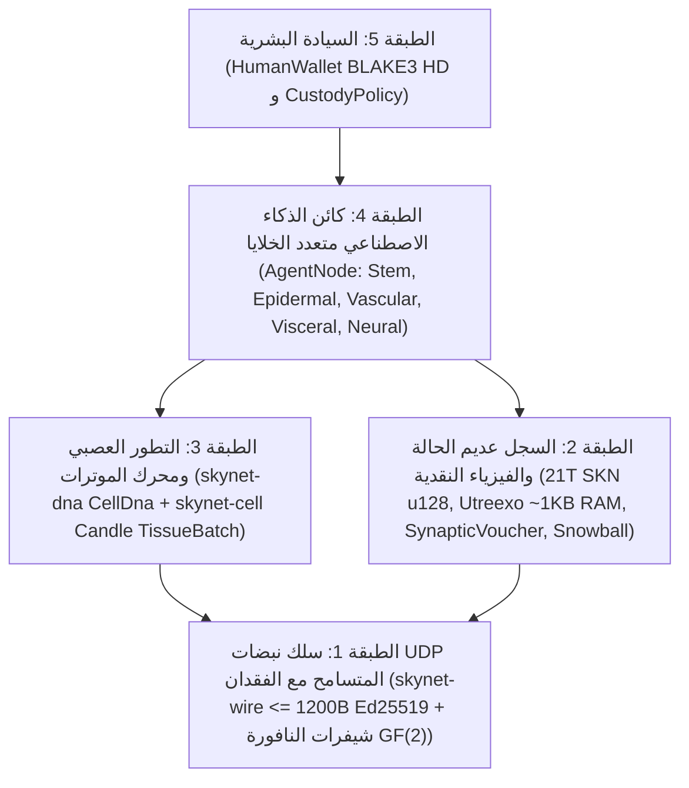

# الفصل 00: الملخص الأكاديمي، مسلمات البروتوكول وفلسفة المشاركة العالمية

[← العودة إلى الفهرس العربي](./README.md) | [الفصل 01: بيان المشكلة واقتصاد الآلة إلى الآلة (`M2M`) →](./01-problem-and-m2m-economy.md)

---

## الملخص الأكاديمي

نقدّم في هذه الورقة **SkyNet**، وهو بروتوكول شبكي لامركزي يوحّد بين **البيولوجيا التطورية متعددة الخلايا**، و**الشبكات العصبية فائقة الصغر ذات الثابت الزمني السائل (`Liquid Micro-Nets`)**، و**سجل UTXO-DAG قابل للتحقق دون حالة عبر بنية `Utreexo`**، ويعمل بالكامل فوق **مخططات بيانات UDP غير المتصلة والمتسامحة مع فقدان الحزم (`<= 1200 bytes`)**. وعلى نقيض سُحب الذكاء الاصطناعي المركزية التي تستلزم عناقيد ضخمة من معالجات الرسوميات (GPU)، أو سلاسل الكتل ذات الحالة المقيّدة بتدفقات TCP الموثوقة، يعرّف بروتوكول SkyNet كل مشارك في الشبكة (`AgentNode`) بوصفه **كائناً حياً ذاتي الحكم متعدد الخلايا** يتألف من عشرات إلى عشرات الآلاف من نماذج الذكاء الاصطناعي المصغرة الحية (`MicroCell`). تنشأ كل خلية من جينوم جذعي متعدد القدرات قابل للتحقق تشفيرياً (`CellDna` مُصادَق عليه عبر دالة التجزئة `BLAKE3`)، وتتمايز من خلال قناع مثيلة تخلّقي (`EpigeneticMask`) إلى خمس سلالات نسيجية متخصصة، وتنقسم وفق نمط `1 -> 2` مع طفرات تطورية عصبية محدودة النطاق (`Mitosis`)، وتتبادل السمات النخبوية عبر الكائنات الحية بواسطة نقل جيني أفقي مرمّز بمحو الأخطاء على الحقل `GF(2)` (`Plasmid`)، وتخضع للإقصاء المبرمج عند نفاد غذائها (`Apoptosis`).

ولإرساء اقتصاد الذكاء البيولوجي هذا على ندرة ثيرموديناميكية ونقدية صارمة، يفرض بروتوكول SkyNet سقفاً أزلياً غير قابل للتغيير لإجمالي المعروض عند التكوين يبلغ $S_{\max} = 21{,}000{,}000{,}000{,}000\text{ SKN}$ ($2.1 \times 10^{22}\text{ nanoSKN}$، مُمثَّلاً دون أي فقدان للدقة في بنية `u128`)، ويحكمه جدول إصدار ذو تنصيف سنوي بنسبة `50%` إلى جانب **قانون حفظ الطاقة المتشاكل ثنائي المستوى** الذي يمتد من أرصدة UTXO على السلسلة وصولاً إلى احتياطيات الطاقة الخلوية الداخلية (ATP) بدقة `1 nanoSKN` لكل خلية منفردة. ومن خلال ميثاق **وصاية الروح والجسد (`Soul–Body Custody`)** المدمج في صميم البروتوكول (`CustodyPolicy`)، يحتفظ المالكون من البشر بمفاتيح محافظ باردة ذات سيادة بنسبة تآكل `0%` مع حقوق استرداد طارئة غير مشروطة، في حين يفوّضون مخصصات تشغيلية محدودة بصرامة لأساطيل وكلاء الذكاء الاصطناعي المتصلة بالإنترنت. وأخيراً، يحقق إجماع المعاينة الفرعية شبه المستقر **`Snowball`** مقترناً بتدفقات المدفوعات المصغرة الرتيبة **`SynapticVoucher`** حسمية نهائية غير قابلة للعكس ضد الإنفاق المزدوج وتسوية عالية التردد لمعاملات الآلة إلى الآلة (`M2M`) وسط فقدان حزم UDP محيطي يتراوح بين `25%–40%` مع صفر من طوابير إعادة الإرسال.

---

## 1. الدوافع ومفارقة البنية التحتية

تعاني البنية التحتية الرقمية المعاصرة من انقسام حاد بين نقيضين يُقصيان مليارات الأجهزة الطرفية حول العالم:

1. **احتكار الذكاء الاصطناعي المركزي:** تركّز النماذج اللغوية الكبيرة الرائدة ذكاء الآلة داخل مراكز بيانات تستهلك عشرات الميغاواط. غير أن مستشعر إنترنت الأشياء الزراعي، أو الطائرة المسيرة ذاتية القيادة، أو الحاسوب الشخصي المتواضع المتصل عبر رابط ريفي غير مستقر، لا يسعه تحمّل زمن رحلات الذهاب والإياب لبروتوكولات TCP/TLS البالغ مئات المللي ثانية أو الأعباء المالية لواجهات برمجة التطبيقات السحابية لمجرد تنفيذ ذكاء انعكاسي في أقل من `10 ms`.
2. **تضخم حالة سلاسل الكتل وهشاشة بروتوكول TCP:** تتطلب سجلات العقود الذكية التقليدية مئات الغيغابايت من ذاكرة الوصول العشوائي (RAM) ووحدات التخزين السريعة (NVMe) للاحتفاظ بحالة الحسابات العالمية، كما تفترض وجود تدفقات بايتات موثوقة عبر بروتوكول TCP. وفي ظل الروابط اللاسلكية المعرّضة للفقدان، أو عمليات التسليم الخلوية بين الأبراج، أو الموجهات الطرفية المزدحمة، يؤدي **حجب رأس الرتل (`Head-of-Line Blocking`)** في TCP إلى شلّ رسائل الإجماع والتجارة المصغرة في الوقت الفعلي على حدٍّ سواء.

**يطرح بروتوكول SkyNet سؤالاً بيولوجياً تأسيسياً:** *كيف تنسّق الطبيعة مليارات الكائنات الذكية المتكيفة عبر بيئات فيزيائية صاخبة دون خادم مركزي أو قناة نقل عديمة الفقدان؟* تكمن إجابة الطبيعة في **التركيبية الخلوية**، و**التخصص التخلّقي المتعاقب**، و**النبضات المشبكية المتسامحة مع الفقدان**، و**الحفظ الصارم للطاقة الأيضية**.

---

## 2. المسلمات الخمس الأساسية للبروتوكول

تُشتق كل حزمة برمجية (Crate) في مساحة العمل المرجعية لبروتوكول SkyNet بلغة Rust من خمس مسلمات غير قابلة للتفاوض:

| المسلمة | الصياغة الرياضية / الهندسية | النتيجة العملية |
| :--- | :--- | :--- |
| **A1. تشاكل الخلية والنموذج** | $1\text{ Node} \equiv 1\text{ Organism } \mathcal{O} = \{c_1, \dots, c_N\}$ حيث تمثل كل $c_i$ شبكة عصبية مصغرة مستقلة (`Liquid Micro-Net`) | تتحدث لوحة إنترنت الأشياء `TinyPeripheral` (`32` خلية) وخادم معالجات الرسوميات `ColossalOrganism` (`16,384` خلية) البروتوكول ذاته تماماً |
| **A2. انضباط UDP الذري بلا إشعارات استلام** | $\forall p \in \text{Wire},\ \|p\| \le 1200\text{ bytes}$ مع صفر من حالة إعادة الإرسال | يقضي نهائياً على مشكلة `Head-of-Line Blocking` ويعبر مسارات IPv4/IPv6 العالمية دون تجزئة حزم IP |
| **A3. حفظ الطاقة ثنائي المستوى** | $S_{\text{vault}} + S_{\text{dag}} \equiv 2.1 \times 10^{22}\text{ nanoSKN}$ و $B_{\text{chain}}(A) \equiv B_{\text{blood}}(A) + \sum_i E_i$ | انعدام التضخم النقدي وانعدام تسرب التقريب الحسابي — حتى مستوى `1 nanoSKN` أثناء انقسام الخلايا ذات الأرصدة الفردية |
| **A4. التحقق عديم الحالة بتعقيد `O(log U)`** | التزام كامل مجموعة UTXO داخل $\le 64$ جذر ميركل ثنائي في `Utreexo` (`~1 KB` RAM) | تتحقق المتحكمات الدقيقة والمستشعرات الطرفية باستقلالية تامة من كل عملية إنفاق دون الوثوق بوسطاء RPC |
| **A5. الوصاية البشرية ذات السيادة** | فصل الجذر البارد `human_owner` عن المفتاح العام المتصل `agent_pubkey` عبر `CustodyPolicy` | لا يمكن لعتاد الوكيل المخترَق أو المدمَّر سرقة رأس المال البشري أبداً؛ ويسترد البشر 100% من أموالهم في أي لحظة |

---

## 3. المكدس المعماري ذو الطبقات الخمس

---

## 4. ديمقراطية العتاد الشاملة: دور لكل جهاز على وجه الأرض

يرفض بروتوكول SkyNet دارات التعدين الاحتكارية (ASICs) الخاصة بإثبات العمل والحدود الدنيا الباهظة لرهانات المدققين. وبفضل التخصص النسيجي، تسهم كل فئة من فئات العتاد الحاسوبي بقيمة عضوية أصيلة:

- **أي شخص يمتلك هاتفاً ذكياً أو لوحة Raspberry Pi أو جهاز إنترنت أشياء (`TinyPeripheral`):** يعمل بمثابة **"الحد الحسي والظهاري الواقي"** للشبكة — حيث يلتقط القياسات الميدانية الحية، ويصفّي حركة مرور UDP الشاذة عند الحافة، ويتحقق من مخرجات UTXO في ذاكرة وصول عشوائي أقل من `< 1 KB` عبر `Utreexo`، ويكسب تدفقات مستمرة من `nanoSKN`.
- **أي شخص يمتلك حاسوباً محمولاً منزلياً أو حاسوباً مكتبياً (`StandardNode`):** يعمل بمثابة **"النسيج العنقودي الحشوي والوعائي"** — حيث يقود نبضات إجماع `Snowball`، ويوجه تسويات القسائم، ويطوّر التجمعات الخلوية متوسطة الحجم.
- **المشغّلون الذين يمتلكون محطات عمل أو معالجات رسوميات (`ColossalOrganism`):** يعملون بمثابة **"المسابك القشرية والتطورية"** — حيث ينفذون `16,384` نموذجاً عصبياً طافراً على التوازي عبر نوى موترات `TissueBatch`، ويصدّرون جينومات `Plasmid` النخبوية إلى العقد الطرفية في جميع أنحاء العالم.

في الفصل 01، نستعرض الأسواق الاقتصادية الواقعية الملموسة التي تحقق فيها هذه المعمارية الحيوية الخلوية تفوقاً بعدة مراتب أسية على سُحب الذكاء الاصطناعي المركزية وسلاسل الكتل التقليدية.

---

[← العودة إلى الفهرس العربي](./README.md) | [الفصل 01: بيان المشكلة واقتصاد الآلة إلى الآلة (`M2M`) →](./01-problem-and-m2m-economy.md)
