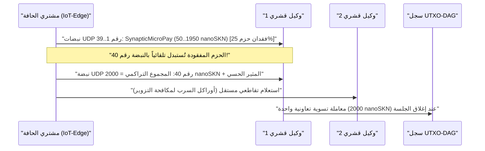

# الفصل 01: بيان المشكلة واقتصاد الآلة إلى الآلة (`M2M`) العملي

[← الفصل 00: الملخص والرؤية](./00-abstract-and-vision.md) | [الفصل 02: المعمارية متعددة الخلايا →](./02-multicellular-architecture.md)

---

## 1. ما وراء روبوتات الدردشة المركزية: الذكاء الانعكاسي عند الحافة الفيزيائية

لا يهدف بروتوكول SkyNet إلى استبدال النماذج اللغوية الكبيرة المركزية ذات مئات المليارات من المعاملات المخصصة لصياغة المستندات المطولة. بدلاً من ذلك، يستهدف SkyNet **نقطة عمياء هيكلية تُقدَّر قيمتها بعدة تريليونات من الدولارات**: ألا وهي الحافة الفيزيائية للإنترنت حيث تحتاج مليارات الآلات ذاتية التشغيل، والمستشعرات الصناعية، وبوابات الشبكات، ووكلاء البرمجيات إلى **استدلال انعكاسي في أقل من `10 ms`، وتكيّف محلي مستمر، وتسوية قيمة بين الآلات (`M2M`) بأجزاء من السنت** عبر روابط لاسلكية غير موثوقة.

### لماذا تفشل السُحب المركزية وسلاسل الكتل التقليدية هنا

لنتأمل وكيلاً طرفياً ذاتي التشغيل $A$ (مثل طائرة مسيرة ضمن سرب، أو بوابة للتخفيف من هجمات حجب الخدمة DDoS، أو مرحّل للشبكة الكهربائية الذكية) يشتري تصنيفاً لحظياً للشذوذ وتحققاً من القياسات عن بُعد كل $\Delta t = 10\text{ ms}$، بقيمة تبلغ $v = 50\text{ nanoSKN}$ لكل نبضة:

1. **جدار الكمون وإعادة الإرسال في بروتوكول TCP:** يتطلب إنشاء جلسات TLS/TCP مع مناطق سحابية بعيدة مصافحات متعددة الرحلات (Multi-RTT). وتحت وطأة فقدان الحزم اللاسلكية المحيطي بنسبة $p_{\text{loss}} = 20\%$, يؤدي تراجع نافذة الازدحام ومُهل إعادة الإرسال في TCP إلى دفع كمون الذيل (`p99`) إلى مئات المللي ثانية — وهو أمر كارثي لحلقات التحكم السيبراني الفيزيائي في الوقت الفعلي.
2. **أرضية الرسوم الأساسية:** على مسارات الدفع النقدي التقليدي أو سلاسل العقود الذكية المتوافقة مع EVM، تتجاوز التكلفة الثابتة لكل معاملة $F_{\text{tx}}$ قيمة النبضة الواحدة بمعامل يتراوح بين $10^5\times$ و $10^8\times$ ($F_{\text{tx}} \gg v$)، مما يجعل تجارة الآلة إلى الآلة بدقة المللي ثانية مستحيلة اقتصادياً.
3. **انجراف النماذج الثابتة:** سرعان ما تتدهور الأوزان الثابتة المدرَّبة مسبقاً والمنشورة من السحابة تحت تأثير تغيّر التوزيعات المحلية للإشارات (`concept drift`)، في حين تفتقر الأجهزة الطرفية المقيدة إلى ميزانية الذاكرة والطاقة اللازمة لتشغيل الانتشار العكسي للتدرجات (Backpropagation).

---

## 2. الركائز الاقتصادية الواقعية الأربع المحفزة للطلب على عملة `SKN`

ينشأ الطلب الجوهري على عملة `SKN` من أربع قدرات ملموسة تعجز السُحب المركزية وسلاسل الكتل ذات الحالة عن المنافسة فيها:

### 2.1. الاستدلال المصغر فائق الانخفاض في الكمون عند حافة الأسراب (`< 10 ms`)
تُضمّن أساطيل الروبوتات، ووحدات التحكم الصناعية لإنترنت الأشياء، ومرحّلات الاتصالات، وأجهزة أمن الشبكات متجهَ سمات مُطبَّعاً ثماني الأبعاد (`stimulus: [f32; 8]`) جنباً إلى جنب مع قسيمة `SynapticVoucher` موقّعة داخل **مخطط بيانات UDP واحد بحجم `<= 1200-byte`**.
- تنفذ الخلايا المجاورة من فئتَي `Epidermal` و`Neural` تمريرات أمامية متكررة للشبكة العصبية السائلة المصغرة (`Liquid Micro-Net`) في أقل من `0.1 ms` لكل نبضة.
- ونظراً لأن `SynapticVoucher` يرمّز مجاميع تراكمية متزايدة برتابة، فإن فقدان حزم UDP العشوائي حتى بنسبة `25%` عبر الروابط الخلوية أو الفضائية يتسبب في **صفر من توقفات الفوترة وصفر من فترات الانتظار لإعادة الإرسال**.

### 2.2. التطور كخدمة وسوق جينات البلازميد (`Plasmid`) اللامركزي
بدلاً من استئجار عناقيد معالجات رسوميات سحابية باهظة التكلفة لتدريب نماذج مدمجة مضغوطة، يستطيع أي مستخدم أو وكيل مستقل بثّ مكافأة تحسين (Optimization Bounty) تحدد تدفقات المثيرات $x_t$، والاستجابات المستهدفة $y_t^*$، ومكافآت `SKN`:
- تُطلق آلاف الكائنات الحية من عقد `AgentNode` انقساماً خيطياً خلوياً (`Mitosis`) بنمط `1 -> 2`، مقيِّمةً عشرات الآلاف من اضطرابات الأوزان والثوابت الزمنية السائلة $\tau$ على التوازي.
- تخضع الطفرات الضعيفة للموت الخلوي المبرمج (`Apoptosis`)، بينما تتقارب السلالات الأعلى أداءً في جينومات `CellDna` مضغوطة (أقل من `2 KB`، مختومة تشفيرياً بواسطة `BLAKE3`).
- يتسلم الطالب كلاً من الاستدلال الحي و**مُخرَج أوزان `CellDna` المتطور المستقل** (الذي يُسلَّم دون أي فقدان عبر حزم `FountainDroplet` المعتمدة على الحقل `GF(2)`) جاهزاً للبرمجة المباشرة على ملايين المتحكمات الدقيقة.

### 2.3. سكة مدفوعات `M2M nanoSKN` الذرية وأوراكل الأسراب المضادة للهلوسة
بوحدات مقومة تصل دقتها إلى `1 nanoSKN` ($10^{-9}\text{ SKN}$)، يشتري وكلاء الذكاء الاصطناعي الإشارات الفيزيائية الواقعية ويتحققون منها تقاطعياً بصورة ذاتية (القياسات المناخية الدقيقة، إشغال الطيف الترددي اللاسلكي، كمون التوجيه، وتدفق الأوامر عالي التردد):

تؤدي المعاينة التقاطعية لكائنات `AgentNode` المستقلة داخل عنقود محلي إلى القضاء على هلوسة النموذج المنفرد وتزوير قراءات المستشعرات.

### 2.4. شبكات البنية التحتية المادية اللامركزية (DePIN) الشاملة متعددة المستويات (التكافل العتادي)
يوحّد بروتوكول SkyNet العتاد غير المستغل وغير المتجانس حول العالم في سلسلة إمداد بيولوجية تكافلية:

| شريحة المشاركين | العتاد اليومي | الدور البيئي | مصدر عوائد `SKN` |
| :--- | :--- | :--- | :--- |
| **الأفراد والأسر** | الهواتف الذكية القديمة، الموجهات المنزلية، لوحات Raspberry Pi، لوحات إنترنت الأشياء | التقاط الإشارات الحسية الطرفية، تصفية الحزم عبر خلايا `Epidermal`، والتحقق الخفيف في `~1 KB` عبر `Utreexo` | كسب `nanoSKN` من تدفقات المستشعرات الحية وتصفية الحدود الشبكية |
| **المطورون ومستخدمو الحواسيب المكتبية** | الحواسيب المحمولة والحواسيب المكتبية (`StandardNode`) | معاينة إجماع `Snowball`، توجيه القسائم، وتطوير الأنسجة متوسطة النطاق | كسب رسوم معاملات العنقود (`cluster_nutrient_pool`) وأجور الاستدلال |
| **المختبرات ومشغلو معالجات الرسوميات** | الخوادم متعددة النوى، ومعالجات الرسوميات Apple `Metal` وNVIDIA `CUDA` | التطور المتوازي عبر `TissueBatch` لما يصل إلى `16,384` خلية لكل عقدة | كسب مكافآت التطور وعوائد التصدير الأفقي لبلازميدات `Plasmid` |

---

## 3. ضغط التسوية دون الخطي على السلسلة

لنفترض أن وكيلَي ذكاء اصطناعي يتبادلان $M$ من نبضات الاستدلال عالية التردد بتكلفة $\delta\text{ nanoSKN}$ لكل استدعاء عبر قناة لاسلكية ذات احتمالية فقدان حزم $p \in [0, 1)$. تتطلب التسوية التقليدية على السلسلة عدداً من معاملات السجل قدره $\mathcal{O}(M)$، بينما يتعاظم عبء إعادة الإرسال في بروتوكول TCP وفق المعامل $\frac{1}{1 - p}$.

أما في SkyNet، فيُصدر الدافع قسائم موقّعة بخوارزمية `Ed25519` مفهرسة بالتسلسل $s \in \{1, \dots, M\}$ وتحمل القيمة التراكمية $V_s = s \cdot \delta$. وتُثبت أي حزمة ناجية $s_k$ تشفيرياً كامل الفارق التزايدي $\Delta V = V_{s_k} - V_{s_{k-1}}$ عبر جميع الحزم الوسيطة المفقودة دون أي إعادة إرسال. وفي نهاية الجلسة، تُسوّى جميع الاستدلالات المصغرة البالغ عددها $M$ في **معاملة UTXO-DAG واحدة فقط ($1$)**، محققةً نسبة ضغط على السلسلة قدرها $M : 1$ (أي خفض عبء السجل بمعامل يتراوح بين $1{,}000\times$ و $100{,}000\times$ في التطبيق العملي).

يفحص الفصل 02 التشريح الداخلي لكل عقدة `AgentNode` — موضحاً كيف ينظّم ملف تنفيذي برمجي واحد نفسه ذاتياً ليغدو كائناً حياً متعدد الخلايا عبر أي مستوى عتادي.

---

[← الفصل 00: الملخص والرؤية](./00-abstract-and-vision.md) | [الفصل 02: المعمارية متعددة الخلايا →](./02-multicellular-architecture.md)
