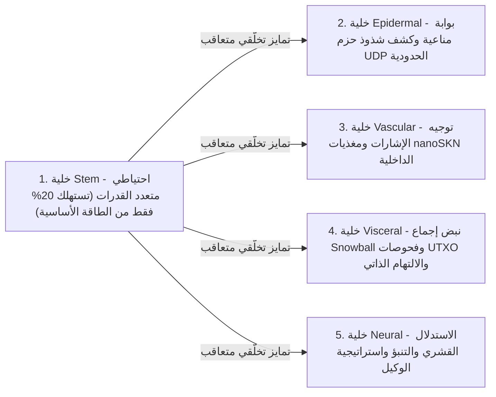

# الفصل 02: معمارية الكائن الحي متعدد الخلايا والتوسع العتادي المرن (`AgentNode`)

[← الفصل 01: بيان المشكلة واقتصاد الآلة إلى الآلة (`M2M`)](./01-problem-and-m2m-economy.md) | [الفصل 03: الترميز الجيني `CellDna` والخلايا العصبية السائلة →](./03-dna-and-liquid-neural-cells.md)

---

## 1. التشاكل البيولوجي: `1 Node = 1 Multicellular Organism`

في شبكات الند للند التقليدية، تنفذ كل عقدة آلة حالة متجانسة وجامدة بغض النظر عما إذا كانت تعمل على متحكم دقيق مدمج أو على خادم معالجات رسوميات يضم 64 نواة. أما في SkyNet (`crates/skynet-agent`)، فيُجسَّد كل مشارك في الشبكة على هيئة عقدة **`AgentNode`** — وهي كائن حي متعدد الخلايا يضم مجتمعاً ديناميكياً من خلايا الذكاء الاصطناعي المصغرة $\mathcal{C}(t) = \{c_1, c_2, \dots, c_{N(t)}\}$، وخزانة أيضية داخلية (`AgentMetabolicBank`)، ومُحقِّق جذور `Utreexo` عديم الحالة (`StatelessUtreexoRoots`)، ومحرك إجماع متسامحاً مع فقدان الحزم (`SnowballEngine`).

إن حجم المجتمع الخلوي $N(t) = |\mathcal{C}(t)|$ ليس مبرمجاً بقيمة ثابتة على الإطلاق؛ بل **يتمدد عبر الانقسام الخيطي (`Mitosis`) وينكمش عبر الموت الخلوي المبرمج (`Apoptosis`) بصورة عضوية تبعاً للسعة العتادية للمضيف وتدفق المغذيات المكتسبة من وحدات `nanoSKN`**.

---

## 2. مستويات العتاد المرنة الثلاثة (`HardwareTier`)

عند بدء التشغيل، تعيّن الدالة `HardwareProfile::for_tier` سعة الجهاز المضيف إلى واحد من ثلاثة ملفات تعريف بيئية ذات عتبات أيضية دقيقة مقومة بوحدة `nanoSKN` (`crates/skynet-cell/src/lib.rs`):

| المعامل البيولوجي (`HardwareProfile`) | `TinyPeripheral` (إنترنت الأشياء / متحكم طرفي) | `StandardNode` (حاسوب محمول / مكتبي) | `ColossalOrganism` (خادم / معالج رسوميات GPU) |
| :--- | :--- | :--- | :--- |
| **الحد الأقصى لتعداد الخلايا (`max_cells`)** | `32` خلية | `512` خلية | `16,384` خلية |
| **الحرق الأساسي النشط لكل نبضة (`basal_burn_per_tick`)** | `50 nanoSKN` | `25 nanoSKN` | `10 nanoSKN` |
| **حرق خلية `Stem` الخاملة لكل نبضة (توفير 80%)** | `10 nanoSKN` | `5 nanoSKN` | `2 nanoSKN` |
| **عتبة الانقسام الخيطي (`mitosis_threshold`)** | `2,000 nanoSKN` | `1,500 nanoSKN` | `1,000 nanoSKN` |
| **رسوم الدم للانقسام (`mitosis_blood_fee`)** | `100 nanoSKN` | `60 nanoSKN` | `40 nanoSKN` |
| **الأرضية الدنيا للإقصاء (`apoptosis_floor`)** | `100 nanoSKN` | `80 nanoSKN` | `50 nanoSKN` |
| **واجهة الحوسبة الخلفية (`candle_core::Device`)** | `Cpu` | `Cpu` / `Metal` / `Cuda` | `Cuda` / `Metal` / `Cpu` SIMD |

> [!NOTE]
> **وفورات الحجم البيولوجية (قانون كلايبر — Kleiber's Law):** تماماً كما تُظهر الكائنات البيولوجية الأكبر حجماً تكلفة أيضية أقل لكل غرام من الأنسجة، تتكبد عقد `ColossalOrganism` حرقاً أساسياً أقل لكل خلية (`10 nanoSKN` مقابل `50 nanoSKN`) لأن آلاف الخلايا تستهلك تكلفة التنفيذ مجتمعةً داخل نواة موتر مجمّعة واحدة على معالج الرسوميات، في حين تظل عقد `TinyPeripheral` رشيقة وعالية الصمود عند حافة الشبكة.

---

## 3. السلالات النسيجية الخمس المتخصصة (`CellRole`)

عندما تنبثق عقدة `AgentNode` (`AgentNode::from_signing_key`)، فإنها تهيّئ بذرة جنينية مكوّنة من 6 خلايا (`2 Stem`، `1 Epidermal`، `1 Vascular`، `1 Visceral`، `1 Neural`) مشتقة من جينوم `base_stem` حتمي. وطوال دورة حياة الكائن الحي، تؤدي خمس سلالات نسيجية خمس وظائف فسيولوجية جوهرية:

1. **`Stem` (الاحتياطي متعدد القدرات — `operon_index = None`):** خلايا تجديدية خاملة لا تستهلك سوى $\max(\lfloor E_{\text{burn}} / 5 \rfloor, 1)$ في كل نبضة. وكلما تعرّض أي عضو متخصص للاستنزاف، تتمايز خلية `Stem` تخلّقياً (`differentiate`) لتعويضه دون الحاجة إلى تنزيل شيفرات خارجية.
2. **`Epidermal` (الحاجز الجلدي والبوابة المناعية — `operon_index = Some(0)`):** تحرس مقبس UDP الخام (`epidermal_inspect_packet`). فقبل أن تصل أي حزمة واردة إلى السجل أو محرك الإجماع، تقيّم خلية `Epidermal` القياسات المُطبَّعة للحزمة (`raw_len / 1200`، `hop_ttl / 16`، وانحراف `epoch`) عبر إطار `candle` لإسقاط النبضات المشوّهة أو الفيضانية.
3. **`Vascular` (منظم الدورة الدموية — `operon_index = Some(1)`):** تنظّم سيولة وعاء الدم الداخلي `blood_pool` داخل `AgentMetabolicBank`، موجِّهةً مكافآت `nanoSKN` نحو الخلايا عالية الدقة.
4. **`Visceral` (صيانة الأعضاء — `operon_index = Some(2)`):** تقود وتيرة استطلاعات `Snowball`، والتحقق عديم الحالة من شواهد `Utreexo`، وإعادة التدوير الأيضي.
5. **`Neural` (الدماغ القشري — `operon_index = Some(3)`):** تنفذ الاستدلال المعرفي؛ ويشكّل المتوسط التجميعي عبر جميع خلايا `Neural` الحية ($\bar{y}_{\text{cortical}} = \frac{1}{|\mathcal{C}_{\text{neural}}|} \sum_{i \in \mathcal{C}_{\text{neural}}} y_i$) مخرج القرار الجماعي للكائن الحي.

---

## 4. دورة حياة النبضة البيولوجية سداسية المراحل (`run_biological_tick`)

في كل نبضة (`pulse_seq`)، تنفذ عقدة `AgentNode` دورة فسيولوجية حتمية من ست مراحل تجمع بين التنافس الدارويني والحفظ الدقيق لوحدات `nanoSKN` في بنية `u128`:

1. **المرحلة 1 — الأيض الأساسي:** تحرق كل خلية $c_i$ طاقة صيانة قدرها $b_i = \text{metabolize\_tick}()$. ومن الجوهري أن $b_i$ لا تُتلَف أبداً على السلسلة؛ إذ يُعاد تدوير 100% من طاقة ATP الخلوية المحترقة إلى الوعاء الداخلي `bank.blood_pool`. أما الخلايا الجائعة ($E_i = 0$) فتفقد `0.25` من مؤشر صحتها (`health`).
2. **المرحلة 2 — استدلال الموترات المجمّع عبر `candle`:** تُنفَّذ جميع الخلايا الحية البالغ عددها $N$ في آنٍ واحد عبر `TissueBatch::forward_slice`، منتجةً المخرجات $y_i \in \mathbb{R}^4$ ومحدِّثةً متجهات الذاكرة السائلة قصيرة المدى $h_{i,t} \in \mathbb{R}^{16}$.
3. **المرحلة 3 — الانتخاب الدارويني للمغذيات داخل العضو الواحد:**
   بمعلومية الإشارة المستهدفة $t \in \mathbb{R}^4$، تُقاس جودة تنبؤ الخلية $i$ عبر متوسط الخطأ المطلق المقيّد:

   $$q_i = \operatorname{clamp}\!\left(1 - \frac{1}{4}\sum_{k=1}^{4} |y_{i,k} - t_k|,\ 0.0,\ 1.0\right)$$

   ليكن $\bar{q}_r$ متوسط الجودة عبر جميع الخلايا التي تتشارك دور العضو $r = \text{role}(c_i)$. تكسب الخلية المتخصصة مغذيات `nanoSKN` من `blood_pool` إذا وفقط إذا كان عضوها يضم $\le 2$ من الخلايا أو إذا تجاوزت عتبة التنافسية داخل العضو $q_i \ge 0.98 \cdot \bar{q}_r$:

   $$R_i = \min\!\left(\lfloor 320 \cdot q_i \rfloor + E_{\text{basal}},\ \left\lfloor \frac{B_{\text{blood}}}{8} \right\rfloor\right)$$

   أما الطفرات ضعيفة الأداء ($q_i < 0.98 \cdot \bar{q}_r$) فلا تتلقى أي مغذيات وتتكبد عقوبة صحية قدرها `-0.35` في `health`.
4. **المرحلة 4 — تمايز الخلايا الجذعية لتحقيق الاتزان الداخلي:** يحدد الكائن الحي العضو المتخصص الأكثر نقصاً في عدد الخلايا (`find_most_needed_role`). وكلما تحقق الشرط `stem_count > 1`، تتمايز خلية `Stem` واحدة إلى ذلك العضو مع الحفاظ دائماً على خلية `Stem` جرمية واحدة (`1`) على الأقل.
5. **المرحلة 5 — الانقسام الخيطي `1 -> 2` (`Mitosis`):** تنقسم الخلايا السليمة جيدة التغذية (`health >= 0.65` و $E_i \ge E_{\text{mitosis}}$) إلى نسخة محافظة مطابقة (الخلية الابنة A) ونسخة مستكشفة طافرة (الخلية الابنة B) حتى سقف `profile.max_cells`.
6. **المرحلة 6 — الموت الخلوي المبرمج المحمي على مستوى الأعضاء (`Apoptosis`):** تتحلل الخلايا الجائعة ($E_i < E_{\text{apoptosis}}$) أو المتضررة بشدة (`health <= 0.15`) وتعيد 100% من رصيد `nanoSKN` المتبقي لديها إلى `blood_pool` — وذلك وفق ضمانة بقاء صارمة: **يُحافَظ دون قيد أو شرط على خلية حية واحدة (`1`) على الأقل لكل دور `CellRole` قائم** بحيث لا ينقرض أي عضو حيوي أبداً.

وعند ختام كل نبضة، تتحقق الدالة `verify_internal_skn_conservation()` من المتطابقة الحسابية التامة على مستوى `u128`:

$$B_{\text{chain}}(\text{Agent}) \equiv B_{\text{blood}}(\text{Agent}) + \sum_{c_i \in \mathcal{C}} E_i$$

يفتح الفصل 03 نواة الخلية لتوصيف البنية الدقيقة على مستوى البايتات والرياضيات لجينوم `CellDna`، وتبديل المشغّلات الجينية التخلّقية (Operons)، والتنفيذ العصبي السائل ثلاثي الأبعاد عبر `TissueBatch`.

---

[← الفصل 01: بيان المشكلة واقتصاد الآلة إلى الآلة (`M2M`)](./01-problem-and-m2m-economy.md) | [الفصل 03: الترميز الجيني `CellDna` والخلايا العصبية السائلة →](./03-dna-and-liquid-neural-cells.md)
