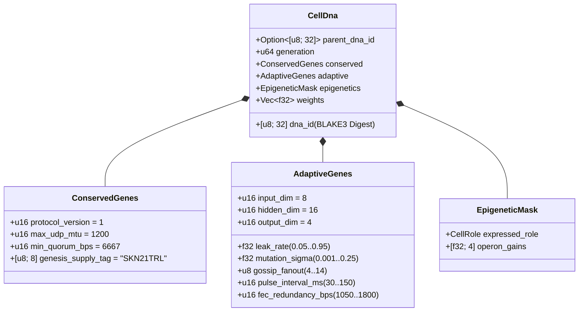

# الفصل 03: الترميز الجيني (`CellDna`)، علم التخلّق المتعاقب والتطور العصبي السائل المصغر على `candle`

[← الفصل 02: المعمارية متعددة الخلايا](./02-multicellular-architecture.md) | [العودة إلى الفهرس العربي →](./README.md)

---

## 1. معمارية الجينوم الخلوي (`CellDna`)

يوازن التطور البيولوجي بين قوتين متقابلتين: **الحفظ الصارم** للثوابت الكيميائية الحيوية الجوهرية (حيث تكون الطفرات قاتلة) و**التنوع المستمر** للسمات العصبية والسلوكية. تصوغ الحزمة البرمجية `skynet-dna` هذه الثنائية رسمياً داخل بنية `CellDna`:

### 1.1. الجينات المحفوظة غير القابلة للتغيير (`ConservedGenes`)
لا يمكن لأي طفرة أو تصالب أفقي تعديل `ConservedGenes`. ويُرفض أي جينوم ينتهك أياً من مسندات أمان الإجماع الأربعة على الفور مع الخطأ `DnaError::ConservedGeneViolation`:
- `protocol_version == 1`
- `max_udp_mtu == 1200` (سقف حزم UDP الخالي من التجزئة)
- $6667 \le \text{min\_quorum\_bps} \le 10000$ (لفرض أغلبية عظمى $\ge \frac{2}{3}$ في إجماع `Snowball`)
- `genesis_supply_tag == *b"SKN21TRL"` (للإرساء الصلب لسقف المعروض البالغ 21 تريليون `SKN`)

### 1.2. الجينات التكيفية (`AdaptiveGenes`) وتخطيط أوزان المشغّلات ذات الجذع المشترك
بدلاً من تخزين أربع شبكات عصبية منفصلة لأنواع الخلايا الأربعة المتخصصة، يرمّز `CellDna` **جذعاً حسياً مشتركاً واحداً (`Shared Sensory Trunk`)** يغذّي **أربعة رؤوس إسقاط لمشغّلات جينية متخصصة (`Specialized Operon Projection Heads`)**. وبالنسبة للأبعاد $(D_{\text{in}}, H, D_{\text{out}})$، يبلغ العدد الدقيق لمعاملات الفاصلة العائمة `f32`:

$$|\theta| = \underbrace{(D_{\text{in}} \cdot H + H)}_{\text{Shared Sensory Trunk }(W_1, b_1)} + \underbrace{4 \cdot (H \cdot D_{\text{out}} + D_{\text{out}})}_{\text{4 Specialized Operon Heads }(W_{2,r}, b_{2,r})}$$

وفي ظل الأبعاد الافتراضية $(D_{\text{in}} = 8,\ H = 16,\ D_{\text{out}} = 4)$:
- الجذع الحسي المشترك: $8 \times 16 + 16 = 144$ معاملاً.
- رؤوس المشغّلات الأربعة (`Epidermal`، `Vascular`، `Visceral`، `Neural`): $4 \times (16 \times 4 + 4) = 272$ معاملاً.
- إجمالي أوزان الجينوم: $|\theta| = 416$ عدد فاصلة عائمة `f32` ($1{,}664\text{ bytes}$ من الأوزان الخام). وتُهيَّأ الجينومات الجذعية من الجيل الصفري (`CellDna::genesis_stem`) بصورة حتمية عبر المولد `ChaCha8Rng` وفق التوزيع المنتظم $\mathcal{U}(-\sigma_0, +\sigma_0)$ بحدود مقيَّسة بطريقة Xavier:

$$\sigma_0 = \sqrt{\frac{2}{D_{\text{in}} + H}}$$

### 1.3. البصمة التشفيرية الحتمية `BLAKE3` (`SKYNET_DNA_V1`)
يُسلسَل كل معامل فائق ووزن من أوزان الفاصلة العائمة عبر أنماط بتات IEEE-754 القانونية بترتيب البايت الأصغر أولاً (`to_bits().to_le_bytes()`) داخل تجزئة معزولة النطاق `BLAKE3("SKYNET_DNA_V1", ...)`. ويؤدي أي تلف في بت واحد، أو حقن لقيم `NaN`/`Inf`، أو تلاعب غير مصرح به في الأوزان إلى رفض فوري أثناء فحص السلامة `verify_integrity()`.

---

## 2. التبديل التخلّقي بالمثيلة (`EpigeneticMask`)

في الأحياء متعددة الخلايا، تحمل الخلية العصبية وخلية الجلد الظهارية تسلسلات الحمض النووي (DNA) ذاتها، لكنهما تعبّران عن أنماط ظاهرية مختلفة جذرياً بفعل مثيلة الجينات. وفي SkyNet، عندما تتمايز خلية جذعية `Stem` إلى دور مستهدف $r \in \{0, 1, 2, 3\}$ (`CellDna::differentiate`)، **يظل 100% من متجه الأوزان الأساسي `weights` دون مساس** بينما يغيّر قناع التخلّق `EpigeneticMask` كسب التعبير الجيني:

- **حالة خلية `Stem` الخاملة:** `operon_gains = [0.25, 0.25, 0.25, 0.25]`، حيث يتم الإسقاط عبر رأس المشغّل `0` بكسب مخفَّف يبلغ $g = 0.25$.
- **الدور المتمايز $r$:** ينشط رأس المشغّل $r$ بكسب كامل ($g_r = 1.0$) بينما تُثبَّط الرؤوس غير المعبَّر عنها إلى $0.05$:

$$g_k = \begin{cases} 1.0 & \text{if } k = r \\ 0.05 & \text{if } k \neq r \end{cases}$$

وبناءً على ذلك، تظل التمثيلات الحسية المتعلَّمة في الجذع المشترك $(W_1, b_1)$ والتكيفات الكامنة في الرؤوس الخاملة محفوظةً عبر الأجيال وتبقى متاحةً عند التحول التمايزي بين الأنسجة (Transdifferentiation).

---

## 3. ديناميكيات الثابت الزمني السائل والتنفيذ المجمّع ثلاثي الأبعاد `TissueBatch`

### 3.1. الديناميكيات السائلة المتكررة للخلية الواحدة
تعجز الشبكات الأمامية عديمة الحالة (Feedforward MLPs) عن التقاط الارتباطات الزمنية عبر تدفقات حزم UDP غير المتزامنة. لذلك تحتفظ كل خلية `MicroCell` بمتجه ذاكرة متكرر قصير المدى $h_t \in \mathbb{R}^H$ يحكمه استيفاء الحالة المتقطع ذو **الثابت الزمني السائل (Liquid Time-Constant — LTC)** مع معدل تسرب قابل للتطور $\tau \in [0.05, 0.95]$:

$$h_t = (1 - \tau)\, h_{t-1} + \tau\, \tanh(x_t W_1 + b_1)$$

$$y_t = g_{\text{role}} \cdot \tanh(h_t W_{2,r} + b_{2,r})$$

- عندما يقترب $\tau \to 0.05$، تحتفظ الخلية بقصور ذاتي للذاكرة طويل الأمد (وهو مثالي لتتبع الاتجاهات في خلايا `Visceral` و`Neural`).
- عندما يقترب $\tau \to 0.95$، تتفاعل الخلية لحظياً مع النبضات الحدودية عالية التردد (وهو مثالي لتقييم الشذوذ في خلايا `Epidermal`).
- وبما أن المعامل $\tau$ يقطن في `AdaptiveGenes`، فإن **الأفق الزمني لذاكرة كل خلية يتطور بصورة مشتركة وطبيعية جنباً إلى جنب مع أوزانها المشبكية**.

### 3.2. محرك الموترات ثلاثي الأبعاد عالي الإنتاجية `TissueBatch` (`Cpu` / `Metal` / `Cuda`)
تتمثل إحدى الاختناقات الكلاسيكية في التطور العصبي في عدم تجانس الأوزان: فكل خلية $i \in \{1, \dots, N\}$ تحمل مصفوفات طافرة متمايزة $W_1^{(i)} \neq W_1^{(j)}$ ومعدلات تسرب متمايزة $\tau^{(i)} \neq \tau^{(j)}$. ومن شأن إطلاق $N$ من النوى المصغرة المتسلسلة أن يُصيب معالجات الرسوميات الحديثة بالمجاعة الحاسوبية.

تحل الدالة `TissueBatch::forward_slice` في الحزمة `skynet-cell` هذه المعضلة عبر حزم جميع الخلايا غير المتجانسة البالغ عددها $N$ داخل موترات متجاورة من الرتبة الثالثة على `candle_core::Device`:

$$\mathbf{X} \in \mathbb{R}^{N \times 1 \times D_{\text{in}}}, \quad \mathbf{W}_1 \in \mathbb{R}^{N \times D_{\text{in}} \times H}, \quad \mathbf{B}_1 \in \mathbb{R}^{N \times 1 \times H}$$

$$\mathbf{H}_t = (\mathbf{1} - \boldsymbol{\tau}) \odot \mathbf{H}_{t-1} + \boldsymbol{\tau} \odot \tanh\!\big(\operatorname{BMM}(\mathbf{X}, \mathbf{W}_1) + \mathbf{B}_1\big)$$

$$\mathbf{Y}_t = \mathbf{G} \odot \tanh\!\big(\operatorname{BMM}(\mathbf{H}_t, \mathbf{W}_2) + \mathbf{B}_2\big)$$

حيث يرمز $\operatorname{BMM}$ إلى ضرب المصفوفات المجمّع في نواة واحدة (Batched Matrix Multiplication)، ويرمز $\odot$ إلى الضرب العنصري مع البث البُعدي مع $\boldsymbol{\tau}, \mathbf{G} \in \mathbb{R}^{N \times 1 \times 1}$. وتؤكد اختبارات الوحدات المدقَّقة تطابق نتائج `TissueBatch` مع التنفيذ الفردي للخلايا ضمن هامش تفاوت للفاصلة العائمة أقل من $< 10^{-5}$، مع التوسع بسلاسة لما يصل إلى `16,384` نموذجاً متطوراً متزامناً لكل عقدة `ColossalOrganism`.

---

## 4. الانقسام الخيطي غير المتماثل، الحفظ الدقيق للأرصدة الفردية من `nanoSKN` والتصالب البلازميدي

### 4.1. الانقسام الخيطي غير المتماثل `1 -> 2` (`Mitosis`) وبرهان الحفظ الذري الدقيق
عندما تستوفي الخلية الأم $P$ الشرط $E_P \ge \max(E_{\text{mitosis}}, F_{\text{blood}} + 2)$ و`health >= 0.65`، تنتج الدالة `divide_mitosis` خليتين ابنتين من الجيل $(g+1)$:
- **الخلية الابنة A (النسخة المحافظة):** تحتفظ بنسبة 100% من أوزان الأم المُثبَتة كفاءتها ومعاملاتها التكيفية دون أي اضطراب.
- **الخلية الابنة B (المستكشفة الطافرة):** ترث استمرارية الحالة الخفية للأم (`hidden_state`) مع خضوعها لطفرة تطورية عصبية محدودة النطاق:
  - يطفر كل وزن $w \in \theta$ باحتمالية $0.35$ عبر اضطراب غاوسي من 6 عينات بطريقة Irwin-Hall عديمة الاعتماديات ($\Delta w \sim \mathcal{N}(0, \sigma^2)$)، مع تقييد صارم ضمن الفترة $[-4.0, +4.0]$ لمنع انفجار التدرجات أو الأوزان.
  - تتطفر المعاملات $\tau$، و$\sigma$، و`gossip_fanout` ($\pm 1$)، و`pulse_interval_ms` ($\pm 10\text{ ms}$)، و`fec_redundancy_bps` ($\pm 50\text{ bps}$) بصورة مشتركة ضمن فترات مسموحة محددة.

**برهان حفظ الأرصدة الفردية من `nanoSKN` دون أي تسرب:** ليكن $E_{\text{dist}} = E_P - F_{\text{blood}}$ رصيد طاقة ATP القابل للتوزيع بعد اقتطاع رسوم الدم. تُقسَّم أرصدة الخليتين الابنتين عبر حساب خارج القسمة والباقي للأعداد الصحيحة على بنية `u128`:

$$E_A = \left\lfloor \frac{E_{\text{dist}}}{2} \right\rfloor + (E_{\text{dist}} \bmod 2), \qquad E_B = \left\lfloor \frac{E_{\text{dist}}}{2} \right\rfloor$$

لكل عدد صحيح غير سالب $E_{\text{dist}} \in \mathbb{Z}_{\ge 0}$ (بما في ذلك الأرصدة الفردية مثل `3,333 nanoSKN`)، يتحقق الحفظ التام بصورة متطابقة:

$$E_A + E_B + F_{\text{blood}} = \left(2\left\lfloor \frac{E_{\text{dist}}}{2} \right\rfloor + (E_{\text{dist}} \bmod 2)\right) + F_{\text{blood}} = E_{\text{dist}} + F_{\text{blood}} \equiv E_P$$

لا تُفقَد وحدة `nanoSKN` واحدة أبداً بفعل التقريب الحسابي ولا تُستحدَث من العدم عبر مليارات الانقسامات الخلوية.

### 4.2. النقل الجيني الأفقي بين الوكلاء (تصالب `Plasmid`)
في محاكاة لتبادل البلازميدات البكتيرية، تصدّر عقدة `AgentNode` جينوم `CellDna` الخاص بأعلى خلاياها لياقةً إلى حزم UDP مرمّزة بمحو الأخطاء من نوع `FountainDroplet` (`encode_elite_plasmid_droplets`). وفور إعادة تجميع `donor_dna` عبر روابط UDP الفاقدة للحزم، يرقّي الوكيل المستقبِل أضعف خلاياه لياقةً عبر دالة التصالب الأفقي `horizontal_crossover`:
- تمتزج سمات الشبكة التكيفية والثابت الزمني وفق النسبة $0.7 \cdot \text{Recipient} + 0.3 \cdot \text{Donor}$.
- يمتزج $30\%$ من الأوزان المشبكية بانتظام وفق الصيغة $0.5 \cdot w_{\text{rec}} + 0.5 \cdot w_{\text{don}} \in [-4.0, +4.0]$.

ومن خلال النقل الأفقي للبلازميدات، يمتص مستشعر إنترنت الأشياء محدود الموارد من فئة `TinyPeripheral` الذكاء العصبي النخبوي الذي تطوّر على عقد معالجات الرسوميات البعيدة من فئة `ColossalOrganism`، مع الحفاظ تشفيرياً على سلامة الجينات المحفوظة `ConservedGenes`.

---

> **القادم في المرحلة 2 (الجزء الثاني):** تُقنّن الفصول `04–06` الرياضيات النقدية لخزنة التنصيف البالغة `21,000,000,000,000 SKN`، وميثاق الوصاية البشرية ذات السيادة `Soul–Body`، وتوسع السجل عديم الحالة `Utreexo` بحجم `~1 KB` مع قنوات `SynapticVoucher`.

[← الفصل 02: المعمارية متعددة الخلايا](./02-multicellular-architecture.md) | [العودة إلى الفهرس العربي →](./README.md)
