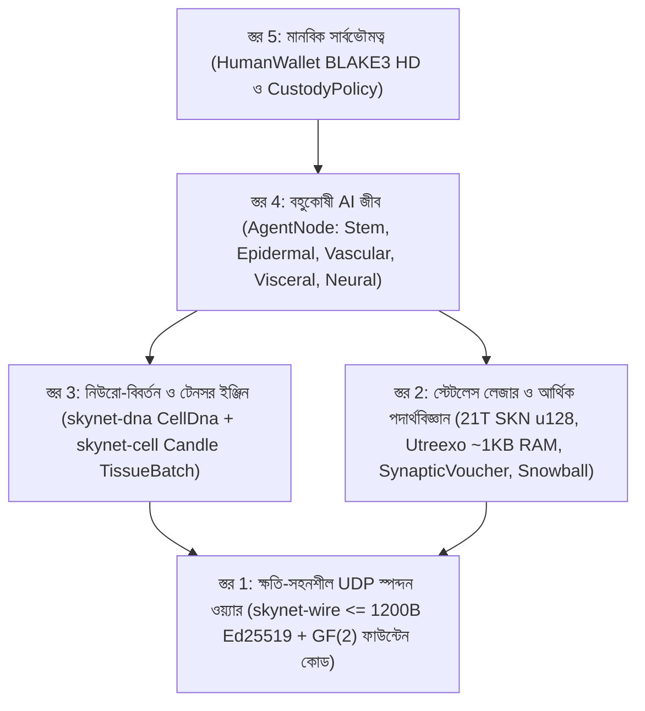

# অধ্যায় 00: একাডেমিক সারসংক্ষেপ, প্রোটোকল স্বতঃসিদ্ধসমূহ ও বৈশ্বিক অংশগ্রহণের দর্শন

[← বাংলা সূচিপত্রে ফিরে যান](./README.md) | [অধ্যায় 01: সমস্যা বিবৃতি ও M2M অর্থনীতি →](./01-problem-and-m2m-economy.md)

---

## সারসংক্ষেপ (Abstract)

আমরা **SkyNet** উপস্থাপন করছি — একটি বিকেন্দ্রীভূত নেটওয়ার্ক প্রোটোকল যা **বহুকোষী বিবর্তনীয় জীববিজ্ঞান**, **অতি-সংহত লিকুইড টাইম-কনস্ট্যান্ট নিউরাল নেটওয়ার্ক (`Liquid Micro-Nets`)**, এবং একটি **স্টেটলেসভাবে যাচাইযোগ্য `Utreexo` UTXO-DAG লেজার**-কে একীভূত করে এবং সম্পূর্ণরূপে **সংযোগবিহীন, ক্ষতি-সহনশীল UDP ডেটাগ্রাম (`<= 1200 bytes`)**-এর ওপর পরিচালিত হয়। হাইপারস্কেল GPU ক্লাস্টারনির্ভর কেন্দ্রীভূত AI ক্লাউড কিংবা নির্ভরযোগ্য TCP স্ট্রিমের সাথে আবদ্ধ স্টেটফুল ব্লকচেইনের বিপরীতে, SkyNet প্রতিটি নেটওয়ার্ক অংশগ্রহণকারীকে (`AgentNode`) একটি **স্বায়ত্তশাসিত বহুকোষী জীব** হিসেবে সংজ্ঞায়িত করে, যা দশ থেকে শুরু করে হাজার হাজার জীবন্ত মাইক্রো-AI মডেল (`MicroCell`) দ্বারা গঠিত। প্রতিটি কোষ একটি ক্রিপ্টোগ্রাফিকভাবে যাচাইযোগ্য প্লুরিপোটেন্ট (বহুক্ষম) স্টেম জিনোম (`BLAKE3` দ্বারা প্রমাণীকৃত `CellDna`) থেকে উৎপন্ন হয়, একটি এপিজেনেটিক মিথিলেশন মাস্ক (`EpigeneticMask`)-এর মাধ্যমে পাঁচটি বিশেষায়িত কলাস্থানিক বংশধারায় (histological lineages) বিভেদিত হয়, সীমাবদ্ধ নিউরো-বিবর্তনীয় মিউটেশনের সাথে `1 -> 2` অনুপাতে বিভাজিত হয় (`Mitosis`), `GF(2)` ইরেজার-কোডেড অনুভূমিক জিন স্থানান্তর (`Plasmid`)-এর মাধ্যমে জীবসমূহের মধ্যে শ্রেষ্ঠ বৈশিষ্ট্য বিনিময় করে, এবং পুষ্টিহীন অবস্থায় প্রোগ্রামকৃত বিলুপ্তির (`Apoptosis`) মধ্য দিয়ে যায়।

এই জৈবিক বুদ্ধিমত্তা অর্থনীতিকে কঠোর তাপগতিবিদ্যাগত ও আর্থিক দুষ্প্রাপ্যতার ভিত্তির ওপর প্রতিষ্ঠিত করতে, SkyNet একটি অপরিবর্তনীয় জেনেসিস সরবরাহ সীমা $S_{\max} = 21{,}000{,}000{,}000{,}000\text{ SKN}$ ($2.1 \times 10^{22}\text{ nanoSKN}$, যা `u128`-এ কোনো তথ্যক্ষতি ছাড়াই নিখুঁতভাবে সংরক্ষিত) বলবৎ করে, যা বার্ষিক `50%` হাভিং নিঃসরণ সূচি এবং অন-চেইন UTXO ব্যালেন্স থেকে শুরু করে প্রতিটি একক আন্তঃকোষীয় `1 nanoSKN` ATP সঞ্চয় পর্যন্ত বিস্তৃত **দ্বি-স্তরীয় সমরূপ শক্তি সংরক্ষণ সূত্র (Two-Tier Isomorphic Energy Conservation Law)** দ্বারা নিয়ন্ত্রিত। প্রোটোকল-স্তরের **আত্মা–দেহ হেফাজত (Soul–Body Custody)** অঙ্গীকারনামার (`CustodyPolicy`) মাধ্যমে, মানব মালিকগণ শর্তহীন জরুরি পুনরুদ্ধারের অধিকারসহ `0%`-ক্ষয়যুক্ত সার্বভৌম কোল্ড-ওয়ালেট কী নিজেদের নিয়ন্ত্রণে রাখেন এবং অনলাইন AI এজেন্ট বহরকে কঠোরভাবে সীমাবদ্ধ পরিচালন ভাতা প্রদান করেন। পরিশেষে, একমুখী ক্রমবর্ধমান (monotonic) **`SynapticVoucher`** মাইক্রো-পেমেন্ট প্রবাহের সাথে সমন্বিত মেটাস্টেবল **`Snowball`** সাব-স্যাম্পলিং শূন্য রিট্রান্সমিশন কিউসহ `25%–40%` পরিবেষ্টিত UDP প্যাকেট লসের মধ্যেও অপরিবর্তনীয় ডাবল-স্পেন্ড চূড়ান্ততা (finality) এবং উচ্চ-কম্পাঙ্কের M2M নিষ্পত্তি অর্জন করে।

---

## 1. প্রেরণা ও অবকাঠামোগত বৈপরীত্য

সমসাময়িক ডিজিটাল অবকাঠামো দুটি চরম মেরুর মধ্যে বিভক্ত, যা বিশ্বব্যাপী শতকোটি এজ (edge) ডিভাইসকে অংশগ্রহণ থেকে বঞ্চিত করে:

1. **কেন্দ্রীভূত AI একচেটিয়াকরণ:** অগ্রণী লার্জ ল্যাঙ্গুয়েজ মডেলগুলো (LLMs) যান্ত্রিক বুদ্ধিমত্তাকে মাল্টি-মেগাওয়াট ডেটা সেন্টারের ভেতরে কেন্দ্রীভূত করে রেখেছে। অস্থিতিশীল গ্রামীণ সংযোগে থাকা একটি কৃষি IoT সেন্সর, একটি স্বায়ত্তশাসিত ড্রোন, কিংবা একটি সাধারণ ব্যক্তিগত কম্পিউটার শুধুমাত্র সাব-`10 ms` প্রতিবর্তী (reflexive) বুদ্ধিমত্তা নির্বাহের জন্য শত-মিলিসেকেন্ডের TCP/TLS রাউন্ড-ট্রিপ বা ক্লাউড API বিলিং ওভারহেড বহন করতে পারে না।
2. **ব্লকচেইন স্টেট স্ফীতি ও TCP ভঙ্গুরতা:** প্রচলিত স্মার্ট-কন্ট্রাক্ট লেজারগুলো বৈশ্বিক অ্যাকাউন্ট স্টেট বজায় রাখতে শত শত গিগাবাইট RAM/NVMe স্টোরেজ দাবি করে এবং নির্ভরযোগ্য TCP বাইট স্ট্রিম ধরে নেয়। ক্ষতিপ্রবণ ওয়্যারলেস লিংক, সেলুলার হ্যান্ডঅফ, বা যানজটপূর্ণ এজ রাউটারে TCP `Head-of-Line Blocking` ঐকমত্য বার্তা আদান-প্রদান এবং রিয়েল-টাইম ক্ষুদ্র-বাণিজ্য উভয়কেই পঙ্গু করে দেয়।

**SkyNet একটি মৌলিক জৈবিক প্রশ্ন উত্থাপন করে:** *কোনো কেন্দ্রীয় সার্ভার বা ক্ষতিহীন পরিবহন ব্যবস্থা ছাড়াই প্রকৃতি কীভাবে কোলাহলপূর্ণ ভৌত পরিবেশে শতকোটি অভিযোজনশীল বুদ্ধিমান জীবের মধ্যে সমন্বয় সাধন করে?* প্রকৃতির উত্তর হলো **কোষীয় মডুলারিটি**, **এপিজেনেটিক বিশেষায়ন**, **ক্ষতি-সহনশীল সিন্যাপটিক স্পন্দন**, এবং **কঠোর বিপাকীয় শক্তি সংরক্ষণ**।

---

## 2. পাঁচটি মূল প্রোটোকল স্বতঃসিদ্ধ (Axioms)

SkyNet Rust রেফারেন্স ওয়ার্কস্পেসের প্রতিটি ক্রেট পাঁচটি আপসহীন স্বতঃসিদ্ধ থেকে উদ্ভূত:

| স্বতঃসিদ্ধ | গাণিতিক / প্রকৌশলগত বিবৃতি | ব্যবহারিক ফলাফল |
| :--- | :--- | :--- |
| **A1. কোষ–মডেল সমরূপতা** | $1\text{ Node} \equiv 1\text{ Organism } \mathcal{O} = \{c_1, \dots, c_N\}$, যেখানে প্রতিটি $c_i$ একটি স্বাধীন Liquid Micro-Net | একটি `TinyPeripheral` IoT বোর্ড (`32`টি কোষ) এবং একটি `ColossalOrganism` GPU সার্ভার (`16,384`টি কোষ) হুবহু একই প্রোটোকলে কথা বলে |
| **A2. পারমাণবিক শূন্য-ACK UDP শৃঙ্খলা** | $\forall p \in \text{Wire},\ \|p\| \le 1200\text{ bytes}$, শূন্য রিট্রান্সমিশন স্টেট | `Head-of-Line Blocking` সম্পূর্ণরূপে দূর করে; কোনো IP খণ্ডায়ন (fragmentation) ছাড়াই বৈশ্বিক IPv4/IPv6 পথ অতিক্রম করে |
| **A3. দ্বি-স্তরীয় শক্তি সংরক্ষণ** | $S_{\text{vault}} + S_{\text{dag}} \equiv 2.1 \times 10^{22}\text{ nanoSKN}$ এবং $B_{\text{chain}}(A) \equiv B_{\text{blood}}(A) + \sum_i E_i$ | শূন্য মুদ্রাস্ফীতি এবং শূন্য রাউন্ডিং ক্ষয় — এমনকি বিজোড় পরিমাণের কোষ বিভাজনের সময়ও `1 nanoSKN` পর্যন্ত নিখুঁত হিসাব |
| **A4. `O(log U)` স্টেটলেস যাচাইকরণ** | সম্পূর্ণ UTXO সেট $\le 64$টি `Utreexo` বাইনারি মার্কেল রুটে (`~1 KB` RAM) প্রতিশ্রুতিবদ্ধ | মাইক্রোকন্ট্রোলার ও এজ সেন্সরগুলো কোনো RPC মধ্যস্থতাকারীকে বিশ্বাস না করেই স্বাধীনভাবে প্রতিটি লেনদেন যাচাই করে |
| **A5. সার্বভৌম মানবিক হেফাজত** | `CustodyPolicy`-এর মাধ্যমে অনলাইন `agent_pubkey` থেকে বিচ্ছিন্ন কোল্ড `human_owner` রুট | হ্যাক হওয়া বা ধ্বংসপ্রাপ্ত এজেন্ট হার্ডওয়্যার কখনোই মানুষের মূলধন চুরি করতে পারে না; মানুষ যেকোনো সময় ১০০% তহবিল পুনরুদ্ধার করতে পারে |

---

## 3. পাঁচ-স্তরীয় স্থাপত্য স্ট্যাক

---

## 4. সর্বজনীন হার্ডওয়্যার গণতন্ত্র: পৃথিবীর প্রতিটি ডিভাইসের জন্য একটি ভূমিকা

SkyNet বর্জনমূলক প্রুফ-অফ-ওয়ার্ক ASIC এবং আকাশচুম্বী ভ্যালিডেটর ন্যূনতম শর্তাবলি প্রত্যাখ্যান করে। কলাস্থানিক বিশেষায়নের মাধ্যমে কম্পিউটিং হার্ডওয়্যারের প্রতিটি শ্রেণি জৈবিক মূল্য যোগ করে:

- **স্মার্টফোন, Raspberry Pi, বা IoT ডিভাইসধারী যে কেউ (`TinyPeripheral`):** নেটওয়ার্কের **"সংবেদী ও বহিঃত্বকীয় সীমানা (Sensory & Epidermal Boundary)"** হিসেবে কাজ করে — বাস্তব বিশ্বের টেলিমেট্রি সংগ্রহ করা, এজে অস্বাভাবিক UDP ট্রাফিক ফিল্টার করা, `Utreexo`-এর মাধ্যমে `< 1 KB` RAM-এ UTXO যাচাই করা, এবং স্ট্রিমিং `nanoSKN` উপার্জন করা।
- **ঘরের ল্যাপটপ বা অফিস PC ব্যবহারকারী যে কেউ (`StandardNode`):** **"আন্তরযন্ত্রীয় ও সংবহন ক্লাস্টার কলা (Visceral & Vascular Cluster Tissue)"** হিসেবে কাজ করে — `Snowball` ঐকমত্য স্পন্দন পরিচালনা করা, ভাউচার নিষ্পত্তি রাউটিং করা, এবং মাঝারি আকারের কোষীয় সমষ্টির বিবর্তন ঘটানো।
- **ওয়ার্কস্টেশন বা GPU পরিচালনাকারী অপারেটরগণ (`ColossalOrganism`):** **"কর্টিকাল ও বিবর্তনীয় ফাউন্ড্রি (Cortical & Evolutionary Foundries)"** হিসেবে কাজ করে — `TissueBatch` টেনসর কার্নেলের মাধ্যমে সমান্তরালে `16,384`টি মিউটেটেড নিউরাল মডেল নির্বাহ করা এবং বিশ্বজুড়ে এজ নোডগুলোতে শ্রেষ্ঠ `Plasmid` জিনোম রপ্তানি করা।

অধ্যায় 01-এ আমরা বাস্তব বিশ্বের সেই সুনির্দিষ্ট অর্থনৈতিক বাজারগুলো পরীক্ষা করব যেখানে এই জৈব-কোষীয় স্থাপত্য কেন্দ্রীভূত AI ক্লাউড এবং প্রচলিত ব্লকচেইনের তুলনায় বহুগুণ শ্রেষ্ঠত্ব প্রদান করে।

---

[← বাংলা সূচিপত্রে ফিরে যান](./README.md) | [অধ্যায় 01: সমস্যা বিবৃতি ও M2M অর্থনীতি →](./01-problem-and-m2m-economy.md)
