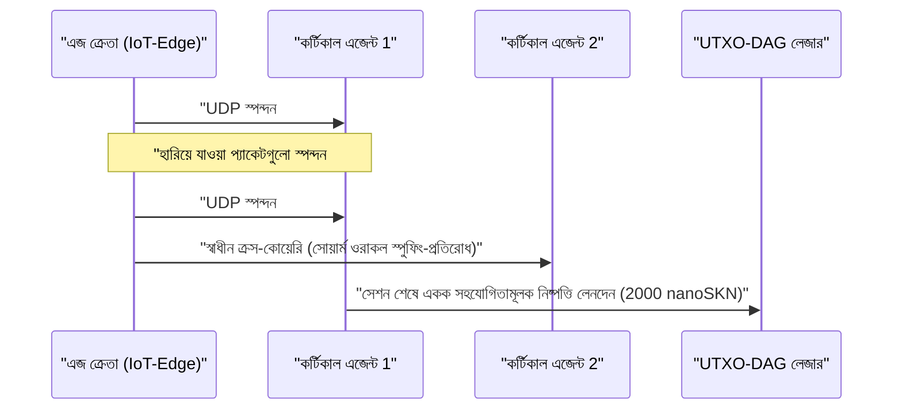

# অধ্যায় 01: সমস্যা বিবৃতি ও ব্যবহারিক মেশিন-টু-মেশিন (`M2M`) অর্থনীতি

[← অধ্যায় 00: সারসংক্ষেপ ও রূপকল্প](./00-abstract-and-vision.md) | [অধ্যায় 02: বহুকোষী স্থাপত্য →](./02-multicellular-architecture.md)

---

## 1. কেন্দ্রীভূত চ্যাটবটের বাইরে: ভৌত এজে প্রতিবর্তী বুদ্ধিমত্তা

দীর্ঘ নথি রচনার জন্য শত-বিলিয়ন-প্যারামিটারের কেন্দ্রীভূত লার্জ ল্যাঙ্গুয়েজ মডেলগুলোকে প্রতিস্থাপন করা SkyNet-এর লক্ষ্য নয়। বরং SkyNet একটি **বহু-ট্রিলিয়ন-ডলারের কাঠামোগত অন্ধ-বিন্দুকে (structural blind spot)** লক্ষ্য করে: ইন্টারনেটের সেই ভৌত এজ (প্রান্তসীমা), যেখানে শতকোটি স্বায়ত্তশাসিত যন্ত্র, শিল্প সেন্সর, নেটওয়ার্ক গেটওয়ে এবং সফটওয়্যার এজেন্টের জন্য অনির্ভরযোগ্য ওয়্যারলেস লিংকের মধ্য দিয়ে **সাব-`10 ms` প্রতিবর্তী অনুমান (reflexive inference), নিরবচ্ছিন্ন স্থানীয় অভিযোজন, এবং এক সেন্টের ভগ্নাংশের চেয়েও ক্ষুদ্র মেশিন-টু-মেশিন (`M2M`) মূল্য নিষ্পত্তি** অপরিহার্য।

### এখানে কেন্দ্রীভূত ক্লাউড ও প্রচলিত ব্লকচেইন কেন ব্যর্থ হয়

একটি স্বায়ত্তশাসিত এজ এজেন্ট $A$ (যেমন একটি সোয়ার্ম ড্রোন, DDoS প্রশমন গেটওয়ে, বা স্মার্ট-গ্রিড রিলে) বিবেচনা করুন, যা প্রতি $\Delta t = 10\text{ ms}$ অন্তর রিয়েল-টাইম অসঙ্গতি শ্রেণিবিন্যাস ও টেলিমেট্রি যাচাইকরণ ক্রয় করে, যার মূল্য প্রতি স্পন্দনে $v = 50\text{ nanoSKN}$:

1. **লেটেন্সি ও TCP রিট্রান্সমিশনের দেয়াল:** দূরবর্তী ক্লাউড অঞ্চলের সাথে TLS/TCP সেশন স্থাপন করতে বহু-RTT হ্যান্ডশেক প্রয়োজন হয়। $p_{\text{loss}} = 20\%$ পরিবেষ্টিত ওয়্যারলেস প্যাকেট লসের অধীনে, TCP কনজেশন উইন্ডো ব্যাকঅফ এবং রিট্রান্সমিশন টাইমআউট `p99` টেইল লেটেন্সিকে শত শত মিলিসেকেন্ডে ঠেলে দেয় — যা রিয়েল-টাইম সাইবার-ফিজিক্যাল নিয়ন্ত্রণ লুপের জন্য বিপর্যয়কর।
2. **ন্যূনতম বেস-ফি সীমা (Base-Fee Floor):** ফিয়াট পেমেন্ট রেল বা EVM স্মার্ট-কন্ট্রাক্ট চেইনে প্রতি-লেনদেনের স্থির ওভারহেড $F_{\text{tx}}$ একক স্পন্দনের মূল্যের চেয়ে $10^5\times$ থেকে $10^8\times$ বেশি হয় ($F_{\text{tx}} \gg v$), যা মিলিসেকেন্ড-সূক্ষ্মতার M2M বাণিজ্যকে অর্থনৈতিকভাবে অসম্ভব করে তোলে।
3. **স্থির মডেলের বিচ্যুতি (Static Model Drift):** ক্লাউড থেকে মোতায়েন করা প্রাক-প্রশিক্ষিত স্থির ওয়েট (static weights) পরিবর্তনশীল স্থানীয় সিগন্যাল বিন্যাসের (`concept drift`) মুখে দ্রুত কার্যকারিতা হারায়, অথচ সীমিত-সম্পদের এজ ডিভাইসগুলোতে গ্রেডিয়েন্ট ব্যাকপ্রোপাগেশন চালানোর মতো মেমরি ও শক্তির বাজেট থাকে না।

---

## 2. `SKN`-এর চাহিদা চালনাকারী চারটি বাস্তব-বিশ্ব অর্থনৈতিক স্তম্ভ

`SKN`-এর অন্তর্নিহিত চাহিদা চারটি সুনির্দিষ্ট সক্ষমতা থেকে উদ্ভূত হয়, যেখানে কেন্দ্রীভূত ক্লাউড এবং স্টেটফুল ব্লকচেইন প্রতিদ্বন্দ্বিতা করতে পারে না:

### 2.1. অতি-নিম্ন-লেটেন্সি সোয়ার্ম এজ মাইক্রো-ইনফারেন্স (`< 10 ms`)
রোবোটিক্স বহর, শিল্প IoT কন্ট্রোলার, টেলিকম রিলে এবং নেটওয়ার্ক নিরাপত্তা যন্ত্রপাতি একটি **একক `<= 1200-byte` UDP ডেটাগ্রামের** ভেতরে স্বাক্ষরিত `SynapticVoucher`-এর পাশাপাশি একটি ৮-মাত্রিক প্রমিত ফিচার ভেক্টর (`stimulus: [f32; 8]`) এমবেড করে।
- পার্শ্ববর্তী `Epidermal` ও `Neural` কোষগুলো প্রতি স্পন্দনে `0.1 ms`-এরও কম সময়ে রিকারেন্ট (পৌনঃপুনিক) লিকুইড মাইক্রো-নেট ফরওয়ার্ড পাস সম্পন্ন করে।
- যেহেতু `SynapticVoucher` একমুখীভাবে ক্রমবর্ধমান ক্রমযোজিত যোগফল (monotonically increasing cumulative totals) এনকোড করে, তাই সেলুলার বা স্যাটেলাইট লিংকে `25%` দৈব UDP প্যাকেট লস হলেও **কোনো বিলিং অচলাবস্থা বা রিট্রান্সমিশন বিরতি ঘটে না**।

### 2.2. সেবা-হিসেবে-বিবর্তন (Evolution-as-a-Service) ও বিকেন্দ্রীভূত `Plasmid` জিন বাজার
সংহত এমবেডেড মডেল প্রশিক্ষণের জন্য ব্যয়বহুল ক্লাউড GPU ক্লাস্টার ভাড়া করার পরিবর্তে, যেকোনো ব্যবহারকারী বা স্বায়ত্তশাসিত এজেন্ট উদ্দীপনা প্রবাহ $x_t$, কাঙ্ক্ষিত প্রতিক্রিয়া $y_t^*$, এবং `SKN` পুরস্কার উল্লেখ করে একটি অপ্টিমাইজেশন বাউন্টি সম্প্রচার করতে পারে:
- হাজার হাজার `AgentNode` জীব `1 -> 2` কোষীয় `Mitosis` সক্রিয় করে এবং সমান্তরালে অযুত-লক্ষ ওয়েট পরিবর্তন (weight perturbations) ও লিকুইড টাইম ধ্রুবক $\tau$ মূল্যায়ন করে।
- দুর্বল মিউট্যান্টগুলো `Apoptosis`-এর শিকার হয়, আর শীর্ষ-কার্যক্ষম বংশধারাগুলো সংহত `CellDna` জিনোমে (`2 KB`-এর নিচে, `BLAKE3` দ্বারা ক্রিপ্টোগ্রাফিকভাবে সিলকৃত) অভিসারী হয়।
- অনুরোধকারী লাইভ ইনফারেন্স এবং **স্বতন্ত্র বিবর্তিত `CellDna` ওয়েট আর্টিফ্যাক্ট** (`GF(2)` `FountainDroplet` প্যাকেটের মাধ্যমে ক্ষতিহীনভাবে সরবরাহকৃত) উভয়ই লাভ করে, যা সরাসরি লক্ষ লক্ষ মাইক্রোকন্ট্রোলারে ফ্ল্যাশ করার জন্য প্রস্তুত থাকে।

### 2.3. পারমাণবিক `M2M nanoSKN` পেমেন্ট রেল ও বিভ্রম-রোধী (Anti-Hallucination) সোয়ার্ম ওরাকল
`1 nanoSKN` ($10^{-9}\text{ SKN}$) পর্যন্ত সূক্ষ্ম এককে বিভাজ্য মূল্যে AI এজেন্টগুলো স্বায়ত্তশাসিতভাবে বাস্তব বিশ্বের ভৌত সংকেত (মাইক্রো-আবহাওয়া টেলিমেট্রি, RF স্পেকট্রাম ব্যবহারের হার, রাউটিং লেটেন্সি, উচ্চ-কম্পাঙ্কের অর্ডারফ্লো) ক্রয় ও ক্রস-যাচাই করে:

স্থানীয় ক্লাস্টারের ভেতরে স্বাধীন `AgentNode` জীবসমূহের ক্রস-স্যাম্পলিং একক-মডেলের বিভ্রম (hallucination) এবং সেন্সর স্পুফিং নির্মূল করে।

### 2.4. অন্তর্ভুক্তিমূলক বহু-স্তরীয় DePIN (হার্ডওয়্যার মিথোজীবিতা)
SkyNet বিশ্বজুড়ে ছড়িয়ে থাকা বৈচিত্র্যময় অব্যবহৃত হার্ডওয়্যারকে একটি মিথোজীবী জৈবিক সরবরাহ শৃঙ্খলে যুক্ত করে:

| অংশগ্রহণকারী শ্রেণি | দৈনন্দিন হার্ডওয়্যার | বাস্তুসংস্থানিক ভূমিকা | `SKN` আয়ের উৎস |
| :--- | :--- | :--- | :--- |
| **ব্যক্তি ও পরিবার** | পুরোনো স্মার্টফোন, হোম রাউটার, Raspberry Pi, IoT বোর্ড | এজ সংবেদী ডেটা সংগ্রহ, `Epidermal` প্যাকেট ফিল্টারিং, `~1 KB` `Utreexo` লাইট যাচাইকরণ | লাইভ সেন্সর ফিড ও সীমানা ফিল্টারিং থেকে `nanoSKN` উপার্জন |
| **ডেভেলপার ও ডেস্কটপ ব্যবহারকারী** | ল্যাপটপ, অফিস PC (`StandardNode`) | `Snowball` ঐকমত্য স্যাম্পলিং, ভাউচার রাউটিং, মাঝারি-পরিসরের কলা বিবর্তন | ক্লাস্টার লেনদেন ফি (`cluster_nutrient_pool`) ও ইনফারেন্স পারিশ্রমিক উপার্জন |
| **গবেষণাগার ও GPU অপারেটর** | মাল্টি-কোর সার্ভার, Apple `Metal`, NVIDIA `CUDA` GPUs | প্রতি নোডে সর্বোচ্চ `16,384`টি কোষের `TissueBatch` সমান্তরাল বিবর্তন | বিবর্তন বাউন্টি ও অনুভূমিক `Plasmid` রপ্তানি রয়্যালটি উপার্জন |

---

## 3. সাব-লিনিয়ার অন-চেইন নিষ্পত্তি সংকোচন

ধরা যাক, দুটি AI এজেন্ট প্যাকেট ড্রপ সম্ভাবনা $p \in [0, 1)$ বিশিষ্ট একটি ওয়্যারলেস চ্যানেলের মাধ্যমে প্রতি কলে $\delta\text{ nanoSKN}$ হারে $M$-সংখ্যক উচ্চ-কম্পাঙ্কের ইনফারেন্স স্পন্দন বিনিময় করে। প্রচলিত অন-চেইন নিষ্পত্তিতে $\mathcal{O}(M)$ সংখ্যক লেজার লেনদেন প্রয়োজন হয় এবং TCP রিট্রান্সমিশন ওভারহেড $\frac{1}{1 - p}$ অনুপাতে বৃদ্ধি পায়।

SkyNet-এ অর্থপ্রদানকারী ক্রম $s \in \{1, \dots, M\}$ দ্বারা সূচীকৃত `Ed25519`-স্বাক্ষরিত ভাউচার প্রেরণ করে, যা ক্রমযোজিত মূল্য $V_s = s \cdot \delta$ বহন করে। টিকে থাকা যেকোনো প্যাকেট $s_k$ কোনো রিট্রান্সমিশন ছাড়াই মধ্যবর্তী সমস্ত হারানো প্যাকেটের সম্পূর্ণ বর্ধিত পার্থক্য $\Delta V = V_{s_k} - V_{s_{k-1}}$ ক্রিপ্টোগ্রাফিকভাবে প্রমাণ করে। সেশন শেষে, সমস্ত $M$টি মাইক্রো-ইনফারেন্স **ঠিক $1$টি UTXO-DAG লেনদেনে** নিষ্পত্তি হয়, যা $M : 1$ অন-চেইন সংকোচন অনুপাত (বাস্তবে $1{,}000\times$ থেকে $100{,}000\times$ লেজার চাপ হ্রাস) অর্জন করে।

অধ্যায় 02 প্রতিটি `AgentNode`-এর অভ্যন্তরীণ শারীরস্থান পরীক্ষা করে — দেখায় কীভাবে একটি একক সফটওয়্যার বাইনারি যেকোনো হার্ডওয়্যার স্তরে স্বয়ংক্রিয়ভাবে একটি জীবন্ত বহুকোষী জীবে সুসংগঠিত হয়।

---

[← অধ্যায় 00: সারসংক্ষেপ ও রূপকল্প](./00-abstract-and-vision.md) | [অধ্যায় 02: বহুকোষী স্থাপত্য →](./02-multicellular-architecture.md)
