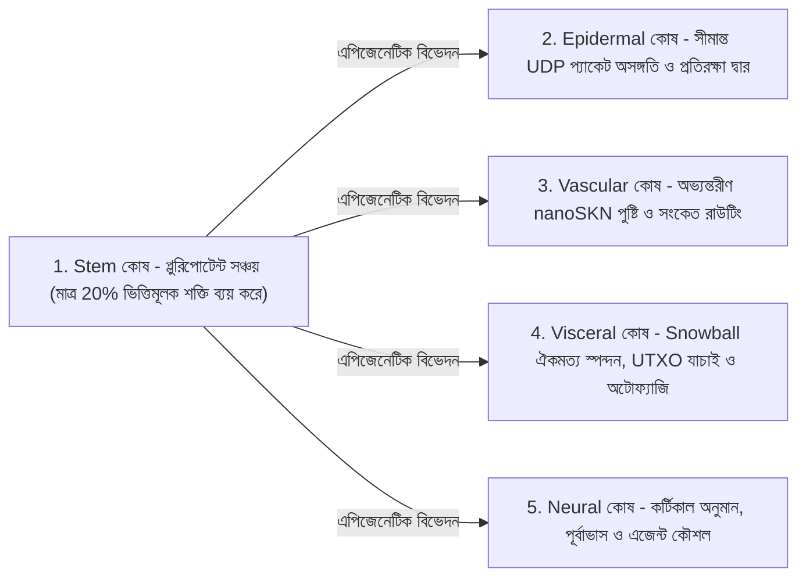

# অধ্যায় 02: বহুকোষী জীব স্থাপত্য ও নমনীয় হার্ডওয়্যার স্কেলিং (`AgentNode`)

[← অধ্যায় 01: সমস্যা বিবৃতি ও M2M অর্থনীতি](./01-problem-and-m2m-economy.md) | [অধ্যায় 03: `CellDna` ও লিকুইড নিউরাল কোষ →](./03-dna-and-liquid-neural-cells.md)

---

## 1. জৈবিক সমরূপতা: `1 Node = 1 Multicellular Organism`

প্রচলিত পিয়ার-টু-পিয়ার নেটওয়ার্কে প্রতিটি নোড একটি একশিলা (monolithic), অনমনীয় স্টেট মেশিন নির্বাহ করে — তা এমবেডেড মাইক্রোকন্ট্রোলারে চলুক বা 64-কোর GPU সার্ভারে। SkyNet (`crates/skynet-agent`)-এ প্রতিটি নেটওয়ার্ক অংশগ্রহণকারীকে একটি **`AgentNode`** হিসেবে গঠন করা হয় — একটি জীবন্ত বহুকোষী জীব, যার মধ্যে রয়েছে মাইক্রো-AI কোষের একটি গতিশীল সমষ্টি $\mathcal{C}(t) = \{c_1, c_2, \dots, c_{N(t)}\}$, একটি অভ্যন্তরীণ বিপাকীয় কোষাগার (`AgentMetabolicBank`), একটি স্টেটলেস `Utreexo` রুট যাচাইকারী (`StatelessUtreexoRoots`), এবং একটি ক্ষতি-সহনশীল `SnowballEngine`।

কোষীয় সমষ্টির আকার $N(t) = |\mathcal{C}(t)|$ কখনোই হার্ডকোড করা থাকে না; এটি **হোস্ট হার্ডওয়্যারের সক্ষমতা এবং অর্জিত `nanoSKN` পুষ্টি প্রবাহ অনুসারে `Mitosis` (কোষ বিভাজন)-এর মাধ্যমে প্রসারিত হয় এবং `Apoptosis` (প্রোগ্রামকৃত কোষ বিলুপ্তি)-এর মাধ্যমে প্রাকৃতিকভাবে সংকুচিত হয়**।

---

## 2. তিনটি নমনীয় হার্ডওয়্যার স্তর (`HardwareTier`)

চালু হওয়ার সময়, `HardwareProfile::for_tier` হোস্টের সক্ষমতাকে সুনির্দিষ্ট `nanoSKN` বিপাকীয় সীমাসহ (`crates/skynet-cell/src/lib.rs`) তিনটি বাস্তুসংস্থানিক প্রোফাইলের একটিতে ম্যাপ করে:

| জৈবিক প্যারামিটার (`HardwareProfile`) | `TinyPeripheral` (IoT / Edge MCU) | `StandardNode` (ল্যাপটপ / ডেস্কটপ PC) | `ColossalOrganism` (সার্ভার / GPU) |
| :--- | :--- | :--- | :--- |
| **সর্বোচ্চ কোষ সমষ্টি (`max_cells`)** | `32`টি কোষ | `512`টি কোষ | `16,384`টি কোষ |
| **সক্রিয় ভিত্তিমূলক ব্যয় / টিক (`basal_burn_per_tick`)** | `50 nanoSKN` | `25 nanoSKN` | `10 nanoSKN` |
| **সুপ্ত `Stem` ব্যয় / টিক (80% সাশ্রয়)** | `10 nanoSKN` | `5 nanoSKN` | `2 nanoSKN` |
| **বিভাজন সীমা (`mitosis_threshold`)** | `2,000 nanoSKN` | `1,500 nanoSKN` | `1,000 nanoSKN` |
| **বিভাজন রক্ত ফি (`mitosis_blood_fee`)** | `100 nanoSKN` | `60 nanoSKN` | `40 nanoSKN` |
| **বিলুপ্তি ন্যূনতম সীমা (`apoptosis_floor`)** | `100 nanoSKN` | `80 nanoSKN` | `50 nanoSKN` |
| **কম্পিউট ব্যাকএন্ড (`candle_core::Device`)** | `Cpu` | `Cpu` / `Metal` / `Cuda` | `Cuda` / `Metal` / `Cpu` SIMD |

> [!NOTE]
> **জৈবিক মাত্রাগত সাশ্রয় (ক্লাইবারের সূত্র / Kleiber's Law):** বৃহত্তর জৈবিক জীব যেমন প্রতি গ্রাম কলায় কম বিপাকীয় ব্যয় প্রদর্শন করে, তেমনি `ColossalOrganism` নোডগুলোতে প্রতি কোষে ভিত্তিমূলক ব্যয় কম হয় (`50 nanoSKN`-এর পরিবর্তে `10 nanoSKN`), কারণ হাজার হাজার কোষ একটি একক ব্যাচড GPU টেনসর কার্নেলের ভেতরে নির্বাহ ব্যয় ভাগাভাগি করে নেয়; অন্যদিকে `TinyPeripheral` নোডগুলো নেটওয়ার্ক প্রান্তে হালকা ও সহনশীল থাকে।

---

## 3. পাঁচটি বিশেষায়িত কলাস্থানিক বংশধারা (`CellRole`)

যখন একটি `AgentNode` জন্ম নেয় (`AgentNode::from_signing_key`), তখন এটি একটি নির্ধারক (deterministic) `base_stem` জিনোম থেকে উদ্ভূত ৬-কোষবিশিষ্ট ভ্রূণীয় বীজ (`2 Stem`, `1 Epidermal`, `1 Vascular`, `1 Visceral`, `1 Neural`) দ্বারা যাত্রা শুরু করে। জীবের সমগ্র জীবনকালে পাঁচটি কলাস্থানিক বংশধারা পাঁচটি অপরিহার্য শারীরবৃত্তীয় কাজ সম্পাদন করে:

1. **`Stem` (প্লুরিপোটেন্ট সঞ্চয় — `operon_index = None`):** সুপ্ত পুনরুৎপাদনশীল কোষ যা প্রতি টিকে মাত্র $\max(\lfloor E_{\text{burn}} / 5 \rfloor, 1)$ শক্তি ব্যয় করে। যখনই কোনো বিশেষায়িত অঙ্গে কোষক্ষয় ঘটে, একটি `Stem` কোষ বাহ্যিক কোড ডাউনলোড ছাড়াই এপিজেনেটিকভাবে বিভেদিত (`differentiate`) হয়ে সেই ঘাটতি পূরণ করে।
2. **`Epidermal` (ত্বক ও প্রতিরক্ষা দ্বার — `operon_index = Some(0)`):** কাঁচা UDP সকেট পাহারা দেয় (`epidermal_inspect_packet`)। আগত কোনো প্যাকেট লেজার বা ঐকমত্য ইঞ্জিনে পৌঁছানোর আগেই একটি `Epidermal` কোষ ত্রুটিপূর্ণ বা ফ্লাড স্পন্দন বাতিল করতে `candle`-এ প্রমিত প্যাকেট টেলিমেট্রি (`raw_len / 1200`, `hop_ttl / 16`, `epoch` বিচ্যুতি) মূল্যায়ন করে।
3. **`Vascular` (সংবহন নিয়ন্ত্রক — `operon_index = Some(1)`):** `AgentMetabolicBank`-এর ভেতরে অভ্যন্তরীণ `blood_pool` তারল্য নিয়ন্ত্রণ করে এবং উচ্চ-নির্ভুলতাসম্পন্ন কোষগুলোর দিকে `nanoSKN` পুরস্কার প্রবাহিত করে।
4. **`Visceral` (অঙ্গ রক্ষণাবেক্ষণ — `operon_index = Some(2)`):** `Snowball` পোলিং ছন্দ, স্টেটলেস `Utreexo` উইটনেস যাচাইকরণ এবং বিপাকীয় পুনর্ব্যবহার পরিচালনা করে।
5. **`Neural` (কর্টিকাল মস্তিষ্ক — `operon_index = Some(3)`):** জ্ঞানীয় অনুমান (cognitive inference) নির্বাহ করে; সমস্ত জীবিত `Neural` কোষের সমষ্টিগত গড় ($\bar{y}_{\text{cortical}} = \frac{1}{|\mathcal{C}_{\text{neural}}|} \sum_{i \in \mathcal{C}_{\text{neural}}} y_i$) জীবের সম্মিলিত সিদ্ধান্ত আউটপুট গঠন করে।

---

## 4. ছয়-ধাপের জৈবিক টিক জীবনচক্র (`run_biological_tick`)

প্রতিটি স্পন্দনে (`pulse_seq`), `AgentNode` নিখুঁত `u128` `nanoSKN` সংরক্ষণের সাথে ডারউইনীয় প্রতিযোগিতাকে একীভূত করে একটি নির্ধারক ছয়-ধাপের শারীরবৃত্তীয় চক্র নির্বাহ করে:

1. **ধাপ ১ — ভিত্তিমূলক বিপাক (Basal Metabolism):** প্রতিটি কোষ $c_i$ রক্ষণাবেক্ষণ শক্তি $b_i = \text{metabolize\_tick}()$ ব্যয় করে। অত্যন্ত গুরুত্বপূর্ণ বিষয় হলো, $b_i$ কখনোই অন-চেইনে ধ্বংস হয় না; ব্যয়িত আন্তঃকোষীয় ATP-এর ১০০% পুনরায় `bank.blood_pool`-এ পুনর্ব্যবহৃত হয়। অনাহারী কোষগুলো ($E_i = 0$) `0.25` `health` হারায়।
2. **ধাপ ২ — ব্যাচড `candle` টেনসর ইনফারেন্স:** সমস্ত $N$-সংখ্যক জীবিত কোষ `TissueBatch::forward_slice`-এর মাধ্যমে একযোগে নির্বাহ হয়, যা আউটপুট $y_i \in \mathbb{R}^4$ উৎপন্ন করে এবং স্বল্পমেয়াদী লিকুইড মেমরি ভেক্টর $h_{i,t} \in \mathbb{R}^{16}$ হালনাগাদ করে।
3. **ধাপ ৩ — আন্তঃ-অঙ্গ ডারউইনীয় পুষ্টি নির্বাচন:**
   কাঙ্ক্ষিত সংকেত $t \in \mathbb{R}^4$ প্রদত্ত হলে, কোষ $i$-এর পূর্বাভাসের গুণমান সীমাবদ্ধ গড় পরম ত্রুটি (Mean Absolute Error) দ্বারা পরিমাপ করা হয়:

   $$q_i = \operatorname{clamp}\!\left(1 - \frac{1}{4}\sum_{k=1}^{4} |y_{i,k} - t_k|,\ 0.0,\ 1.0\right)$$

   ধরা যাক, অঙ্গের ভূমিকা $r = \text{role}(c_i)$ ভাগ করে নেওয়া সমস্ত কোষের গড় গুণমান হলো $\bar{q}_r$। একটি বিশেষায়িত কোষ `blood_pool` থেকে পুষ্টি `nanoSKN` তখন এবং কেবল তখনই অর্জন করে যদি তার অঙ্গে $\le 2$টি কোষ থাকে অথবা সে আন্তঃ-অঙ্গ প্রতিযোগিতামূলক সীমা $q_i \ge 0.98 \cdot \bar{q}_r$ অতিক্রম করে:

   $$R_i = \min\!\left(\lfloor 320 \cdot q_i \rfloor + E_{\text{basal}},\ \left\lfloor \frac{B_{\text{blood}}}{8} \right\rfloor\right)$$

   নিম্নমানের মিউট্যান্টগুলো ($q_i < 0.98 \cdot \bar{q}_r$) শূন্য পুষ্টি পায় এবং `-0.35` `health` দণ্ড ভোগ করে।
4. **ধাপ ৪ — হোমিওস্ট্যাটিক স্টেম বিভেদন (Homeostatic Stem Differentiation):** জীব তার সবচেয়ে কম কোষবিশিষ্ট বিশেষায়িত অঙ্গটি শনাক্ত করে (`find_most_needed_role`)। যখনই `stem_count > 1` হয়, অন্তত `1`টি জার্মলাইন `Stem` কোষ সর্বদা সংরক্ষিত রেখে একটি `Stem` কোষ সেই অঙ্গে বিভেদিত হয়।
5. **ধাপ ৫ — `1 -> 2` মাইটোসিস বিভাজন (Mitosis):** সুস্থ ও সুপুষ্ট কোষগুলো (`health >= 0.65` এবং $E_i \ge E_{\text{mitosis}}$) `profile.max_cells` সীমা পর্যন্ত একটি রক্ষণশীল ক্লোন (কন্যা A) এবং একটি মিউটেটেড অভিযাত্রী (কন্যা B)-তে বিভাজিত হয়।
6. **ধাপ ৬ — অঙ্গ-সুরক্ষিত অ্যাপোপটোসিস (Apoptosis):** অনাহারী ($E_i < E_{\text{apoptosis}}$) বা গুরুতরভাবে ক্ষতিগ্রস্ত (`health <= 0.15`) কোষগুলো বিলীন হয়ে যায় এবং তাদের অবশিষ্ট `nanoSKN`-এর ১০০% `blood_pool`-এ ফিরিয়ে দেয় — তবে একটি কঠোর টিকে থাকার সুরক্ষা শর্ত সাপেক্ষে: **প্রতিটি বিদ্যমান `CellRole`-এর অন্তত `1`টি জীবিত কোষ শর্তহীনভাবে সংরক্ষিত থাকে**, যাতে কোনো অত্যাবশ্যকীয় অঙ্গ কখনোই বিলুপ্ত না হয়।

প্রতিটি টিকের শেষে, `verify_internal_skn_conservation()` নিখুঁত `u128` অভেদটি যাচাই করে:

$$B_{\text{chain}}(\text{Agent}) \equiv B_{\text{blood}}(\text{Agent}) + \sum_{c_i \in \mathcal{C}} E_i$$

অধ্যায় 03 `CellDna`, এপিজেনেটিক অপেরন সুইচিং এবং 3D `TissueBatch` লিকুইড নিউরাল নির্বাহের সুনির্দিষ্ট বাইট ও গাণিতিক গঠন ব্যাখ্যা করতে কোষের নিউক্লিয়াস উন্মোচন করে।

---

[← অধ্যায় 01: সমস্যা বিবৃতি ও M2M অর্থনীতি](./01-problem-and-m2m-economy.md) | [অধ্যায় 03: `CellDna` ও লিকুইড নিউরাল কোষ →](./03-dna-and-liquid-neural-cells.md)
