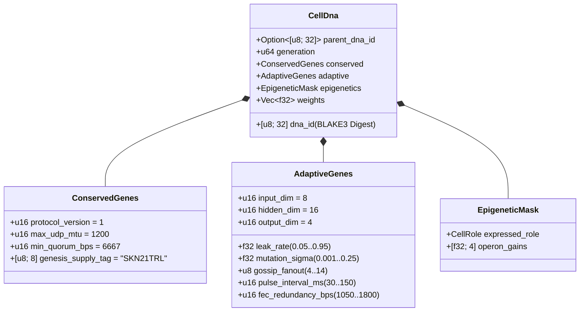

# অধ্যায় 03: জেনেটিক এনকোডিং (`CellDna`), এপিজেনেটিক্স ও `candle`-এ লিকুইড মাইক্রো-নিউরাল বিবর্তন

[← অধ্যায় 02: বহুকোষী স্থাপত্য](./02-multicellular-architecture.md) | [বাংলা সূচিপত্রে ফিরে যান →](./README.md)

---

## 1. কোষীয় জিনোম স্থাপত্য (`CellDna`)

জৈবিক বিবর্তন দুটি পরস্পরবিরোধী শক্তির মধ্যে ভারসাম্য বজায় রাখে: মৌলিক জৈব-রাসায়নিক অপরিবর্তনীয়সমূহের **কঠোর সংরক্ষণ** (যেখানে মিউটেশন প্রাণঘাতী) এবং স্নায়বিক ও আচরণগত বৈশিষ্ট্যের **নিরবচ্ছিন্ন বৈচিত্র্য**। `skynet-dna` ক্রেট `CellDna`-এর ভেতরে এই দ্বৈততাকে গাণিতিক রূপ দেয়:

### 1.1. অপরিবর্তনীয় `ConservedGenes`
কোনো মিউটেশন বা অনুভূমিক ক্রসওভার `ConservedGenes` পরিবর্তন করতে পারে না। চারটি ঐকমত্য-নিরাপত্তা শর্তের যেকোনো একটি লঙ্ঘনকারী জিনোম তাৎক্ষণিকভাবে `DnaError::ConservedGeneViolation` সহ প্রত্যাখ্যাত হয়:
- `protocol_version == 1`
- `max_udp_mtu == 1200` (খণ্ডায়ন-মুক্ত UDP সর্বোচ্চ সীমা)
- $6667 \le \text{min\_quorum\_bps} \le 10000$ (`Snowball`-এ $\ge \frac{2}{3}$ বিশেষ সংখ্যাগরিষ্ঠতা নিশ্চিতকরণ)
- `genesis_supply_tag == *b"SKN21TRL"` (২১-ট্রিলিয়ন `SKN` সরবরাহ সীমাকে স্থায়ীভাবে আবদ্ধকরণ)

### 1.2. `AdaptiveGenes` ও অভিন্ন-ট্রাঙ্ক অপেরন ওয়েট বিন্যাস
চারটি বিশেষায়িত কোষের ধরনের জন্য চারটি বিচ্ছিন্ন নিউরাল নেটওয়ার্ক সংরক্ষণের পরিবর্তে, `CellDna` **চারটি বিশেষায়িত অপেরন প্রজেকশন হেড (Specialized Operon Projection Heads)**-কে সংযুক্ত করে এমন **একটি অভিন্ন সংবেদী ট্রাঙ্ক (Shared Sensory Trunk)** এনকোড করে। $(D_{\text{in}}, H, D_{\text{out}})$ মাত্রার জন্য সুনির্দিষ্ট `f32` প্যারামিটার সংখ্যা হলো:

$$|\theta| = \underbrace{(D_{\text{in}} \cdot H + H)}_{\text{Shared Sensory Trunk }(W_1, b_1)} + \underbrace{4 \cdot (H \cdot D_{\text{out}} + D_{\text{out}})}_{\text{4 Specialized Operon Heads }(W_{2,r}, b_{2,r})}$$

ডিফল্ট মাত্রা $(D_{\text{in}} = 8,\ H = 16,\ D_{\text{out}} = 4)$-এর অধীনে:
- অভিন্ন ট্রাঙ্ক: $8 \times 16 + 16 = 144$টি প্যারামিটার।
- চারটি অপেরন হেড (`Epidermal`, `Vascular`, `Visceral`, `Neural`): $4 \times (16 \times 4 + 4) = 272$টি প্যারামিটার।
- মোট জিনোম ওয়েট: $|\theta| = 416$টি `f32` ফ্লোট ($1{,}664\text{ bytes}$ কাঁচা ওয়েট)। প্রজন্ম-০ স্টেম জিনোম (`CellDna::genesis_stem`) Xavier-স্কেলকৃত সীমাসহ $\mathcal{U}(-\sigma_0, +\sigma_0)$ বিস্তারে `ChaCha8Rng`-এর মাধ্যমে নির্ধারকভাবে প্রারম্ভিক মান গ্রহণ করে:

$$\sigma_0 = \sqrt{\frac{2}{D_{\text{in}} + H}}$$

### 1.3. নির্ধারক `BLAKE3` ক্রিপ্টোগ্রাফিক ডাইজেস্ট (`SKYNET_DNA_V1`)
প্রতিটি ফ্লোটিং-পয়েন্ট হাইপারপ্যারামিটার এবং ওয়েট প্রামাণিক লিটল-এন্ডিয়ান IEEE-754 বিট প্যাটার্নের (`to_bits().to_le_bytes()`) মাধ্যমে ডোমেইন-পৃথকীকৃত `BLAKE3("SKYNET_DNA_V1", ...)` হ্যাশে সিরিয়ালাইজ করা হয়। যেকোনো একক-বিট বিকৃতি, `NaN`/`Inf` ইনজেকশন, বা অননুমোদিত ওয়েট কারসাজি ঘটলে `verify_integrity()`-এ তাৎক্ষণিকভাবে প্রত্যাখ্যাত হয়।

---

## 2. এপিজেনেটিক মিথিলেশন সুইচিং (`EpigeneticMask`)

বহুকোষী জীববিজ্ঞানে একটি নিউরন এবং একটি বহিঃত্বকীয় কোষ অভিন্ন DNA ক্রম বহন করে, তবুও জিন মিথিলেশনের মাধ্যমে সম্পূর্ণ ভিন্ন ফেনোটাইপ (লক্ষণ) প্রকাশ করে। SkyNet-এ যখন একটি `Stem` কোষ উদ্দিষ্ট ভূমিকা $r \in \{0, 1, 2, 3\}$-এ বিভেদিত হয় (`CellDna::differentiate`), তখন **অন্তর্নিহিত `weights` ভেক্টরের ১০০% অপরিবর্তিত থাকে** এবং কেবল `EpigeneticMask` প্রকাশের মাত্রা (expression gain) পরিবর্তন করে:

- **সুপ্ত `Stem` অবস্থা:** `operon_gains = [0.25, 0.25, 0.25, 0.25]`, যা হ্রাসকৃত গেইন $g = 0.25$-এ অপেরন হেড `0`-এর মাধ্যমে প্রজেক্ট করে।
- **বিভেদিত ভূমিকা $r$:** অপেরন হেড $r$ পূর্ণ গেইনে ($g_r = 1.0$) সক্রিয় হয় এবং অপ্রকাশিত হেডগুলো $0.05$-এ অবদমিত থাকে:

$$g_k = \begin{cases} 1.0 & \text{if } k = r \\ 0.05 & \text{if } k \neq r \end{cases}$$

ফলস্বরূপ, অভিন্ন ট্রাঙ্কে $(W_1, b_1)$ অর্জিত সংবেদী উপস্থাপনা এবং সুপ্ত হেডগুলোতে সঞ্চিত সুপ্ত অভিযোজনসমূহ প্রজন্মের পর প্রজন্ম টিকে থাকে এবং রূপান্তরিত বিভেদনের (transdifferentiation) সময় পুনরায় ব্যবহারযোগ্য থাকে।

---

## 3. লিকুইড টাইম-কনস্ট্যান্ট গতিবিদ্যা ও 3D `TissueBatch` নির্বাহ

### 3.1. একক-কোষ রিকারেন্ট লিকুইড গতিবিদ্যা
স্টেটলেস ফিডফরওয়ার্ড MLP অ্যাসিনক্রোনাস UDP প্যাকেট প্রবাহের মধ্যকার কালিক সহসম্পর্ক (temporal correlations) ধারণ করতে পারে না। প্রতিটি `MicroCell` বিবর্তনযোগ্য লিক রেট (leak rate) $\tau \in [0.05, 0.95]$-সহ বিচ্ছিন্ন **লিকুইড টাইম-কনস্ট্যান্ট (LTC)** স্টেট ইন্টারপোলেশন দ্বারা নিয়ন্ত্রিত একটি রিকারেন্ট স্বল্পমেয়াদী মেমরি ভেক্টর $h_t \in \mathbb{R}^H$ বজায় রাখে:

$$h_t = (1 - \tau)\, h_{t-1} + \tau\, \tanh(x_t W_1 + b_1)$$

$$y_t = g_{\text{role}} \cdot \tanh(h_t W_{2,r} + b_{2,r})$$

- যখন $\tau \to 0.05$ হয়, কোষ দীর্ঘমেয়াদী স্মৃতি জড়তা ধরে রাখে (`Visceral` ও `Neural` প্রবণতা পর্যবেক্ষণের জন্য আদর্শ)।
- যখন $\tau \to 0.95$ হয়, কোষ উচ্চ-কম্পাঙ্কের সীমান্ত স্পন্দনে তাৎক্ষণিক প্রতিক্রিয়া জানায় (`Epidermal` অসঙ্গতি স্কোরিংয়ের জন্য আদর্শ)।
- যেহেতু $\tau$ `AdaptiveGenes`-এ অবস্থান করে, তাই **প্রতিটি কোষের কালিক স্মৃতির দিগন্ত তার সিন্যাপটিক ওয়েটের সাথে প্রাকৃতিকভাবে সহ-বিবর্তিত হয়**।

### 3.2. উচ্চ-থ্রুপুট 3D `TissueBatch` টেনসর ইঞ্জিন (`Cpu` / `Metal` / `Cuda`)
নিউরো-বিবর্তনের একটি ধ্রুপদী প্রতিবন্ধকতা হলো ওয়েটের ভিন্নতা: প্রতিটি কোষ $i \in \{1, \dots, N\}$ স্বতন্ত্র মিউটেটেড ম্যাট্রিক্স $W_1^{(i)} \neq W_1^{(j)}$ এবং স্বতন্ত্র লিক রেট $\tau^{(i)} \neq \tau^{(j)}$ বহন করে। $N$-সংখ্যক ধারাবাহিক মাইক্রো-কার্নেল চালু করলে আধুনিক GPU কর্মহীন হয়ে পড়ে।

`skynet-cell`-এর `TissueBatch::forward_slice` সমস্ত $N$টি বৈচিত্র্যময় কোষকে `candle_core::Device`-এ সংলগ্ন র‍্যাঙ্ক-৩ টেনসরে প্যাক করে এই সমস্যার সমাধান করে:

$$\mathbf{X} \in \mathbb{R}^{N \times 1 \times D_{\text{in}}}, \quad \mathbf{W}_1 \in \mathbb{R}^{N \times D_{\text{in}} \times H}, \quad \mathbf{B}_1 \in \mathbb{R}^{N \times 1 \times H}$$

$$\mathbf{H}_t = (\mathbf{1} - \boldsymbol{\tau}) \odot \mathbf{H}_{t-1} + \boldsymbol{\tau} \odot \tanh\!\big(\operatorname{BMM}(\mathbf{X}, \mathbf{W}_1) + \mathbf{B}_1\big)$$

$$\mathbf{Y}_t = \mathbf{G} \odot \tanh\!\big(\operatorname{BMM}(\mathbf{H}_t, \mathbf{W}_2) + \mathbf{B}_2\big)$$

যেখানে $\operatorname{BMM}$ একক-কার্নেল ব্যাচড ম্যাট্রিক্স গুণন (Batched Matrix Multiplication) এবং $\odot$ হলো $\boldsymbol{\tau}, \mathbf{G} \in \mathbb{R}^{N \times 1 \times 1}$-এর সাথে ব্রডকাস্ট উপাদান-ভিত্তিক গুণন। নিরীক্ষিত ইউনিট পরীক্ষা নিশ্চিত করে যে `TissueBatch` প্রতি `ColossalOrganism`-এ একযোগে সর্বোচ্চ `16,384`টি বিবর্তিত মডেল পর্যন্ত স্কেল করার পাশাপাশি $< 10^{-5}$ ফ্লোটিং-পয়েন্ট সহনশীলতার মধ্যে একক কোষ নির্বাহের সাথে হুবহু মিলে যায়।

---

## 4. অপ্রতিসম মাইটোসিস, নিখুঁত বিজোড়-`nanoSKN` সংরক্ষণ ও প্লাজমিড ক্রসওভার

### 4.1. অপ্রতিসম `1 -> 2` `Mitosis` ও নিখুঁত পারমাণবিক সংরক্ষণের প্রমাণ
যখন মাতৃকোষ $P$, $E_P \ge \max(E_{\text{mitosis}}, F_{\text{blood}} + 2)$ এবং `health >= 0.65` শর্ত পূরণ করে, তখন `divide_mitosis` দুটি প্রজন্ম-$(g+1)$ কন্যাকোষ সৃষ্টি করে:
- **কন্যা A (রক্ষণশীল ক্লোন):** কোনো পরিবর্তন ছাড়াই পরীক্ষিত মাতৃ-ওয়েট এবং অভিযোজনশীল প্যারামিটারের ১০০% অক্ষুণ্ণ রাখে।
- **কন্যা B (মিউটেটেড অভিযাত্রী):** সীমাবদ্ধ নিউরো-বিবর্তনীয় মিউটেশনের মধ্য দিয়ে যাওয়ার সময় মাতৃকোষের `hidden_state` ধারাবাহিকতা উত্তরাধিকারসূত্রে লাভ করে:
  - প্রতিটি ওয়েট $w \in \theta$, $0.35$ সম্ভাবনায় শূন্য-নির্ভরতার ৬-নমুনা আরউইন-হল গাউসিয়ান বিচ্যুতির ($\Delta w \sim \mathcal{N}(0, \sigma^2)$) মাধ্যমে মিউটেটেড হয়, যা গ্রেডিয়েন্ট/ওয়েট বিস্ফোরণ রোধে কঠোরভাবে $[-4.0, +4.0]$ সীমায় আবদ্ধ থাকে।
  - $\tau$, $\sigma$, `gossip_fanout` ($\pm 1$), `pulse_interval_ms` ($\pm 10\text{ ms}$), এবং `fec_redundancy_bps` ($\pm 50\text{ bps}$) নির্ধারিত সীমার ভেতরে সহ-মিউটেটেড হয়।

**শূন্য-ক্ষয় বিজোড়-`nanoSKN` সংরক্ষণের প্রমাণ:** ধরা যাক, ফি-পরবর্তী বণ্টনযোগ্য ATP হলো $E_{\text{dist}} = E_P - F_{\text{blood}}$। কন্যাকোষদ্বয়ের ব্যালেন্স `u128`-এর পূর্ণসংখ্যার ভাগফল-ভাগশেষ পাটিগণিতের মাধ্যমে বণ্টিত হয়:

$$E_A = \left\lfloor \frac{E_{\text{dist}}}{2} \right\rfloor + (E_{\text{dist}} \bmod 2), \qquad E_B = \left\lfloor \frac{E_{\text{dist}}}{2} \right\rfloor$$

প্রতিটি অঋণাত্মক পূর্ণসংখ্যা $E_{\text{dist}} \in \mathbb{Z}_{\ge 0}$ (যার মধ্যে `3,333 nanoSKN`-এর মতো বিজোড় ব্যালেন্সও অন্তর্ভুক্ত)-এর জন্য নিখুঁত সংরক্ষণ অভেদভাবে সিদ্ধ হয়:

$$E_A + E_B + F_{\text{blood}} = \left(2\left\lfloor \frac{E_{\text{dist}}}{2} \right\rfloor + (E_{\text{dist}} \bmod 2)\right) + F_{\text{blood}} = E_{\text{dist}} + F_{\text{blood}} \equiv E_P$$

শতকোটি বিভাজনের পরেও রাউন্ডিংয়ের কারণে একটি একক `nanoSKN`-ও কখনো হারায় না কিংবা শূন্য থেকে সৃষ্টি হয় না।

### 4.2. আন্তঃ-এজেন্ট অনুভূমিক জিন স্থানান্তর (`Plasmid` ক্রসওভার)
ব্যাকটেরিয়ার প্লাজমিড বিনিময়ের অনুকরণে একটি `AgentNode` তার সর্বোচ্চ-ফিটনেসবিশিষ্ট কোষের `CellDna`-কে ইরেজার-কোডেড UDP `FountainDroplet` প্যাকেটে (`encode_elite_plasmid_droplets`) রপ্তানি করে। ক্ষতিপ্রবণ UDP লিংকের মধ্য দিয়ে `donor_dna` পুনর্গঠনের পর গ্রহণকারী এজেন্ট `horizontal_crossover`-এর মাধ্যমে তার সর্বনিম্ন-ফিটনেসবিশিষ্ট কোষটিকে উন্নত করে:
- অভিযোজনশীল নেটওয়ার্কিং ও টাইম-কনস্ট্যান্ট বৈশিষ্ট্যগুলো $0.7 \cdot \text{Recipient} + 0.3 \cdot \text{Donor}$ অনুপাতে মিশ্রিত হয়।
- সিন্যাপটিক ওয়েটের $30\%$ সমভাবে $0.5 \cdot w_{\text{rec}} + 0.5 \cdot w_{\text{don}} \in [-4.0, +4.0]$ হিসেবে মিশ্রিত হয়।

অনুভূমিক প্লাজমিড স্থানান্তরের মাধ্যমে একটি সীমিত-সম্পদের `TinyPeripheral` IoT সেন্সর `ConservedGenes`-এর নিরাপত্তা ক্রিপ্টোগ্রাফিকভাবে অক্ষুণ্ণ রেখে দূরবর্তী GPU `ColossalOrganism` নোডে বিবর্তিত শ্রেষ্ঠ নিউরাল বুদ্ধিমত্তা আত্মীকরণ করতে পারে।

---

> **পর্যায় ২ (পর্ব II)-এ আসছে:** অধ্যায় `04–06`-এ `21,000,000,000,000 SKN` হাভিং ভল্টের গণিত, `Soul–Body` মানবিক সার্বভৌম হেফাজত অঙ্গীকারনামা, এবং `~1 KB` স্টেটলেস `Utreexo` + `SynapticVoucher` লেজার স্কেলিং সুসংবদ্ধভাবে উপস্থাপন করা হবে।

[← অধ্যায় 02: বহুকোষী স্থাপত্য](./02-multicellular-architecture.md) | [বাংলা সূচিপত্রে ফিরে যান →](./README.md)
