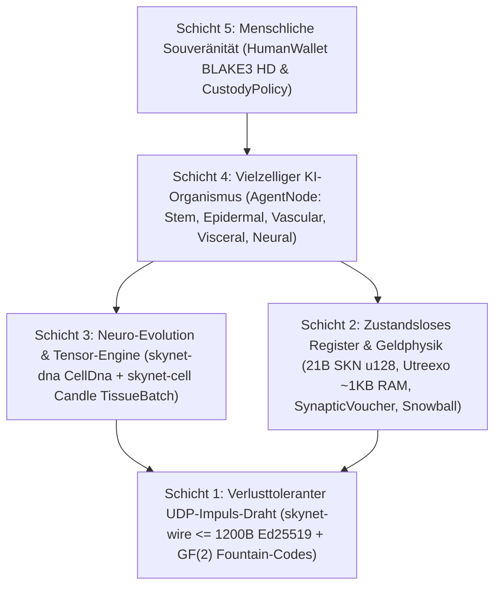

# Kapitel 00: Wissenschaftliche Zusammenfassung, Protokoll-Axiome & Philosophie der Globalen Teilhabe

[← Zurück zum Deutschen Index](./README.md) | [Kapitel 01: Problemstellung & M2M-Ökonomie →](./01-problem-and-m2m-economy.md)

---

## Zusammenfassung

Wir präsentieren **SkyNet**, ein dezentrales Netzwerkprotokoll, das **vielzellige Evolutionsbiologie**, **ultrakompakte neuronale Netze mit flüssiger Zeitkonstante (`Liquid Micro-Nets`)** und ein **zustandslos verifizierbares `Utreexo`-UTXO-DAG-Register** vereint und vollständig über **verbindungslose, verlusttolerante UDP-Datagramme (`<= 1200 bytes`)** operiert. Im Gegensatz zu zentralisierten KI-Clouds, die Hyperscale-GPU-Cluster erfordern, oder zustandsbehafteten Blockchains, die auf zuverlässige TCP-Datenströme angewiesen sind, definiert SkyNet jeden Netzwerkteilnehmer (`AgentNode`) als einen **autonomen vielzelligen Organismus**, der aus Dutzenden bis Zehntausenden lebender Mikro-KI-Modelle (`MicroCell`) besteht. Jede Zelle entspringt einem kryptographisch verifizierbaren pluripotenten Stammgenom (`CellDna`, authentifiziert über `BLAKE3`), differenziert sich mittels einer epigenetischen Methylierungsmaske (`EpigeneticMask`) in fünf spezialisierte histologische Zelllinien, teilt sich im Verhältnis `1 -> 2` unter beschränkten neuro-evolutionären Mutationen (`Mitosis`), tauscht über `GF(2)`-löschkodierten horizontalen Gentransfer (`Plasmid`) Elite-Merkmale zwischen Organismen aus und durchläuft bei Energiemangel einen programmierten Zelltod (`Apoptosis`).

Um diese biologische Intelligenzökonomie in strikter thermodynamischer und monetärer Knappheit zu verankern, setzt SkyNet eine unveränderliche Genesis-Gesamtobergrenze von $S_{\max} = 21{,}000{,}000{,}000{,}000\text{ SKN}$ ($2.1 \times 10^{22}\text{ nanoSKN}$, verlustfrei dargestellt in `u128`) durch, gesteuert über einen jährlichen `50%`-Halving-Emissionsplan sowie ein **Zweistufiges Isomorphes Energieerhaltungsgesetz**, das von On-Chain-UTXO-Guthaben bis hinab zu einzelnen intrazellulären `1 nanoSKN`-ATP-Reserven reicht. Durch einen auf Protokollebene verankerten **Seele–Körper-Verwahrungsvertrag** (`CustodyPolicy`) behalten menschliche Eigentümer souveräne Cold-Wallet-Schlüssel mit `0%` Wertverfall und bedingungslosem Notfall-Rückholrecht, während sie online agierenden KI-Agenten-Flotten streng begrenzte operative Budgets zuweisen. Schließlich erreicht metastabiles **`Snowball`**-Subsampling in Kombination mit monoton wachsenden **`SynapticVoucher`**-Mikrozahlungsströmen irreversible Double-Spend-Finalität und hochfrequente M2M-Abrechnung selbst bei `25%–40%` allgemeinem UDP-Paketverlust — ganz ohne Neuübertragungs-Warteschlangen.

---

## 1. Motivation & Das Infrastruktur-Paradoxon

Die heutige digitale Infrastruktur ist zwischen zwei Extremen gespalten, die weltweit Milliarden von Edge-Geräten ausschließen:

1. **Zentralisierte KI-Monopolisierung:** Moderne große Sprachmodelle konzentrieren maschinelle Intelligenz in Megawatt-Rechenzentren. Ein landwirtschaftlicher IoT-Sensor, eine autonome Drohne oder ein einfacher Personal Computer an einer instabilen ländlichen Funkstrecke kann sich weder Hunderte Millisekunden lange TCP/TLS-Roundtrips noch den Abrechnungs-Overhead von Cloud-APIs leisten, nur um reflexive Echtzeit-Intelligenz unter `10 ms` auszuführen.
2. **Blockchain-Zustandsaufblähung & TCP-Fragilität:** Klassische Smart-Contract-Register verlangen Hunderte Gigabyte an RAM- und NVMe-Speicher zur Haltung des globalen Kontozustands und setzen zuverlässige TCP-Byteströme voraus. Über verlustbehaftete Funkstrecken, bei Mobilfunk-Zellwechseln oder an überlasteten Edge-Routern legt TCP `Head-of-Line Blocking` sowohl Konsensnachrichten als auch Echtzeit-Mikrohandel lahm.

**SkyNet stellt eine fundamentale biologische Frage:** *Wie koordiniert die Natur Milliarden adaptiver intelligenter Organismen in verrauschten physischen Umgebungen ohne Zentralserver und ohne verlustfreien Transport?* Die Antwort der Natur lautet: **zelluläre Modularität**, **epigenetische Spezialisierung**, **verlusttolerante synaptische Impulse** und **strikte metabolische Energieerhaltung**.

---

## 2. Fünf Zentrale Protokoll-Axiome

Jedes Crate im Rust-Referenz-Workspace von SkyNet leitet sich aus fünf nicht verhandelbaren Axiomen ab:

| Axiom | Formale / Ingenieurtechnische Aussage | Praktische Konsequenz |
| :--- | :--- | :--- |
| **A1. Zelle–Modell-Isomorphie** | $1\text{ Node} \equiv 1\text{ Organismus } \mathcal{O} = \{c_1, \dots, c_N\}$, wobei jedes $c_i$ ein unabhängiges Liquid Micro-Net ist | Ein `TinyPeripheral`-IoT-Board (`32` Zellen) und ein `ColossalOrganism`-GPU-Server (`16,384` Zellen) sprechen exakt dasselbe Protokoll |
| **A2. Atomare Zero-ACK-UDP-Disziplin** | $\forall p \in \text{Wire},\ \|p\| \le 1200\text{ bytes}$, null Retransmissions-Zustand | Eliminiert `Head-of-Line Blocking` vollständig; passiert globale IPv4/IPv6-Pfade ohne IP-Fragmentierung |
| **A3. Zweistufige Energieerhaltung** | $S_{\text{vault}} + S_{\text{dag}} \equiv 2.1 \times 10^{22}\text{ nanoSKN}$ und $B_{\text{chain}}(A) \equiv B_{\text{blood}}(A) + \sum_i E_i$ | Null monetäre Inflation und null Rundungsverlust — bis auf `1 nanoSKN` genau selbst bei ungerader Zellteilung |
| **A4. Zustandslose `O(log U)`-Verifikation** | Gesamtes UTXO-Set in $\le 64$ binären `Utreexo`-Merkle-Wurzeln komprimiert (`~1 KB` RAM) | Mikrocontroller und Edge-Sensoren prüfen jede Ausgabe eigenständig ohne Vertrauen in RPC-Drittanbieter |
| **A5. Souveräne Menschliche Verwahrung** | Kalte `human_owner`-Wurzel getrennt vom Online-`agent_pubkey` über `CustodyPolicy` | Kompromittierte oder zerstörte Agenten-Hardware kann niemals menschliches Stammkapital entwenden; Menschen holen jederzeit 100 % der Mittel zurück |

---

## 3. Fünfschichtiger Architektur-Stack

---

## 4. Universelle Hardware-Demokratie: Eine Rolle für Jedes Gerät auf der Erde

SkyNet lehnt exklusive Proof-of-Work-ASICs ebenso ab wie unerschwingliche Validator-Mindesteinlagen. Durch histologische Spezialisierung stiftet jede Klasse von Rechenhardware organischen Nutzen:

- **Jeder mit Smartphone, Raspberry Pi oder IoT-Gerät (`TinyPeripheral`):** Dient als **„Sensorische & Epidermale Grenzschicht“** des Netzwerks — erfasst reale Telemetriedaten, filtert anomalen UDP-Verkehr am Netzwerkrand, verifiziert UTXOs in `< 1 KB` RAM mittels `Utreexo` und verdient kontinuierlich `nanoSKN`.
- **Jeder mit Heim-Laptop oder Büro-PC (`StandardNode`):** Dient als **„Viszerales & Vaskuläres Cluster-Gewebe“** — treibt `Snowball`-Konsensimpulse voran, leitet Gutschein-Abrechnungen weiter und evolviert mittelgroße Zellpopulationen.
- **Betreiber von Workstations oder GPUs (`ColossalOrganism`):** Dienen als **„Kortikale & Evolutionäre Gießereien“** — führen `16,384` mutierte neuronale Modelle parallel über `TissueBatch`-Tensorkerne aus und exportieren erstklassige `Plasmid`-Genome zurück an Edge-Knoten auf der ganzen Welt.

In Kapitel 01 untersuchen wir die konkreten realwirtschaftlichen Märkte, in denen diese bio-zelluläre Architektur zentralisierten KI-Clouds und klassischen Blockchains um Größenordnungen überlegen ist.

---

[← Zurück zum Deutschen Index](./README.md) | [Kapitel 01: Problemstellung & M2M-Ökonomie →](./01-problem-and-m2m-economy.md)
