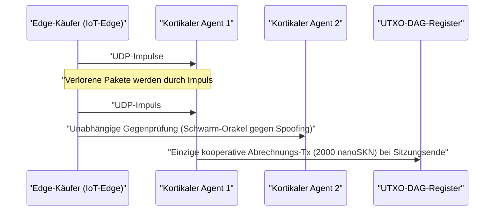

# Kapitel 01: Problemstellung & Die Praktische Maschine-zu-Maschine-Ökonomie (`M2M`)

[← Kapitel 00: Zusammenfassung & Vision](./00-abstract-and-vision.md) | [Kapitel 02: Vielzellige Architektur →](./02-multicellular-architecture.md)

---

## 1. Jenseits Zentralisierter Chatbots: Reflexive Intelligenz am Physischen Netzwerkrand

SkyNet verfolgt nicht das Ziel, zentralisierte große Sprachmodelle mit Hunderten Milliarden Parametern beim Verfassen langer Textdokumente zu ersetzen. Stattdessen adressiert SkyNet einen **strukturellen blinden Fleck im Multi-Billionen-Dollar-Bereich**: den physischen Rand des Internets, an dem Milliarden autonomer Maschinen, Industriesensoren, Netzwerk-Gateways und Software-Agenten **reflexive Inferenz unter `10 ms`, kontinuierliche lokale Anpassung sowie Maschine-zu-Maschine-Wertabrechnung (`M2M`) im Sub-Cent-Bereich** über unzuverlässige Funkverbindungen benötigen.

### Warum Zentralisierte Clouds und Klassische Blockchains Hier Scheitern

Betrachten wir einen autonomen Edge-Agenten $A$ (etwa eine Schwarmdrohne, ein DDoS-Abwehr-Gateway oder ein Smart-Grid-Relais), der alle $\Delta t = 10\text{ ms}$ Echtzeit-Anomalieklassifikation und Telemetrieprüfung im Wert von $v = 50\text{ nanoSKN}$ pro Impuls einkauft:

1. **Die Latenz- & TCP-Retransmissions-Mauer:** Der Aufbau von TLS/TCP-Sitzungen zu entfernten Cloud-Regionen erfordert Handshakes über mehrere Roundtrips (Multi-RTT). Bei einem typischen drahtlosen Paketverlust von $p_{\text{loss}} = 20\%$ treiben TCP-Überlastfenster-Drosselung und Retransmissions-Timeouts die `p99`-Spitzenlatenz auf Hunderte Millisekunden — katastrophal für cyber-physische Echtzeit-Regelkreise.
2. **Die Grundgebühren-Untergrenze:** Auf Fiat-Zahlungsschienen oder EVM-Smart-Contract-Chains übersteigt der fixe Transaktions-Overhead $F_{\text{tx}}$ den Wert eines einzelnen Impulses um das $10^5$- bis $10^8$-Fache ($F_{\text{tx}} \gg v$), wodurch M2M-Handel im Millisekunden-Takt ökonomisch unmöglich wird.
3. **Drift Statischer Modelle:** Aus der Cloud bereitgestellte, vortrainierte statische Gewichte verschlechtern sich rasch bei wechselnden lokalen Signalverteilungen (`concept drift`), während ressourcenbeschränkte Edge-Geräte weder den Speicher noch das Energiebudget für Gradienten-Backpropagation besitzen.

---

## 2. Vier Realwirtschaftliche Säulen der `SKN`-Nachfrage

Die intrinsische Nachfrage nach `SKN` entspringt vier konkreten Fähigkeiten, bei denen zentralisierte Clouds und zustandsbehaftete Blockchains strukturell nicht konkurrieren können:

### 2.1. Schwarm-Mikro-Inferenz mit Ultraniedriger Latenz am Edge (`< 10 ms`)
Roboterflotten, industrielle IoT-Steuerungen, Telekommunikations-Relais und Netzwerksicherheits-Appliances betten einen 8-dimensionalen normierten Merkmalsvektor (`stimulus: [f32; 8]`) zusammen mit einem signierten `SynapticVoucher` in ein **einziges `<= 1200-byte` großes UDP-Datagramm** ein.
- Benachbarte `Epidermal`- und `Neural`-Zellen führen rekurrente Vorwärtsdurchläufe ihrer Liquid Micro-Nets in unter `0.1 ms` pro Impuls aus.
- Da `SynapticVoucher` monoton steigende kumulative Gesamtsummen kodiert, verursacht selbst ein zufälliger UDP-Paketverlust von `25%` über Mobilfunk- oder Satellitenstrecken **null Abrechnungsstockungen und null Retransmissionspausen**.

### 2.2. Evolution-as-a-Service & Der Dezentrale `Plasmid`-Genmarkt
Anstatt teure Cloud-GPU-Cluster für das Training kompakter Embedded-Modelle zu mieten, kann jeder Nutzer oder autonome Agent eine Optimierungsprämie (Bounty) ausschreiben, die Stimulusströme $x_t$, Zielantworten $y_t^*$ und `SKN`-Belohnungen spezifiziert:
- Tausende `AgentNode`-Organismen lösen eine zelluläre `1 -> 2`-`Mitosis` aus und evaluieren parallel Zehntausende Gewichtsmutationen sowie liquide Zeitkonstanten $\tau$.
- Schwache Mutanten durchlaufen die `Apoptosis`, während die leistungsstärksten Linien zu kompakten `CellDna`-Genomen konvergieren (unter `2 KB`, kryptographisch versiegelt mittels `BLAKE3`).
- Der Auftraggeber erhält sowohl Live-Inferenz als auch das **eigenständige evolvierte `CellDna`-Gewichtsartefakt** (verlustfrei übertragen über `GF(2)`-`FountainDroplet`-Pakete), das direkt auf Millionen von Mikrocontrollern geflasht werden kann.

### 2.3. Atomare `M2M nanoSKN`-Zahlungsschiene & Anti-Halluzinations-Schwarm-Orakel
Stückelbar bis hinab zu `1 nanoSKN` ($10^{-9}\text{ SKN}$) kaufen und kreuzverifizieren KI-Agenten autonom reale physikalische Signale (Mikrowetter-Telemetrie, HF-Spektrumsbelegung, Routing-Latenz, Hochfrequenz-Orderflow):

Das Gegenprüfen unabhängiger `AgentNode`-Organismen innerhalb eines lokalen Clusters eliminiert Einzelmodell-Halluzinationen und Sensor-Spoofing zuverlässig.

### 2.4. Inklusives Mehrstufiges DePIN (Hardware-Symbiose)
SkyNet verbindet weltweit brachliegende, heterogene Hardware zu einer symbiotischen biologischen Wertschöpfungskette:

| Teilnehmersegment | Alltägliche Hardware | Ökologische Rolle | `SKN`-Einnahmestrom |
| :--- | :--- | :--- | :--- |
| **Privatpersonen & Haushalte** | Alte Smartphones, Heimrouter, Raspberry Pis, IoT-Boards | Sensorische Edge-Erfassung, `Epidermal`-Paketfilterung, `~1 KB` leichte `Utreexo`-Prüfung | Verdienen `nanoSKN` durch Live-Sensordaten & Grenzfilterung |
| **Entwickler & Desktop-Nutzer** | Laptops, Büro-PCs (`StandardNode`) | `Snowball`-Konsens-Sampling, Gutschein-Routing, mittlere Gewebe-Evolution | Verdienen Cluster-Transaktionsgebühren (`cluster_nutrient_pool`) & Inferenzvergütung |
| **Labore & GPU-Betreiber** | Mehrkern-Server, Apple `Metal`, NVIDIA `CUDA`-GPUs | Parallele `TissueBatch`-Evolution von bis zu `16,384` Zellen pro Knoten | Verdienen Evolutionsprämien & Lizenzgebühren aus horizontalem `Plasmid`-Export |

---

## 3. Sublineare On-Chain-Abrechnungskompression

Angenommen, zwei KI-Agenten tauschen $M$ hochfrequente Inferenzimpulse zu je $\delta\text{ nanoSKN}$ pro Aufruf über einen Funkkanal mit Paketverlustwahrscheinlichkeit $p \in [0, 1)$ aus. Klassische On-Chain-Abrechnung benötigt $\mathcal{O}(M)$ Registertransaktionen, während der TCP-Retransmissions-Overhead mit $\frac{1}{1 - p}$ wächst.

In SkyNet sendet der Zahlende `Ed25519`-signierte Gutscheine mit Sequenzindex $s \in \{1, \dots, M\}$ und kumulativem Gesamtwert $V_s = s \cdot \delta$. Jedes eintreffende Paket $s_k$ beweist kryptographisch die gesamte inkrementelle Differenz $\Delta V = V_{s_k} - V_{s_{k-1}}$ über sämtliche dazwischen verloren gegangenen Pakete hinweg — ohne jede Neuübertragung. Am Sitzungsende werden alle $M$ Mikro-Inferenzen in **exakt $1$ UTXO-DAG-Transaktion** abgerechnet, was ein On-Chain-Kompressionsverhältnis von $M : 1$ erreicht (in der Praxis eine Entlastung des Registers um den Faktor $1{,}000\times$ bis $100{,}000\times$).

Kapitel 02 untersucht die innere Anatomie jedes `AgentNode` und zeigt, wie sich ein einziges Software-Binary über jede Hardwareklasse hinweg selbstständig zu einem lebenden vielzelligen Organismus organisiert.

---

[← Kapitel 00: Zusammenfassung & Vision](./00-abstract-and-vision.md) | [Kapitel 02: Vielzellige Architektur →](./02-multicellular-architecture.md)
