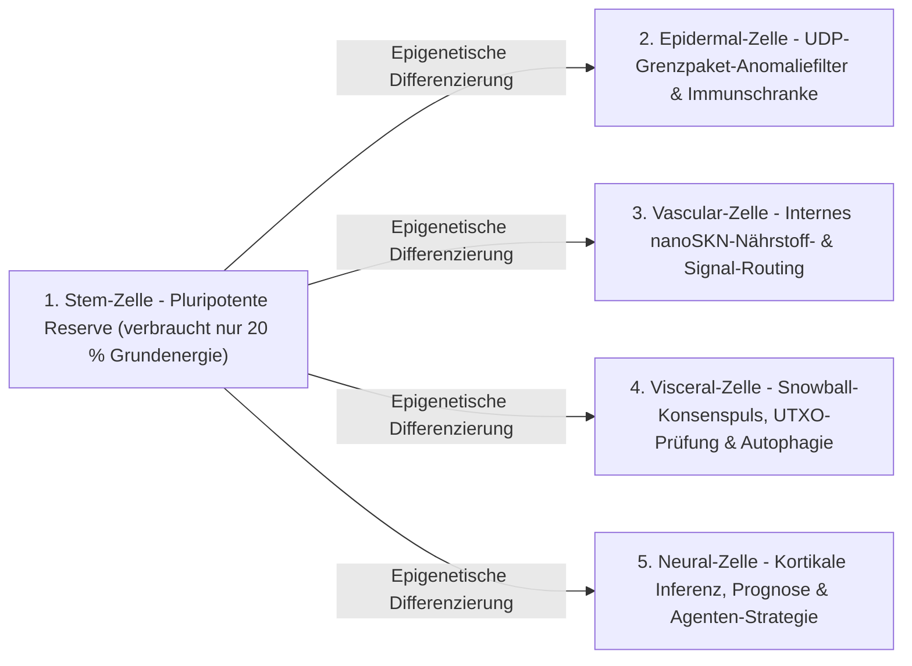

# Kapitel 02: Architektur des Vielzelligen Organismus & Elastische Hardware-Skalierung (`AgentNode`)

[← Kapitel 01: Problemstellung & M2M-Ökonomie](./01-problem-and-m2m-economy.md) | [Kapitel 03: `CellDna` & Liquide Neuronalzellen →](./03-dna-and-liquid-neural-cells.md)

---

## 1. Biologische Isomorphie: `1 Knoten = 1 Vielzelliger Organismus`

In herkömmlichen Peer-to-Peer-Netzwerken führt jeder Knoten einen monolithischen, starren Zustandsautomaten aus — unabhängig davon, ob er auf einem eingebetteten Mikrocontroller oder einem 64-Kern-GPU-Server läuft. In SkyNet (`crates/skynet-agent`) wird jeder Netzwerkteilnehmer als **`AgentNode`** instanziiert: ein lebender vielzelliger Organismus, bestehend aus einer dynamischen Population von Mikro-KI-Zellen $\mathcal{C}(t) = \{c_1, c_2, \dots, c_{N(t)}\}$, einer internen Stoffwechsel-Schatzkammer (`AgentMetabolicBank`), einem zustandslosen `Utreexo`-Wurzelprüfer (`StatelessUtreexoRoots`) und einer verlusttoleranten `SnowballEngine`.

Die Zellpopulationsgröße $N(t) = |\mathcal{C}(t)|$ ist niemals fest einprogrammiert; sie **wächst durch `Mitosis` und schrumpft durch `Apoptosis` auf organische Weise entsprechend der Host-Hardwarekapazität und dem Zufluss verdienter `nanoSKN`-Nährstoffe**.

---

## 2. Drei Elastische Hardware-Stufen (`HardwareTier`)

Beim Start bildet `HardwareProfile::for_tier` die Leistungsfähigkeit des Hosts auf eines von drei ökologischen Profilen mit exakten metabolischen `nanoSKN`-Schwellenwerten ab (`crates/skynet-cell/src/lib.rs`):

| Biologischer Parameter (`HardwareProfile`) | `TinyPeripheral` (IoT / Edge-MCU) | `StandardNode` (Laptop / Desktop-PC) | `ColossalOrganism` (Server / GPU) |
| :--- | :--- | :--- | :--- |
| **Maximale Zellpopulation (`max_cells`)** | `32` Zellen | `512` Zellen | `16,384` Zellen |
| **Aktiver Grundumsatz / Tick (`basal_burn_per_tick`)** | `50 nanoSKN` | `25 nanoSKN` | `10 nanoSKN` |
| **Ruhender `Stem`-Umsatz / Tick (80 % Ersparnis)** | `10 nanoSKN` | `5 nanoSKN` | `2 nanoSKN` |
| **Teilungsschwelle (`mitosis_threshold`)** | `2,000 nanoSKN` | `1,500 nanoSKN` | `1,000 nanoSKN` |
| **Teilungs-Blutgebühr (`mitosis_blood_fee`)** | `100 nanoSKN` | `60 nanoSKN` | `40 nanoSKN` |
| **Eliminations-Untergrenze (`apoptosis_floor`)** | `100 nanoSKN` | `80 nanoSKN` | `50 nanoSKN` |
| **Rechen-Backend (`candle_core::Device`)** | `Cpu` | `Cpu` / `Metal` / `Cuda` | `Cuda` / `Metal` / `Cpu` SIMD |

> [!NOTE]
> **Biologische Skaleneffekte (Kleibersches Gesetz):** Ebenso wie größere biologische Organismen geringere Stoffwechselkosten pro Gramm Gewebe aufweisen, verzeichnen `ColossalOrganism`-Knoten einen niedrigeren Grundumsatz pro Zelle (`10 nanoSKN` gegenüber `50 nanoSKN`), da Tausende Zellen ihre Ausführung in einem einzigen gebündelten GPU-Tensorkern amortisieren, während `TinyPeripheral`-Knoten am Netzwerkrand schlank und widerstandsfähig bleiben.

---

## 3. Fünf Spezialisierte Histologische Zelllinien (`CellRole`)

Wenn ein `AgentNode` entsteht (`AgentNode::from_signing_key`), initialisiert er einen embryonalen Keim aus 6 Zellen (`2 Stem`, `1 Epidermal`, `1 Vascular`, `1 Visceral`, `1 Neural`), abgeleitet aus einem deterministischen `base_stem`-Genom. Über die gesamte Lebensspanne des Organismus hinweg erfüllen fünf histologische Zelllinien fünf essenzielle physiologische Aufgaben:

1. **`Stem` (Pluripotente Reserve — `operon_index = None`):** Ruhende regenerative Stammzellen, die pro Tick lediglich $\max(\lfloor E_{\text{burn}} / 5 \rfloor, 1)$ verbrauchen. Sobald ein spezialisiertes Organ Zellschwund erleidet, differenziert sich eine `Stem`-Zelle epigenetisch (`differentiate`), um das Gewebe ohne externe Code-Downloads wieder aufzufüllen.
2. **`Epidermal` (Haut & Immunschranke — `operon_index = Some(0)`):** Bewacht den rohen UDP-Socket (`epidermal_inspect_packet`). Bevor ein eingehendes Paket das Register oder die Konsens-Engine erreicht, bewertet eine `Epidermal`-Zelle auf `candle` die normierte Pakettelemetrie (`raw_len / 1200`, `hop_ttl / 16`, `epoch`-Abweichung), um fehlerhafte oder flutende Impulse sofort zu verwerfen.
3. **`Vascular` (Kreislauf-Regulator — `operon_index = Some(1)`):** Reguliert die interne `blood_pool`-Liquidität innerhalb der `AgentMetabolicBank` und lenkt `nanoSKN`-Belohnungen gezielt zu präzise arbeitenden Zellen.
4. **`Visceral` (Organerhaltung — `operon_index = Some(2)`):** Steuert die `Snowball`-Abfragetaktung, die zustandslose `Utreexo`-Zeugenprüfung sowie das metabolische Recycling.
5. **`Neural` (Kortikales Gehirn — `operon_index = Some(3)`):** Führt kognitive Inferenz aus; das Ensemble-Mittel über alle lebenden `Neural`-Zellen ($\bar{y}_{\text{cortical}} = \frac{1}{|\mathcal{C}_{\text{neural}}|} \sum_{i \in \mathcal{C}_{\text{neural}}} y_i$) bildet den kollektiven Entscheidungsausgang des Organismus.

---

## 4. Der Sechsphasige Biologische Tick-Lebenszyklus (`run_biological_tick`)

Bei jedem Puls (`pulse_seq`) durchläuft `AgentNode` einen deterministischen sechsphasigen physiologischen Zyklus, der darwinistischen Wettbewerb mit exakter `u128`-`nanoSKN`-Erhaltung vereint:

1. **Phase 1 — Grundstoffwechsel (Basal Metabolism):** Jede Zelle $c_i$ verbrennt Erhaltungsenergie $b_i = \text{metabolize\_tick}()$. Entscheidend ist: $b_i$ wird niemals On-Chain vernichtet; 100 % des verbrauchten intrazellulären ATP fließen vollständig zurück in `bank.blood_pool`. Ausgehungerte Zellen ($E_i = 0$) verlieren `0.25` `health`.
2. **Phase 2 — Gebündelte `candle`-Tensor-Inferenz:** Alle $N$ lebenden Zellen werden gleichzeitig über `TissueBatch::forward_slice` ausgeführt, erzeugen Ausgaben $y_i \in \mathbb{R}^4$ und aktualisieren ihre kurzzeitigen liquiden Gedächtnisvektoren $h_{i,t} \in \mathbb{R}^{16}$.
3. **Phase 3 — Intra-Organische Darwinistische Nährstoffselektion:**
   Gegeben ein Zielsignal $t \in \mathbb{R}^4$, wird die Vorhersagegüte von Zelle $i$ über den beschränkten mittleren absoluten Fehler gemessen:

   $$q_i = \operatorname{clamp}\!\left(1 - \frac{1}{4}\sum_{k=1}^{4} |y_{i,k} - t_k|,\ 0.0,\ 1.0\right)$$

   Sei $\bar{q}_r$ die mittlere Güte aller Zellen derselben Organrolle $r = \text{role}(c_i)$. Eine spezialisierte Zelle erhält genau dann `nanoSKN`-Nährstoffe aus dem `blood_pool`, wenn ihr Organ $\le 2$ Zellen besitzt oder sie die intra-organische Wettbewerbsschwelle $q_i \ge 0.98 \cdot \bar{q}_r$ übertrifft:

   $$R_i = \min\!\left(\lfloor 320 \cdot q_i \rfloor + E_{\text{basal}},\ \left\lfloor \frac{B_{\text{blood}}}{8} \right\rfloor\right)$$

   Schwache Mutanten ($q_i < 0.98 \cdot \bar{q}_r$) erhalten null Nährstoffe und erleiden einen `health`-Abzug von `-0.35`.
4. **Phase 4 — Homöostatische Stammzelldifferenzierung:** Der Organismus ermittelt sein am stärksten unterbesetztes Spezialorgan (`find_most_needed_role`). Solange `stem_count > 1` gilt, differenziert sich eine `Stem`-Zelle in dieses Organ, wobei stets mindestens `1` Keimbahn-`Stem`-Zelle bewahrt bleibt.
5. **Phase 5 — `1 -> 2`-Mitose:** Gesunde, gut versorgte Zellen (`health >= 0.65` und $E_i \ge E_{\text{mitosis}}$) teilen sich bis zur Grenze `profile.max_cells` in einen konservativen Klon (Tochterzelle A) und einen mutierten Explorer (Tochterzelle B).
6. **Phase 6 — Organgeschützte Apoptose:** Ausgehungerte ($E_i < E_{\text{apoptosis}}$) oder kritisch geschädigte (`health <= 0.15`) Zellen lösen sich auf und führen 100 % ihrer verbleibenden `nanoSKN` an den `blood_pool` zurück — unter einer strikten Überlebensgarantie: **pro existierender `CellRole` bleibt bedingungslos mindestens `1` lebende Zelle erhalten**, sodass kein lebenswichtiges Organ jemals ausstirbt.

Am Ende jedes Ticks prüft `verify_internal_skn_conservation()` die exakte `u128`-Identität:

$$B_{\text{chain}}(\text{Agent}) \equiv B_{\text{blood}}(\text{Agent}) + \sum_{c_i \in \mathcal{C}} E_i$$

Kapitel 03 öffnet den Zellkern und spezifiziert den exakten Byte- und Mathematikaufbau von `CellDna`, die epigenetische Operon-Umschaltung sowie die 3D-`TissueBatch`-Ausführung liquider neuronaler Netze.

---

[← Kapitel 01: Problemstellung & M2M-Ökonomie](./01-problem-and-m2m-economy.md) | [Kapitel 03: `CellDna` & Liquide Neuronalzellen →](./03-dna-and-liquid-neural-cells.md)
