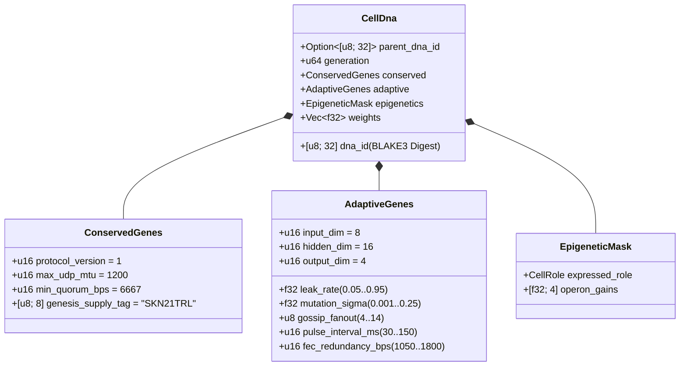

# Kapitel 03: Genetische Kodierung (`CellDna`), Epigenetik & Liquide Mikro-Neuronale Evolution auf `candle`

[← Kapitel 02: Vielzellige Architektur](./02-multicellular-architecture.md) | [Zurück zum Deutschen Index →](./README.md)

---

## 1. Architektur des Zellgenoms (`CellDna`)

Die biologische Evolution balanciert zwei gegensätzliche Kräfte aus: **strikte Konservierung** zentraler biochemischer Invarianten (bei denen Mutationen tödlich sind) und **kontinuierliche Variation** neuronaler sowie verhaltensbezogener Merkmale. Das Crate `skynet-dna` formalisiert diese Dualität innerhalb von `CellDna`:

### 1.1. Unveränderliche `ConservedGenes`
Weder Mutation noch horizontales Crossover können `ConservedGenes` verändern. Jedes Genom, das gegen eines der vier Konsenssicherheits-Prädikate verstößt, wird sofort mit `DnaError::ConservedGeneViolation` abgewiesen:
- `protocol_version == 1`
- `max_udp_mtu == 1200` (fragmentierungsfreie UDP-Obergrenze)
- $6667 \le \text{min\_quorum\_bps} \le 10000$ (erzwingt eine $\ge \frac{2}{3}$-Supermajorität in `Snowball`)
- `genesis_supply_tag == *b"SKN21TRL"` (verankert fest die Geldmengenobergrenze von 21 Billionen `SKN`)

### 1.2. `AdaptiveGenes` & Gewichtsarchitektur mit Gemeinsamem Stamm und Operon-Köpfen
Anstatt vier getrennte neuronale Netze für die vier spezialisierten Zelltypen zu speichern, kodiert `CellDna` **einen Gemeinsamen Sensorik-Stamm**, der **vier Spezialisierte Operon-Projektionsköpfe** speist. Für die Dimensionen $(D_{\text{in}}, H, D_{\text{out}})$ beträgt die exakte Anzahl der `f32`-Parameter:

$$|\theta| = \underbrace{(D_{\text{in}} \cdot H + H)}_{\text{Gemeinsamer Sensorik-Stamm }(W_1, b_1)} + \underbrace{4 \cdot (H \cdot D_{\text{out}} + D_{\text{out}})}_{\text{4 Spezialisierte Operon-Projektionen }(W_{2,r}, b_{2,r})}$$

Unter den Standarddimensionen $(D_{\text{in}} = 8,\ H = 16,\ D_{\text{out}} = 4)$ ergibt sich:
- Gemeinsamer Stamm: $8 \times 16 + 16 = 144$ Parameter.
- Vier Operon-Köpfe (`Epidermal`, `Vascular`, `Visceral`, `Neural`): $4 \times (16 \times 4 + 4) = 272$ Parameter.
- Gesamte Genomgewichte: $|\theta| = 416$ `f32`-Gleitkommazahlen ($1{,}664\text{ bytes}$ Rohgewichte). Stammgenome der Generation 0 (`CellDna::genesis_stem`) werden deterministisch über `ChaCha8Rng` gemäß $\mathcal{U}(-\sigma_0, +\sigma_0)$ mit Xavier-skalierter Schranke initialisiert:

$$\sigma_0 = \sqrt{\frac{2}{D_{\text{in}} + H}}$$

### 1.3. Deterministischer Kryptographischer `BLAKE3`-Digest (`SKYNET_DNA_V1`)
Jeder Gleitkomma-Hyperparameter und jedes Gewicht wird über kanonische Little-Endian-IEEE-754-Bitmuster (`to_bits().to_le_bytes()`) in einen domänengetrennten `BLAKE3("SKYNET_DNA_V1", ...)`-Hash serialisiert. Jede Einzelbit-Korruption, `NaN`/`Inf`-Injektion oder unautorisierte Gewichtsmanipulation führt in `verify_integrity()` zur sofortigen Zurückweisung.

---

## 2. Epigenetische Methylierungs-Umschaltung (`EpigeneticMask`)

In der Biologie vielzelliger Organismen tragen ein Neuron und eine epidermale Hautzelle identische DNA-Sequenzen, exprimieren jedoch durch Genmethylierung grundverschiedene Phänotypen. Wenn sich in SkyNet eine `Stem`-Zelle in eine Zielrolle $r \in \{0, 1, 2, 3\}$ differenziert (`CellDna::differentiate`), **bleibt der zugrunde liegende `weights`-Vektor zu 100 % unangetastet**, während `EpigeneticMask` die Expressionsverstärkung umschaltet:

- **Ruhender `Stem`-Zustand:** `operon_gains = [0.25, 0.25, 0.25, 0.25]`, Projektion über Operon-Kopf `0` mit gedämpfter Verstärkung $g = 0.25$.
- **Differenzierte Rolle $r$:** Operon-Kopf $r$ wird mit voller Verstärkung aktiviert ($g_r = 1.0$), während nicht exprimierte Köpfe auf $0.05$ unterdrückt werden:

$$g_k = \begin{cases} 1.0 & \text{falls } k = r \\ 0.05 & \text{falls } k \neq r \end{cases}$$

Dadurch bleiben im gemeinsamen Stamm $(W_1, b_1)$ erlernte sensorische Repräsentationen sowie latente Anpassungen in ruhenden Köpfen über Generationen hinweg erhalten und stehen bei einer Transdifferenzierung unmittelbar wieder bereit.

---

## 3. Liquid-Time-Constant-Dynamik & 3D-`TissueBatch`-Ausführung

### 3.1. Rekurrente Liquide Dynamik einer Einzelzelle
Zustandslose vorwärtsgerichtete MLPs können zeitliche Korrelationen über asynchrone UDP-Paketströme hinweg nicht erfassen. Jede `MicroCell` führt daher einen rekurrenten Kurzzeit-Gedächtnisvektor $h_t \in \mathbb{R}^H$, gesteuert durch diskrete **Liquid Time-Constant (LTC)**-Zustandsinterpolation mit evolvierbarer Leckrate $\tau \in [0.05, 0.95]$:

$$h_t = (1 - \tau)\, h_{t-1} + \tau\, \tanh(x_t W_1 + b_1)$$

$$y_t = g_{\text{role}} \cdot \tanh(h_t W_{2,r} + b_{2,r})$$

- Für $\tau \to 0.05$ bewahrt die Zelle eine hohe Gedächtnisträgheit über lange Zeithorizonte (ideal für Trendverfolgung in `Visceral`- und `Neural`-Zellen).
- Für $\tau \to 0.95$ reagiert die Zelle verzögerungsfrei auf hochfrequente Grenzimpulse (ideal für Anomaliebewertung in `Epidermal`-Zellen).
- Da $\tau$ Teil von `AdaptiveGenes` ist, **evolviert der zeitliche Gedächtnishorizont jeder Zelle auf natürliche Weise gemeinsam mit ihren synaptischen Gewichten**.

### 3.2. Hochdurchsatz-3D-`TissueBatch`-Tensor-Engine (`Cpu` / `Metal` / `Cuda`)
Ein klassischer Engpass der Neuro-Evolution ist die Gewichtsheterogenität: Jede Zelle $i \in \{1, \dots, N\}$ trägt individuelle mutierte Matrizen $W_1^{(i)} \neq W_1^{(j)}$ sowie individuelle Leckraten $\tau^{(i)} \neq \tau^{(j)}$. Das sequenzielle Starten von $N$ Mikro-Kernen würde moderne GPUs unausgelastet lassen.

`TissueBatch::forward_slice` in `skynet-cell` löst dieses Problem, indem alle $N$ heterogenen Zellen in zusammenhängende Rang-3-Tensoren auf `candle_core::Device` gepackt werden:

$$\mathbf{X} \in \mathbb{R}^{N \times 1 \times D_{\text{in}}}, \quad \mathbf{W}_1 \in \mathbb{R}^{N \times D_{\text{in}} \times H}, \quad \mathbf{B}_1 \in \mathbb{R}^{N \times 1 \times H}$$

$$\mathbf{H}_t = (\mathbf{1} - \boldsymbol{\tau}) \odot \mathbf{H}_{t-1} + \boldsymbol{\tau} \odot \tanh\!\big(\operatorname{BMM}(\mathbf{X}, \mathbf{W}_1) + \mathbf{B}_1\big)$$

$$\mathbf{Y}_t = \mathbf{G} \odot \tanh\!\big(\operatorname{BMM}(\mathbf{H}_t, \mathbf{W}_2) + \mathbf{B}_2\big)$$

wobei $\operatorname{BMM}$ für Batched Matrix Multiplication innerhalb eines einzigen Kernels steht und $\odot$ die elementweise Multiplikation mit Dimensions-Broadcasting für $\boldsymbol{\tau}, \mathbf{G} \in \mathbb{R}^{N \times 1 \times 1}$ bezeichnet. Geprüfte Unit-Tests bestätigen, dass `TissueBatch` mit der Einzelzell-Ausführung bis auf eine Gleitkommatoleranz von $< 10^{-5}$ übereinstimmt und gleichzeitig auf bis zu `16,384` simultan evolvierte Modelle pro `ColossalOrganism` skaliert.

---

## 4. Asymmetrische Mitose, Exakte Ungerade `nanoSKN`-Erhaltung & Plasmid-Crossover

### 4.1. Asymmetrische `1 -> 2`-`Mitosis` & Beweis der Exakten Atomaren Erhaltung
Sobald eine Elternzelle $P$ die Bedingungen $E_P \ge \max(E_{\text{mitosis}}, F_{\text{blood}} + 2)$ sowie `health >= 0.65` erfüllt, erzeugt `divide_mitosis` zwei Tochterzellen der Generation $(g+1)$:
- **Tochterzelle A (Konservativer Klon):** Übernimmt 100 % der bewährten Elterngewichte und adaptiven Parameter ohne jede Veränderung.
- **Tochterzelle B (Mutierter Explorer):** Erbt die Kontinuität des elterlichen `hidden_state` und durchläuft zugleich eine beschränkte neuro-evolutionäre Mutation:
  - Jedes Gewicht $w \in \theta$ mutiert mit Wahrscheinlichkeit $0.35$ über eine abhängigkeitsfreie 6-Stichproben-Irwin-Hall-Gauß-Störung ($\Delta w \sim \mathcal{N}(0, \sigma^2)$), strikt begrenzt auf $[-4.0, +4.0]$, um Gewichts- oder Gradientenexplosionen auszuschließen.
  - $\tau$, $\sigma$, `gossip_fanout` ($\pm 1$), `pulse_interval_ms` ($\pm 10\text{ ms}$) und `fec_redundancy_bps` ($\pm 50\text{ bps}$) ko-mutieren innerhalb fest definierter zulässiger Intervalle.

**Beweis der Verlustfreien Erhaltung bei Ungeraden `nanoSKN`-Beträgen:** Sei $E_{\text{dist}} = E_P - F_{\text{blood}}$ das nach Abzug der Blutgebühr verteilbare ATP. Die Guthaben der Tochterzellen werden mittels ganzzahliger Quotient-Rest-Arithmetik auf `u128` aufgeteilt:

$$E_A = \left\lfloor \frac{E_{\text{dist}}}{2} \right\rfloor + (E_{\text{dist}} \bmod 2), \qquad E_B = \left\lfloor \frac{E_{\text{dist}}}{2} \right\rfloor$$

Für jede nicht-negative ganze Zahl $E_{\text{dist}} \in \mathbb{Z}_{\ge 0}$ (einschließlich ungerader Guthaben wie `3,333 nanoSKN`) gilt identisch die exakte Erhaltung:

$$E_A + E_B + F_{\text{blood}} = \left(2\left\lfloor \frac{E_{\text{dist}}}{2} \right\rfloor + (E_{\text{dist}} \bmod 2)\right) + F_{\text{blood}} = E_{\text{dist}} + F_{\text{blood}} \equiv E_P$$

Über Milliarden von Zellteilungen hinweg geht kein einziges `nanoSKN` durch Rundung verloren, noch entsteht jemals eines aus dem Nichts.

### 4.2. Horizontaler Gentransfer Zwischen Agenten (`Plasmid`-Crossover)
Analog zum bakteriellen Plasmidaustausch exportiert ein `AgentNode` die `CellDna` seiner fittesten Zelle in löschkodierte UDP-`FountainDroplet`-Pakete (`encode_elite_plasmid_droplets`). Nach der Rekonstruktion von `donor_dna` über verlustbehaftete UDP-Verbindungen rüstet ein empfangender Agent seine schwächste Zelle über `horizontal_crossover` auf:
- Adaptive Netzwerk- und Zeitkonstanten-Merkmale mischen sich gemäß $0.7 \cdot \text{Recipient} + 0.3 \cdot \text{Donor}$.
- $30\%$ der synaptischen Gewichte werden gleichmäßig gemäß $0.5 \cdot w_{\text{rec}} + 0.5 \cdot w_{\text{don}} \in [-4.0, +4.0]$ gemittelt.

Durch diesen horizontalen Plasmidtransfer absorbiert selbst ein ressourcenbeschränkter `TinyPeripheral`-IoT-Sensor erstklassige neuronale Intelligenz, die auf entfernten GPU-`ColossalOrganism`-Knoten evolviert wurde, während die Sicherheit der `ConservedGenes` kryptographisch gewahrt bleibt.

---

> **Ausblick auf Phase 2 (Teil II):** Die Kapitel `04–06` formalisieren die Mathematik des `21,000,000,000,000 SKN`-Halving-Tresors, den `Soul–Body`-Vertrag für Souveräne Menschliche Verwahrung sowie die Register-Skalierung mit `~1 KB` zustandslosem `Utreexo` und `SynapticVoucher`-Kanälen.

[← Kapitel 02: Vielzellige Architektur](./02-multicellular-architecture.md) | [Zurück zum Deutschen Index →](./README.md)
