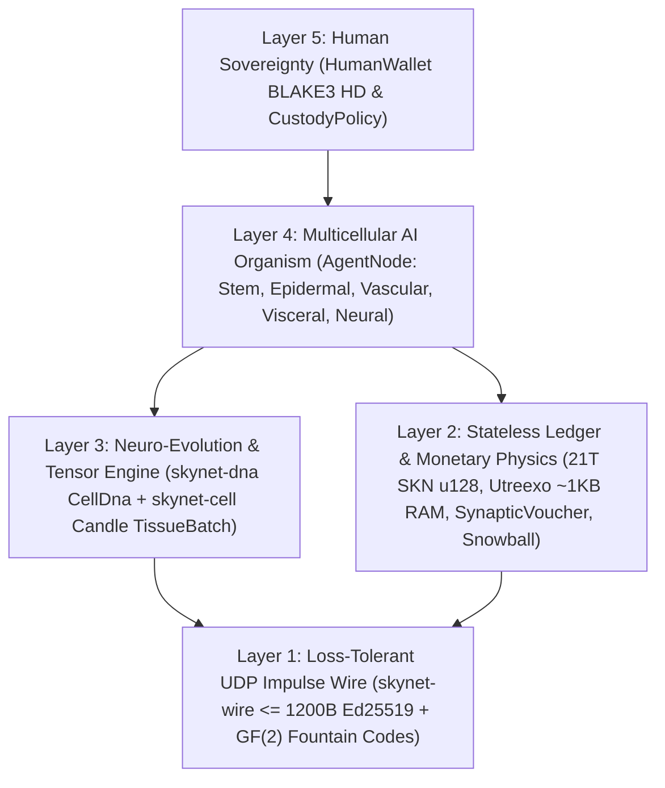

# Chapter 00: Academic Abstract, Protocol Axioms & Global Participation Philosophy

[← Back to English Index](./README.md) | [Chapter 01: Problem Statement & M2M Economy →](./01-problem-and-m2m-economy.md)

---

## Abstract

We present **SkyNet**, a decentralized network protocol unifying **multicellular evolutionary biology**, **ultra-compact Liquid Time-Constant neural networks (`Liquid Micro-Nets`)**, and a **statelessly verifiable `Utreexo` UTXO-DAG ledger**, operating entirely over **connectionless, loss-tolerant UDP datagrams (`<= 1200 bytes`)**. Unlike centralized AI clouds requiring hyperscale GPU clusters or stateful blockchains bound to reliable TCP streams, SkyNet defines every network participant (`AgentNode`) as an **autonomous multicellular organism** composed of tens to tens of thousands of living micro-AI models (`MicroCell`). Every cell originates from a cryptographically verifiable pluripotent stem genome (`CellDna` authenticated via `BLAKE3`), differentiates through an epigenetic methylation mask (`EpigeneticMask`) into five specialized histological lineages, divides `1 -> 2` with bounded neuro-evolutionary mutations (`Mitosis`), exchanges elite traits across organisms via `GF(2)` erasure-coded horizontal gene transfer (`Plasmid`), and undergoes programmed elimination when starved (`Apoptosis`).

To anchor this biological intelligence economy in strict thermodynamic and monetary scarcity, SkyNet enforces an immutable Genesis supply cap of $S_{\max} = 21{,}000{,}000{,}000{,}000\text{ SKN}$ ($2.1 \times 10^{22}\text{ nanoSKN}$, represented losslessly in `u128`), governed by an annual `50%` halving emission schedule and a **Two-Tier Isomorphic Energy Conservation Law** spanning on-chain UTXO balances down to individual intracellular `1 nanoSKN` ATP reserves. Through a protocol-level **Soul–Body Custody** covenant (`CustodyPolicy`), human owners retain `0%`-decay sovereign cold-wallet keys with unconditional emergency recovery rights, while delegating strictly bounded operational allowances to online AI Agent fleets. Finally, metastable **`Snowball`** sub-sampling combined with monotonic **`SynapticVoucher`** micro-payment streams achieves irreversible double-spend finality and high-frequency M2M settlement across `25%–40%` ambient UDP packet loss with zero retransmission queues.

---

## 1. Motivation & The Infrastructure Paradox

Contemporary digital infrastructure is fractured between two extremes that exclude billions of edge devices worldwide:

1. **Centralized AI Monopolization:** Frontier Large Language Models concentrate machine intelligence inside multi-megawatt data centers. An agricultural IoT sensor, an autonomous drone, or a modest personal computer on an unstable rural link cannot afford hundred-millisecond TCP/TLS round-trips or cloud API billing overhead merely to execute sub-`10 ms` reflexive intelligence.
2. **Blockchain State Bloat & TCP Fragility:** Legacy smart-contract ledgers demand hundreds of gigabytes of RAM/NVMe storage to maintain global account state and assume reliable TCP byte streams. Over lossy wireless links, cellular handoffs, or congested edge routers, TCP `Head-of-Line Blocking` paralyzes both consensus messaging and real-time micro-commerce.

**SkyNet asks a foundational biological question:** *How does nature coordinate billions of adaptive intelligent organisms across noisy physical environments without a central server or lossless transport?* Nature's answer is **cellular modularity**, **epigenetic specialization**, **loss-tolerant synaptic impulses**, and **strict metabolic energy conservation**.

---

## 2. Five Core Protocol Axioms

Every crate in the SkyNet Rust reference workspace derives from five non-negotiable axioms:

| Axiom | Formal / Engineering Statement | Practical Consequence |
| :--- | :--- | :--- |
| **A1. Cell–Model Isomorphism** | $1\text{ Node} \equiv 1\text{ Organism } \mathcal{O} = \{c_1, \dots, c_N\}$, where each $c_i$ is an independent Liquid Micro-Net | A `TinyPeripheral` IoT board (`32` cells) and a `ColossalOrganism` GPU server (`16,384` cells) speak the exact same protocol |
| **A2. Atomic Zero-ACK UDP Discipline** | $\forall p \in \text{Wire},\ \|p\| \le 1200\text{ bytes}$, zero retransmission state | Eliminates `Head-of-Line Blocking` completely; traverses global IPv4/IPv6 paths without IP fragmentation |
| **A3. Two-Tier Energy Conservation** | $S_{\text{vault}} + S_{\text{dag}} \equiv 2.1 \times 10^{22}\text{ nanoSKN}$ and $B_{\text{chain}}(A) \equiv B_{\text{blood}}(A) + \sum_i E_i$ | Zero monetary inflation and zero rounding leakage — even down to `1 nanoSKN` during odd-amount cell division |
| **A4. `O(log U)` Stateless Verification** | Full UTXO set committed into $\le 64$ `Utreexo` binary Merkle roots (`~1 KB` RAM) | Microcontrollers and edge sensors independently verify every spend without trusting RPC intermediaries |
| **A5. Sovereign Human Custody** | Cold `human_owner` root separated from online `agent_pubkey` via `CustodyPolicy` | Compromised or destroyed Agent hardware can never steal human principal; humans reclaim 100% of funds anytime |

---

## 3. Five-Layer Architectural Stack

---

## 4. Universal Hardware Democracy: A Role for Every Device on Earth

SkyNet rejects exclusionary proof-of-work ASICs and exorbitant validator minimums. Through histological specialization, every class of computing hardware contributes organic value:

- **Anyone with a smartphone, Raspberry Pi, or IoT device (`TinyPeripheral`):** Serves as the network's **"Sensory & Epidermal Boundary"** — capturing real-world telemetry, filtering anomalous UDP traffic at the edge, verifying UTXOs in `< 1 KB` of RAM via `Utreexo`, and earning streaming `nanoSKN`.
- **Anyone with a home laptop or office PC (`StandardNode`):** Serves as **"Visceral & Vascular Cluster Tissue"** — driving `Snowball` consensus pulses, routing voucher settlement, and evolving mid-sized cellular populations.
- **Operators with workstations or GPUs (`ColossalOrganism`):** Serve as **"Cortical & Evolutionary Foundries"** — executing `16,384` mutated neural models in parallel via `TissueBatch` tensor kernels and exporting elite `Plasmid` genomes back to edge nodes worldwide.

In Chapter 01, we examine the concrete real-world economic markets where this bio-cellular architecture delivers orders-of-magnitude superiority over centralized AI clouds and legacy blockchains.

---

[← Back to English Index](./README.md) | [Chapter 01: Problem Statement & M2M Economy →](./01-problem-and-m2m-economy.md)
