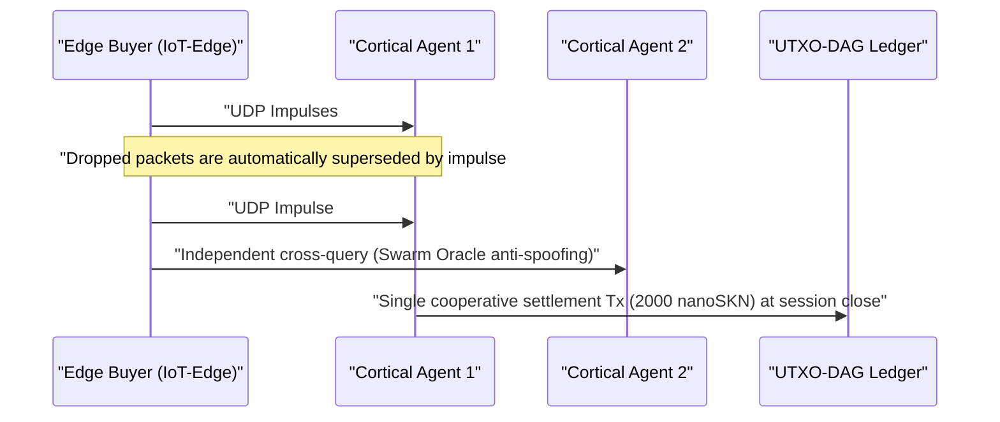

# Chapter 01: Problem Statement & The Practical Machine-to-Machine (`M2M`) Economy

[← Chapter 00: Abstract & Vision](./00-abstract-and-vision.md) | [Chapter 02: Multicellular Architecture →](./02-multicellular-architecture.md)

---

## 1. Beyond Centralized Chatbots: Reflexive Intelligence at the Physical Edge

SkyNet does not aim to replace centralized hundred-billion-parameter Large Language Models for long-form document drafting. Instead, SkyNet targets a **multi-trillion-dollar structural blind spot**: the physical edge of the internet where billions of autonomous machines, industrial sensors, network gateways, and software agents require **sub-`10 ms` reflexive inference, continuous local adaptation, and sub-cent machine-to-machine (`M2M`) value settlement** across unreliable wireless links.

### Why Centralized Clouds and Legacy Blockchains Fail Here

Consider an autonomous edge agent $A$ (such as a swarm drone, DDoS mitigation gateway, or smart-grid relay) purchasing real-time anomaly classification and telemetry verification every $\Delta t = 10\text{ ms}$, valued at $v = 50\text{ nanoSKN}$ per impulse:

1. **The Latency & TCP Retransmission Wall:** Establishing TLS/TCP sessions to distant cloud regions incurs multi-RTT handshakes. Under ambient wireless packet loss of $p_{\text{loss}} = 20\%$, TCP congestion window backoff and retransmission timeouts push `p99` tail latency into hundreds of milliseconds — catastrophic for real-time cyber-physical control loops.
2. **The Base-Fee Floor:** On fiat payment rails or EVM smart-contract chains, fixed per-transaction overhead $F_{\text{tx}}$ exceeds single-impulse value by $10^5\times$ to $10^8\times$ ($F_{\text{tx}} \gg v$), rendering millisecond-granularity M2M commerce economically impossible.
3. **Static Model Drift:** Pre-trained static weights deployed from a cloud quickly degrade under shifting local signal distributions (`concept drift`), while constrained edge devices lack the memory and power budget to run gradient backpropagation.

---

## 2. Four Real-World Economic Pillars Driving `SKN` Demand

Intrinsic demand for `SKN` arises from four concrete capabilities where centralized clouds and stateful blockchains cannot compete:

### 2.1. Ultra-Low-Latency Swarm Edge Micro-Inference (`< 10 ms`)
Robotics fleets, industrial IoT controllers, telecom relays, and network security appliances embed an 8-dimensional normalized feature vector (`stimulus: [f32; 8]`) alongside a signed `SynapticVoucher` inside a **single `<= 1200-byte` UDP datagram**.
- Neighboring `Epidermal` and `Neural` cells execute recurrent Liquid Micro-Net forward passes in under `0.1 ms` per impulse.
- Because `SynapticVoucher` encodes monotonically increasing cumulative totals, even `25%` random UDP packet loss over cellular or satellite links causes **zero billing stalls and zero retransmission pauses**.

### 2.2. Evolution-as-a-Service & The Decentralized `Plasmid` Gene Market
Instead of renting expensive cloud GPU clusters to train compact embedded models, any user or autonomous agent can broadcast an optimization bounty specifying stimulus streams $x_t$, target responses $y_t^*$, and `SKN` rewards:
- Thousands of `AgentNode` organisms trigger `1 -> 2` cellular `Mitosis`, evaluating tens of thousands of weight perturbations and liquid time constants $\tau$ in parallel.
- Weak mutants undergo `Apoptosis`, while top-performing lineages converge into compact `CellDna` genomes (under `2 KB`, cryptographically sealed by `BLAKE3`).
- The requester receives both live inference and the **standalone evolved `CellDna` weight artifact** (delivered losslessly via `GF(2)` `FountainDroplet` packets) ready to flash directly onto millions of microcontrollers.

### 2.3. Atomic `M2M nanoSKN` Payment Rail & Anti-Hallucination Swarm Oracles
Denominated down to `1 nanoSKN` ($10^{-9}\text{ SKN}$), AI Agents autonomously buy and cross-verify real-world physical signals (micro-weather telemetry, RF spectrum occupancy, routing latency, high-frequency orderflow):

Cross-sampling independent `AgentNode` organisms within a local cluster eliminates single-model hallucination and sensor spoofing.

### 2.4. Inclusive Multi-Tier DePIN (Hardware Symbiosis)
SkyNet unites heterogeneous idle hardware worldwide into a symbiotic biological supply chain:

| Participant Segment | Everyday Hardware | Ecological Role | `SKN` Revenue Stream |
| :--- | :--- | :--- | :--- |
| **Individuals & Households** | Old smartphones, home routers, Raspberry Pis, IoT boards | Edge sensory capture, `Epidermal` packet filtering, `~1 KB` `Utreexo` light verification | Earn `nanoSKN` from live sensor feeds & boundary filtering |
| **Developers & Desktop Users** | Laptops, office PCs (`StandardNode`) | `Snowball` consensus sampling, voucher routing, mid-scale tissue evolution | Earn cluster transaction fees (`cluster_nutrient_pool`) & inference pay |
| **Labs & GPU Operators** | Multi-core servers, Apple `Metal`, NVIDIA `CUDA` GPUs | `TissueBatch` parallel evolution of up to `16,384` cells per node | Earn evolution bounties & horizontal `Plasmid` export royalties |

---

## 3. Sub-Linear On-Chain Settlement Compression

Suppose two AI Agents exchange $M$ high-frequency inference impulses at $\delta\text{ nanoSKN}$ per call across a wireless channel with packet drop probability $p \in [0, 1)$. Legacy on-chain settlement requires $\mathcal{O}(M)$ ledger transactions while TCP retransmission overhead scales as $\frac{1}{1 - p}$.

In SkyNet, the payer emits `Ed25519`-signed vouchers indexed by sequence $s \in \{1, \dots, M\}$ carrying cumulative value $V_s = s \cdot \delta$. Any surviving packet $s_k$ cryptographically proves the entire incremental delta $\Delta V = V_{s_k} - V_{s_{k-1}}$ across all intermediate lost packets without retransmission. At session end, all $M$ micro-inferences settle in **exactly $1$ UTXO-DAG transaction**, achieving an $M : 1$ on-chain compression ratio ($1{,}000\times$ to $100{,}000\times$ ledger load reduction in practice).

Chapter 02 examines the internal anatomy of each `AgentNode` — showing how a single software binary self-organizes into a living multicellular organism across any hardware tier.

---

[← Chapter 00: Abstract & Vision](./00-abstract-and-vision.md) | [Chapter 02: Multicellular Architecture →](./02-multicellular-architecture.md)
