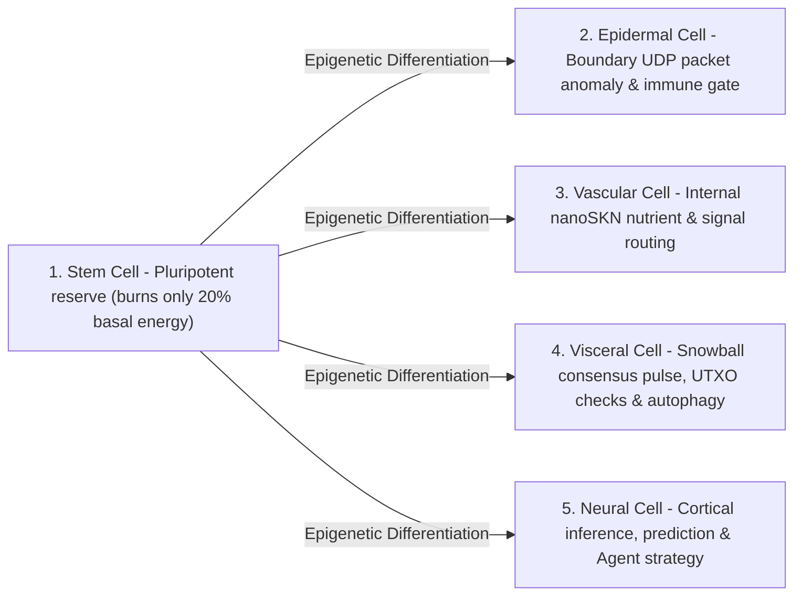

# Chapter 02: Multicellular Organism Architecture & Elastic Hardware Scaling (`AgentNode`)

[← Chapter 01: Problem Statement & M2M Economy](./01-problem-and-m2m-economy.md) | [Chapter 03: `CellDna` & Liquid Neural Cells →](./03-dna-and-liquid-neural-cells.md)

---

## 1. Biological Isomorphism: `1 Node = 1 Multicellular Organism`

In conventional peer-to-peer networks, every node executes a monolithic, rigid state machine regardless of whether it runs on an embedded microcontroller or a 64-core GPU server. In SkyNet (`crates/skynet-agent`), each network participant is instantiated as an **`AgentNode`** — a living multicellular organism comprising a dynamic population of micro-AI cells $\mathcal{C}(t) = \{c_1, c_2, \dots, c_{N(t)}\}$, an internal metabolic treasury (`AgentMetabolicBank`), a stateless `Utreexo` root verifier (`StatelessUtreexoRoots`), and a loss-tolerant `SnowballEngine`.

The cellular population size $N(t) = |\mathcal{C}(t)|$ is never hardcoded; it **expands via `Mitosis` and contracts via `Apoptosis` organically according to host hardware capacity and earned `nanoSKN` nutrient inflow**.

---

## 2. Three Elastic Hardware Tiers (`HardwareTier`)

At startup, `HardwareProfile::for_tier` maps host capacity into one of three ecological profiles with exact `nanoSKN` metabolic thresholds (`crates/skynet-cell/src/lib.rs`):

| Biological Parameter (`HardwareProfile`) | `TinyPeripheral` (IoT / Edge MCU) | `StandardNode` (Laptop / Desktop PC) | `ColossalOrganism` (Server / GPU) |
| :--- | :--- | :--- | :--- |
| **Maximum Cell Population (`max_cells`)** | `32` cells | `512` cells | `16,384` cells |
| **Active Basal Burn / Tick (`basal_burn_per_tick`)** | `50 nanoSKN` | `25 nanoSKN` | `10 nanoSKN` |
| **Dormant `Stem` Burn / Tick (80% savings)** | `10 nanoSKN` | `5 nanoSKN` | `2 nanoSKN` |
| **Division Threshold (`mitosis_threshold`)** | `2,000 nanoSKN` | `1,500 nanoSKN` | `1,000 nanoSKN` |
| **Division Blood Fee (`mitosis_blood_fee`)** | `100 nanoSKN` | `60 nanoSKN` | `40 nanoSKN` |
| **Elimination Floor (`apoptosis_floor`)** | `100 nanoSKN` | `80 nanoSKN` | `50 nanoSKN` |
| **Compute Backend (`candle_core::Device`)** | `Cpu` | `Cpu` / `Metal` / `Cuda` | `Cuda` / `Metal` / `Cpu` SIMD |

> [!NOTE]
> **Biological Economies of Scale (Kleiber's Law):** Just as larger biological organisms exhibit lower metabolic cost per gram of tissue, `ColossalOrganism` nodes incur lower per-cell basal burn (`10 nanoSKN` vs `50 nanoSKN`) because thousands of cells amortize execution inside a single batched GPU tensor kernel, whereas `TinyPeripheral` nodes stay lean and resilient at the network edge.

---

## 3. Five Specialized Histological Lineages (`CellRole`)

When an `AgentNode` spawns (`AgentNode::from_signing_key`), it initializes an embryonic 6-cell seed (`2 Stem`, `1 Epidermal`, `1 Vascular`, `1 Visceral`, `1 Neural`) derived from a deterministic `base_stem` genome. Throughout the organism's lifetime, five histological lineages fulfill five essential physiological functions:

1. **`Stem` (Pluripotent Reserve — `operon_index = None`):** Dormant regenerative cells consuming only $\max(\lfloor E_{\text{burn}} / 5 \rfloor, 1)$ per tick. Whenever any specialized organ suffers attrition, a `Stem` cell epigenetically differentiates (`differentiate`) to replenish it without external code downloads.
2. **`Epidermal` (Skin & Immune Gate — `operon_index = Some(0)`):** Guards the raw UDP socket (`epidermal_inspect_packet`). Before any incoming packet reaches the ledger or consensus engine, an `Epidermal` cell evaluates normalized packet telemetry (`raw_len / 1200`, `hop_ttl / 16`, `epoch` drift) on `candle` to drop malformed or flood impulses.
3. **`Vascular` (Circulatory Regulator — `operon_index = Some(1)`):** Regulates internal `blood_pool` liquidity inside `AgentMetabolicBank`, channeling `nanoSKN` rewards toward high-accuracy cells.
4. **`Visceral` (Organ Maintenance — `operon_index = Some(2)`):** Drives `Snowball` polling cadence, stateless `Utreexo` witness verification, and metabolic recycling.
5. **`Neural` (Cortical Brain — `operon_index = Some(3)`):** Executes cognitive inference; the ensemble mean across all living `Neural` cells ($\bar{y}_{\text{cortical}} = \frac{1}{|\mathcal{C}_{\text{neural}}|} \sum_{i \in \mathcal{C}_{\text{neural}}} y_i$) forms the organism's collective decision output.

---

## 4. The Six-Phase Biological Tick Lifecycle (`run_biological_tick`)

On every pulse (`pulse_seq`), `AgentNode` executes a deterministic six-phase physiological cycle uniting Darwinian competition with exact `u128` `nanoSKN` conservation:

1. **Phase 1 — Basal Metabolism:** Every cell $c_i$ burns maintenance energy $b_i = \text{metabolize\_tick}()$. Crucially, $b_i$ is never destroyed on-chain; 100% of burned intracellular ATP is recycled back into `bank.blood_pool`. Starved cells ($E_i = 0$) lose `0.25` `health`.
2. **Phase 2 — Batched `candle` Tensor Inference:** All $N$ living cells execute simultaneously via `TissueBatch::forward_slice`, producing outputs $y_i \in \mathbb{R}^4$ and updating short-term liquid memory vectors $h_{i,t} \in \mathbb{R}^{16}$.
3. **Phase 3 — Intra-Organ Darwinian Nutrient Selection:**
   Given target signal $t \in \mathbb{R}^4$, cell $i$'s prediction quality is measured via bounded Mean Absolute Error:

   $$q_i = \operatorname{clamp}\!\left(1 - \frac{1}{4}\sum_{k=1}^{4} |y_{i,k} - t_k|,\ 0.0,\ 1.0\right)$$

   Let $\bar{q}_r$ denote the mean quality across all cells sharing organ role $r = \text{role}(c_i)$. A specialized cell earns nutrient `nanoSKN` from `blood_pool` if and only if its organ has $\le 2$ cells or it beats the intra-organ competitiveness threshold $q_i \ge 0.98 \cdot \bar{q}_r$:

   $$R_i = \min\!\left(\lfloor 320 \cdot q_i \rfloor + E_{\text{basal}},\ \left\lfloor \frac{B_{\text{blood}}}{8} \right\rfloor\right)$$

   Underperforming mutants ($q_i < 0.98 \cdot \bar{q}_r$) receive zero nutrients and suffer a `-0.35` `health` penalty.
4. **Phase 4 — Homeostatic Stem Differentiation:** The organism identifies its most under-populated specialized organ (`find_most_needed_role`). Whenever `stem_count > 1`, one `Stem` cell differentiates into that organ while always preserving at least `1` germline `Stem` cell.
5. **Phase 5 — `1 -> 2` Mitosis:** Healthy, well-fed cells (`health >= 0.65` and $E_i \ge E_{\text{mitosis}}$) divide into a conservative clone (Daughter A) and a mutated explorer (Daughter B) up to `profile.max_cells`.
6. **Phase 6 — Organ-Protected Apoptosis:** Starved ($E_i < E_{\text{apoptosis}}$) or critically damaged (`health <= 0.15`) cells dissolve and return 100% of their remaining `nanoSKN` to `blood_pool` — subject to a strict survival safeguard: **at least `1` living cell per existing `CellRole` is unconditionally preserved** so no vital organ ever goes extinct.

At the close of every tick, `verify_internal_skn_conservation()` asserts the exact `u128` identity:

$$B_{\text{chain}}(\text{Agent}) \equiv B_{\text{blood}}(\text{Agent}) + \sum_{c_i \in \mathcal{C}} E_i$$

Chapter 03 opens the cell nucleus to specify the exact byte and mathematical structure of `CellDna`, epigenetic operon switching, and 3D `TissueBatch` Liquid Neural execution.

---

[← Chapter 01: Problem Statement & M2M Economy](./01-problem-and-m2m-economy.md) | [Chapter 03: `CellDna` & Liquid Neural Cells →](./03-dna-and-liquid-neural-cells.md)
