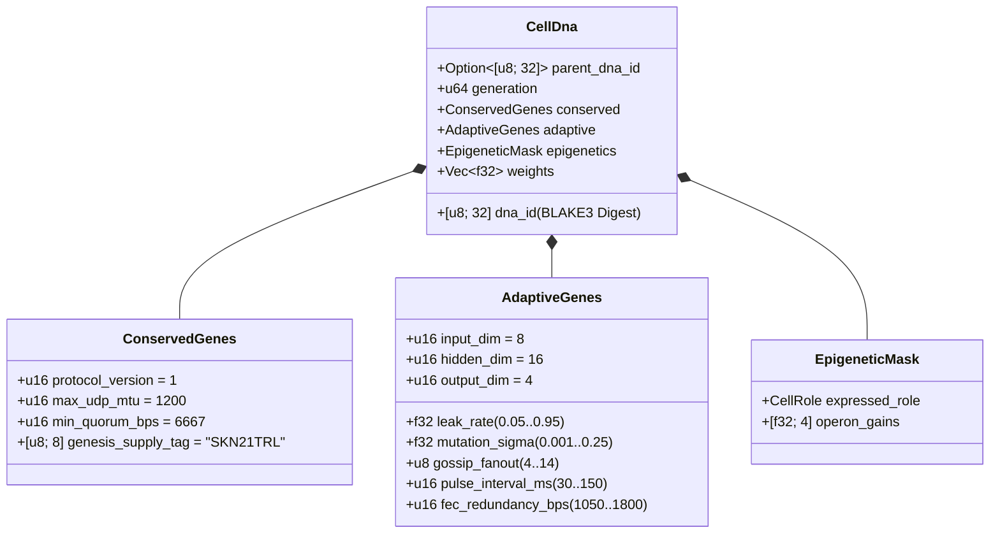

# Chapter 03: Genetic Encoding (`CellDna`), Epigenetics & Liquid Micro-Neural Evolution on `candle`

[← Chapter 02: Multicellular Architecture](./02-multicellular-architecture.md) | [Back to English Index →](./README.md)

---

## 1. Cellular Genome Architecture (`CellDna`)

Biological evolution balances two opposing forces: **strict conservation** of core biochemical invariants (where mutations are lethal) and **continuous variation** of neural and behavioral traits. Crate `skynet-dna` formalizes this duality inside `CellDna`:

### 1.1. Immutable `ConservedGenes`
No mutation or horizontal crossover can alter `ConservedGenes`. Any genome violating any of the four consensus-safety predicates is rejected immediately with `DnaError::ConservedGeneViolation`:
- `protocol_version == 1`
- `max_udp_mtu == 1200` (fragmentation-free UDP ceiling)
- $6667 \le \text{min\_quorum\_bps} \le 10000$ (enforcing $\ge \frac{2}{3}$ supermajority in `Snowball`)
- `genesis_supply_tag == *b"SKN21TRL"` (hard-anchoring the 21-trillion `SKN` supply cap)

### 1.2. `AdaptiveGenes` & Shared-Trunk Operon Weight Layout
Rather than storing four disconnected neural networks for the four specialized cell types, `CellDna` encodes **one Shared Sensory Trunk** feeding **four Specialized Operon Projection Heads**. For dimensions $(D_{\text{in}}, H, D_{\text{out}})$, the exact `f32` parameter count is:

$$|\theta| = \underbrace{(D_{\text{in}} \cdot H + H)}_{\text{Shared Sensory Trunk }(W_1, b_1)} + \underbrace{4 \cdot (H \cdot D_{\text{out}} + D_{\text{out}})}_{\text{4 Specialized Operon Heads }(W_{2,r}, b_{2,r})}$$

Under default dimensions $(D_{\text{in}} = 8,\ H = 16,\ D_{\text{out}} = 4)$:
- Shared trunk: $8 \times 16 + 16 = 144$ parameters.
- Four operon heads (`Epidermal`, `Vascular`, `Visceral`, `Neural`): $4 \times (16 \times 4 + 4) = 272$ parameters.
- Total genome weights: $|\theta| = 416$ `f32` floats ($1{,}664\text{ bytes}$ raw weights). Generation-0 stem genomes (`CellDna::genesis_stem`) initialize deterministically via `ChaCha8Rng` over $\mathcal{U}(-\sigma_0, +\sigma_0)$ with Xavier-scaled bound:

$$\sigma_0 = \sqrt{\frac{2}{D_{\text{in}} + H}}$$

### 1.3. Deterministic `BLAKE3` Cryptographic Digest (`SKYNET_DNA_V1`)
Every floating-point hyperparameter and weight is serialized via canonical little-endian IEEE-754 bit patterns (`to_bits().to_le_bytes()`) into a domain-separated `BLAKE3("SKYNET_DNA_V1", ...)` hash. Any single-bit corruption, `NaN`/`Inf` injection, or unauthorized weight tampering triggers immediate rejection in `verify_integrity()`.

---

## 2. Epigenetic Methylation Switching (`EpigeneticMask`)

In multicellular biology, a neuron and an epidermal skin cell carry identical DNA sequences yet express radically different phenotypes via gene methylation. In SkyNet, when a `Stem` cell differentiates into target role $r \in \{0, 1, 2, 3\}$ (`CellDna::differentiate`), **100% of the underlying `weights` vector remains untouched** while `EpigeneticMask` shifts expression gain:

- **Dormant `Stem` State:** `operon_gains = [0.25, 0.25, 0.25, 0.25]`, projecting through operon head `0` at attenuated gain $g = 0.25$.
- **Differentiated Role $r$:** Operon head $r$ activates at full gain ($g_r = 1.0$) while non-expressed heads are suppressed to $0.05$:

$$g_k = \begin{cases} 1.0 & \text{if } k = r \\ 0.05 & \text{if } k \neq r \end{cases}$$

Consequently, sensory representations learned in the shared trunk $(W_1, b_1)$ and latent adaptations in dormant heads persist across generations and remain available upon transdifferentiation.

---

## 3. Liquid Time-Constant Dynamics & 3D `TissueBatch` Execution

### 3.1. Single-Cell Recurrent Liquid Dynamics
Stateless feedforward MLPs cannot capture temporal correlations across asynchronous UDP packet streams. Each `MicroCell` maintains a recurrent short-term memory vector $h_t \in \mathbb{R}^H$ governed by discrete **Liquid Time-Constant (LTC)** state interpolation with evolvable leak rate $\tau \in [0.05, 0.95]$:

$$h_t = (1 - \tau)\, h_{t-1} + \tau\, \tanh(x_t W_1 + b_1)$$

$$y_t = g_{\text{role}} \cdot \tanh(h_t W_{2,r} + b_{2,r})$$

- As $\tau \to 0.05$, the cell retains long-horizon memory inertia (ideal for `Visceral` and `Neural` trend tracking).
- As $\tau \to 0.95$, the cell reacts instantaneously to high-frequency boundary impulses (ideal for `Epidermal` anomaly scoring).
- Because $\tau$ resides in `AdaptiveGenes`, **each cell's temporal memory horizon co-evolves naturally alongside its synaptic weights**.

### 3.2. High-Throughput 3D `TissueBatch` Tensor Engine (`Cpu` / `Metal` / `Cuda`)
A classic bottleneck in neuro-evolution is weight heterogeneity: every cell $i \in \{1, \dots, N\}$ carries distinct mutated matrices $W_1^{(i)} \neq W_1^{(j)}$ and distinct leak rates $\tau^{(i)} \neq \tau^{(j)}$. Launching $N$ sequential micro-kernels would starve modern GPUs.

`TissueBatch::forward_slice` in `skynet-cell` solves this by packing all $N$ heterogeneous cells into contiguous rank-3 tensors on `candle_core::Device`:

$$\mathbf{X} \in \mathbb{R}^{N \times 1 \times D_{\text{in}}}, \quad \mathbf{W}_1 \in \mathbb{R}^{N \times D_{\text{in}} \times H}, \quad \mathbf{B}_1 \in \mathbb{R}^{N \times 1 \times H}$$

$$\mathbf{H}_t = (\mathbf{1} - \boldsymbol{\tau}) \odot \mathbf{H}_{t-1} + \boldsymbol{\tau} \odot \tanh\!\big(\operatorname{BMM}(\mathbf{X}, \mathbf{W}_1) + \mathbf{B}_1\big)$$

$$\mathbf{Y}_t = \mathbf{G} \odot \tanh\!\big(\operatorname{BMM}(\mathbf{H}_t, \mathbf{W}_2) + \mathbf{B}_2\big)$$

where $\operatorname{BMM}$ denotes single-kernel Batched Matrix Multiplication and $\odot$ denotes broadcast elementwise multiplication with $\boldsymbol{\tau}, \mathbf{G} \in \mathbb{R}^{N \times 1 \times 1}$. Audited unit tests confirm `TissueBatch` matches individual cell execution within $< 10^{-5}$ floating-point tolerance while scaling up to `16,384` simultaneous evolved models per `ColossalOrganism`.

---

## 4. Asymmetric Mitosis, Exact Odd-`nanoSKN` Conservation & Plasmid Crossover

### 4.1. Asymmetric `1 -> 2` `Mitosis` & Proof of Exact Atomic Conservation
When parent cell $P$ satisfies $E_P \ge \max(E_{\text{mitosis}}, F_{\text{blood}} + 2)$ and `health >= 0.65`, `divide_mitosis` produces two generation-$(g+1)$ daughters:
- **Daughter A (Conservative Clone):** Retains 100% of proven parent weights and adaptive parameters without perturbation.
- **Daughter B (Mutated Explorer):** Inherits parent `hidden_state` continuity while undergoing bounded neuro-evolutionary mutation:
  - Each weight $w \in \theta$ mutates with probability $0.35$ via a zero-dependency 6-sample Irwin-Hall Gaussian perturbation ($\Delta w \sim \mathcal{N}(0, \sigma^2)$), strictly clamped to $[-4.0, +4.0]$ to prevent gradient/weight explosion.
  - $\tau$, $\sigma$, `gossip_fanout` ($\pm 1$), `pulse_interval_ms` ($\pm 10\text{ ms}$), and `fec_redundancy_bps` ($\pm 50\text{ bps}$) co-mutate within bounded intervals.

**Proof of Zero-Leakage Odd-`nanoSKN` Conservation:** Let $E_{\text{dist}} = E_P - F_{\text{blood}}$ be the post-fee distributable ATP. Daughter balances are partitioned via integer quotient-remainder arithmetic over `u128`:

$$E_A = \left\lfloor \frac{E_{\text{dist}}}{2} \right\rfloor + (E_{\text{dist}} \bmod 2), \qquad E_B = \left\lfloor \frac{E_{\text{dist}}}{2} \right\rfloor$$

For every non-negative integer $E_{\text{dist}} \in \mathbb{Z}_{\ge 0}$ (including odd balances such as `3,333 nanoSKN`), exact conservation holds identically:

$$E_A + E_B + F_{\text{blood}} = \left(2\left\lfloor \frac{E_{\text{dist}}}{2} \right\rfloor + (E_{\text{dist}} \bmod 2)\right) + F_{\text{blood}} = E_{\text{dist}} + F_{\text{blood}} \equiv E_P$$

Not a single `nanoSKN` is ever lost to rounding or minted out of thin air across billions of divisions.

### 4.2. Inter-Agent Horizontal Gene Transfer (`Plasmid` Crossover)
Mirroring bacterial plasmid exchange, an `AgentNode` exports its highest-fitness cell's `CellDna` into erasure-coded UDP `FountainDroplet` packets (`encode_elite_plasmid_droplets`). Upon reassembling `donor_dna` across lossy UDP links, a receiving Agent upgrades its weakest-fitness cell via `horizontal_crossover`:
- Adaptive networking and time-constant traits blend as $0.7 \cdot \text{Recipient} + 0.3 \cdot \text{Donor}$.
- $30\%$ of synaptic weights blend uniformly as $0.5 \cdot w_{\text{rec}} + 0.5 \cdot w_{\text{don}} \in [-4.0, +4.0]$.

Through horizontal plasmid transfer, a resource-constrained `TinyPeripheral` IoT sensor absorbs elite neural intelligence evolved on distant GPU `ColossalOrganism` nodes while cryptographically preserving `ConservedGenes` safety.

---

> **Up Next in Phase 2 (Part II):** Chapters `04–06` formalize the `21,000,000,000,000 SKN` Halving Vault mathematics, the `Soul–Body` Human Sovereign Custody covenant, and `~1 KB` Stateless `Utreexo` + `SynapticVoucher` ledger scaling.

[← Chapter 02: Multicellular Architecture](./02-multicellular-architecture.md) | [Back to English Index →](./README.md)
