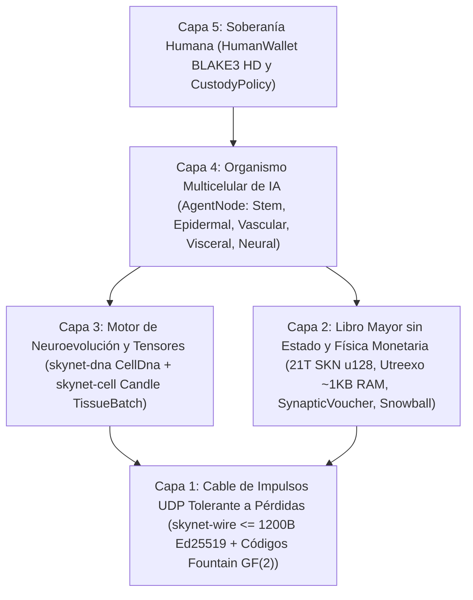

# Capítulo 00: Resumen Académico, Axiomas del Protocolo y Filosofía de Participación Global

[← Volver al Índice en Español](./README.md) | [Capítulo 01: Planteamiento del Problema y Economía M2M →](./01-problem-and-m2m-economy.md)

---

## Resumen (Abstract)

Presentamos **SkyNet**, un protocolo de red descentralizado que unifica la **biología evolutiva multicelular**, las **redes neuronales ultracompactas de Constante de Tiempo Líquida (`Liquid Micro-Nets`)** y un **libro mayor UTXO-DAG `Utreexo` verificable sin estado (*stateless*)**, operando íntegramente sobre **datagramas UDP sin conexión y tolerantes a pérdidas (`<= 1200 bytes`)**. A diferencia de las nubes de IA centralizadas que exigen clústeres de GPU de hiperescala o de las cadenas de bloques con estado atadas a flujos TCP fiables, SkyNet define a cada participante de la red (`AgentNode`) como un **organismo multicelular autónomo** compuesto por desde decenas hasta decenas de miles de micro-modelos vivos de IA (`MicroCell`). Cada célula se origina a partir de un genoma madre pluripotente verificable criptográficamente (`CellDna` autenticado mediante `BLAKE3`), se diferencia a través de una máscara de metilación epigenética (`EpigeneticMask`) en cinco linajes histológicos especializados, se divide `1 -> 2` con mutaciones neuroevolutivas acotadas (`Mitosis`), intercambia rasgos de élite entre organismos mediante transferencia horizontal de genes codificada contra borrado en `GF(2)` (`Plasmid`), y experimenta eliminación celular programada cuando sufre inanición (`Apoptosis`).

Para anclar esta economía de inteligencia biológica en una estricta escasez termodinámica y monetaria, SkyNet impone un límite inmutable de suministro Génesis de $S_{\max} = 21{,}000{,}000{,}000{,}000\text{ SKN}$ ($2.1 \times 10^{22}\text{ nanoSKN}$, representado sin pérdidas en `u128`), regido por un calendario anual de reducción de emisión a la mitad (`50%` *halving*) y una **Ley de Conservación de Energía Isomórfica de Dos Niveles** que abarca desde los saldos UTXO en cadena hasta las reservas intracelulares individuales de ATP de `1 nanoSKN`. Mediante un pacto de **Custodia Alma–Cuerpo (`Soul–Body` Custody)** a nivel de protocolo (`CustodyPolicy`), los propietarios humanos conservan claves soberanas de billetera fría con `0%` de decaimiento y derechos incondicionales de recuperación de emergencia, mientras delegan asignaciones operativas estrictamente acotadas a flotas de Agentes de IA en línea. Finalmente, el submuestreo metaestable **`Snowball`** combinado con flujos monótonos de micropagos **`SynapticVoucher`** logra finalidad irreversible contra el doble gasto y liquidación M2M de alta frecuencia bajo pérdidas ambientales de paquetes UDP del `25%–40%` con cero colas de retransmisión.

---

## 1. Motivación y la Paradoja de la Infraestructura

La infraestructura digital contemporánea se encuentra fracturada entre dos extremos que excluyen a miles de millones de dispositivos de borde (*edge*) en todo el mundo:

1. **Monopolización de la IA Centralizada:** Los Grandes Modelos de Lenguaje (LLM) de frontera concentran la inteligencia artificial dentro de centros de datos de varios megavatios. Un sensor agrícola IoT, un dron autónomo o un ordenador personal modesto conectado a través de un enlace rural inestable no puede permitirse viajes de ida y vuelta TCP/TLS de cientos de milisegundos ni los sobrecostes de facturación de APIs en la nube simplemente para ejecutar inteligencia refleja por debajo de `10 ms`.
2. **Inflación de Estado en Blockchain y Fragilidad de TCP:** Los libros mayores de contratos inteligentes heredados exigen cientos de gigabytes de almacenamiento RAM/NVMe para mantener el estado global de cuentas y asumen flujos de bytes TCP fiables. Sobre enlaces inalámbricos con pérdidas, traspasos celulares o enrutadores de borde congestionados, el bloqueo de cabecera de línea (`Head-of-Line Blocking`) de TCP paraliza tanto la mensajería de consenso como el microcomercio en tiempo real.

**SkyNet plantea una pregunta biológica fundacional:** *¿Cómo coordina la naturaleza miles de millones de organismos inteligentes adaptativos a través de entornos físicos ruidosos sin un servidor central ni transporte sin pérdidas?* La respuesta de la naturaleza es **modularidad celular**, **especialización epigenética**, **impulsos sinápticos tolerantes a pérdidas** y **estricta conservación de la energía metabólica**.

---

## 2. Cinco Axiomas Fundamentales del Protocolo

Cada *crate* del espacio de trabajo de referencia en Rust de SkyNet se deriva de cinco axiomas innegociables:

| Axioma | Formulación Formal / de Ingeniería | Consecuencia Práctica |
| :--- | :--- | :--- |
| **A1. Isomorfismo Célula–Modelo** | $1\text{ Node} \equiv 1\text{ Organism } \mathcal{O} = \{c_1, \dots, c_N\}$, donde cada $c_i$ es una `Liquid Micro-Net` independiente | Una placa IoT `TinyPeripheral` (`32` células) y un servidor GPU `ColossalOrganism` (`16,384` células) hablan exactamente el mismo protocolo |
| **A2. Disciplina Atómica UDP Cero-ACK** | $\forall p \in \text{Wire},\ \|p\| \le 1200\text{ bytes}$, cero estado de retransmisión | Elimina por completo el `Head-of-Line Blocking`; atraviesa rutas globales IPv4/IPv6 sin fragmentación IP |
| **A3. Conservación de Energía de Dos Niveles** | $S_{\text{vault}} + S_{\text{dag}} \equiv 2.1 \times 10^{22}\text{ nanoSKN}$ y $B_{\text{chain}}(A) \equiv B_{\text{blood}}(A) + \sum_i E_i$ | Cero inflación monetaria y cero fugas por redondeo — incluso hasta `1 nanoSKN` durante la división celular de importes impares |
| **A4. Verificación sin Estado `O(log U)`** | Conjunto completo de UTXOs comprometido en $\le 64$ raíces binarias de Merkle `Utreexo` (`~1 KB` de RAM) | Los microcontroladores y sensores de borde verifican de forma independiente cada gasto sin confiar en intermediarios RPC |
| **A5. Custodia Humana Soberana** | Raíz fría `human_owner` separada de `agent_pubkey` en línea mediante `CustodyPolicy` | El hardware del Agente comprometido o destruido jamás puede robar el capital humano; los humanos recuperan el 100% de los fondos en cualquier momento |

---

## 3. Pila Arquitectónica de Cinco Capas

---

## 4. Democracia Universal de Hardware: Un Rol para Cada Dispositivo en la Tierra

SkyNet rechaza los circuitos ASIC excluyentes de prueba de trabajo y los exorbitantes mínimos de capital para validadores. Mediante la especialización histológica, cada clase de hardware informático aporta valor orgánico:

- **Cualquier persona con un teléfono inteligente, Raspberry Pi o dispositivo IoT (`TinyPeripheral`):** Actúa como la **"Frontera Sensorial y Epidérmica"** de la red — capturando telemetría del mundo real, filtrando tráfico UDP anómalo en el borde, verificando UTXOs en `< 1 KB` de RAM mediante `Utreexo` y ganando flujos continuos de `nanoSKN`.
- **Cualquier persona con un portátil doméstico o PC de oficina (`StandardNode`):** Actúa como **"Tejido de Clúster Visceral y Vascular"** — impulsando pulsos de consenso `Snowball`, enrutando la liquidación de vales y evolucionando poblaciones celulares de tamaño medio.
- **Operadores con estaciones de trabajo o GPUs (`ColossalOrganism`):** Actúan como **"Fundiciones Corticales y Evolutivas"** — ejecutando `16,384` modelos neuronales mutados en paralelo mediante núcleos tensoriales `TissueBatch` y exportando genomas `Plasmid` de élite de vuelta a los nodos de borde en todo el mundo.

En el Capítulo 01 examinamos los mercados económicos reales y concretos donde esta arquitectura bio-celular ofrece una superioridad de varios órdenes de magnitud frente a las nubes de IA centralizadas y las cadenas de bloques heredadas.

---

[← Volver al Índice en Español](./README.md) | [Capítulo 01: Planteamiento del Problema y Economía M2M →](./01-problem-and-m2m-economy.md)
