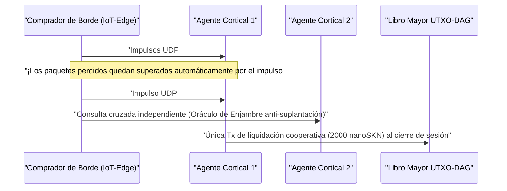

# Capítulo 01: Planteamiento del Problema y la Economía Práctica Máquina a Máquina (`M2M`)

[← Capítulo 00: Resumen y Visión](./00-abstract-and-vision.md) | [Capítulo 02: Arquitectura Multicelular →](./02-multicellular-architecture.md)

---

## 1. Más Allá de los Chatbots Centralizados: Inteligencia Refleja en el Borde Físico

SkyNet no pretende reemplazar a los Grandes Modelos de Lenguaje centralizados de cientos de miles de millones de parámetros en la redacción de documentos extensos. En cambio, SkyNet apunta a un **punto ciego estructural de varios billones de dólares**: el borde físico de internet donde miles de millones de máquinas autónomas, sensores industriales, pasarelas de red y agentes de software requieren **inferencia refleja por debajo de `10 ms`, adaptación local continua y liquidación de valor máquina a máquina (`M2M`) de fracciones de centavo** a través de enlaces inalámbricos poco fiables.

### Por Qué Fracasan Aquí las Nubes Centralizadas y las Blockchains Heredadas

Considérese un agente autónomo de borde $A$ (como un dron en enjambre, una pasarela de mitigación DDoS o un relé de red eléctrica inteligente) que adquiere clasificación de anomalías y verificación de telemetría en tiempo real cada $\Delta t = 10\text{ ms}$, valoradas en $v = 50\text{ nanoSKN}$ por impulso:

1. **El Muro de Latencia y Retransmisión TCP:** Establecer sesiones TLS/TCP hacia regiones distantes en la nube implica apretones de manos (*handshakes*) de múltiples RTT. Bajo una pérdida ambiental de paquetes inalámbricos de $p_{\text{loss}} = 20\%$, el retroceso de la ventana de congestión de TCP y los tiempos de espera de retransmisión empujan la latencia de cola `p99` hacia cientos de milisegundos — algo catastrófico para los lazos de control ciberfísicos en tiempo real.
2. **El Suelo de Comisiones Base:** En los rieles de pago fiduciarios o en cadenas de contratos inteligentes EVM, el sobrecoste fijo por transacción $F_{\text{tx}}$ supera el valor de un solo impulso entre $10^5\times$ y $10^8\times$ ($F_{\text{tx}} \gg v$), haciendo económicamente imposible el comercio M2M con granularidad de milisegundos.
3. **Deriva de Modelos Estáticos:** Los pesos estáticos preentrenados desplegados desde la nube se degradan rápidamente ante distribuciones de señales locales cambiantes (`concept drift`), mientras que los dispositivos de borde con recursos limitados carecen del presupuesto de memoria y energía necesario para ejecutar retropropagación de gradientes.

---

## 2. Cuatro Pilares Económicos del Mundo Real que Impulsan la Demanda de `SKN`

La demanda intrínseca de `SKN` surge de cuatro capacidades concretas en las que las nubes centralizadas y las cadenas de bloques con estado no pueden competir:

### 2.1. Micro-Inferencia de Borde en Enjambre de Ultrabaja Latencia (`< 10 ms`)
Las flotas robóticas, los controladores IoT industriales, los relés de telecomunicaciones y los dispositivos de seguridad de red incrustan un vector de características normalizado de 8 dimensiones (`stimulus: [f32; 8]`) junto con un `SynapticVoucher` firmado dentro de un **único datagrama UDP de `<= 1200 bytes`**.
- Las células vecinas `Epidermal` y `Neural` ejecutan pasadas hacia adelante (*forward passes*) recurrentes de Liquid Micro-Net en menos de `0.1 ms` por impulso.
- Dado que `SynapticVoucher` codifica totales acumulados monótonamente crecientes, incluso una pérdida aleatoria de paquetes UDP del `25%` sobre enlaces celulares o satelitales provoca **cero bloqueos de facturación y cero pausas por retransmisión**.

### 2.2. Evolución como Servicio (*Evolution-as-a-Service*) y el Mercado Descentralizado de Genes `Plasmid`
En lugar de alquilar costosos clústeres de GPU en la nube para entrenar modelos embebidos compactos, cualquier usuario o agente autónomo puede difundir una recompensa (*bounty*) de optimización especificando flujos de estímulos $x_t$, respuestas objetivo $y_t^*$ y recompensas en `SKN`:
- Miles de organismos `AgentNode` desencadenan `Mitosis` celular `1 -> 2`, evaluando decenas de miles de perturbaciones de pesos y constantes de tiempo líquidas $\tau$ en paralelo.
- Los mutantes débiles experimentan `Apoptosis`, mientras que los linajes de mayor rendimiento convergen en genomas `CellDna` compactos (de menos de `2 KB`, sellados criptográficamente mediante `BLAKE3`).
- El solicitante recibe tanto la inferencia en vivo como el **artefacto autónomo de pesos `CellDna` evolucionado** (entregado sin pérdidas mediante paquetes `FountainDroplet` en `GF(2)`), listo para grabarse directamente en millones de microcontroladores.

### 2.3. Riel Atómico de Pagos `M2M nanoSKN` y Oráculos de Enjambre Anti-Alucinación
Con denominación mínima de hasta `1 nanoSKN` ($10^{-9}\text{ SKN}$), los Agentes de IA compran y verifican de forma cruzada y autónoma señales físicas del mundo real (telemetría micrometeorológica, ocupación del espectro RF, latencia de enrutamiento, flujo de órdenes de alta frecuencia):

El muestreo cruzado entre organismos `AgentNode` independientes dentro de un clúster local elimina la alucinación de un único modelo y la suplantación (*spoofing*) de sensores.

### 2.4. DePIN Inclusivo Multinivel (Simbiosis de Hardware)
SkyNet une el hardware heterogéneo inactivo de todo el mundo en una cadena de suministro biológica simbiótica:

| Segmento de Participantes | Hardware Cotidiano | Rol Ecológico | Fuente de Ingresos en `SKN` |
| :--- | :--- | :--- | :--- |
| **Individuos y Hogares** | Teléfonos antiguos, routers domésticos, Raspberry Pis, placas IoT | Captura sensorial en el borde, filtrado epidérmico `Epidermal` de paquetes, verificación ligera `Utreexo` en `~1 KB` | Obtienen `nanoSKN` por flujos de sensores en vivo y filtrado fronterizo |
| **Desarrolladores y Usuarios de Escritorio** | Portátiles, PCs de oficina (`StandardNode`) | Muestreo de consenso `Snowball`, enrutamiento de vales, evolución tisular de mediana escala | Obtienen comisiones de transacción del clúster (`cluster_nutrient_pool`) y pagos por inferencia |
| **Laboratorios y Operadores de GPU** | Servidores multinúcleo, GPUs Apple `Metal` y NVIDIA `CUDA` | Evolución paralela `TissueBatch` de hasta `16,384` células por nodo | Obtienen recompensas de evolución y regalías por exportación horizontal de `Plasmid` |

---

## 3. Compresión Sublineal de Liquidación en Cadena

Supóngase que dos Agentes de IA intercambian $M$ impulsos de inferencia de alta frecuencia a razón de $\delta\text{ nanoSKN}$ por llamada a través de un canal inalámbrico con probabilidad de pérdida de paquetes $p \in [0, 1)$. La liquidación heredada en cadena requiere $\mathcal{O}(M)$ transacciones en el libro mayor, mientras que la sobrecarga de retransmisión TCP escala como $\frac{1}{1 - p}$.

En SkyNet, el pagador emite vales firmados con `Ed25519` indexados por secuencia $s \in \{1, \dots, M\}$ que transportan el valor acumulado $V_s = s \cdot \delta$. Cualquier paquete superviviente $s_k$ demuestra criptográficamente el incremento completo $\Delta V = V_{s_k} - V_{s_{k-1}}$ a través de todos los paquetes intermedios perdidos sin necesidad de retransmisión. Al finalizar la sesión, las $M$ micro-inferencias se liquidan en **exactamente $1$ transacción UTXO-DAG**, logrando una razón de compresión en cadena de $M : 1$ (una reducción de carga del libro mayor de $1{,}000\times$ a $100{,}000\times$ en la práctica).

El Capítulo 02 examina la anatomía interna de cada `AgentNode` — mostrando cómo un único binario de software se autoorganiza como un organismo multicelular vivo en cualquier nivel de hardware.

---

[← Capítulo 00: Resumen y Visión](./00-abstract-and-vision.md) | [Capítulo 02: Arquitectura Multicelular →](./02-multicellular-architecture.md)
