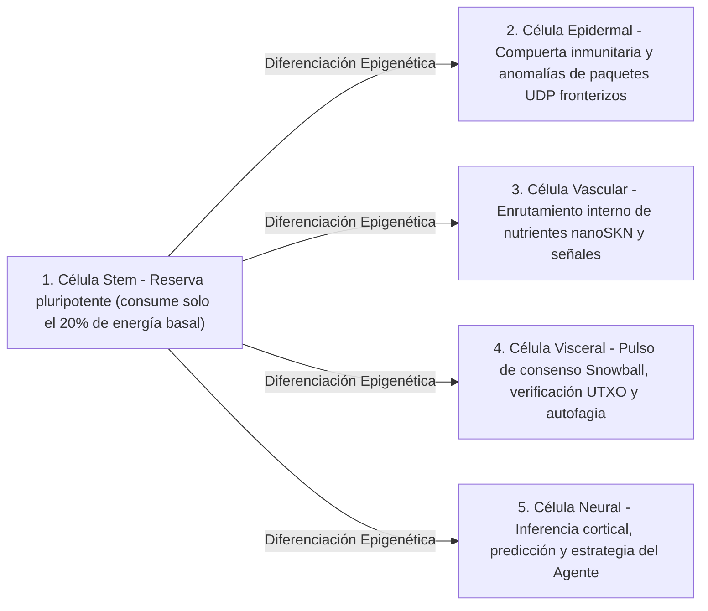

# Capítulo 02: Arquitectura de Organismo Multicelular y Escalado Elástico de Hardware (`AgentNode`)

[← Capítulo 01: Planteamiento del Problema y Economía M2M](./01-problem-and-m2m-economy.md) | [Capítulo 03: `CellDna` y Células Neuronales Líquidas →](./03-dna-and-liquid-neural-cells.md)

---

## 1. Isomorfismo Biológico: `1 Node = 1 Multicellular Organism`

En las redes entre pares (*peer-to-peer*) convencionales, cada nodo ejecuta una máquina de estados monolítica y rígida con independencia de si opera sobre un microcontrolador embebido o sobre un servidor GPU de 64 núcleos. En SkyNet (`crates/skynet-agent`), cada participante de la red se instancia como un **`AgentNode`** — un organismo multicelular vivo compuesto por una población dinámica de micro-células de IA $\mathcal{C}(t) = \{c_1, c_2, \dots, c_{N(t)}\}$, una tesorería metabólica interna (`AgentMetabolicBank`), un verificador de raíces `Utreexo` sin estado (`StatelessUtreexoRoots`) y un motor tolerante a pérdidas `SnowballEngine`.

El tamaño de la población celular $N(t) = |\mathcal{C}(t)|$ nunca está codificado de forma fija; **se expande mediante `Mitosis` y se contrae mediante `Apoptosis` de manera orgánica en función de la capacidad del hardware anfitrión y del flujo entrante de nutrientes `nanoSKN` ganados**.

---

## 2. Tres Niveles Elásticos de Hardware (`HardwareTier`)

Al iniciarse, `HardwareProfile::for_tier` asigna la capacidad del anfitrión a uno de tres perfiles ecológicos con umbrales metabólicos exactos en `nanoSKN` (`crates/skynet-cell/src/lib.rs`):

| Parámetro Biológico (`HardwareProfile`) | `TinyPeripheral` (IoT / MCU de Borde) | `StandardNode` (Portátil / PC de Escritorio) | `ColossalOrganism` (Servidor / GPU) |
| :--- | :--- | :--- | :--- |
| **Población Celular Máxima (`max_cells`)** | `32` células | `512` células | `16,384` células |
| **Consumo Basal Activo / Tick (`basal_burn_per_tick`)** | `50 nanoSKN` | `25 nanoSKN` | `10 nanoSKN` |
| **Consumo de `Stem` Latente / Tick (80% de ahorro)** | `10 nanoSKN` | `5 nanoSKN` | `2 nanoSKN` |
| **Umbral de División (`mitosis_threshold`)** | `2,000 nanoSKN` | `1,500 nanoSKN` | `1,000 nanoSKN` |
| **Tasa Sanguínea de División (`mitosis_blood_fee`)** | `100 nanoSKN` | `60 nanoSKN` | `40 nanoSKN` |
| **Suelo de Eliminación (`apoptosis_floor`)** | `100 nanoSKN` | `80 nanoSKN` | `50 nanoSKN` |
| **Backend de Cómputo (`candle_core::Device`)** | `Cpu` | `Cpu` / `Metal` / `Cuda` | `Cuda` / `Metal` / `Cpu` SIMD |

> [!NOTE]
> **Economías de Escala Biológicas (Ley de Kleiber):** Al igual que los organismos biológicos de mayor tamaño presentan un menor coste metabólico por gramo de tejido, los nodos `ColossalOrganism` incurren en un menor consumo basal por célula (`10 nanoSKN` frente a `50 nanoSKN`) debido a que miles de células amortizan su ejecución dentro de un único núcleo tensorial GPU por lotes, mientras que los nodos `TinyPeripheral` se mantienen ligeros y resilientes en el borde de la red.

---

## 3. Cinco Linajes Histológicos Especializados (`CellRole`)

Cuando nace un `AgentNode` (`AgentNode::from_signing_key`), inicializa una semilla embrionaria de 6 células (`2 Stem`, `1 Epidermal`, `1 Vascular`, `1 Visceral`, `1 Neural`) derivada de un genoma determinista `base_stem`. A lo largo de toda la vida del organismo, cinco linajes histológicos cumplen cinco funciones fisiológicas esenciales:

1. **`Stem` (Reserva Pluripotente — `operon_index = None`):** Células regenerativas latentes que consumen únicamente $\max(\lfloor E_{\text{burn}} / 5 \rfloor, 1)$ por *tick*. Siempre que cualquier órgano especializado sufre desgaste, una célula `Stem` se diferencia epigenéticamente (`differentiate`) para reponerlo sin necesidad de descargar código externo.
2. **`Epidermal` (Piel y Compuerta Inmunitaria — `operon_index = Some(0)`):** Protege el *socket* UDP sin procesar (`epidermal_inspect_packet`). Antes de que cualquier paquete entrante alcance el libro mayor o el motor de consenso, una célula `Epidermal` evalúa la telemetría normalizada del paquete (`raw_len / 1200`, `hop_ttl / 16`, deriva de `epoch`) sobre `candle` para descartar impulsos malformados o ataques de inundación (*flood*).
3. **`Vascular` (Regulador Circulatorio — `operon_index = Some(1)`):** Regula la liquidez interna de `blood_pool` dentro de `AgentMetabolicBank`, canalizando las recompensas en `nanoSKN` hacia las células de mayor precisión.
4. **`Visceral` (Mantenimiento Orgánico — `operon_index = Some(2)`):** Dirige la cadencia de sondeo `Snowball`, la verificación sin estado de testigos `Utreexo` y el reciclaje metabólico.
5. **`Neural` (Cerebro Cortical — `operon_index = Some(3)`):** Ejecuta la inferencia cognitiva; la media del conjunto (*ensemble*) de todas las células `Neural` vivas ($\bar{y}_{\text{cortical}} = \frac{1}{|\mathcal{C}_{\text{neural}}|} \sum_{i \in \mathcal{C}_{\text{neural}}} y_i$) conforma la salida de decisión colectiva del organismo.

---

## 4. El Ciclo de Vida Fisiológico de Seis Fases por Tick (`run_biological_tick`)

En cada pulso (`pulse_seq`), `AgentNode` ejecuta un ciclo fisiológico determinista de seis fases que une la competencia darwiniana con la conservación exacta de `nanoSKN` en `u128`:

1. **Fase 1 — Metabolismo Basal:** Cada célula $c_i$ quema energía de mantenimiento $b_i = \text{metabolize\_tick}()$. Crucialmente, $b_i$ jamás se destruye en cadena; el 100% del ATP intracelular consumido se recicla de vuelta hacia `bank.blood_pool`. Las células hambrientas ($E_i = 0$) pierden `0.25` de `health`.
2. **Fase 2 — Inferencia Tensorial por Lotes en `candle`:** Todas las $N$ células vivas se ejecutan simultáneamente mediante `TissueBatch::forward_slice`, produciendo salidas $y_i \in \mathbb{R}^4$ y actualizando los vectores de memoria líquida a corto plazo $h_{i,t} \in \mathbb{R}^{16}$.
3. **Fase 3 — Selección Darwiniana Intra-Orgánica de Nutrientes:**
   Dada la señal objetivo $t \in \mathbb{R}^4$, la calidad de predicción de la célula $i$ se mide mediante el Error Absoluto Medio acotado:

   $$q_i = \operatorname{clamp}\!\left(1 - \frac{1}{4}\sum_{k=1}^{4} |y_{i,k} - t_k|,\ 0.0,\ 1.0\right)$$

   Sea $\bar{q}_r$ la calidad media de todas las células que comparten el rol orgánico $r = \text{role}(c_i)$. Una célula especializada gana nutrientes `nanoSKN` procedentes de `blood_pool` si y solo si su órgano cuenta con $\le 2$ células o supera el umbral de competitividad intra-orgánica $q_i \ge 0.98 \cdot \bar{q}_r$:

   $$R_i = \min\!\left(\lfloor 320 \cdot q_i \rfloor + E_{\text{basal}},\ \left\lfloor \frac{B_{\text{blood}}}{8} \right\rfloor\right)$$

   Los mutantes de bajo rendimiento ($q_i < 0.98 \cdot \bar{q}_r$) reciben cero nutrientes y sufren una penalización de `-0.35` en `health`.
4. **Fase 4 — Diferenciación Homeostática de Células Madre:** El organismo identifica su órgano especializado con menor población (`find_most_needed_role`). Siempre que `stem_count > 1`, una célula `Stem` se diferencia hacia dicho órgano preservando en todo momento al menos `1` célula `Stem` de línea germinal.
5. **Fase 5 — `Mitosis` `1 -> 2`:** Las células sanas y bien nutridas (`health >= 0.65` y $E_i \ge E_{\text{mitosis}}$) se dividen en un clon conservador (Célula Hija A) y un explorador mutado (Célula Hija B) hasta alcanzar `profile.max_cells`.
6. **Fase 6 — `Apoptosis` con Protección de Órganos:** Las células hambrientas ($E_i < E_{\text{apoptosis}}$) o críticamente dañadas (`health <= 0.15`) se disuelven y devuelven el 100% de sus `nanoSKN` restantes a `blood_pool` — sujetas a una estricta salvaguarda de supervivencia: **se preserva incondicionalmente al menos `1` célula viva por cada `CellRole` existente** para que ningún órgano vital llegue jamás a extinguirse.

Al cierre de cada *tick*, `verify_internal_skn_conservation()` verifica la identidad exacta en `u128`:

$$B_{\text{chain}}(\text{Agent}) \equiv B_{\text{blood}}(\text{Agent}) + \sum_{c_i \in \mathcal{C}} E_i$$

El Capítulo 03 abre el núcleo celular para especificar la estructura exacta en bytes y términos matemáticos de `CellDna`, la conmutación epigenética de operones y la ejecución neuronal líquida 3D mediante `TissueBatch`.

---

[← Capítulo 01: Planteamiento del Problema y Economía M2M](./01-problem-and-m2m-economy.md) | [Capítulo 03: `CellDna` y Células Neuronales Líquidas →](./03-dna-and-liquid-neural-cells.md)
