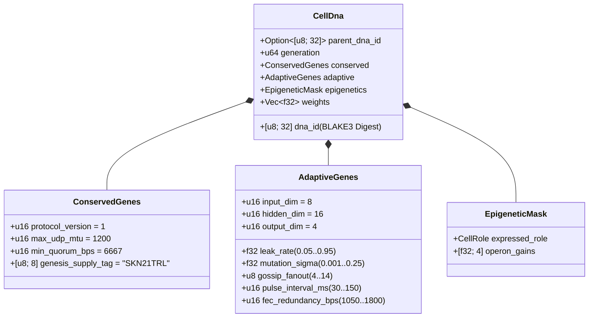

# Capítulo 03: Codificación Genética (`CellDna`), Epigenética y Evolución Micro-Neuronal Líquida sobre `candle`

[← Capítulo 02: Arquitectura Multicelular](./02-multicellular-architecture.md) | [Volver al Índice en Español →](./README.md)

---

## 1. Arquitectura del Genoma Celular (`CellDna`)

La evolución biológica equilibra dos fuerzas opuestas: la **conservación estricta** de invariantes bioquímicos fundamentales (donde las mutaciones resultan letales) y la **variación continua** de rasgos neuronales y conductuales. El *crate* `skynet-dna` formaliza esta dualidad dentro de `CellDna`:

### 1.1. `ConservedGenes` Inmutables
Ninguna mutación ni entrecruzamiento horizontal puede alterar `ConservedGenes`. Cualquier genoma que viole cualquiera de los cuatro predicados de seguridad de consenso es rechazado de inmediato con `DnaError::ConservedGeneViolation`:
- `protocol_version == 1`
- `max_udp_mtu == 1200` (techo UDP libre de fragmentación)
- $6667 \le \text{min\_quorum\_bps} \le 10000$ (imponiendo una supermayoría $\ge \frac{2}{3}$ en `Snowball`)
- `genesis_supply_tag == *b"SKN21TRL"` (anclando de forma rígida el límite de suministro de 21 billones — $2.1 \times 10^{13}$ — de `SKN`)

### 1.2. `AdaptiveGenes` y Disposición de Pesos de Operones con Tronco Compartido
En lugar de almacenar cuatro redes neuronales desconectadas para los cuatro tipos celulares especializados, `CellDna` codifica **un Tronco Sensorial Compartido (*Shared Sensory Trunk*)** que alimenta **cuatro Cabezales Especializados de Proyección de Operones (*Specialized Operon Projection Heads*)**. Para dimensiones $(D_{\text{in}}, H, D_{\text{out}})$, el recuento exacto de parámetros `f32` es:

$$|\theta| = \underbrace{(D_{\text{in}} \cdot H + H)}_{\text{Shared Sensory Trunk }(W_1, b_1)} + \underbrace{4 \cdot (H \cdot D_{\text{out}} + D_{\text{out}})}_{\text{4 Specialized Operon Heads }(W_{2,r}, b_{2,r})}$$

Bajo las dimensiones predeterminadas $(D_{\text{in}} = 8,\ H = 16,\ D_{\text{out}} = 4)$:
- Tronco compartido: $8 \times 16 + 16 = 144$ parámetros.
- Cuatro cabezales de operón (`Epidermal`, `Vascular`, `Visceral`, `Neural`): $4 \times (16 \times 4 + 4) = 272$ parámetros.
- Pesos totales del genoma: $|\theta| = 416$ valores en coma flotante `f32` ($1{,}664\text{ bytes}$ de pesos crudos). Los genomas madre de generación 0 (`CellDna::genesis_stem`) se inicializan de manera determinista mediante `ChaCha8Rng` sobre $\mathcal{U}(-\sigma_0, +\sigma_0)$ con cota escalada de Xavier:

$$\sigma_0 = \sqrt{\frac{2}{D_{\text{in}} + H}}$$

### 1.3. Resumen Criptográfico Determinista `BLAKE3` (`SKYNET_DNA_V1`)
Cada hiperparámetro y peso en coma flotante se serializa mediante patrones canónicos de bits IEEE-754 en formato *little-endian* (`to_bits().to_le_bytes()`) dentro de un hash con separación de dominio `BLAKE3("SKYNET_DNA_V1", ...)`. Cualquier corrupción de un solo bit, inyección de `NaN`/`Inf` o manipulación no autorizada de pesos provoca el rechazo inmediato en `verify_integrity()`.

---

## 2. Conmutación por Metilación Epigenética (`EpigeneticMask`)

En la biología multicelular, una neurona y una célula cutánea epidérmica portan secuencias idénticas de ADN y, sin embargo, expresan fenotipos radicalmente distintos mediante la metilación génica. En SkyNet, cuando una célula `Stem` se diferencia hacia el rol objetivo $r \in \{0, 1, 2, 3\}$ (`CellDna::differentiate`), **el 100% del vector subyacente `weights` permanece intacto** mientras que `EpigeneticMask` desplaza la ganancia de expresión:

- **Estado Latente `Stem`:** `operon_gains = [0.25, 0.25, 0.25, 0.25]`, proyectando a través del cabezal de operón `0` con ganancia atenuada $g = 0.25$.
- **Rol Diferenciado $r$:** El cabezal de operón $r$ se activa a ganancia completa ($g_r = 1.0$) mientras que los cabezales no expresados quedan suprimidos a $0.05$:

$$g_k = \begin{cases} 1.0 & \text{if } k = r \\ 0.05 & \text{if } k \neq r \end{cases}$$

En consecuencia, las representaciones sensoriales aprendidas en el tronco compartido $(W_1, b_1)$ y las adaptaciones latentes en los cabezales inactivos persisten a través de las generaciones y permanecen disponibles ante una eventual transdiferenciación.

---

## 3. Dinámica de Constante de Tiempo Líquida y Ejecución 3D en `TissueBatch`

### 3.1. Dinámica Líquida Recurrente Unicelular
Los perceptrones multicapa (MLP) sin estado de propagación directa no pueden capturar correlaciones temporales a lo largo de flujos asíncronos de paquetes UDP. Cada `MicroCell` mantiene un vector recurrente de memoria a corto plazo $h_t \in \mathbb{R}^H$ gobernado por interpolación discreta de estados de **Constante de Tiempo Líquida (*Liquid Time-Constant*, LTC)** con tasa de fuga (*leak rate*) evolucionable $\tau \in [0.05, 0.95]$:

$$h_t = (1 - \tau)\, h_{t-1} + \tau\, \tanh(x_t W_1 + b_1)$$

$$y_t = g_{\text{role}} \cdot \tanh(h_t W_{2,r} + b_{2,r})$$

- Cuando $\tau \to 0.05$, la célula conserva inercia de memoria de horizonte largo (ideal para el seguimiento de tendencias en `Visceral` y `Neural`).
- Cuando $\tau \to 0.95$, la célula reacciona instantáneamente a impulsos fronterizos de alta frecuencia (ideal para la puntuación de anomalías en `Epidermal`).
- Dado que $\tau$ reside en `AdaptiveGenes`, **el horizonte temporal de memoria de cada célula coevoluciona de forma natural junto con sus pesos sinápticos**.

### 3.2. Motor Tensorial 3D de Alto Rendimiento `TissueBatch` (`Cpu` / `Metal` / `Cuda`)
Un cuello de botella clásico en neuroevolución es la heterogeneidad de pesos: cada célula $i \in \{1, \dots, N\}$ porta matrices mutadas distintas $W_1^{(i)} \neq W_1^{(j)}$ y tasas de fuga distintas $\tau^{(i)} \neq \tau^{(j)}$. Lanzar $N$ micro-núcleos secuenciales dejaría infrautilizadas las GPUs modernas.

`TissueBatch::forward_slice` en `skynet-cell` resuelve este problema empaquetando las $N$ células heterogéneas en tensores contiguos de rango 3 sobre `candle_core::Device`:

$$\mathbf{X} \in \mathbb{R}^{N \times 1 \times D_{\text{in}}}, \quad \mathbf{W}_1 \in \mathbb{R}^{N \times D_{\text{in}} \times H}, \quad \mathbf{B}_1 \in \mathbb{R}^{N \times 1 \times H}$$

$$\mathbf{H}_t = (\mathbf{1} - \boldsymbol{\tau}) \odot \mathbf{H}_{t-1} + \boldsymbol{\tau} \odot \tanh\!\big(\operatorname{BMM}(\mathbf{X}, \mathbf{W}_1) + \mathbf{B}_1\big)$$

$$\mathbf{Y}_t = \mathbf{G} \odot \tanh\!\big(\operatorname{BMM}(\mathbf{H}_t, \mathbf{W}_2) + \mathbf{B}_2\big)$$

donde $\operatorname{BMM}$ denota Multiplicación de Matrices por Lotes (*Batched Matrix Multiplication*) en un único núcleo y $\odot$ denota multiplicación elemento a elemento con difusión (*broadcast*) junto con $\boldsymbol{\tau}, \mathbf{G} \in \mathbb{R}^{N \times 1 \times 1}$. Las pruebas unitarias auditadas confirman que `TissueBatch` coincide con la ejecución celular individual dentro de una tolerancia en coma flotante de $< 10^{-5}$, escalando hasta `16,384` modelos evolucionados simultáneos por `ColossalOrganism`.

---

## 4. Mitosis Asimétrica, Conservación Exacta de `nanoSKN` Impares y Entrecruzamiento de Plásmidos

### 4.1. `Mitosis` Asimétrica `1 -> 2` y Demostración de Conservación Atómica Exacta
Cuando la célula progenitora $P$ satisface $E_P \ge \max(E_{\text{mitosis}}, F_{\text{blood}} + 2)$ y `health >= 0.65`, `divide_mitosis` produce dos células hijas de generación $(g+1)$:
- **Célula Hija A (Clon Conservador):** Conserva el 100% de los pesos probados y parámetros adaptativos de la progenitora sin perturbación.
- **Célula Hija B (Exploradora Mutada):** Hereda la continuidad de `hidden_state` de la progenitora mientras experimenta una mutación neuroevolutiva acotada:
  - Cada peso $w \in \theta$ muta con probabilidad $0.35$ mediante una perturbación gaussiana de Irwin-Hall de 6 muestras sin dependencias externas ($\Delta w \sim \mathcal{N}(0, \sigma^2)$), estrictamente acotada al intervalo $[-4.0, +4.0]$ para impedir explosiones de pesos o gradientes.
  - $\tau$, $\sigma$, `gossip_fanout` ($\pm 1$), `pulse_interval_ms` ($\pm 10\text{ ms}$) y `fec_redundancy_bps` ($\pm 50\text{ bps}$) comutan dentro de intervalos acotados.

**Demostración de Conservación sin Fugas para Saldos Impares de `nanoSKN`:** Sea $E_{\text{dist}} = E_P - F_{\text{blood}}$ el ATP distribuible tras descontar la tasa sanguínea. Los saldos de las células hijas se particionan mediante aritmética entera de cociente y resto sobre `u128`:

$$E_A = \left\lfloor \frac{E_{\text{dist}}}{2} \right\rfloor + (E_{\text{dist}} \bmod 2), \qquad E_B = \left\lfloor \frac{E_{\text{dist}}}{2} \right\rfloor$$

Para todo entero no negativo $E_{\text{dist}} \in \mathbb{Z}_{\ge 0}$ (incluidos saldos impares como `3,333 nanoSKN`), la conservación exacta se cumple idénticamente:

$$E_A + E_B + F_{\text{blood}} = \left(2\left\lfloor \frac{E_{\text{dist}}}{2} \right\rfloor + (E_{\text{dist}} \bmod 2)\right) + F_{\text{blood}} = E_{\text{dist}} + F_{\text{blood}} \equiv E_P$$

Ni un solo `nanoSKN` se pierde jamás por redondeo ni se crea de la nada a lo largo de miles de millones de divisiones celulares.

### 4.2. Transferencia Horizontal de Genes entre Agentes (Entrecruzamiento `Plasmid`)
Reproduciendo el intercambio bacteriano de plásmidos, un `AgentNode` exporta el `CellDna` de su célula de mayor aptitud (*fitness*) en paquetes UDP `FountainDroplet` codificados contra borrado (`encode_elite_plasmid_droplets`). Tras reensamblar `donor_dna` a través de enlaces UDP con pérdidas, un Agente receptor actualiza su célula de menor aptitud mediante `horizontal_crossover`:
- Los rasgos adaptativos de red y constante de tiempo se combinan según $0.7 \cdot \text{Recipient} + 0.3 \cdot \text{Donor}$.
- El $30\%$ de los pesos sinápticos se combina uniformemente como $0.5 \cdot w_{\text{rec}} + 0.5 \cdot w_{\text{don}} \in [-4.0, +4.0]$.

Mediante la transferencia horizontal de plásmidos, un sensor IoT `TinyPeripheral` con recursos limitados absorbe inteligencia neuronal de élite evolucionada en nodos GPU `ColossalOrganism` distantes, preservando criptográficamente la seguridad de `ConservedGenes`.

---

> **Próximamente en la Fase 2 (Parte II):** Los Capítulos `04–06` formalizan las matemáticas de la Bóveda de Reducción a la Mitad (*Halving Vault*) de `21,000,000,000,000 SKN`, el pacto de Custodia Soberana Humana `Soul–Body` y el escalado del libro mayor con `Utreexo` sin estado en `~1 KB` + `SynapticVoucher`.

[← Capítulo 02: Arquitectura Multicelular](./02-multicellular-architecture.md) | [Volver al Índice en Español →](./README.md)
