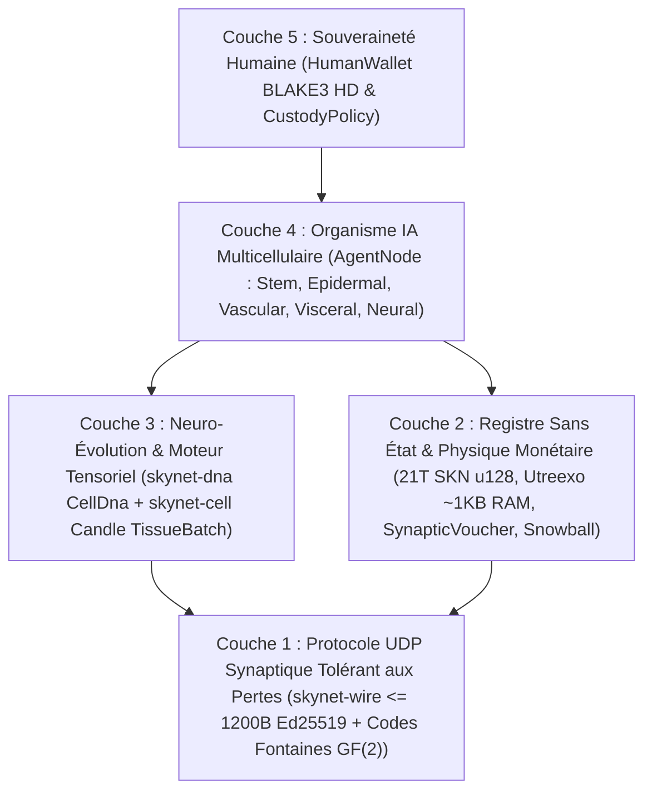

# Chapitre 00 : Résumé Académique, Axiomes du Protocole & Philosophie de Participation Mondiale

[← Retour à l'Index Français](./README.md) | [Chapitre 01 : Énoncé du Problème & Économie M2M →](./01-problem-and-m2m-economy.md)

---

## Résumé

Nous présentons **SkyNet**, un protocole réseau décentralisé unifiant la **biologie évolutive multicellulaire**, des **réseaux de neurones ultra-compacts à constante de temps liquide (`Liquid Micro-Nets`)**, et un **registre UTXO-DAG `Utreexo` vérifiable sans état**, opérant intégralement sur des **datagrammes UDP sans connexion et tolérants aux pertes (`<= 1200 bytes`)**. Contrairement aux clouds d'IA centralisés exigeant des grappes GPU hyperscale ou aux blockchains à état dépendantes de flux TCP fiables, SkyNet définit chaque participant du réseau (`AgentNode`) comme un **organisme multicellulaire autonome** composé de quelques dizaines à plusieurs dizaines de milliers de micro-modèles d'IA vivants (`MicroCell`). Chaque cellule est issue d'un génome souche pluripotent vérifiable cryptographiquement (`CellDna` authentifié par `BLAKE3`), se différencie par un masque de méthylation épigénétique (`EpigeneticMask`) en cinq lignées histologiques spécialisées, se divise selon un schéma `1 -> 2` avec mutations neuro-évolutives bornées (`Mitosis`), échange des traits d'élite entre organismes par transfert horizontal de gènes codé à effacement sur `GF(2)` (`Plasmid`), et subit une élimination programmée en cas de famine énergétique (`Apoptosis`).

Afin d'ancrer cette économie d'intelligence biologique dans une rareté thermodynamique et monétaire stricte, SkyNet impose un plafond d'émission Genesis immuable de $S_{\max} = 21{,}000{,}000{,}000{,}000\text{ SKN}$ ($2.1 \times 10^{22}\text{ nanoSKN}$, représenté sans perte sur `u128`), régi par un calendrier de réduction de moitié (`halving`) annuel de `50%` et par une **Loi de Conservation d'Énergie Isomorphe à Deux Niveaux** reliant les soldes UTXO sur chaîne jusqu'aux réserves intracellulaires individuelles d'ATP à `1 nanoSKN` près. Grâce à un pacte protocolaire de **Garde Âme–Corps** (`CustodyPolicy`), les propriétaires humains conservent des clés souveraines sur portefeuille froid à dépréciation `0%` dotées d'un droit inconditionnel de recouvrement d'urgence, tout en déléguant des allocations opérationnelles strictement bornées à leurs flottes d'Agents IA en ligne. Enfin, le sous-échantillonnage métastable **`Snowball`** combiné aux flux de micro-paiements monotones **`SynapticVoucher`** assure une finalité irréversible contre la double dépense et un règlement M2M à haute fréquence malgré `25%–40%` de perte ambiante de paquets UDP, sans aucune file d'attente de retransmission.

---

## 1. Motivation & Le Paradoxe des Infrastructures Contemporaines

L'infrastructure numérique contemporaine est fracturée entre deux extrêmes qui excluent des milliards d'appareils périphériques à travers le monde :

1. **La Monopolisation Centralisée de l'IA :** Les grands modèles de langage de pointe concentrent l'intelligence artificielle au sein de centres de données de plusieurs mégawatts. Un capteur IoT agricole, un drone autonome ou un ordinateur personnel modeste sur une liaison rurale instable ne peut supporter ni des allers-retours TCP/TLS de plusieurs centaines de millisecondes, ni les frais de facturation d'API cloud pour exécuter une intelligence réflexe en moins de `10 ms`.
2. **L'Enflement d'État Blockchain & la Fragilité de TCP :** Les registres historiques de contrats intelligents exigent des centaines de gigaoctets de RAM et de stockage NVMe pour maintenir l'état global des comptes et supposent des flux d'octets TCP fiables. Sur des liaisons sans fil sujettes aux pertes, lors de transferts cellulaires ou derrière des routeurs de bordure congestionnés, le blocage en tête de file (`Head-of-Line Blocking`) de TCP paralyse à la fois les messages de consensus et le micro-commerce en temps réel.

**SkyNet pose une question biologique fondamentale :** *Comment la nature coordonne-t-elle des milliards d'organismes intelligents adaptatifs dans des environnements physiques bruités sans serveur central ni transport sans perte ?* La réponse de la nature repose sur la **modularité cellulaire**, la **spécialisation épigénétique**, les **impulsions synaptiques tolérantes aux pertes** et une **conservation métabolique stricte de l'énergie**.

---

## 2. Cinq Axiomes Fondamentaux du Protocole

Chaque crate de l'espace de travail Rust de référence SkyNet découle de cinq axiomes non négociables :

| Axiome | Formulation Formelle / Ingénierie | Conséquence Pratique |
| :--- | :--- | :--- |
| **A1. Isomorphisme Cellule–Modèle** | $1\text{ Node} \equiv 1\text{ Organisme } \mathcal{O} = \{c_1, \dots, c_N\}$, où chaque $c_i$ est un Liquid Micro-Net indépendant | Une carte IoT `TinyPeripheral` (`32` cellules) et un serveur GPU `ColossalOrganism` (`16,384` cellules) parlent exactement le même protocole |
| **A2. Discipline UDP Atomique Zéro-ACK** | $\forall p \in \text{Wire},\ \|p\| \le 1200\text{ bytes}$, zéro état de retransmission | Élimine intégralement le `Head-of-Line Blocking` ; traverse les chemins IPv4/IPv6 mondiaux sans fragmentation IP |
| **A3. Conservation d'Énergie à Deux Niveaux** | $S_{\text{vault}} + S_{\text{dag}} \equiv 2.1 \times 10^{22}\text{ nanoSKN}$ et $B_{\text{chain}}(A) \equiv B_{\text{blood}}(A) + \sum_i E_i$ | Inflation monétaire nulle et fuite d'arrondi nulle — jusqu'au `1 nanoSKN` près lors d'une division cellulaire à solde impair |
| **A4. Vérification Sans État en `O(log U)`** | Ensemble UTXO complet engagé dans $\le 64$ racines binaires de Merkle `Utreexo` (`~1 KB` de RAM) | Les microcontrôleurs et capteurs de bordure vérifient indépendamment chaque dépense sans faire confiance à des intermédiaires RPC |
| **A5. Garde Humaine Souveraine** | Racine froide `human_owner` séparée de la clé en ligne `agent_pubkey` via `CustodyPolicy` | Un matériel Agent compromis ou détruit ne peut jamais dérober le capital humain ; l'humain récupère 100 % des fonds à tout moment |

---

## 3. Pile Architecturale en Cinq Couches

---

## 4. Démocratie Matérielle Universelle : Un Rôle pour Chaque Appareil sur Terre

SkyNet rejette les ASIC de preuve de travail exclusifs ainsi que les seuils financiers exorbitants imposés aux validateurs. Grâce à la spécialisation histologique, chaque catégorie de matériel informatique apporte une valeur organique :

- **Toute personne disposant d'un smartphone, d'un Raspberry Pi ou d'un objet IoT (`TinyPeripheral`) :** Agit comme la **« Frontière Sensorielle & Épidermique »** du réseau — captant la télémétrie du monde réel, filtrant le trafic UDP anormal en périphérie, vérifiant les UTXO dans `< 1 KB` de RAM via `Utreexo`, et gagnant un flux continu de `nanoSKN`.
- **Toute personne disposant d'un ordinateur portable ou d'un PC de bureau (`StandardNode`) :** Agit comme **« Tissu Viscéral & Vasculaire de Cluster »** — pilotant les impulsions de consensus `Snowball`, routant le règlement des bons synaptiques et faisant évoluer des populations cellulaires de taille intermédiaire.
- **Les opérateurs équipés de stations de travail ou de GPU (`ColossalOrganism`) :** Agissent comme des **« Fonderies Corticales & Évolutives »** — exécutant `16,384` modèles neuronaux mutés en parallèle via les noyaux tensoriels `TissueBatch` et exportant les génomes `Plasmid` d'élite vers les nœuds périphériques du monde entier.

Au Chapitre 01, nous examinons les marchés économiques concrets où cette architecture bio-cellulaire offre une supériorité de plusieurs ordres de grandeur face aux clouds d'IA centralisés et aux blockchains traditionnelles.

---

[← Retour à l'Index Français](./README.md) | [Chapitre 01 : Énoncé du Problème & Économie M2M →](./01-problem-and-m2m-economy.md)
