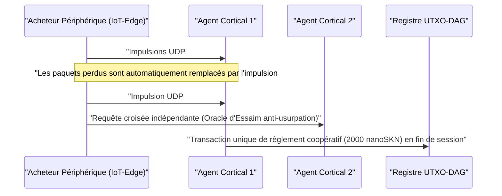

# Chapitre 01 : Énoncé du Problème & L'Économie Pratique Machine-à-Machine (`M2M`)

[← Chapitre 00 : Résumé & Vision](./00-abstract-and-vision.md) | [Chapitre 02 : Architecture Multicellulaire →](./02-multicellular-architecture.md)

---

## 1. Au-Delà des Chatbots Centralisés : L'Intelligence Réflexe à la Périphérie Physique

SkyNet n'a pas vocation à remplacer les grands modèles de langage centralisés à cent milliards de paramètres destinés à la rédaction de longs documents. SkyNet cible au contraire un **angle mort structurel de plusieurs milliers de milliards de dollars** : la périphérie physique d'Internet, là où des milliards de machines autonomes, de capteurs industriels, de passerelles réseau et d'agents logiciels exigent **une inférence réflexe inférieure à `10 ms`, une adaptation locale continue et un règlement de valeur machine-à-machine (`M2M`) inférieur au centime** sur des liaisons sans fil non fiables.

### Pourquoi les Clouds Centralisés et les Blockchains Historiques Échouent Ici

Considérons un agent périphérique autonome $A$ (tel qu'un drone en essaim, une passerelle d'atténuation DDoS ou un relais de réseau électrique intelligent) achetant une classification d'anomalies et une vérification télémétrique en temps réel toutes les $\Delta t = 10\text{ ms}$, valorisées à $v = 50\text{ nanoSKN}$ par impulsion :

1. **Le Mur de la Latence & des Retransmissions TCP :** L'établissement de sessions TLS/TCP vers des régions cloud distantes impose des poignées de main à multiples allers-retours (multi-RTT). Sous une perte ambiante de paquets sans fil de $p_{\text{loss}} = 20\%$, la réduction de la fenêtre de congestion TCP et les délais d'expiration de retransmission propulsent la latence de queue `p99` à plusieurs centaines de millisecondes — une dégradation catastrophique pour les boucles d'asservissement cyber-physiques en temps réel.
2. **Le Plancher des Frais Fixes :** Sur les rails de paiement fiduciaires ou les chaînes de contrats intelligents EVM, le surcoût fixe par transaction $F_{\text{tx}}$ dépasse la valeur d'une impulsion individuelle d'un facteur $10^5\times$ à $10^8\times$ ($F_{\text{tx}} \gg v$), rendant le commerce M2M à l'échelle de la milliseconde économiquement impossible.
3. **La Dérive des Modèles Statiques :** Les poids statiques pré-entraînés déployés depuis un cloud se dégradent rapidement face à l'évolution des distributions de signaux locaux (`concept drift`), tandis que les appareils périphériques contraints ne disposent ni de la mémoire ni du budget énergétique requis pour exécuter une rétropropagation du gradient.

---

## 2. Quatre Piliers Économiques Concrets Stimulant la Demande en `SKN`

La demande intrinsèque en `SKN` découle de quatre capacités concrètes sur lesquelles ni les clouds centralisés ni les blockchains à état ne peuvent rivaliser :

### 2.1. Micro-Inférence d'Essaim à Très Faible Latence en Périphérie (`< 10 ms`)
Les flottes robotiques, contrôleurs IoT industriels, relais télécoms et équipements de sécurité réseau intègrent un vecteur de caractéristiques normalisé à 8 dimensions (`stimulus: [f32; 8]`) accompagné d'un `SynapticVoucher` signé à l'intérieur d'**un unique datagramme UDP `<= 1200 bytes`**.
- Les cellules voisines `Epidermal` et `Neural` exécutent les passes avant récurrentes de leur Liquid Micro-Net en moins de `0.1 ms` par impulsion.
- Comme `SynapticVoucher` encode des totaux cumulés strictement croissants de manière monotone, même une perte aléatoire de paquets UDP de `25%` sur liaison cellulaire ou satellitaire n'engendre **aucun blocage de facturation ni aucune pause de retransmission**.

### 2.2. L'Évolution en tant que Service (EaaS) & Le Marché Décentralisé de Gènes `Plasmid`
Au lieu de louer de coûteuses grappes GPU cloud pour entraîner des modèles embarqués compacts, tout utilisateur ou agent autonome peut diffuser une prime d'optimisation spécifiant les flux de stimuli $x_t$, les réponses cibles $y_t^*$ et les récompenses en `SKN` :
- Des milliers d'organismes `AgentNode` déclenchent une `Mitosis` cellulaire `1 -> 2`, évaluant en parallèle des dizaines de milliers de perturbations synaptiques et de constantes de temps liquides $\tau$.
- Les mutants sous-performants subissent l'`Apoptosis`, tandis que les lignées les plus performantes convergent vers des génomes `CellDna` compacts (moins de `2 KB`, scellés cryptographiquement par `BLAKE3`).
- Le demandeur reçoit à la fois l'inférence en direct et **l'artefact autonome de poids évolués `CellDna`** (livré sans perte via des paquets `FountainDroplet` sur `GF(2)`), prêt à être flashé directement sur des millions de microcontrôleurs.

### 2.3. Rail de Paiement Atomique `M2M nanoSKN` & Oracles d'Essaim Anti-Hallucination
Libellés jusqu'à l'unité atomique de `1 nanoSKN` ($10^{-9}\text{ SKN}$), les Agents IA achètent et recoupent de manière autonome des signaux physiques du monde réel (micro-météorologie, occupation du spectre RF, latence de routage, flux d'ordres haute fréquence) :

L'échantillonnage croisé d'organismes `AgentNode` indépendants au sein d'un cluster local élimine les hallucinations d'un modèle isolé ainsi que l'usurpation de capteurs (`spoofing`).

### 2.4. DePIN Multi-Niveaux Inclusif (Symbiose Matérielle)
SkyNet fédère le matériel hétérogène inutilisé à travers le monde au sein d'une chaîne logistique biologique symbiotique :

| Segment de Participants | Matériel Courant | Rôle Écologique | Flux de Revenus `SKN` |
| :--- | :--- | :--- | :--- |
| **Particuliers & Foyers** | Anciens smartphones, routeurs domestiques, Raspberry Pi, cartes IoT | Capture sensorielle de bordure, filtrage de paquets `Epidermal`, vérification légère `Utreexo` dans `~1 KB` | Gains en `nanoSKN` via les flux de capteurs en direct & le filtrage périphérique |
| **Développeurs & Utilisateurs PC** | Ordinateurs portables, PC de bureau (`StandardNode`) | Échantillonnage de consensus `Snowball`, routage de bons, évolution tissulaire de taille moyenne | Gains sur les frais de transaction du cluster (`cluster_nutrient_pool`) & revenus d'inférence |
| **Laboratoires & Opérateurs GPU** | Serveurs multicœurs, GPU Apple `Metal`, NVIDIA `CUDA` | Évolution parallèle `TissueBatch` jusqu'à `16,384` cellules par nœud | Gains sur les primes d'évolution & redevances d'exportation horizontale de `Plasmid` |

---

## 3. Compression Sous-Linéaire du Règlement sur Chaîne

Supposons que deux Agents IA échangent $M$ impulsions d'inférence haute fréquence à $\delta\text{ nanoSKN}$ par appel sur un canal sans fil présentant une probabilité de perte de paquet $p \in [0, 1)$. Un règlement historique sur chaîne exige $\mathcal{O}(M)$ transactions sur le registre tandis que le surcoût de retransmission TCP croît selon $\frac{1}{1 - p}$.

Dans SkyNet, le payeur émet des bons signés par `Ed25519`, indexés par le numéro de séquence $s \in \{1, \dots, M\}$ et portant la valeur cumulée $V_s = s \cdot \delta$. Tout paquet survivant $s_k$ prouve cryptographiquement l'intégralité du delta incrémental $\Delta V = V_{s_k} - V_{s_{k-1}}$ couvrant tous les paquets intermédiaires perdus sans aucune retransmission. À la clôture de la session, l'ensemble des $M$ micro-inférences se règle en **exactement $1$ transaction UTXO-DAG**, atteignant un taux de compression sur chaîne de $M : 1$ (soit une réduction de charge du registre de $1{,}000\times$ à $100{,}000\times$ en pratique).

Le Chapitre 02 examine l'anatomie interne de chaque `AgentNode` — en montrant comment un binaire logiciel unique s'auto-organise en organisme multicellulaire vivant sur n'importe quel palier matériel.

---

[← Chapitre 00 : Résumé & Vision](./00-abstract-and-vision.md) | [Chapitre 02 : Architecture Multicellulaire →](./02-multicellular-architecture.md)
