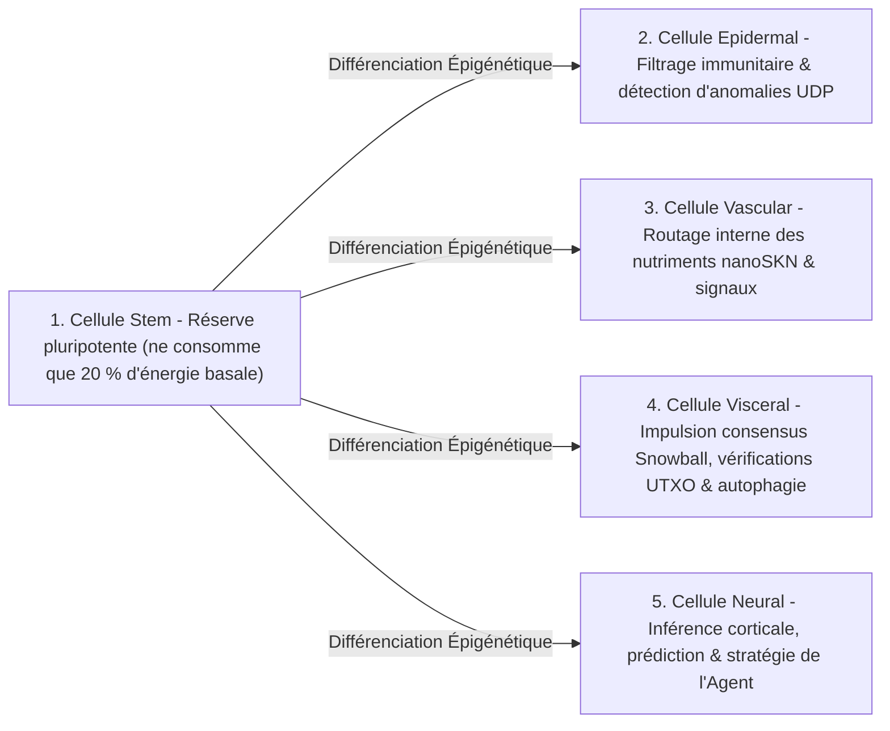

# Chapitre 02 : Architecture de l'Organisme Multicellulaire & Mise à l'Échelle Matérielle Élastique (`AgentNode`)

[← Chapitre 01 : Énoncé du Problème & Économie M2M](./01-problem-and-m2m-economy.md) | [Chapitre 03 : `CellDna` & Cellules Neuronales Liquides →](./03-dna-and-liquid-neural-cells.md)

---

## 1. Isomorphisme Biologique : `1 Nœud = 1 Organisme Multicellulaire`

Dans les réseaux pair-à-pair conventionnels, chaque nœud exécute une machine à états monolithique et rigide, qu'il tourne sur un microcontrôleur embarqué ou sur un serveur GPU à 64 cœurs. Dans SkyNet (`crates/skynet-agent`), chaque participant du réseau est instancié sous la forme d'un **`AgentNode`** — un organisme multicellulaire vivant comprenant une population dynamique de micro-cellules d'IA $\mathcal{C}(t) = \{c_1, c_2, \dots, c_{N(t)}\}$, une trésorerie métabolique interne (`AgentMetabolicBank`), un vérificateur de racines `Utreexo` sans état (`StatelessUtreexoRoots`), et un moteur `SnowballEngine` tolérant aux pertes.

La taille de la population cellulaire $N(t) = |\mathcal{C}(t)|$ n'est jamais figée en dur ; elle **s'étend par `Mitosis` et se contracte par `Apoptosis` de manière organique selon la capacité matérielle de l'hôte et l'afflux de nutriments `nanoSKN` gagnés**.

---

## 2. Trois Paliers Matériels Élastiques (`HardwareTier`)

Au démarrage, `HardwareProfile::for_tier` associe la capacité de l'hôte à l'un des trois profils écologiques dotés de seuils métaboliques exacts en `nanoSKN` (`crates/skynet-cell/src/lib.rs`) :

| Paramètre Biologique (`HardwareProfile`) | `TinyPeripheral` (IoT / MCU de Bordure) | `StandardNode` (Portable / PC de Bureau) | `ColossalOrganism` (Serveur / GPU) |
| :--- | :--- | :--- | :--- |
| **Population Cellulaire Maximale (`max_cells`)** | `32` cellules | `512` cellules | `16,384` cellules |
| **Consommation Basale Active / Tick (`basal_burn_per_tick`)** | `50 nanoSKN` | `25 nanoSKN` | `10 nanoSKN` |
| **Consommation `Stem` Dormante / Tick (économie de 80 %)** | `10 nanoSKN` | `5 nanoSKN` | `2 nanoSKN` |
| **Seuil de Division (`mitosis_threshold`)** | `2,000 nanoSKN` | `1,500 nanoSKN` | `1,000 nanoSKN` |
| **Frais Sanguins de Division (`mitosis_blood_fee`)** | `100 nanoSKN` | `60 nanoSKN` | `40 nanoSKN` |
| **Plancher d'Élimination (`apoptosis_floor`)** | `100 nanoSKN` | `80 nanoSKN` | `50 nanoSKN` |
| **Moteur de Calcul (`candle_core::Device`)** | `Cpu` | `Cpu` / `Metal` / `Cuda` | `Cuda` / `Metal` / `Cpu` SIMD |

> [!NOTE]
> **Économies d'Échelle Biologiques (Loi de Kleiber) :** Tout comme les grands organismes biologiques présentent un coût métabolique inférieur par gramme de tissu, les nœuds `ColossalOrganism` supportent une dépense basale par cellule plus faible (`10 nanoSKN` contre `50 nanoSKN`), car des milliers de cellules amortissent leur exécution au sein d'un unique noyau tensoriel GPU traité par lots, tandis que les nœuds `TinyPeripheral` demeurent sobres et résilients à la périphérie du réseau.

---

## 3. Cinq Lignées Histologiques Spécialisées (`CellRole`)

Lorsqu'un `AgentNode` naît (`AgentNode::from_signing_key`), il initialise un germe embryonnaire de 6 cellules (`2 Stem`, `1 Epidermal`, `1 Vascular`, `1 Visceral`, `1 Neural`) dérivé d'un génome déterministe `base_stem`. Tout au long de la vie de l'organisme, cinq lignées histologiques assurent cinq fonctions physiologiques essentielles :

1. **`Stem` (Réserve Pluripotente — `operon_index = None`) :** Cellules régénératrices dormantes ne consommant que $\max(\lfloor E_{\text{burn}} / 5 \rfloor, 1)$ par tick. Dès qu'un organe spécialisé subit une attrition, une cellule `Stem` se différencie épigénétiquement (`differentiate`) pour le reconstituer sans téléchargement de code externe.
2. **`Epidermal` (Peau & Barrière Immunitaire — `operon_index = Some(0)`) :** Protège le socket UDP brut (`epidermal_inspect_packet`). Avant qu'un paquet entrant n'atteigne le registre ou le moteur de consensus, une cellule `Epidermal` évalue sur `candle` la télémétrie normalisée du paquet (`raw_len / 1200`, `hop_ttl / 16`, dérive d'`epoch`) afin d'écarter les impulsions malformées ou d'inondation.
3. **`Vascular` (Régulateur Circulatoire — `operon_index = Some(1)`) :** Régule la liquidité interne du `blood_pool` au sein d'`AgentMetabolicBank`, canalisant les récompenses en `nanoSKN` vers les cellules à haute précision.
4. **`Visceral` (Maintenance des Organes — `operon_index = Some(2)`) :** Pilote la cadence de sondage `Snowball`, la vérification sans état des témoins `Utreexo` et le recyclage métabolique.
5. **`Neural` (Cerveau Cortical — `operon_index = Some(3)`) :** Exécute l'inférence cognitive ; la moyenne d'ensemble sur toutes les cellules `Neural` vivantes ($\bar{y}_{\text{cortical}} = \frac{1}{|\mathcal{C}_{\text{neural}}|} \sum_{i \in \mathcal{C}_{\text{neural}}} y_i$) forme la sortie décisionnelle collective de l'organisme.

---

## 4. Le Cycle Physiologique en Six Phases par Tick (`run_biological_tick`)

À chaque pulsation (`pulse_seq`), `AgentNode` exécute un cycle physiologique déterministe en six phases unissant compétition darwinienne et conservation exacte des `nanoSKN` sur `u128` :

1. **Phase 1 — Métabolisme Basal :** Chaque cellule $c_i$ brûle son énergie de maintenance $b_i = \text{metabolize\_tick}()$. Point crucial : $b_i$ n'est jamais détruit sur chaîne ; 100 % de l'ATP intracellulaire consommé est recyclé dans `bank.blood_pool`. Les cellules affamées ($E_i = 0$) perdent `0.25` de `health`.
2. **Phase 2 — Inférence Tensorielle Groupée sur `candle` :** Les $N$ cellules vivantes s'exécutent simultanément via `TissueBatch::forward_slice`, produisant les sorties $y_i \in \mathbb{R}^4$ et mettant à jour leurs vecteurs de mémoire liquide à court terme $h_{i,t} \in \mathbb{R}^{16}$.
3. **Phase 3 — Sélection Nutritive Darwinienne Intra-Organe :**
   Étant donné le signal cible $t \in \mathbb{R}^4$, la qualité de prédiction de la cellule $i$ est mesurée par l'erreur absolue moyenne bornée :

   $$q_i = \operatorname{clamp}\!\left(1 - \frac{1}{4}\sum_{k=1}^{4} |y_{i,k} - t_k|,\ 0.0,\ 1.0\right)$$

   Soit $\bar{q}_r$ la qualité moyenne de l'ensemble des cellules partageant le rôle d'organe $r = \text{role}(c_i)$. Une cellule spécialisée reçoit des nutriments `nanoSKN` puisés dans `blood_pool` si et seulement si son organe compte $\le 2$ cellules ou si elle franchit le seuil de compétitivité intra-organe $q_i \ge 0.98 \cdot \bar{q}_r$ :

   $$R_i = \min\!\left(\lfloor 320 \cdot q_i \rfloor + E_{\text{basal}},\ \left\lfloor \frac{B_{\text{blood}}}{8} \right\rfloor\right)$$

   Les mutants sous-performants ($q_i < 0.98 \cdot \bar{q}_r$) ne reçoivent aucun nutriment et subissent une pénalité de `health` de `-0.35`.
4. **Phase 4 — Différenciation Homéostatique des Cellules Souches :** L'organisme identifie son organe spécialisé le plus sous-peuplé (`find_most_needed_role`). Dès que `stem_count > 1`, une cellule `Stem` se différencie vers cet organe tout en préservant systématiquement au moins `1` cellule `Stem` germinale.
5. **Phase 5 — Mitose `1 -> 2` :** Les cellules saines et bien nourries (`health >= 0.65` et $E_i \ge E_{\text{mitosis}}$) se divisent en un clone conservateur (Cellule Fille A) et un explorateur muté (Cellule Fille B), jusqu'à la limite `profile.max_cells`.
6. **Phase 6 — Apoptose avec Protection des Organes :** Les cellules affamées ($E_i < E_{\text{apoptosis}}$) ou gravement endommagées (`health <= 0.15`) se dissolvent et restituent 100 % de leurs `nanoSKN` restants au `blood_pool` — sous réserve d'un garde-fou strict de survie : **au moins `1` cellule vivante par `CellRole` existant est inconditionnellement préservée** afin qu'aucun organe vital ne s'éteigne jamais.

À la clôture de chaque tick, `verify_internal_skn_conservation()` vérifie l'identité exacte sur `u128` :

$$B_{\text{chain}}(\text{Agent}) \equiv B_{\text{blood}}(\text{Agent}) + \sum_{c_i \in \mathcal{C}} E_i$$

Le Chapitre 03 ouvre le noyau cellulaire pour spécifier la structure binaire et mathématique exacte de `CellDna`, la commutation épigénétique des opérons et l'exécution neuronale liquide 3D `TissueBatch`.

---

[← Chapitre 01 : Énoncé du Problème & Économie M2M](./01-problem-and-m2m-economy.md) | [Chapitre 03 : `CellDna` & Cellules Neuronales Liquides →](./03-dna-and-liquid-neural-cells.md)
