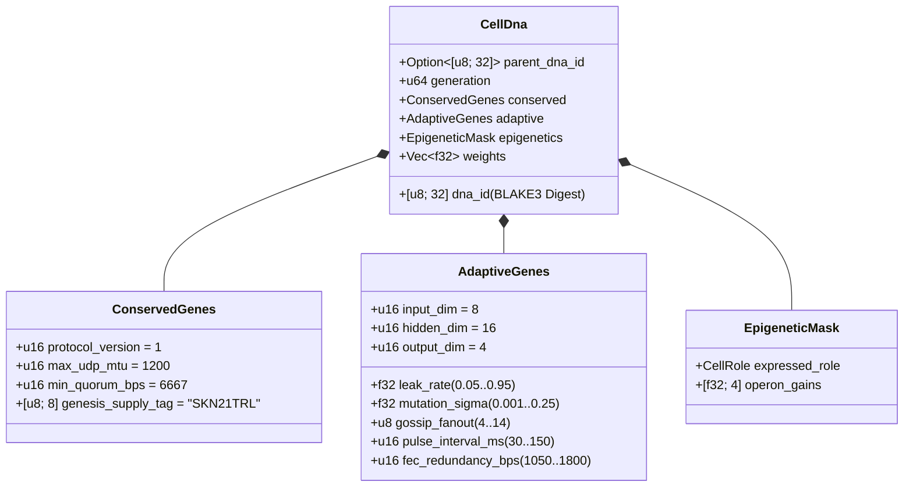

# Chapitre 03 : Encodage Génétique (`CellDna`), Épigénétique & Évolution Micro-Neuronale Liquide sur `candle`

[← Chapitre 02 : Architecture Multicellulaire](./02-multicellular-architecture.md) | [Retour à l'Index Français →](./README.md)

---

## 1. Architecture du Génome Cellulaire (`CellDna`)

L'évolution biologique équilibre deux forces opposées : la **conservation stricte** des invariants biochimiques fondamentaux (où toute mutation est létale) et la **variation continue** des traits neuronaux et comportementaux. Le crate `skynet-dna` formalise cette dualité au sein de `CellDna` :

### 1.1. Gènes Conservés Immuables (`ConservedGenes`)
Aucune mutation ni aucun croisement horizontal ne peut altérer `ConservedGenes`. Tout génome violant l'un des quatre prédicats de sûreté du consensus est immédiatement rejeté avec l'erreur `DnaError::ConservedGeneViolation` :
- `protocol_version == 1`
- `max_udp_mtu == 1200` (plafond UDP garanti sans fragmentation)
- $6667 \le \text{min\_quorum\_bps} \le 10000$ (imposant une majorité qualifiée $\ge \frac{2}{3}$ dans `Snowball`)
- `genesis_supply_tag == *b"SKN21TRL"` (ancrant irrévocablement le plafond d'émission à 21 mille milliards de `SKN`)

### 1.2. `AdaptiveGenes` & Topologie des Poids à Tronc Commun et Opérons
Plutôt que de stocker quatre réseaux neuronaux disjoints pour les quatre types cellulaires spécialisés, `CellDna` encode **un Tronc Sensoriel Commun** alimentant **quatre Têtes de Projection d'Opéron Spécialisées**. Pour des dimensions $(D_{\text{in}}, H, D_{\text{out}})$, le nombre exact de paramètres `f32` est :

$$|\theta| = \underbrace{(D_{\text{in}} \cdot H + H)}_{\text{Tronc sensoriel commun }(W_1, b_1)} + \underbrace{4 \cdot (H \cdot D_{\text{out}} + D_{\text{out}})}_{\text{4 Projections Operon }(W_{2,r}, b_{2,r})}$$

Sous les dimensions par défaut $(D_{\text{in}} = 8,\ H = 16,\ D_{\text{out}} = 4)$ :
- Tronc commun : $8 \times 16 + 16 = 144$ paramètres.
- Quatre têtes d'opéron (`Epidermal`, `Vascular`, `Visceral`, `Neural`) : $4 \times (16 \times 4 + 4) = 272$ paramètres.
- Poids totaux du génome : $|\theta| = 416$ flottants `f32` ($1{,}664\text{ bytes}$ de poids bruts). Les génomes souches de génération 0 (`CellDna::genesis_stem`) sont initialisés de façon déterministe via `ChaCha8Rng` selon une loi uniforme $\mathcal{U}(-\sigma_0, +\sigma_0)$ calibrée à l'échelle de Xavier :

$$\sigma_0 = \sqrt{\frac{2}{D_{\text{in}} + H}}$$

### 1.3. Empreinte Cryptographique Déterministe `BLAKE3` (`SKYNET_DNA_V1`)
Chaque hyperparamètre et poids en virgule flottante est sérialisé selon sa représentation binaire canonique IEEE-754 petit-boutiste (`to_bits().to_le_bytes()`) dans un hachage à séparation de domaine `BLAKE3("SKYNET_DNA_V1", ...)`. Toute corruption d'un seul bit, injection de `NaN`/`Inf` ou altération non autorisée des poids provoque un rejet immédiat lors de l'appel à `verify_integrity()`.

---

## 2. Commutation par Méthylation Épigénétique (`EpigeneticMask`)

En biologie multicellulaire, un neurone et une cellule épidermique portent exactement la même séquence d'ADN mais expriment des phénotypes radicalement différents grâce à la méthylation génétique. Dans SkyNet, lorsqu'une cellule `Stem` se différencie vers un rôle cible $r \in \{0, 1, 2, 3\}$ (`CellDna::differentiate`), **100 % du vecteur sous-jacent `weights` demeure intact** tandis que `EpigeneticMask` ajuste le gain d'expression :

- **État `Stem` Dormant :** `operon_gains = [0.25, 0.25, 0.25, 0.25]`, projetant via la tête d'opéron `0` avec un gain atténué $g = 0.25$.
- **Rôle Différencié $r$ :** La tête d'opéron $r$ s'active à plein gain ($g_r = 1.0$) tandis que les têtes non exprimées sont inhibées à $0.05$ :

$$g_k = \begin{cases} 1.0 & \text{si } k = r \\ 0.05 & \text{si } k \neq r \end{cases}$$

Par conséquent, les représentations sensorielles apprises dans le tronc commun $(W_1, b_1)$ ainsi que les adaptations latentes logées dans les têtes dormantes persistent au fil des générations et restent immédiatement mobilisables lors d'une transdifférenciation.

---

## 3. Dynamique à Constante de Temps Liquide & Exécution 3D `TissueBatch`

### 3.1. Dynamique Liquide Récurrente d'une Cellule Individuelle
Des perceptrons multicouches (MLP) sans état à propagation avant pure ne peuvent pas capturer les corrélations temporelles présentes dans des flux asynchrones de paquets UDP. Chaque `MicroCell` maintient un vecteur récurrent de mémoire à court terme $h_t \in \mathbb{R}^H$ régi par une interpolation d'état discrète **Liquid Time-Constant (LTC)** dotée d'un taux de fuite évolutif $\tau \in [0.05, 0.95]$ :

$$h_t = (1 - \tau)\, h_{t-1} + \tau\, \tanh(x_t W_1 + b_1)$$

$$y_t = g_{\text{role}} \cdot \tanh(h_t W_{2,r} + b_{2,r})$$

- Lorsque $\tau \to 0.05$, la cellule conserve une forte inertie mémorielle à long horizon (idéale pour le suivi de tendances des cellules `Visceral` et `Neural`).
- Lorsque $\tau \to 0.95$, la cellule réagit instantanément aux impulsions frontalières à haute fréquence (idéal pour le score d'anomalies des cellules `Epidermal`).
- Comme $\tau$ réside dans `AdaptiveGenes`, **l'horizon de mémoire temporelle de chaque cellule co-évolue naturellement avec ses poids synaptiques**.

### 3.2. Moteur Tensoriel 3D à Haut Débit `TissueBatch` (`Cpu` / `Metal` / `Cuda`)
Un goulot d'étranglement classique de la neuro-évolution réside dans l'hétérogénéité des poids : chaque cellule $i \in \{1, \dots, N\}$ porte des matrices mutées distinctes $W_1^{(i)} \neq W_1^{(j)}$ ainsi que des taux de fuite distincts $\tau^{(i)} \neq \tau^{(j)}$. Lancer $N$ micro-noyaux séquentiels sous-utiliserait gravement les GPU modernes.

`TissueBatch::forward_slice` dans `skynet-cell` résout ce problème en assemblant l'ensemble des $N$ cellules hétérogènes au sein de tenseurs contigus d'ordre 3 sur `candle_core::Device` :

$$\mathbf{X} \in \mathbb{R}^{N \times 1 \times D_{\text{in}}}, \quad \mathbf{W}_1 \in \mathbb{R}^{N \times D_{\text{in}} \times H}, \quad \mathbf{B}_1 \in \mathbb{R}^{N \times 1 \times H}$$

$$\mathbf{H}_t = (\mathbf{1} - \boldsymbol{\tau}) \odot \mathbf{H}_{t-1} + \boldsymbol{\tau} \odot \tanh\!\big(\operatorname{BMM}(\mathbf{X}, \mathbf{W}_1) + \mathbf{B}_1\big)$$

$$\mathbf{Y}_t = \mathbf{G} \odot \tanh\!\big(\operatorname{BMM}(\mathbf{H}_t, \mathbf{W}_2) + \mathbf{B}_2\big)$$

où $\operatorname{BMM}$ désigne la multiplication matricielle par lots en un seul noyau (Batched Matrix Multiplication) et $\odot$ désigne la multiplication élément par élément avec diffusion de dimensions (`broadcast`) pour $\boldsymbol{\tau}, \mathbf{G} \in \mathbb{R}^{N \times 1 \times 1}$. Les tests unitaires audités confirment que `TissueBatch` reproduit l'exécution individuelle cellule par cellule avec une tolérance en virgule flottante $< 10^{-5}$, tout en passant à l'échelle jusqu'à `16,384` modèles évolués simultanés par `ColossalOrganism`.

---

## 4. Mitose Asymétrique, Conservation Exacte des `nanoSKN` Impairs & Croisement Plasmidique

### 4.1. `Mitosis` Asymétrique `1 -> 2` & Preuve de Conservation Atomique Exacte
Lorsqu'une cellule mère $P$ vérifie $E_P \ge \max(E_{\text{mitosis}}, F_{\text{blood}} + 2)$ et `health >= 0.65`, `divide_mitosis` engendre deux cellules filles de génération $(g+1)$ :
- **Cellule Fille A (Clone Conservateur) :** Conserve 100 % des poids parentaux éprouvés et des paramètres adaptatifs sans aucune perturbation.
- **Cellule Fille B (Explorateur Muté) :** Hérite de la continuité de l'état caché `hidden_state` parental tout en subissant une mutation neuro-évolutive bornée :
  - Chaque poids $w \in \theta$ mute avec une probabilité de $0.35$ selon une perturbation gaussienne d'Irwin-Hall à 6 échantillons sans dépendance externe ($\Delta w \sim \mathcal{N}(0, \sigma^2)$), strictement bornée dans $[-4.0, +4.0]$ afin d'empêcher toute explosion des poids ou des gradients.
  - $\tau$, $\sigma$, `gossip_fanout` ($\pm 1$), `pulse_interval_ms` ($\pm 10\text{ ms}$) et `fec_redundancy_bps` ($\pm 50\text{ bps}$) co-mutent à l'intérieur d'intervalles bornés.

**Preuve de Conservation Sans Fuite des `nanoSKN` Impairs :** Soit $E_{\text{dist}} = E_P - F_{\text{blood}}$ l'ATP distribuable après prélèvement des frais sanguins. Les soldes des cellules filles sont partitionnés par arithmétique entière quotient-reste sur `u128` :

$$E_A = \left\lfloor \frac{E_{\text{dist}}}{2} \right\rfloor + (E_{\text{dist}} \bmod 2), \qquad E_B = \left\lfloor \frac{E_{\text{dist}}}{2} \right\rfloor$$

Pour tout entier positif ou nul $E_{\text{dist}} \in \mathbb{Z}_{\ge 0}$ (y compris les soldes impairs tels que `3,333 nanoSKN`), la conservation exacte est vérifiée identiquement :

$$E_A + E_B + F_{\text{blood}} = \left(2\left\lfloor \frac{E_{\text{dist}}}{2} \right\rfloor + (E_{\text{dist}} \bmod 2)\right) + F_{\text{blood}} = E_{\text{dist}} + F_{\text{blood}} \equiv E_P$$

Pas un seul `nanoSKN` n'est jamais perdu par arrondi ni créé ex nihilo à travers des milliards de divisions cellulaires.

### 4.2. Transfert Horizontal de Gènes Inter-Agents (Croisement `Plasmid`)
À l'image de l'échange bactérien de plasmides, un `AgentNode` exporte le `CellDna` de sa cellule à plus haute valeur sélective dans des paquets UDP `FountainDroplet` codés à effacement (`encode_elite_plasmid_droplets`). Dès la reconstitution de `donor_dna` sur des liaisons UDP sujettes aux pertes, l'Agent récepteur améliore sa cellule la moins performante via `horizontal_crossover` :
- Les paramètres adaptatifs réseau et la constante de temps se combinent selon $0.7 \cdot \text{Recipient} + 0.3 \cdot \text{Donor}$.
- $30\%$ des poids synaptiques sont hybridés uniformément selon $0.5 \cdot w_{\text{rec}} + 0.5 \cdot w_{\text{don}} \in [-4.0, +4.0]$.

Grâce au transfert horizontal de plasmides, un capteur IoT `TinyPeripheral` aux ressources limitées absorbe l'intelligence neuronale d'élite évoluée sur des nœuds GPU `ColossalOrganism` distants, tout en préservant cryptographiquement la sûreté de `ConservedGenes`.

---

> **À suivre dans la Phase 2 (Partie II) :** Les Chapitres `04–06` formalisent les mathématiques du coffre de Halving à `21,000,000,000,000 SKN`, le pacte de Garde Humaine Souveraine `Soul–Body` ainsi que le passage à l'échelle du registre sans état `Utreexo` (`~1 KB`) couplé aux canaux `SynapticVoucher`.

[← Chapitre 02 : Architecture Multicellulaire](./02-multicellular-architecture.md) | [Retour à l'Index Français →](./README.md)
