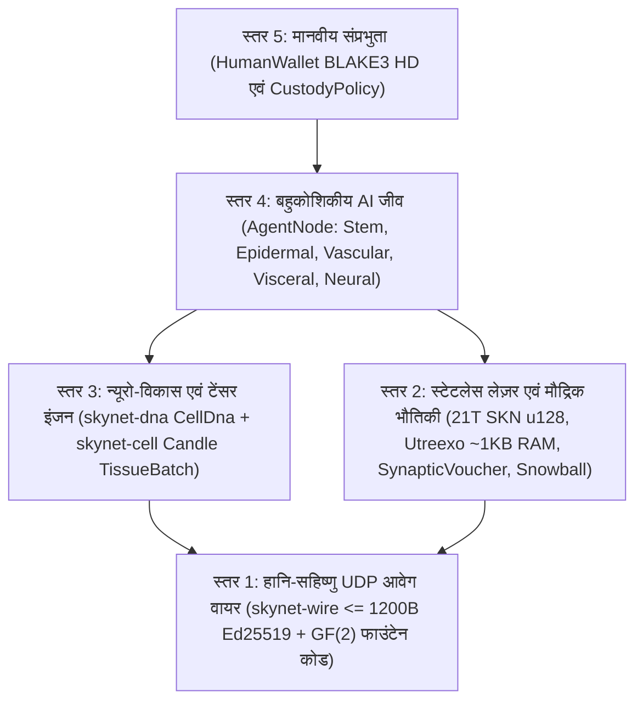

# अध्याय 00: अकादमिक सारांश, प्रोटोकॉल स्वयंसिद्ध सिद्धांत और वैश्विक भागीदारी दर्शन

[← हिन्दी अनुक्रमणिका पर वापस जाएँ](./README.md) | [अध्याय 01: समस्या कथन और M2M अर्थव्यवस्था →](./01-problem-and-m2m-economy.md)

---

## सारांश (Abstract)

हम **SkyNet** प्रस्तुत करते हैं — एक विकेंद्रीकृत नेटवर्क प्रोटोकॉल जो **बहुकोशिकीय विकासवादी जीवविज्ञान**, **अति-सघन लिक्विड टाइम-कॉन्स्टेंट तंत्रिका नेटवर्क (`Liquid Micro-Nets`)**, और **स्टेटलेस रूप से सत्यापन योग्य `Utreexo` UTXO-DAG लेज़र** को एकीकृत करता है, तथा पूर्णतः **कनेक्शन-रहित, हानि-सहिष्णु UDP डेटाग्राम (`<= 1200 bytes`)** पर संचालित होता है। हाइपरस्केल GPU क्लस्टरों की माँग करने वाले केंद्रीकृत AI क्लाउड या विश्वसनीय TCP स्ट्रीम से बंधे स्टेटफुल ब्लॉकचेन के विपरीत, SkyNet प्रत्येक नेटवर्क प्रतिभागी (`AgentNode`) को एक **स्वायत्त बहुकोशिकीय जीव** के रूप में परिभाषित करता है जो दसियों से लेकर हजारों जीवंत सूक्ष्म-AI मॉडलों (`MicroCell`) से निर्मित होता है। प्रत्येक कोशिका क्रिप्टोग्राफ़िक रूप से सत्यापन योग्य बहुक्षम (pluripotent) स्टेम जीनोम (`BLAKE3` द्वारा प्रमाणित `CellDna`) से उत्पन्न होती है, एपिजेनेटिक मिथाइलेशन मास्क (`EpigeneticMask`) के माध्यम से पाँच विशिष्ट ऊतकीय वंश-क्रमों (histological lineages) में विभेदित होती है, परिबद्ध न्यूरो-विकासवादी उत्परिवर्तनों के साथ `1 -> 2` में विभाजित होती है (`Mitosis`), `GF(2)` इरेज़र-कोडेड क्षैतिज जीन स्थानांतरण (`Plasmid`) के माध्यम से जीवों के बीच श्रेष्ठ गुणों का आदान-प्रदान करती है, और पोषण-अभाव की स्थिति में क्रमादेशित विलोपन (`Apoptosis`) से गुज़रती है।

इस जैविक बुद्धिमत्ता अर्थव्यवस्था को कठोर ऊष्मागतिकीय और मौद्रिक दुर्लभता में स्थिर करने के लिए, SkyNet $S_{\max} = 21{,}000{,}000{,}000{,}000\text{ SKN}$ ($2.1 \times 10^{22}\text{ nanoSKN}$, जिसे `u128` में बिना किसी सटीकता-हानि के निरूपित किया जाता है) की एक अपरिवर्तनीय जेनेसिस आपूर्ति सीमा लागू करता है, जो वार्षिक `50%` हाविंग उत्सर्जन अनुसूची और ऑन-चेन UTXO शेष से लेकर व्यक्तिगत अंतःकोशिकीय `1 nanoSKN` ATP भंडार तक विस्तृत **द्वि-स्तरीय समरूप ऊर्जा संरक्षण नियम (Two-Tier Isomorphic Energy Conservation Law)** द्वारा शासित होती है। प्रोटोकॉल-स्तरीय **आत्मा–शरीर अभिरक्षा (Soul–Body Custody)** अनुबंध (`CustodyPolicy`) के माध्यम से, मानवीय स्वामी अनन्य आपातकालीन पुनर्प्राप्ति अधिकारों के साथ `0%`-क्षय वाली संप्रभु कोल्ड-वॉलेट कुंजियाँ अपने पास रखते हैं, जबकि ऑनलाइन AI एजेंट बेड़ों को कठोरता से परिबद्ध परिचालन भत्ते सौंपते हैं। अंततः, एकदिष्ट (monotonic) **`SynapticVoucher`** सूक्ष्म-भुगतान धाराओं के साथ संयुक्त मेटास्टेबल **`Snowball`** उप-प्रतिचयन (sub-sampling) शून्य पुनःप्रेषण कतारों (zero retransmission queues) के साथ `25%–40%` परिवेशीय UDP पैकेट हानि के बावजूद अपरिवर्तनीय डबल-स्पेंड अंतिमता (finality) और उच्च-आवृत्ति M2M निपटान प्राप्त करता है।

---

## 1. प्रेरणा और अवसंरचना विरोधाभास

समकालीन डिजिटल अवसंरचना दो चरम ध्रुवों के बीच विखंडित है जो विश्व भर के अरबों एज (edge) उपकरणों को बाहर कर देते हैं:

1. **केंद्रीकृत AI एकाधिकार:** अग्रणी लार्ज लैंग्वेज मॉडल (LLMs) मशीन बुद्धिमत्ता को बहु-मेगावाट डेटा सेंटरों के भीतर केंद्रित कर देते हैं। अस्थिर ग्रामीण नेटवर्क लिंक पर कार्यरत कोई कृषि IoT सेंसर, स्वायत्त ड्रोन, या साधारण व्यक्तिगत कंप्यूटर केवल सब-`10 ms` प्रतिवर्ती (reflexive) बुद्धिमत्ता निष्पादित करने के लिए सैकड़ों-मिलीसेकंड के TCP/TLS राउंड-ट्रिप या क्लाउड API बिलिंग ओवरहेड का वहन नहीं कर सकता।
2. **ब्लॉकचेन स्टेट स्फीति और TCP भंगुरता:** पारंपरिक स्मार्ट-कॉन्ट्रैक्ट लेज़र वैश्विक खाता स्थिति (account state) बनाए रखने के लिए सैकड़ों गीगाबाइट RAM/NVMe स्टोरेज की माँग करते हैं और विश्वसनीय TCP बाइट स्ट्रीम की पूर्वधारणा रखते हैं। हानिपूर्ण वायरलेस लिंक, सेलुलर हैंडऑफ़, या भीड़भाड़ वाले एज राउटरों पर, TCP `Head-of-Line Blocking` सर्वसम्मति संदेश-प्रवाह और रीयल-टाइम सूक्ष्म-वाणिज्य दोनों को पंगु बना देता है।

**SkyNet एक मूलभूत जैविक प्रश्न पूछता है:** *प्रकृति बिना किसी केंद्रीय सर्वर या हानि-रहित परिवहन के शोरगुल वाले भौतिक वातावरण में अरबों अनुकूली बुद्धिमान जीवों का समन्वय कैसे करती है?* प्रकृति का उत्तर है — **कोशिकीय मॉड्यूलरता**, **एपिजेनेटिक विशिष्टीकरण**, **हानि-सहिष्णु सिनैप्टिक आवेग**, और **कठोर उपापचयी ऊर्जा संरक्षण**।

---

## 2. पाँच मूल प्रोटोकॉल स्वयंसिद्ध सिद्धांत (Axioms)

SkyNet Rust संदर्भ कार्यक्षेत्र (reference workspace) का प्रत्येक क्रेट पाँच अटल स्वयंसिद्ध सिद्धांतों से व्युत्पन्न है:

| स्वयंसिद्ध सिद्धांत | औपचारिक / अभियांत्रिकी कथन | व्यावहारिक परिणाम |
| :--- | :--- | :--- |
| **A1. कोशिका–मॉडल समरूपता** | $1\text{ Node} \equiv 1\text{ Organism } \mathcal{O} = \{c_1, \dots, c_N\}$, जहाँ प्रत्येक $c_i$ एक स्वतंत्र Liquid Micro-Net है | एक `TinyPeripheral` IoT बोर्ड (`32` कोशिकाएँ) और एक `ColossalOrganism` GPU सर्वर (`16,384` कोशिकाएँ) बिल्कुल एक ही प्रोटोकॉल बोलते हैं |
| **A2. परमाण्विक शून्य-ACK UDP अनुशासन** | $\forall p \in \text{Wire},\ \|p\| \le 1200\text{ bytes}$, शून्य पुनःप्रेषण अवस्था | `Head-of-Line Blocking` को पूर्णतः समाप्त करता है; बिना IP विखंडन (fragmentation) के वैश्विक IPv4/IPv6 पथों को पार करता है |
| **A3. द्वि-स्तरीय ऊर्जा संरक्षण** | $S_{\text{vault}} + S_{\text{dag}} \equiv 2.1 \times 10^{22}\text{ nanoSKN}$ और $B_{\text{chain}}(A) \equiv B_{\text{blood}}(A) + \sum_i E_i$ | शून्य मौद्रिक मुद्रास्फीति और शून्य पूर्णांकन रिसाव (rounding leakage) — विषम-मात्रा वाले कोशिका विभाजन के दौरान भी `1 nanoSKN` तक सटीक |
| **A4. `O(log U)` स्टेटलेस सत्यापन** | संपूर्ण UTXO सेट $\le 64$ `Utreexo` बाइनरी मर्कल रूट्स (`~1 KB` RAM) में प्रतिबद्ध | माइक्रोकंट्रोलर और एज सेंसर RPC मध्यस्थों पर भरोसा किए बिना प्रत्येक व्यय को स्वतंत्र रूप से सत्यापित करते हैं |
| **A5. संप्रभु मानवीय अभिरक्षा** | `CustodyPolicy` के माध्यम से ऑनलाइन `agent_pubkey` से पृथक कोल्ड `human_owner` रूट | समझौताग्रस्त या नष्ट हुआ एजेंट हार्डवेयर कभी भी मानवीय मूलधन चुरा नहीं सकता; मनुष्य किसी भी समय 100% निधि पुनः प्राप्त कर सकते हैं |

---

## 3. पाँच-स्तरीय वास्तुशिल्प स्टैक

---

## 4. सार्वभौमिक हार्डवेयर लोकतंत्र: पृथ्वी के प्रत्येक उपकरण के लिए एक भूमिका

SkyNet बहिष्कारकारी प्रूफ़-ऑफ़-वर्क ASICs और अत्यधिक महँगी वैलिडेटर न्यूनतम आवश्यकताओं को अस्वीकार करता है। ऊतकीय विशिष्टीकरण के माध्यम से, कंप्यूटिंग हार्डवेयर का प्रत्येक वर्ग जैविक मूल्य का योगदान करता है:

- **स्मार्टफ़ोन, Raspberry Pi, या IoT उपकरण वाला कोई भी व्यक्ति (`TinyPeripheral`):** नेटवर्क की **"संवेदी एवं बाह्यत्वचीय सीमा (Sensory & Epidermal Boundary)"** के रूप में कार्य करता है — वास्तविक दुनिया की टेलीमेट्री कैप्चर करना, एज पर असंगत UDP ट्रैफ़िक को फ़िल्टर करना, `Utreexo` के माध्यम से `< 1 KB` RAM में UTXO सत्यापित करना, और स्ट्रीमिंग `nanoSKN` अर्जित करना।
- **घरेलू लैपटॉप या ऑफ़िस PC वाला कोई भी व्यक्ति (`StandardNode`):** **"आंतरांगीय एवं संवहनी क्लस्टर ऊतक (Visceral & Vascular Cluster Tissue)"** के रूप में कार्य करता है — `Snowball` सर्वसम्मति स्पंदनों को संचालित करना, वाउचर निपटान को रूट करना, और मध्यम-आकार की कोशिकीय समष्टियों का विकास करना।
- **वर्कस्टेशन या GPU वाले ऑपरेटर (`ColossalOrganism`):** **"वल्कुटीय एवं विकासवादी ढलाईघर (Cortical & Evolutionary Foundries)"** के रूप में कार्य करते हैं — `TissueBatch` टेंसर कर्नेल के माध्यम से समानांतर रूप से `16,384` उत्परिवर्तित तंत्रिका मॉडलों को निष्पादित करना और विश्व भर के एज नोड्स को श्रेष्ठ `Plasmid` जीनोम निर्यात करना।

अध्याय 01 में, हम उन ठोस वास्तविक-विश्व आर्थिक बाज़ारों का परीक्षण करेंगे जहाँ यह जैव-कोशिकीय वास्तुकला केंद्रीकृत AI क्लाउड और पारंपरिक ब्लॉकचेन की तुलना में कई परिमाण-कोटि (orders-of-magnitude) की श्रेष्ठता प्रदान करती है।

---

[← हिन्दी अनुक्रमणिका पर वापस जाएँ](./README.md) | [अध्याय 01: समस्या कथन और M2M अर्थव्यवस्था →](./01-problem-and-m2m-economy.md)
