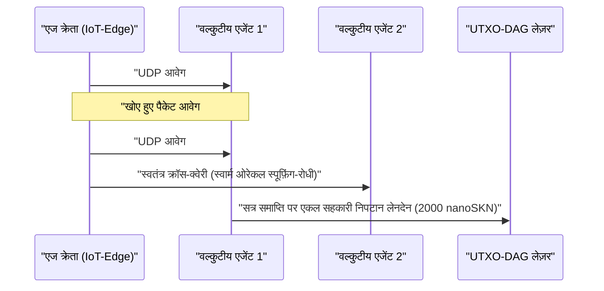

# अध्याय 01: समस्या कथन और व्यावहारिक मशीन-टू-मशीन (`M2M`) अर्थव्यवस्था

[← अध्याय 00: सारांश और दृष्टिकोण](./00-abstract-and-vision.md) | [अध्याय 02: बहुकोशिकीय वास्तुकला →](./02-multicellular-architecture.md)

---

## 1. केंद्रीकृत चैटबॉट से परे: भौतिक एज पर प्रतिवर्ती बुद्धिमत्ता

SkyNet का उद्देश्य लंबे दस्तावेज़ लिखने के लिए सौ-अरब-पैरामीटर वाले केंद्रीकृत लार्ज लैंग्वेज मॉडलों को प्रतिस्थापित करना नहीं है। इसके बजाय, SkyNet एक **बहु-ट्रिलियन-डॉलर के संरचनात्मक अंध-बिंदु (structural blind spot)** को लक्षित करता है: इंटरनेट का भौतिक एज (किनारा), जहाँ अरबों स्वायत्त मशीनों, औद्योगिक सेंसरों, नेटवर्क गेटवे और सॉफ़्टवेयर एजेंटों को अविश्वसनीय वायरलेस लिंक के पार **सब-`10 ms` प्रतिवर्ती अनुमान (reflexive inference), निरंतर स्थानीय अनुकूलन, और एक सेंट के अंश से भी सूक्ष्म मशीन-टू-मशीन (`M2M`) मूल्य निपटान** की आवश्यकता होती है।

### यहाँ केंद्रीकृत क्लाउड और पारंपरिक ब्लॉकचेन क्यों विफल हो जाते हैं

एक स्वायत्त एज एजेंट $A$ (जैसे कि स्वार्म ड्रोन, DDoS शमन गेटवे, या स्मार्ट-ग्रिड रिले) पर विचार करें, जो प्रत्येक $\Delta t = 10\text{ ms}$ पर रीयल-टाइम विसंगति वर्गीकरण और टेलीमेट्री सत्यापन खरीदता है, जिसका मूल्य प्रति आवेग $v = 50\text{ nanoSKN}$ है:

1. **विलंबता (Latency) और TCP पुनःप्रेषण की दीवार:** दूरस्थ क्लाउड क्षेत्रों के साथ TLS/TCP सत्र स्थापित करने में बहु-RTT हैंडशेक लगते हैं। $p_{\text{loss}} = 20\%$ की परिवेशीय वायरलेस पैकेट हानि के तहत, TCP कंजेशन विंडो बैकऑफ़ और पुनःप्रेषण टाइमआउट `p99` टेल लेटेंसी को सैकड़ों मिलीसेकंड तक धकेल देते हैं — जो रीयल-टाइम साइबर-भौतिक नियंत्रण लूप के लिए विनाशकारी है।
2. **आधार-शुल्क की न्यूनतम सीमा (Base-Fee Floor):** फ़िएट भुगतान रेल या EVM स्मार्ट-कॉन्ट्रैक्ट चेन पर, प्रति-लेनदेन स्थिर ओवरहेड $F_{\text{tx}}$ एकल-आवेग मूल्य से $10^5\times$ से $10^8\times$ तक अधिक होता है ($F_{\text{tx}} \gg v$), जिससे मिलीसेकंड-सूक्ष्मता वाला M2M वाणिज्य आर्थिक रूप से असंभव हो जाता है।
3. **स्थिर मॉडल विचलन (Static Model Drift):** क्लाउड से तैनात किए गए पूर्व-प्रशिक्षित स्थिर भार (static weights) बदलते स्थानीय सिग्नल वितरण (`concept drift`) के तहत शीघ्र ही अपनी सटीकता खो देते हैं, जबकि संसाधन-सीमित एज उपकरणों में ग्रेडिएंट बैकप्रोपैगेशन चलाने के लिए आवश्यक मेमोरी और ऊर्जा बजट का अभाव होता है।

---

## 2. `SKN` की माँग को गति देने वाले चार वास्तविक-विश्व आर्थिक स्तंभ

`SKN` की अंतर्निहित माँग चार ठोस क्षमताओं से उत्पन्न होती है जहाँ केंद्रीकृत क्लाउड और स्टेटफुल ब्लॉकचेन प्रतिस्पर्धा नहीं कर सकते:

### 2.1. अति-न्यून-विलंबता स्वार्म एज सूक्ष्म-अनुमान (`< 10 ms`)
रोबोटिक्स बेड़े, औद्योगिक IoT नियंत्रक, टेलीकॉम रिले और नेटवर्क सुरक्षा उपकरण एक **एकल `<= 1200-byte` UDP डेटाग्राम** के भीतर हस्ताक्षरित `SynapticVoucher` के साथ 8-आयामी मानकीकृत फ़ीचर वेक्टर (`stimulus: [f32; 8]`) को एम्बेड करते हैं।
- पड़ोसी `Epidermal` और `Neural` कोशिकाएँ प्रति आवेग `0.1 ms` से भी कम समय में आवर्ती (recurrent) लिक्विड माइक्रो-नेट फ़ॉरवर्ड पास निष्पादित करती हैं।
- चूँकि `SynapticVoucher` एकदिष्ट रूप से बढ़ते संचयी योग (monotonically increasing cumulative totals) को एनकोड करता है, इसलिए सेलुलर या उपग्रह लिंक पर `25%` यादृच्छिक UDP पैकेट हानि होने पर भी **शून्य बिलिंग अवरोध और शून्य पुनःप्रेषण विराम** उत्पन्न होता है।

### 2.2. सेवा-के-रूप-में-विकास (Evolution-as-a-Service) और विकेंद्रीकृत `Plasmid` जीन बाज़ार
कॉम्पैक्ट एम्बेडेड मॉडलों को प्रशिक्षित करने के लिए महँगे क्लाउड GPU क्लस्टर किराए पर लेने के बजाय, कोई भी उपयोगकर्ता या स्वायत्त एजेंट उद्दीपन धाराओं $x_t$, लक्षित प्रतिक्रियाओं $y_t^*$, और `SKN` पुरस्कारों को निर्दिष्ट करते हुए एक अनुकूलन बाउंटी (optimization bounty) प्रसारित कर सकता है:
- हजारों `AgentNode` जीव `1 -> 2` कोशिकीय `Mitosis` सक्रिय करते हैं, जो समानांतर रूप से हजारों भार विक्षोभों (weight perturbations) और लिक्विड टाइम स्थिरांकों $\tau$ का मूल्यांकन करते हैं।
- कमजोर उत्परिवर्ती `Apoptosis` से गुज़रते हैं, जबकि शीर्ष-प्रदर्शन करने वाले वंश-क्रम सघन `CellDna` जीनोम (`2 KB` से कम, `BLAKE3` द्वारा क्रिप्टोग्राफ़िक रूप से मुहरबंद) में अभिसरित होते हैं।
- अनुरोधकर्ता को लाइव अनुमान और **स्वतंत्र विकसित `CellDna` भार आर्टिफैक्ट** (`GF(2)` `FountainDroplet` पैकेटों के माध्यम से हानि-रहित रूप से वितरित) दोनों प्राप्त होते हैं, जिन्हें सीधे लाखों माइक्रोकंट्रोलरों पर फ़्लैश किया जा सकता है।

### 2.3. परमाण्विक `M2M nanoSKN` भुगतान रेल और भ्रम-रोधी (Anti-Hallucination) स्वार्म ओरेकल
`1 nanoSKN` ($10^{-9}\text{ SKN}$) तक विभाजित मूल्यवर्ग में, AI एजेंट वास्तविक दुनिया के भौतिक संकेतों (सूक्ष्म-मौसम टेलीमेट्री, RF स्पेक्ट्रम अधिभोग, रूटिंग विलंबता, उच्च-आवृत्ति ऑर्डरफ़्लो) को स्वायत्त रूप से खरीदते और क्रॉस-सत्यापित करते हैं:

स्थानीय क्लस्टर के भीतर स्वतंत्र `AgentNode` जीवों का क्रॉस-प्रतिचयन एकल-मॉडल मतिभ्रम (hallucination) और सेंसर स्पूफ़िंग को समाप्त करता है।

### 2.4. समावेशी बहु-स्तरीय DePIN (हार्डवेयर सहजीविता)
SkyNet विश्व भर के विषम निष्क्रिय हार्डवेयर को एक सहजीवी जैविक आपूर्ति शृंखला में जोड़ता है:

| प्रतिभागी वर्ग | दैनिक हार्डवेयर | पारिस्थितिक भूमिका | `SKN` राजस्व स्रोत |
| :--- | :--- | :--- | :--- |
| **व्यक्ति और परिवार** | पुराने स्मार्टफ़ोन, घरेलू राउटर, Raspberry Pi, IoT बोर्ड | एज संवेदी डेटा संग्रहण, `Epidermal` पैकेट फ़िल्टरिंग, `~1 KB` `Utreexo` लाइट सत्यापन | लाइव सेंसर फ़ीड और सीमा फ़िल्टरिंग से `nanoSKN` अर्जित करें |
| **डेवलपर्स और डेस्कटॉप उपयोगकर्ता** | लैपटॉप, ऑफ़िस PC (`StandardNode`) | `Snowball` सर्वसम्मति प्रतिचयन, वाउचर रूटिंग, मध्यम-स्तरीय ऊतक विकास | क्लस्टर लेनदेन शुल्क (`cluster_nutrient_pool`) और अनुमान भुगतान अर्जित करें |
| **प्रयोगशालाएँ और GPU ऑपरेटर** | मल्टी-कोर सर्वर, Apple `Metal`, NVIDIA `CUDA` GPUs | प्रति नोड `16,384` कोशिकाओं तक का `TissueBatch` समानांतर विकास | विकास बाउंटी और क्षैतिज `Plasmid` निर्यात रॉयल्टी अर्जित करें |

---

## 3. सब-लीनियर ऑन-चेन निपटान संपीड़न

मान लीजिए कि दो AI एजेंट पैकेट ड्रॉप प्रायिकता $p \in [0, 1)$ वाले वायरलेस चैनल के पार प्रति कॉल $\delta\text{ nanoSKN}$ की दर से $M$ उच्च-आवृत्ति अनुमान आवेगों का आदान-प्रदान करते हैं। पारंपरिक ऑन-चेन निपटान के लिए $\mathcal{O}(M)$ लेज़र लेनदेनों की आवश्यकता होती है जबकि TCP पुनःप्रेषण ओवरहेड $\frac{1}{1 - p}$ के अनुपात में बढ़ता है।

SkyNet में, भुगतानकर्ता अनुक्रम $s \in \{1, \dots, M\}$ द्वारा अनुक्रमित `Ed25519`-हस्ताक्षरित वाउचर उत्सर्जित करता है जो संचयी मूल्य $V_s = s \cdot \delta$ वहन करते हैं। कोई भी जीवित पहुँचा पैकेट $s_k$ बिना किसी पुनःप्रेषण के सभी मध्यवर्ती खोए हुए पैकेटों के संपूर्ण वृद्धिशील अंतर $\Delta V = V_{s_k} - V_{s_{k-1}}$ को क्रिप्टोग्राफ़िक रूप से प्रमाणित करता है। सत्र के अंत में, सभी $M$ सूक्ष्म-अनुमान **ठीक $1$ UTXO-DAG लेनदेन** में निपटाए जाते हैं, जिससे $M : 1$ का ऑन-चेन संपीड़न अनुपात (व्यावहारिक रूप से $1{,}000\times$ से $100{,}000\times$ लेज़र भार कटौती) प्राप्त होता है।

अध्याय 02 प्रत्येक `AgentNode` की आंतरिक शरीर-रचना का परीक्षण करता है — यह दर्शाते हुए कि कैसे एक एकल सॉफ़्टवेयर बाइनरी किसी भी हार्डवेयर स्तर पर स्वयं को एक जीवंत बहुकोशिकीय जीव में संगठित कर लेता है।

---

[← अध्याय 00: सारांश और दृष्टिकोण](./00-abstract-and-vision.md) | [अध्याय 02: बहुकोशिकीय वास्तुकला →](./02-multicellular-architecture.md)
