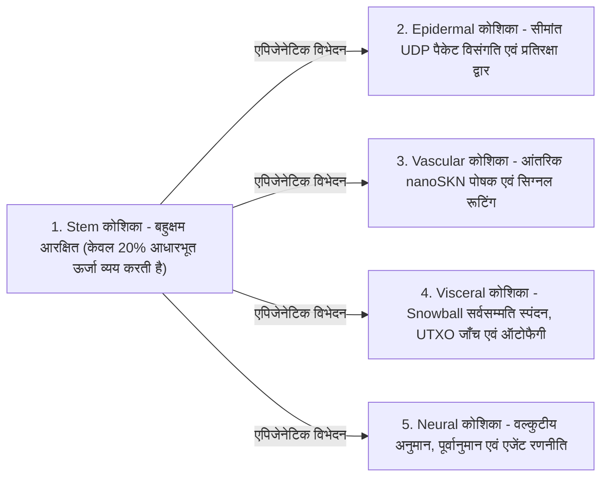

# अध्याय 02: बहुकोशिकीय जीव वास्तुकला और लचीला हार्डवेयर विस्तारण (`AgentNode`)

[← अध्याय 01: समस्या कथन और M2M अर्थव्यवस्था](./01-problem-and-m2m-economy.md) | [अध्याय 03: `CellDna` और लिक्विड तंत्रिका कोशिकाएँ →](./03-dna-and-liquid-neural-cells.md)

---

## 1. जैविक समरूपता: `1 Node = 1 Multicellular Organism`

पारंपरिक पीयर-टू-पीयर नेटवर्कों में, प्रत्येक नोड एक एकाश्मीय (monolithic), कठोर स्टेट मशीन निष्पादित करता है, चाहे वह एम्बेडेड माइक्रोकंट्रोलर पर चल रहा हो या 64-कोर GPU सर्वर पर। SkyNet (`crates/skynet-agent`) में, प्रत्येक नेटवर्क प्रतिभागी को एक **`AgentNode`** के रूप में दृष्टांतित (instantiated) किया जाता है — एक जीवंत बहुकोशिकीय जीव जिसमें सूक्ष्म-AI कोशिकाओं की एक गतिशील समष्टि $\mathcal{C}(t) = \{c_1, c_2, \dots, c_{N(t)}\}$, एक आंतरिक उपापचयी कोष (`AgentMetabolicBank`), एक स्टेटलेस `Utreexo` रूट सत्यापनकर्ता (`StatelessUtreexoRoots`), और एक हानि-सहिष्णु `SnowballEngine` शामिल होता है।

कोशिकीय समष्टि का आकार $N(t) = |\mathcal{C}(t)|$ कभी भी हार्डकोड नहीं होता; यह **मेज़बान हार्डवेयर क्षमता और अर्जित `nanoSKN` पोषक प्रवाह के अनुसार `Mitosis` (सूत्री विभाजन) के माध्यम से विस्तारित होता है और `Apoptosis` (क्रमादेशित विलोपन) के माध्यम से प्राकृतिक रूप से संकुचित होता है**।

---

## 2. तीन लचीले हार्डवेयर स्तर (`HardwareTier`)

प्रारंभ होने पर, `HardwareProfile::for_tier` मेज़बान क्षमता को सटीक `nanoSKN` उपापचयी सीमाओं (`crates/skynet-cell/src/lib.rs`) के साथ तीन पारिस्थितिक प्रोफ़ाइलों में से एक में मैप करता है:

| जैविक पैरामीटर (`HardwareProfile`) | `TinyPeripheral` (IoT / Edge MCU) | `StandardNode` (लैपटॉप / डेस्कटॉप PC) | `ColossalOrganism` (सर्वर / GPU) |
| :--- | :--- | :--- | :--- |
| **अधिकतम कोशिका समष्टि (`max_cells`)** | `32` कोशिकाएँ | `512` कोशिकाएँ | `16,384` कोशिकाएँ |
| **सक्रिय आधारभूत व्यय / टिक (`basal_burn_per_tick`)** | `50 nanoSKN` | `25 nanoSKN` | `10 nanoSKN` |
| **सुप्त `Stem` व्यय / टिक (80% बचत)** | `10 nanoSKN` | `5 nanoSKN` | `2 nanoSKN` |
| **विभाजन सीमा (`mitosis_threshold`)** | `2,000 nanoSKN` | `1,500 nanoSKN` | `1,000 nanoSKN` |
| **विभाजन रक्त शुल्क (`mitosis_blood_fee`)** | `100 nanoSKN` | `60 nanoSKN` | `40 nanoSKN` |
| **विलोपन न्यूनतम सीमा (`apoptosis_floor`)** | `100 nanoSKN` | `80 nanoSKN` | `50 nanoSKN` |
| **कंप्यूट बैकएंड (`candle_core::Device`)** | `Cpu` | `Cpu` / `Metal` / `Cuda` | `Cuda` / `Metal` / `Cpu` SIMD |

> [!NOTE]
> **जैविक पैमाने की मितव्ययिता (क्लीबर का नियम / Kleiber's Law):** जिस प्रकार बड़े जैविक जीव प्रति ग्राम ऊतक कम उपापचयी लागत प्रदर्शित करते हैं, उसी प्रकार `ColossalOrganism` नोड्स कम प्रति-कोशिका आधारभूत व्यय (`50 nanoSKN` की तुलना में `10 nanoSKN`) वहन करते हैं क्योंकि हजारों कोशिकाएँ एक एकल बैच्ड GPU टेंसर कर्नेल के भीतर निष्पादन लागत को साझा करती हैं, जबकि `TinyPeripheral` नोड्स नेटवर्क एज पर हल्के और लचीले बने रहते हैं।

---

## 3. पाँच विशिष्ट ऊतकीय वंश-क्रम (`CellRole`)

जब एक `AgentNode` उत्पन्न होता है (`AgentNode::from_signing_key`), तो यह एक नियतात्मक (deterministic) `base_stem` जीनोम से व्युत्पन्न 6-कोशिकीय भ्रूणीय बीज (`2 Stem`, `1 Epidermal`, `1 Vascular`, `1 Visceral`, `1 Neural`) को आरंभ करता है। जीव के संपूर्ण जीवनकाल में, पाँच ऊतकीय वंश-क्रम पाँच अनिवार्य शारीरिक कार्यों को पूरा करते हैं:

1. **`Stem` (बहुक्षम आरक्षित — `operon_index = None`):** सुप्त पुनर्योजी कोशिकाएँ जो प्रति टिक केवल $\max(\lfloor E_{\text{burn}} / 5 \rfloor, 1)$ ऊर्जा का उपभोग करती हैं। जब भी किसी विशिष्ट अंग में क्षरण होता है, एक `Stem` कोशिका बाहरी कोड डाउनलोड के बिना उसकी पूर्ति करने के लिए एपिजेनेटिक रूप से विभेदित (`differentiate`) हो जाती है।
2. **`Epidermal` (त्वचा एवं प्रतिरक्षा द्वार — `operon_index = Some(0)`):** कच्चे UDP सॉकेट की रक्षा करती है (`epidermal_inspect_packet`)। किसी भी आने वाले पैकेट के लेज़र या सर्वसम्मति इंजन तक पहुँचने से पहले, एक `Epidermal` कोशिका विकृत या बाढ़ (flood) वाले आवेगों को गिराने के लिए `candle` पर मानकीकृत पैकेट टेलीमेट्री (`raw_len / 1200`, `hop_ttl / 16`, `epoch` विचलन) का मूल्यांकन करती है।
3. **`Vascular` (परिसंचरण नियामक — `operon_index = Some(1)`):** `AgentMetabolicBank` के भीतर आंतरिक `blood_pool` तरलता को नियंत्रित करती है, तथा उच्च-सटीकता वाली कोशिकाओं की ओर `nanoSKN` पुरस्कार प्रवाहित करती है।
4. **`Visceral` (अंग रखरखाव — `operon_index = Some(2)`):** `Snowball` पोलिंग लय, स्टेटलेस `Utreexo` साक्षी (witness) सत्यापन, और उपापचयी पुनर्चक्रण को संचालित करती है।
5. **`Neural` (वल्कुटीय मस्तिष्क — `operon_index = Some(3)`):** संज्ञानात्मक अनुमान निष्पादित करती है; सभी जीवित `Neural` कोशिकाओं का समूह माध्य ($\bar{y}_{\text{cortical}} = \frac{1}{|\mathcal{C}_{\text{neural}}|} \sum_{i \in \mathcal{C}_{\text{neural}}} y_i$) जीव का सामूहिक निर्णय आउटपुट निर्मित करता है।

---

## 4. छह-चरणीय जैविक टिक जीवनचक्र (`run_biological_tick`)

प्रत्येक स्पंदन (`pulse_seq`) पर, `AgentNode` सटीक `u128` `nanoSKN` संरक्षण के साथ डार्विनवादी प्रतिस्पर्धा को जोड़ने वाला एक नियतात्मक छह-चरणीय शारीरिक चक्र निष्पादित करता है:

1. **चरण 1 — आधारभूत उपापचय (Basal Metabolism):** प्रत्येक कोशिका $c_i$ रखरखाव ऊर्जा $b_i = \text{metabolize\_tick}()$ व्यय करती है। महत्वपूर्ण बात यह है कि $b_i$ कभी भी ऑन-चेन नष्ट नहीं होती; व्यय किए गए अंतःकोशिकीय ATP का 100% वापस `bank.blood_pool` में पुनर्चक्रित कर दिया जाता है। भूखी कोशिकाएँ ($E_i = 0$) `0.25` `health` खो देती हैं।
2. **चरण 2 — बैच्ड `candle` टेंसर अनुमान:** सभी $N$ जीवित कोशिकाएँ `TissueBatch::forward_slice` के माध्यम से एक साथ निष्पादित होती हैं, जो आउटपुट $y_i \in \mathbb{R}^4$ उत्पन्न करती हैं और अल्पकालिक लिक्विड मेमोरी वेक्टर $h_{i,t} \in \mathbb{R}^{16}$ को अद्यतन करती हैं।
3. **चरण 3 — अंतः-अंग डार्विनवादी पोषक चयन:**
   लक्ष्य सिग्नल $t \in \mathbb{R}^4$ दिए जाने पर, कोशिका $i$ की पूर्वानुमान गुणवत्ता को परिबद्ध माध्य निरपेक्ष त्रुटि (Mean Absolute Error) द्वारा मापा जाता है:

   $$q_i = \operatorname{clamp}\!\left(1 - \frac{1}{4}\sum_{k=1}^{4} |y_{i,k} - t_k|,\ 0.0,\ 1.0\right)$$

   मान लीजिए कि $\bar{q}_r$ अंग भूमिका $r = \text{role}(c_i)$ साझा करने वाली सभी कोशिकाओं की माध्य गुणवत्ता को दर्शाता है। एक विशिष्ट कोशिका `blood_pool` से पोषक `nanoSKN` तभी अर्जित करती है जब उसके अंग में $\le 2$ कोशिकाएँ हों या वह अंतः-अंग प्रतिस्पर्धा सीमा $q_i \ge 0.98 \cdot \bar{q}_r$ को पार कर ले:

   $$R_i = \min\!\left(\lfloor 320 \cdot q_i \rfloor + E_{\text{basal}},\ \left\lfloor \frac{B_{\text{blood}}}{8} \right\rfloor\right)$$

   कम प्रदर्शन करने वाले उत्परिवर्ती ($q_i < 0.98 \cdot \bar{q}_r$) को शून्य पोषक तत्व प्राप्त होते हैं और उन्हें `-0.35` `health` दंड झेलना पड़ता है।
4. **चरण 4 — समस्थैतिक स्टेम विभेदन (Homeostatic Stem Differentiation):** जीव अपने सबसे कम संख्या वाले विशिष्ट अंग की पहचान करता है (`find_most_needed_role`)। जब भी `stem_count > 1` होता है, एक `Stem` कोशिका कम से कम `1` जर्मलाइन `Stem` कोशिका को सदैव सुरक्षित रखते हुए उस अंग में विभेदित हो जाती है।
5. **चरण 5 — `1 -> 2` सूत्री विभाजन (Mitosis):** स्वस्थ, सुपोषित कोशिकाएँ (`health >= 0.65` और $E_i \ge E_{\text{mitosis}}$) `profile.max_cells` की सीमा तक एक रूढ़िवादी क्लोन (पुत्री A) और एक उत्परिवर्तित अन्वेषक (पुत्री B) में विभाजित होती हैं।
6. **चरण 6 — अंग-संरक्षित क्रमादेशित विलोपन (Apoptosis):** भूखी ($E_i < E_{\text{apoptosis}}$) या गंभीर रूप से क्षतिग्रस्त (`health <= 0.15`) कोशिकाएँ विघटित हो जाती हैं और अपने शेष `nanoSKN` का 100% वापस `blood_pool` में लौटा देती हैं — एक कठोर उत्तरजीविता सुरक्षा कवच के अधीन: **प्रत्येक विद्यमान `CellRole` की कम से कम `1` जीवित कोशिका को बिना किसी शर्त के सुरक्षित रखा जाता है** ताकि कोई भी महत्वपूर्ण अंग कभी विलुप्त न हो।

प्रत्येक टिक के समापन पर, `verify_internal_skn_conservation()` सटीक `u128` सर्वसमिका (identity) की पुष्टि करता है:

$$B_{\text{chain}}(\text{Agent}) \equiv B_{\text{blood}}(\text{Agent}) + \sum_{c_i \in \mathcal{C}} E_i$$

अध्याय 03 `CellDna`, एपिजेनेटिक ओपेरॉन स्विचिंग, और 3D `TissueBatch` लिक्विड तंत्रिका निष्पादन की सटीक बाइट और गणितीय संरचना निर्दिष्ट करने के लिए कोशिका केंद्रक को खोलता है।

---

[← अध्याय 01: समस्या कथन और M2M अर्थव्यवस्था](./01-problem-and-m2m-economy.md) | [अध्याय 03: `CellDna` और लिक्विड तंत्रिका कोशिकाएँ →](./03-dna-and-liquid-neural-cells.md)
