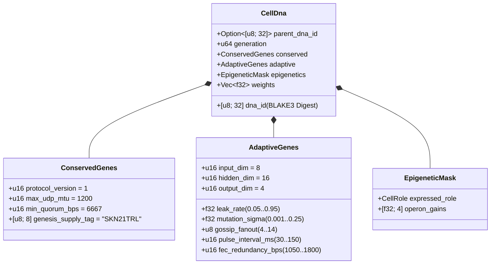

# अध्याय 03: आनुवंशिक संकेतन (`CellDna`), एपिजेनेटिक्स और `candle` पर लिक्विड सूक्ष्म-तंत्रिका विकास

[← अध्याय 02: बहुकोशिकीय वास्तुकला](./02-multicellular-architecture.md) | [हिन्दी अनुक्रमणिका पर वापस जाएँ →](./README.md)

---

## 1. कोशिकीय जीनोम वास्तुकला (`CellDna`)

जैविक विकास दो परस्पर विरोधी शक्तियों को संतुलित करता है: मूल जैव-रासायनिक अपरिवर्तनीयों का **कठोर संरक्षण** (जहाँ उत्परिवर्तन घातक होते हैं) और तंत्रिकीय व व्यावहारिक गुणों में **निरंतर विविधता**। क्रेट `skynet-dna` इस द्वैत को `CellDna` के भीतर औपचारिक रूप देता है:

### 1.1. अपरिवर्तनीय `ConservedGenes`
कोई भी उत्परिवर्तन या क्षैतिज क्रॉसओवर `ConservedGenes` को परिवर्तित नहीं कर सकता। चारों सर्वसम्मति-सुरक्षा विधेयों (predicates) में से किसी का भी उल्लंघन करने वाला कोई भी जीनोम `DnaError::ConservedGeneViolation` के साथ तत्काल अस्वीकार कर दिया जाता है:
- `protocol_version == 1`
- `max_udp_mtu == 1200` (विखंडन-मुक्त UDP अधिकतम सीमा)
- $6667 \le \text{min\_quorum\_bps} \le 10000$ (`Snowball` में $\ge \frac{2}{3}$ विशेष बहुमत लागू करना)
- `genesis_supply_tag == *b"SKN21TRL"` (21-ट्रिलियन `SKN` आपूर्ति सीमा को कठोरता से स्थिर करना)

### 1.2. `AdaptiveGenes` और साझा-ट्रंक ओपेरॉन भार विन्यास
चार विशिष्ट कोशिका प्रकारों के लिए चार असंबद्ध तंत्रिका नेटवर्क संग्रहीत करने के बजाय, `CellDna` **चार विशिष्ट ओपेरॉन प्रक्षेपण शीर्षों (Specialized Operon Projection Heads)** को पोषित करने वाला **एक साझा संवेदी ट्रंक (Shared Sensory Trunk)** एनकोड करता है। आयामों $(D_{\text{in}}, H, D_{\text{out}})$ के लिए, सटीक `f32` पैरामीटर संख्या है:

$$|\theta| = \underbrace{(D_{\text{in}} \cdot H + H)}_{\text{Shared Sensory Trunk }(W_1, b_1)} + \underbrace{4 \cdot (H \cdot D_{\text{out}} + D_{\text{out}})}_{\text{4 Specialized Operon Heads }(W_{2,r}, b_{2,r})}$$

डिफ़ॉल्ट आयामों $(D_{\text{in}} = 8,\ H = 16,\ D_{\text{out}} = 4)$ के अंतर्गत:
- साझा ट्रंक: $8 \times 16 + 16 = 144$ पैरामीटर।
- चार ओपेरॉन शीर्ष (`Epidermal`, `Vascular`, `Visceral`, `Neural`): $4 \times (16 \times 4 + 4) = 272$ पैरामीटर।
- कुल जीनोम भार: $|\theta| = 416$ `f32` फ़्लोट्स ($1{,}664\text{ bytes}$ कच्चे भार)। पीढ़ी-0 स्टेम जीनोम (`CellDna::genesis_stem`) Xavier-स्केल्ड सीमा के साथ $\mathcal{U}(-\sigma_0, +\sigma_0)$ पर `ChaCha8Rng` के माध्यम से नियतात्मक रूप से आरंभ होते हैं:

$$\sigma_0 = \sqrt{\frac{2}{D_{\text{in}} + H}}$$

### 1.3. नियतात्मक `BLAKE3` क्रिप्टोग्राफ़िक डाइजेस्ट (`SKYNET_DNA_V1`)
प्रत्येक फ़्लोटिंग-पॉइंट हाइपरपैरामीटर और भार को मानक लिटिल-एंडियन IEEE-754 बिट पैटर्न (`to_bits().to_le_bytes()`) के माध्यम से डोमेन-पृथक्कृत `BLAKE3("SKYNET_DNA_V1", ...)` हैश में क्रमबद्ध (serialize) किया जाता है। किसी भी एकल-बिट भ्रष्टाचार, `NaN`/`Inf` इंजेक्शन, या अनधिकृत भार छेड़छाड़ से `verify_integrity()` में तत्काल अस्वीकृति सक्रिय हो जाती है।

---

## 2. एपिजेनेटिक मिथाइलेशन स्विचिंग (`EpigeneticMask`)

बहुकोशिकीय जीवविज्ञान में, एक न्यूरॉन और एक बाह्यत्वचीय त्वचा कोशिका समान DNA अनुक्रम धारण करती हैं, फिर भी जीन मिथाइलेशन के माध्यम से पूर्णतः भिन्न लक्षण-प्रारूप (phenotypes) अभिव्यक्त करती हैं। SkyNet में, जब एक `Stem` कोशिका लक्षित भूमिका $r \in \{0, 1, 2, 3\}$ (`CellDna::differentiate`) में विभेदित होती है, तो **अंतर्निहित `weights` वेक्टर का 100% अछूता रहता है** जबकि `EpigeneticMask` अभिव्यक्ति लब्धि (expression gain) को परिवर्तित करता है:

- **सुप्त `Stem` अवस्था:** `operon_gains = [0.25, 0.25, 0.25, 0.25]`, जो क्षीणित लब्धि $g = 0.25$ पर ओपेरॉन शीर्ष `0` के माध्यम से प्रक्षेपण करता है।
- **विभेदित भूमिका $r$:** ओपेरॉन शीर्ष $r$ पूर्ण लब्धि ($g_r = 1.0$) पर सक्रिय होता है जबकि गैर-अभिव्यक्त शीर्षों को $0.05$ तक दबा दिया जाता है:

$$g_k = \begin{cases} 1.0 & \text{if } k = r \\ 0.05 & \text{if } k \neq r \end{cases}$$

परिणामस्वरूप, साझा ट्रंक $(W_1, b_1)$ में सीखे गए संवेदी निरूपण और सुप्त शीर्षों में निहित अनुकूलन पीढ़ियों तक बने रहते हैं और पार-विभेदन (transdifferentiation) होने पर उपलब्ध रहते हैं।

---

## 3. लिक्विड टाइम-कॉन्स्टेंट गतिकी और 3D `TissueBatch` निष्पादन

### 3.1. एकल-कोशिका आवर्ती लिक्विड गतिकी
स्टेटलेस फ़ीडफ़ॉरवर्ड MLPs अतुल्यकालिक (asynchronous) UDP पैकेट धाराओं के पार कालिक सहसंबंधों (temporal correlations) को पकड़ नहीं सकते। प्रत्येक `MicroCell` विकासशील रिसाव दर (leak rate) $\tau \in [0.05, 0.95]$ के साथ असतत **लिक्विड टाइम-कॉन्स्टेंट (LTC)** अवस्था अंतर्वेशन द्वारा शासित एक आवर्ती अल्पकालिक स्मृति वेक्टर $h_t \in \mathbb{R}^H$ बनाए रखती है:

$$h_t = (1 - \tau)\, h_{t-1} + \tau\, \tanh(x_t W_1 + b_1)$$

$$y_t = g_{\text{role}} \cdot \tanh(h_t W_{2,r} + b_{2,r})$$

- जैसे-जैसे $\tau \to 0.05$ होता है, कोशिका दीर्घकालिक स्मृति जड़त्व बनाए रखती है (`Visceral` और `Neural` प्रवृत्ति ट्रैकिंग के लिए आदर्श)।
- जैसे-जैसे $\tau \to 0.95$ होता है, कोशिका उच्च-आवृत्ति सीमांत आवेगों पर तात्कालिक प्रतिक्रिया देती है (`Epidermal` विसंगति स्कोरिंग के लिए आदर्श)।
- चूँकि $\tau$ `AdaptiveGenes` में निवास करता है, **प्रत्येक कोशिका का कालिक स्मृति क्षितिज उसके सिनैप्टिक भारों के साथ प्राकृतिक रूप से सह-विकसित होता है**।

### 3.2. उच्च-थ्रूपुट 3D `TissueBatch` टेंसर इंजन (`Cpu` / `Metal` / `Cuda`)
न्यूरो-विकास में एक चिरसम्मत अवरोध भार विषमता है: प्रत्येक कोशिका $i \in \{1, \dots, N\}$ भिन्न उत्परिवर्तित आव्यूह $W_1^{(i)} \neq W_1^{(j)}$ और भिन्न रिसाव दर $\tau^{(i)} \neq \tau^{(j)}$ धारण करती है। $N$ अनुक्रमिक सूक्ष्म-कर्नेल लॉन्च करने से आधुनिक GPU संसाधन-विहीन (starved) रह जाएँगे।

`skynet-cell` में `TissueBatch::forward_slice` सभी $N$ विषम कोशिकाओं को `candle_core::Device` पर सन्निहित रैंक-3 टेंसरों में पैक करके इस समस्या का समाधान करता है:

$$\mathbf{X} \in \mathbb{R}^{N \times 1 \times D_{\text{in}}}, \quad \mathbf{W}_1 \in \mathbb{R}^{N \times D_{\text{in}} \times H}, \quad \mathbf{B}_1 \in \mathbb{R}^{N \times 1 \times H}$$

$$\mathbf{H}_t = (\mathbf{1} - \boldsymbol{\tau}) \odot \mathbf{H}_{t-1} + \boldsymbol{\tau} \odot \tanh\!\big(\operatorname{BMM}(\mathbf{X}, \mathbf{W}_1) + \mathbf{B}_1\big)$$

$$\mathbf{Y}_t = \mathbf{G} \odot \tanh\!\big(\operatorname{BMM}(\mathbf{H}_t, \mathbf{W}_2) + \mathbf{B}_2\big)$$

जहाँ $\operatorname{BMM}$ एकल-कर्नेल बैच्ड मैट्रिक्स गुणन (Batched Matrix Multiplication) को दर्शाता है और $\odot$, $\boldsymbol{\tau}, \mathbf{G} \in \mathbb{R}^{N \times 1 \times 1}$ के साथ ब्रॉडकास्ट तत्व-वार गुणन को दर्शाता है। ऑडिट किए गए यूनिट परीक्षण पुष्टि करते हैं कि `TissueBatch` प्रति `ColossalOrganism` एक साथ `16,384` विकसित मॉडलों तक विस्तारित होते हुए $< 10^{-5}$ फ़्लोटिंग-पॉइंट सहनशीलता के भीतर व्यक्तिगत कोशिका निष्पादन से मेल खाता है।

---

## 4. असममित सूत्री विभाजन, सटीक विषम-`nanoSKN` संरक्षण और प्लाज़्मिड क्रॉसओवर

### 4.1. असममित `1 -> 2` `Mitosis` और सटीक परमाण्विक संरक्षण का प्रमाण
जब जनक कोशिका $P$, $E_P \ge \max(E_{\text{mitosis}}, F_{\text{blood}} + 2)$ और `health >= 0.65` को संतुष्ट करती है, तो `divide_mitosis` दो पीढ़ी-$(g+1)$ पुत्री कोशिकाएँ उत्पन्न करता है:
- **पुत्री A (रूढ़िवादी क्लोन):** बिना किसी विक्षोभ के प्रमाणित जनक भारों और अनुकूली पैरामीटरों का 100% सुरक्षित रखती है।
- **पुत्री B (उत्परिवर्तित अन्वेषक):** परिबद्ध न्यूरो-विकासवादी उत्परिवर्तन से गुज़रते हुए जनक `hidden_state` निरंतरता विरासत में प्राप्त करती है:
  - प्रत्येक भार $w \in \theta$, $0.35$ की प्रायिकता के साथ शून्य-निर्भरता वाले 6-नमूना इरविन-हॉल गॉसियन विक्षोभ ($\Delta w \sim \mathcal{N}(0, \sigma^2)$) के माध्यम से उत्परिवर्तित होता है, जिसे ग्रेडिएंट/भार विस्फोट को रोकने के लिए कठोरता से $[-4.0, +4.0]$ पर क्लैंप किया जाता है।
  - $\tau$, $\sigma$, `gossip_fanout` ($\pm 1$), `pulse_interval_ms` ($\pm 10\text{ ms}$), और `fec_redundancy_bps` ($\pm 50\text{ bps}$) परिबद्ध अंतरालों के भीतर सह-उत्परिवर्तित होते हैं।

**शून्य-रिसाव विषम-`nanoSKN` संरक्षण का प्रमाण:** मान लीजिए कि $E_{\text{dist}} = E_P - F_{\text{blood}}$ शुल्क-पश्चात वितरण योग्य ATP है। पुत्री शेष राशियों को `u128` पर पूर्णांक भागफल-शेषफल अंकगणित के माध्यम से विभाजित किया जाता है:

$$E_A = \left\lfloor \frac{E_{\text{dist}}}{2} \right\rfloor + (E_{\text{dist}} \bmod 2), \qquad E_B = \left\lfloor \frac{E_{\text{dist}}}{2} \right\rfloor$$

प्रत्येक ऋणेतर पूर्णांक $E_{\text{dist}} \in \mathbb{Z}_{\ge 0}$ (जिसमें `3,333 nanoSKN` जैसी विषम शेष राशियाँ भी शामिल हैं) के लिए, सटीक संरक्षण सर्वथा सत्य सिद्ध होता है:

$$E_A + E_B + F_{\text{blood}} = \left(2\left\lfloor \frac{E_{\text{dist}}}{2} \right\rfloor + (E_{\text{dist}} \bmod 2)\right) + F_{\text{blood}} = E_{\text{dist}} + F_{\text{blood}} \equiv E_P$$

अरबों विभाजनों के दौरान पूर्णांकन के कारण कभी भी एक भी `nanoSKN` की हानि नहीं होती और न ही शून्य से उसका सृजन होता है।

### 4.2. अंतर-एजेंट क्षैतिज जीन स्थानांतरण (`Plasmid` क्रॉसओवर)
जीवाणुओं के प्लाज़्मिड विनिमय के समान, एक `AgentNode` अपनी उच्चतम-उपयुक्तता (highest-fitness) वाली कोशिका के `CellDna` को इरेज़र-कोडेड UDP `FountainDroplet` पैकेटों (`encode_elite_plasmid_droplets`) में निर्यात करता है। हानिपूर्ण UDP लिंक के पार `donor_dna` को पुनः संयोजित करने पर, प्राप्तकर्ता एजेंट `horizontal_crossover` के माध्यम से अपनी सबसे कमजोर-उपयुक्तता वाली कोशिका को उन्नत करता है:
- अनुकूली नेटवर्किंग और टाइम-कॉन्स्टेंट गुण $0.7 \cdot \text{Recipient} + 0.3 \cdot \text{Donor}$ के रूप में मिश्रित होते हैं।
- सिनैप्टिक भारों का $30\%$ एकसमान रूप से $0.5 \cdot w_{\text{rec}} + 0.5 \cdot w_{\text{don}} \in [-4.0, +4.0]$ के रूप में मिश्रित होता है।

क्षैतिज प्लाज़्मिड स्थानांतरण के माध्यम से, एक संसाधन-सीमित `TinyPeripheral` IoT सेंसर `ConservedGenes` सुरक्षा को क्रिप्टोग्राफ़िक रूप से अक्षुण्ण रखते हुए दूरस्थ GPU `ColossalOrganism` नोड्स पर विकसित श्रेष्ठ तंत्रिका बुद्धिमत्ता को आत्मसात कर लेता है।

---

> **चरण 2 (भाग II) में आगे:** अध्याय `04–06` में `21,000,000,000,000 SKN` हाविंग वॉल्ट गणित, `Soul–Body` मानवीय संप्रभु अभिरक्षा अनुबंध, और `~1 KB` स्टेटलेस `Utreexo` + `SynapticVoucher` लेज़र विस्तारण को औपचारिक रूप दिया जाएगा।

[← अध्याय 02: बहुकोशिकीय वास्तुकला](./02-multicellular-architecture.md) | [हिन्दी अनुक्रमणिका पर वापस जाएँ →](./README.md)
