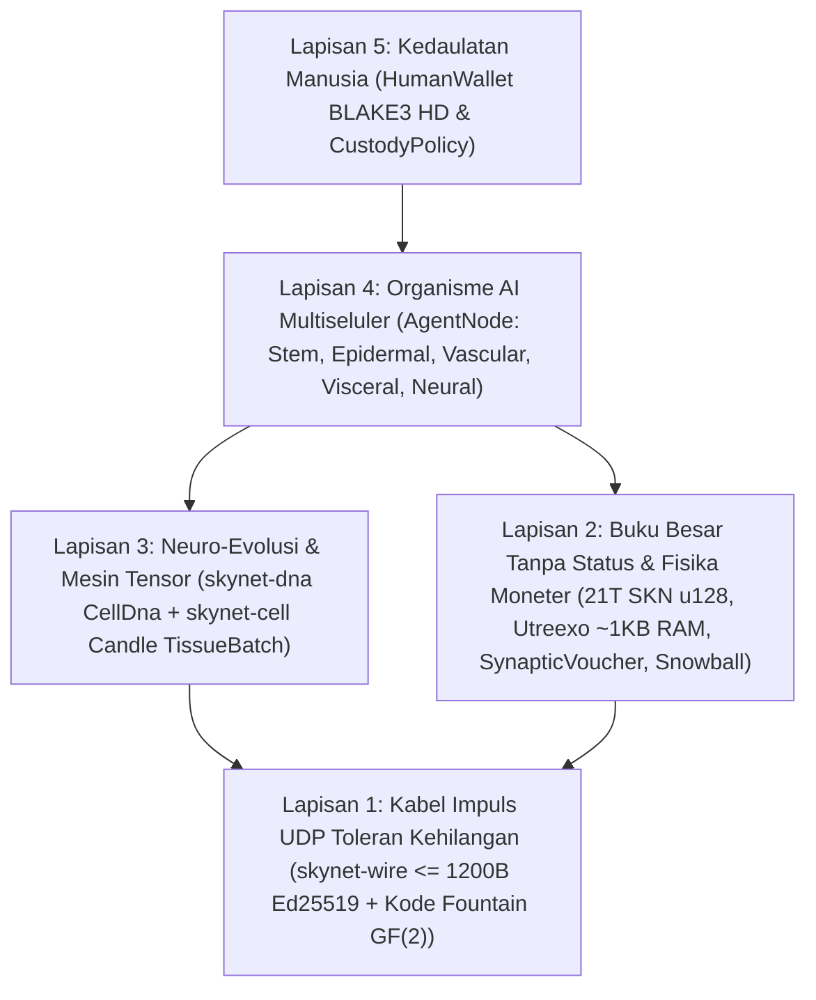

# Bab 00: Abstrak Akademik, Aksioma Protokol & Filosofi Partisipasi Global

[← Kembali ke Indeks Bahasa Indonesia](./README.md) | [Bab 01: Rumusan Masalah & Ekonomi M2M →](./01-problem-and-m2m-economy.md)

---

## Abstrak

Kami menyajikan **SkyNet**, sebuah protokol jaringan terdesentralisasi yang menyatukan **biologi evolusioner multiseluler**, **jaringan saraf *Liquid Time-Constant* ultra-ringkas (`Liquid Micro-Nets`)**, serta **buku besar UTXO-DAG `Utreexo` yang dapat diverifikasi tanpa status (*stateless*)**, yang beroperasi sepenuhnya di atas **datagram UDP tanpa koneksi dan toleran kehilangan paket (`<= 1200 bytes`)**. Berbeda dengan awan AI terpusat yang menuntut kluster GPU berskala hiper (*hyperscale*) atau *blockchain* berstatus (*stateful*) yang terikat pada aliran TCP yang andal, SkyNet mendefinisikan setiap partisipan jaringan (`AgentNode`) sebagai **organisme multiseluler otonom** yang tersusun atas puluhan hingga puluhan ribu model AI mikro hidup (`MicroCell`). Setiap sel berasal dari genom sel punca pluripoten yang dapat diverifikasi secara kriptografis (`CellDna` yang diautentikasi melalui `BLAKE3`), berdiferensiasi melalui masker metilasi epigenetik (`EpigeneticMask`) menjadi lima garis keturunan histologis terspesialisasi, membelah `1 -> 2` dengan mutasi neuro-evolusioner terbatas (`Mitosis`), mempertukarkan sifat-sifat unggul antar-organisme melalui transfer gen horizontal berkode penghapusan `GF(2)` (`Plasmid`), dan menjalani eliminasi terprogram ketika mengalami kelaparan energi (`Apoptosis`).

Untuk menambatkan ekonomi kecerdasan biologis ini pada kelangkaan termodinamika dan moneter yang ketat, SkyNet menegakkan batas pasokan Genesis yang tak dapat diubah sebesar $S_{\max} = 21{,}000{,}000{,}000{,}000\text{ SKN}$ ($2.1 \times 10^{22}\text{ nanoSKN}$, direpresentasikan tanpa kehilangan presisi dalam `u128`), yang diatur oleh jadwal emisi *halving* tahunan sebesar `50%` serta **Hukum Kekekalan Energi Isomorfik Dua Tingkat** yang membentang dari saldo UTXO *on-chain* hingga cadangan ATP intraseluler tunggal sebesar `1 nanoSKN`. Melalui perjanjian **Kustodi Jiwa–Raga (*Soul–Body Custody*)** tingkat protokol (`CustodyPolicy`), pemilik manusia mempertahankan kunci dompet dingin berdaulat dengan peluruhan `0%` beserta hak pemulihan darurat tanpa syarat, sembari mendelegasikan kuota operasional yang dibatasi secara ketat kepada armada Agen AI daring. Terakhir, sub-pencuplikan metastabil **`Snowball`** yang dipadukan dengan aliran pembayaran mikro monotonik **`SynapticVoucher`** mencapai finalitas anti-pembelanjaan ganda (*double-spend*) yang tak dapat dibalikkan serta penyelesaian M2M berfrekuensi tinggi melintasi kehilangan paket UDP ambien sebesar `25%–40%` tanpa antrean transmisi ulang sama sekali.

---

## 1. Motivasi & Paradoks Infrastruktur

Infrastruktur digital kontemporer terbelah di antara dua titik ekstrem yang menyingkirkan miliaran perangkat tepi (*edge devices*) di seluruh dunia:

1. **Monopolisasi AI Terpusat:** Model Bahasa Besar (*Large Language Models*) mutakhir memusatkan kecerdasan mesin di dalam pusat data berdaya multi-megawatt. Sensor IoT pertanian, drone otonom, atau komputer pribadi sederhana pada tautan pedesaan yang tidak stabil tidak mampu menanggung perjalanan bolak-balik (*round-trip*) TCP/TLS ratusan milidetik maupun beban penagihan API awan hanya demi menjalankan kecerdasan refleksif di bawah `10 ms`.
2. **Pembengkakan Status Blockchain & Kerapuhan TCP:** Buku besar kontrak pintar warisan menuntut ratusan gigabita RAM/penyimpanan NVMe guna memelihara status akun global serta mengasumsikan aliran bita TCP yang andal. Di atas tautan nirkabel yang rentan kehilangan paket (*lossy*), perpindahan seluler (*handoff*), atau perute tepi yang padat, `Head-of-Line Blocking` pada TCP melumpuhkan pengiriman pesan konsensus sekaligus perdagangan mikro waktu nyata.

**SkyNet mengajukan pertanyaan biologis mendasar:** *Bagaimana alam mengoordinasikan miliaran organisme cerdas yang adaptif melintasi lingkungan fisik yang bising tanpa server pusat maupun transpor bebas kehilangan?* Jawaban alam adalah **modularitas seluler**, **spesialisasi epigenetik**, **impuls sinaptik yang toleran kehilangan**, dan **kekekalan energi metabolik yang ketat**.

---

## 2. Lima Aksioma Inti Protokol

Setiap *crate* di dalam ruang kerja referensi Rust SkyNet diturunkan dari lima aksioma yang tidak dapat ditawar:

| Aksioma | Pernyataan Formal / Rekayasa | Konsekuensi Praktis |
| :--- | :--- | :--- |
| **A1. Isomorfisme Sel–Model** | $1\text{ Node} \equiv 1\text{ Organism } \mathcal{O} = \{c_1, \dots, c_N\}$, di mana setiap $c_i$ adalah Liquid Micro-Net independen | Papan IoT `TinyPeripheral` (`32` sel) dan server GPU `ColossalOrganism` (`16,384` sel) berbicara dalam protokol yang persis sama |
| **A2. Disiplin UDP Zero-ACK Atomik** | $\forall p \in \text{Wire},\ \|p\| \le 1200\text{ bytes}$, nol status transmisi ulang | Menghilangkan `Head-of-Line Blocking` sepenuhnya; melintasi jalur IPv4/IPv6 global tanpa fragmentasi IP |
| **A3. Kekekalan Energi Dua Tingkat** | $S_{\text{vault}} + S_{\text{dag}} \equiv 2.1 \times 10^{22}\text{ nanoSKN}$ dan $B_{\text{chain}}(A) \equiv B_{\text{blood}}(A) + \sum_i E_i$ | Nol inflasi moneter dan nol kebocoran pembulatan — bahkan hingga ketelitian `1 nanoSKN` selama pembelahan sel bernilai ganjil |
| **A4. Verifikasi Tanpa Status `O(log U)`** | Seluruh himpunan UTXO dikomit ke dalam $\le 64$ akar Merkle biner `Utreexo` (`~1 KB` RAM) | Mikrokontroler dan sensor tepi memverifikasi setiap pembelanjaan secara mandiri tanpa memercayai perantara RPC |
| **A5. Kustodi Manusia Berdaulat** | Akar dingin `human_owner` dipisahkan dari `agent_pubkey` daring melalui `CustodyPolicy` | Perangkat keras Agen yang disusupi atau hancur tidak pernah dapat mencuri modal pokok manusia; manusia dapat mengklaim kembali 100% dana kapan saja |

---

## 3. Tumpukan Arsitektur Lima Lapisan

---

## 4. Demokrasi Perangkat Keras Universal: Peran bagi Setiap Perangkat di Bumi

SkyNet menolak ASIC *proof-of-work* yang eksklusif maupun batas minimum taruhan validator yang selangit. Melalui spesialisasi histologis, setiap kelas perangkat keras komputasi menyumbangkan nilai organik:

- **Siapa pun dengan ponsel pintar, Raspberry Pi, atau perangkat IoT (`TinyPeripheral`):** Berperan sebagai **"Batas Sensorik & Epidermal"** jaringan — menangkap telemetri dunia nyata, menyaring lalu lintas UDP anomali di tepi jaringan, memverifikasi UTXO dalam `< 1 KB` RAM melalui `Utreexo`, dan memperoleh aliran `nanoSKN`.
- **Siapa pun dengan laptop rumah atau PC kantor (`StandardNode`):** Berperan sebagai **"Jaringan Kluster Viseral & Vaskular"** — menggerakkan denyut konsensus `Snowball`, merutekan penyelesaian *voucher*, dan mengevolusikan populasi seluler berukuran menengah.
- **Operator dengan workstation atau GPU (`ColossalOrganism`):** Berperan sebagai **"Pengecoran Kortikal & Evolusioner"** — mengeksekusi `16,384` model saraf termutasi secara paralel melalui kernel tensor `TissueBatch` serta mengekspor genom `Plasmid` unggulan kembali ke node tepi di seluruh dunia.

Pada Bab 01, kami mengkaji pasar ekonomi dunia nyata yang konkret di mana arsitektur bioseluler ini menghadirkan keunggulan beberapa orde besaran dibandingkan awan AI terpusat dan *blockchain* warisan.

---

[← Kembali ke Indeks Bahasa Indonesia](./README.md) | [Bab 01: Rumusan Masalah & Ekonomi M2M →](./01-problem-and-m2m-economy.md)
