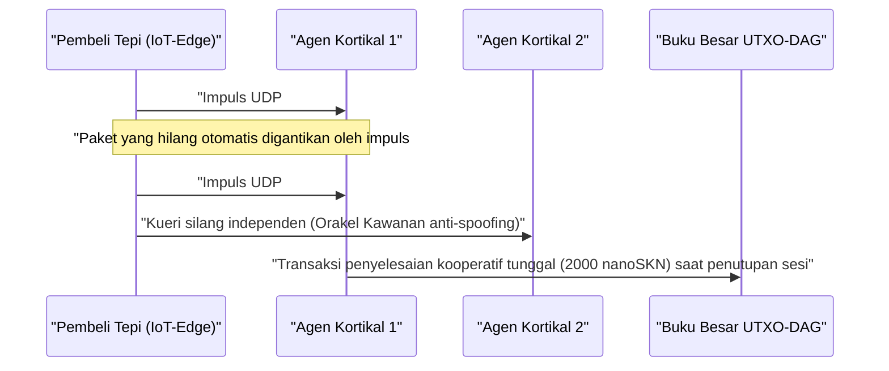

# Bab 01: Rumusan Masalah & Ekonomi Mesin-ke-Mesin (`M2M`) Praktis

[← Bab 00: Abstrak & Visi](./00-abstract-and-vision.md) | [Bab 02: Arsitektur Multiseluler →](./02-multicellular-architecture.md)

---

## 1. Melampaui Chatbot Terpusat: Kecerdasan Refleksif di Tepi Fisik

SkyNet tidak bertujuan menggantikan Model Bahasa Besar berparameter ratusan miliar yang terpusat untuk penyusunan dokumen panjang. Sebaliknya, SkyNet membidik **titik buta struktural bernilai multi-triliun dolar**: tepi fisik internet tempat miliaran mesin otonom, sensor industri, gerbang (*gateway*) jaringan, dan agen perangkat lunak membutuhkan **inferensi refleksif di bawah `10 ms`, adaptasi lokal berkelanjutan, serta penyelesaian nilai mesin-ke-mesin (`M2M`) bernilai pecahan sen** melintasi tautan nirkabel yang tidak andal.

### Mengapa Awan Terpusat dan Blockchain Warisan Gagal di Sini

Tinjau sebuah agen tepi otonom $A$ (seperti drone kawanan, gerbang mitigasi DDoS, atau relai jaringan listrik pintar) yang membeli klasifikasi anomali waktu nyata dan verifikasi telemetri setiap $\Delta t = 10\text{ ms}$, dengan nilai $v = 50\text{ nanoSKN}$ per impuls:

1. **Dinding Latensi & Transmisi Ulang TCP:** Membangun sesi TLS/TCP ke wilayah awan yang jauh menimbulkan jabat tangan (*handshake*) multi-RTT. Di bawah kehilangan paket nirkabel ambien sebesar $p_{\text{loss}} = 20\%$, penundaan jendela kemacetan (*congestion window backoff*) dan batas waktu transmisi ulang TCP mendorong latensi ekor `p99` hingga ratusan milidetik — sebuah bencana bagi lingkar kendali siber-fisik waktu nyata.
2. **Batas Bawah Biaya Dasar (*Base-Fee Floor*):** Pada jalur pembayaran fiat maupun rantai kontrak pintar EVM, beban biaya tetap per transaksi $F_{\text{tx}}$ melampaui nilai satu impuls sebesar $10^5\times$ hingga $10^8\times$ ($F_{\text{tx}} \gg v$), sehingga menjadikan perdagangan M2M bergranularitas milidetik mustahil secara ekonomi.
3. **Pergeseran Model Statis (*Static Model Drift*):** Bobot statis hasil pra-pelatihan yang diterapkan dari awan mengalami penurunan kinerja secara cepat ketika menghadapi perubahan distribusi sinyal lokal (`concept drift`), sementara perangkat tepi yang terbatas tidak memiliki anggaran memori maupun daya untuk menjalankan perambatan balik gradien (*gradient backpropagation*).

---

## 2. Empat Pilar Ekonomi Dunia Nyata Pendorong Permintaan `SKN`

Permintaan intrinsik terhadap `SKN` muncul dari empat kapabilitas konkret di mana awan terpusat dan *blockchain* berstatus tidak mampu bersaing:

### 2.1. Inferensi Mikro Tepi Kawanan Berlatensi Ultra-Rendah (`< 10 ms`)
Armada robotika, pengontrol IoT industri, relai telekomunikasi, dan perangkat keamanan jaringan menyematkan vektor fitur ternormalisasi berdimensi 8 (`stimulus: [f32; 8]`) berdampingan dengan `SynapticVoucher` tertanda tangan di dalam **satu datagram UDP berukuran `<= 1200-byte`**.
- Sel-sel `Epidermal` dan `Neural` tetangga mengeksekusi lintasan maju (*forward pass*) Liquid Micro-Net rekuren dalam waktu kurang dari `0.1 ms` per impuls.
- Karena `SynapticVoucher` mengodekan total kumulatif yang meningkat secara monotonik, bahkan kehilangan paket UDP acak sebesar `25%` pada tautan seluler atau satelit menimbulkan **nol kemacetan penagihan dan nol jeda transmisi ulang**.

### 2.2. Evolusi-sebagai-Layanan (*Evolution-as-a-Service*) & Pasar Gen `Plasmid` Terdesentralisasi
Alih-alih menyewa kluster GPU awan yang mahal guna melatih model tertanam yang ringkas, setiap pengguna atau agen otonom dapat menyiarkan sayembara (*bounty*) optimasi yang menentukan aliran stimulus $x_t$, respons target $y_t^*$, serta imbalan `SKN`:
- Ribuan organisme `AgentNode` memicu `Mitosis` seluler `1 -> 2`, mengevaluasi puluhan ribu perturbasi bobot serta konstanta waktu cair $\tau$ secara paralel.
- Mutan yang lemah menjalani `Apoptosis`, sementara garis keturunan berkinerja terbaik berkonvergensi menjadi genom `CellDna` yang ringkas (di bawah `2 KB`, disegel secara kriptografis oleh `BLAKE3`).
- Pemohon menerima baik inferensi langsung maupun **artefak bobot `CellDna` hasil evolusi yang mandiri** (dikirimkan tanpa kehilangan melalui paket `FountainDroplet` `GF(2)`) yang siap di-*flash* langsung ke jutaan mikrokontroler.

### 2.3. Jalur Pembayaran Atomik `M2M nanoSKN` & Orakel Kawanan Anti-Halusinasi
Dengan denominasi hingga `1 nanoSKN` ($10^{-9}\text{ SKN}$), Agen AI secara otonom membeli dan memverifikasi silang sinyal fisik dunia nyata (telemetri cuaca mikro, okupansi spektrum RF, latensi perutean, aliran pesanan berfrekuensi tinggi):

Pencuplikan silang antar-organisme `AgentNode` independen di dalam kluster lokal menghilangkan halusinasi model tunggal serta pemalsuan (*spoofing*) sensor.

### 2.4. DePIN Multi-Tingkat yang Inklusif (Simbiosis Perangkat Keras)
SkyNet menyatukan perangkat keras menganggur yang heterogen di seluruh dunia ke dalam rantai pasok biologis yang simbiotik:

| Segmen Partisipan | Perangkat Keras Harian | Peran Ekologis | Aliran Pendapatan `SKN` |
| :--- | :--- | :--- | :--- |
| **Individu & Rumah Tangga** | Ponsel pintar lama, perute rumah, Raspberry Pi, papan IoT | Penangkapan sensorik tepi, penyaringan paket `Epidermal`, verifikasi ringan `Utreexo` `~1 KB` | Memperoleh `nanoSKN` dari umpan sensor langsung & penyaringan batas |
| **Pengembang & Pengguna Desktop** | Laptop, PC kantor (`StandardNode`) | Pencuplikan konsensus `Snowball`, perutean *voucher*, evolusi jaringan skala menengah | Memperoleh biaya transaksi kluster (`cluster_nutrient_pool`) & bayaran inferensi |
| **Laboratorium & Operator GPU** | Server multi-inti, Apple `Metal`, GPU NVIDIA `CUDA` | Evolusi paralel `TissueBatch` hingga `16,384` sel per node | Memperoleh sayembara evolusi & royalti ekspor `Plasmid` horizontal |

---

## 3. Kompresi Penyelesaian *On-Chain* Sub-Linear

Misalkan dua Agen AI mempertukarkan $M$ impuls inferensi berfrekuensi tinggi sebesar $\delta\text{ nanoSKN}$ per panggilan melintasi kanal nirkabel dengan probabilitas kehilangan paket $p \in [0, 1)$. Penyelesaian *on-chain* warisan memerlukan $\mathcal{O}(M)$ transaksi buku besar sementara beban transmisi ulang TCP meningkat sebesar $\frac{1}{1 - p}$.

Di dalam SkyNet, pembayar memancarkan *voucher* bertanda tangan `Ed25519` yang diindeks oleh urutan $s \in \{1, \dots, M\}$ dengan membawa nilai kumulatif $V_s = s \cdot \delta$. Setiap paket yang berhasil tiba $s_k$ secara kriptografis membuktikan seluruh selisih inkremental $\Delta V = V_{s_k} - V_{s_{k-1}}$ melintasi semua paket perantara yang hilang tanpa transmisi ulang. Pada akhir sesi, seluruh $M$ inferensi mikro diselesaikan hanya dalam **tepat $1$ transaksi UTXO-DAG**, mencapai rasio kompresi *on-chain* sebesar $M : 1$ (pengurangan beban buku besar sebesar $1{,}000\times$ hingga $100{,}000\times$ dalam praktik).

Bab 02 membedah anatomi internal setiap `AgentNode` — memperlihatkan bagaimana satu biner perangkat lunak mengorganisasi dirinya sendiri menjadi organisme multiseluler hidup di berbagai tingkat perangkat keras.

---

[← Bab 00: Abstrak & Visi](./00-abstract-and-vision.md) | [Bab 02: Arsitektur Multiseluler →](./02-multicellular-architecture.md)
