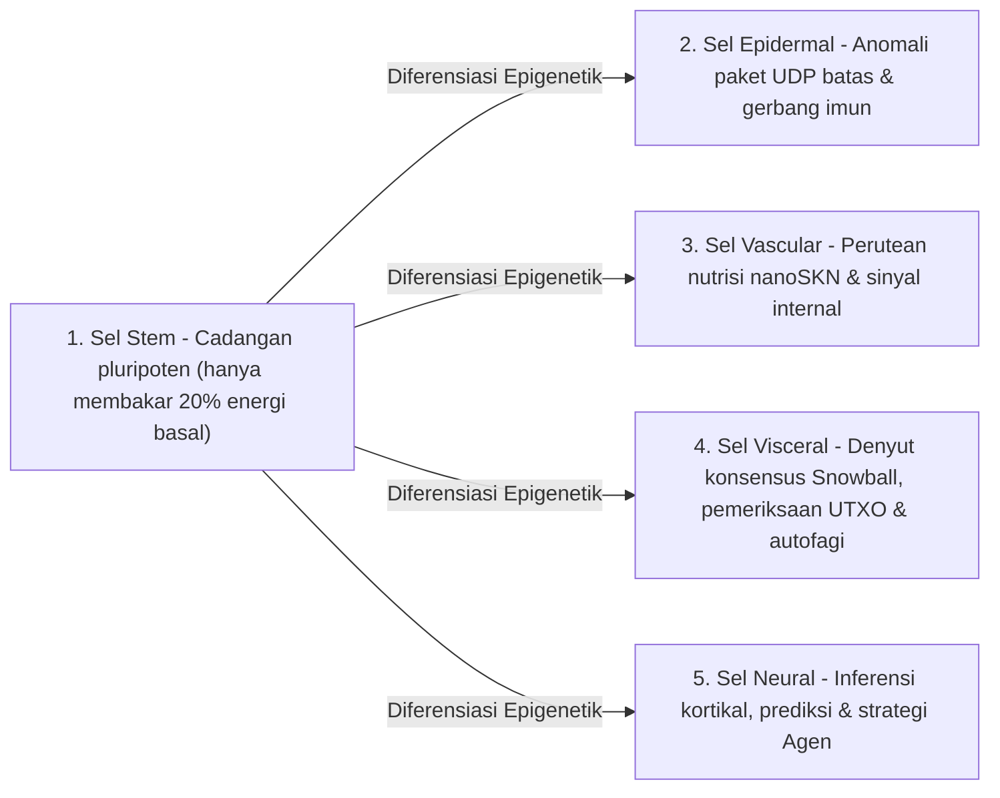

# Bab 02: Arsitektur Organisme Multiseluler & Penskalaan Perangkat Keras Elastis (`AgentNode`)

[← Bab 01: Rumusan Masalah & Ekonomi M2M](./01-problem-and-m2m-economy.md) | [Bab 03: `CellDna` & Sel Saraf Cair →](./03-dna-and-liquid-neural-cells.md)

---

## 1. Isomorfisme Biologis: `1 Node = 1 Organisme Multiseluler`

Dalam jaringan *peer-to-peer* konvensional, setiap node mengeksekusi mesin status yang monolitik dan kaku tanpa memandang apakah ia berjalan di atas mikrokontroler tertanam atau server GPU 64-inti. Di dalam SkyNet (`crates/skynet-agent`), setiap partisipan jaringan diinstansiasi sebagai **`AgentNode`** — sebuah organisme multiseluler hidup yang terdiri atas populasi dinamis sel AI mikro $\mathcal{C}(t) = \{c_1, c_2, \dots, c_{N(t)}\}$, perbendaharaan metabolik internal (`AgentMetabolicBank`), pemverifikasi akar `Utreexo` tanpa status (`StatelessUtreexoRoots`), serta `SnowballEngine` yang toleran terhadap kehilangan paket.

Ukuran populasi seluler $N(t) = |\mathcal{C}(t)|$ tidak pernah dikodekan secara kaku (*hardcoded*); populasi tersebut **berekspansi melalui `Mitosis` dan berkontraksi melalui `Apoptosis` secara organik mengikuti kapasitas perangkat keras inang serta aliran masuk nutrisi `nanoSKN` yang diperoleh**.

---

## 2. Tiga Tingkat Perangkat Keras Elastis (`HardwareTier`)

Saat inisialisasi awal, `HardwareProfile::for_tier` memetakan kapasitas inang ke dalam salah satu dari tiga profil ekologis dengan ambang metabolik `nanoSKN` yang presisi (`crates/skynet-cell/src/lib.rs`):

| Parameter Biologis (`HardwareProfile`) | `TinyPeripheral` (IoT / MCU Tepi) | `StandardNode` (Laptop / PC Desktop) | `ColossalOrganism` (Server / GPU) |
| :--- | :--- | :--- | :--- |
| **Populasi Sel Maksimum (`max_cells`)** | `32` sel | `512` sel | `16,384` sel |
| **Pembakaran Basal Aktif / Detak (`basal_burn_per_tick`)** | `50 nanoSKN` | `25 nanoSKN` | `10 nanoSKN` |
| **Pembakaran `Stem` Dorman / Detak (penghematan 80%)** | `10 nanoSKN` | `5 nanoSKN` | `2 nanoSKN` |
| **Ambang Pembelahan (`mitosis_threshold`)** | `2,000 nanoSKN` | `1,500 nanoSKN` | `1,000 nanoSKN` |
| **Biaya Darah Pembelahan (`mitosis_blood_fee`)** | `100 nanoSKN` | `60 nanoSKN` | `40 nanoSKN` |
| **Batas Bawah Eliminasi (`apoptosis_floor`)** | `100 nanoSKN` | `80 nanoSKN` | `50 nanoSKN` |
| **Backend Komputasi (`candle_core::Device`)** | `Cpu` | `Cpu` / `Metal` / `Cuda` | `Cuda` / `Metal` / `Cpu` SIMD |

> [!NOTE]
> **Skala Ekonomi Biologis (Hukum Kleiber):** Sebagaimana organisme biologis berukuran lebih besar menunjukkan biaya metabolik yang lebih rendah per gram jaringan, node `ColossalOrganism` menanggung pembakaran basal per sel yang lebih rendah (`10 nanoSKN` dibandingkan `50 nanoSKN`) karena ribuan sel mengamortisasi eksekusi di dalam satu kernel tensor GPU ter-*batch* tunggal, sedangkan node `TinyPeripheral` tetap ramping dan tangguh di tepi jaringan.

---

## 3. Lima Garis Keturunan Histologis Terspesialisasi (`CellRole`)

Ketika sebuah `AgentNode` dilahirkan (`AgentNode::from_signing_key`), ia menginisialisasi benih embrionik 6 sel (`2 Stem`, `1 Epidermal`, `1 Vascular`, `1 Visceral`, `1 Neural`) yang diturunkan dari genom `base_stem` deterministik. Sepanjang masa hidup organisme, lima garis keturunan histologis menjalankan lima fungsi fisiologis esensial:

1. **`Stem` (Cadangan Pluripoten — `operon_index = None`):** Sel regeneratif dorman yang hanya mengonsumsi $\max(\lfloor E_{\text{burn}} / 5 \rfloor, 1)$ per detak (*tick*). Setiap kali organ terspesialisasi mana pun mengalami penyusutan, sebuah sel `Stem` berdiferensiasi secara epigenetik (`differentiate`) untuk memulihkannya tanpa unduhan kode eksternal.
2. **`Epidermal` (Kulit & Gerbang Imun — `operon_index = Some(0)`):** Menjaga soket UDP mentah (`epidermal_inspect_packet`). Sebelum paket masuk mana pun mencapai buku besar atau mesin konsensus, sel `Epidermal` mengevaluasi telemetri paket ternormalisasi (`raw_len / 1200`, `hop_ttl / 16`, penyimpangan `epoch`) pada `candle` guna membuang impuls yang cacat atau membanjiri jaringan (*flood*).
3. **`Vascular` (Regulator Sirkulasi — `operon_index = Some(1)`):** Mengatur likuiditas `blood_pool` internal di dalam `AgentMetabolicBank`, menyalurkan imbalan `nanoSKN` menuju sel-sel berakurasi tinggi.
4. **`Visceral` (Pemeliharaan Organ — `operon_index = Some(2)`):** Menggerakkan irama pemungutan suara `Snowball`, verifikasi bukti saksi (*witness*) `Utreexo` tanpa status, serta daur ulang metabolik.
5. **`Neural` (Otak Kortikal — `operon_index = Some(3)`):** Mengeksekusi inferensi kognitif; rata-rata ansambel di seluruh sel `Neural` yang hidup ($\bar{y}_{\text{cortical}} = \frac{1}{|\mathcal{C}_{\text{neural}}|} \sum_{i \in \mathcal{C}_{\text{neural}}} y_i$) membentuk keluaran keputusan kolektif organisme.

---

## 4. Siklus Hidup Detak Biologis Enam Fase (`run_biological_tick`)

Pada setiap denyut (`pulse_seq`), `AgentNode` mengeksekusi siklus fisiologis enam fase deterministik yang menyatukan kompetisi Darwinian dengan kekekalan `nanoSKN` `u128` yang eksak:

1. **Fase 1 — Metabolisme Basal:** Setiap sel $c_i$ membakar energi pemeliharaan $b_i = \text{metabolize\_tick}()$. Hal yang krusial, $b_i$ tidak pernah dimusnahkan secara *on-chain*; 100% dari ATP intraseluler yang dibakar didaur ulang kembali ke dalam `bank.blood_pool`. Sel yang kelaparan ($E_i = 0$) kehilangan `0.25` `health`.
2. **Fase 2 — Inferensi Tensor `candle` Ter-*Batch*:** Seluruh $N$ sel hidup dieksekusi secara simultan melalui `TissueBatch::forward_slice`, menghasilkan keluaran $y_i \in \mathbb{R}^4$ dan memperbarui vektor memori cair jangka pendek $h_{i,t} \in \mathbb{R}^{16}$.
3. **Fase 3 — Seleksi Nutrisi Darwinian Intra-Organ:**
   Diberikan sinyal target $t \in \mathbb{R}^4$, kualitas prediksi sel $i$ diukur melalui *Mean Absolute Error* terbatas:

   $$q_i = \operatorname{clamp}\!\left(1 - \frac{1}{4}\sum_{k=1}^{4} |y_{i,k} - t_k|,\ 0.0,\ 1.0\right)$$

   Misalkan $\bar{q}_r$ menyatakan kualitas rata-rata di seluruh sel yang berbagi peran organ $r = \text{role}(c_i)$. Sebuah sel terspesialisasi memperoleh nutrisi `nanoSKN` dari `blood_pool` jika dan hanya jika organnya memiliki $\le 2$ sel atau sel tersebut melampaui ambang daya saing intra-organ $q_i \ge 0.98 \cdot \bar{q}_r$:

   $$R_i = \min\!\left(\lfloor 320 \cdot q_i \rfloor + E_{\text{basal}},\ \left\lfloor \frac{B_{\text{blood}}}{8} \right\rfloor\right)$$

   Mutan yang berkinerja buruk ($q_i < 0.98 \cdot \bar{q}_r$) tidak menerima nutrisi sama sekali dan mengalami penalti `health` sebesar `-0.35`.
4. **Fase 4 — Diferensiasi Sel Punca Homeostatis:** Organisme mengidentifikasi organ terspesialisasi yang paling kekurangan populasi (`find_most_needed_role`). Setiap kali `stem_count > 1`, satu sel `Stem` berdiferensiasi menjadi organ tersebut sembari selalu mempertahankan setidaknya `1` sel `Stem` garis nutfah (*germline*).
5. **Fase 5 — Mitosis `1 -> 2`:** Sel yang sehat dan cukup nutrisi (`health >= 0.65` dan $E_i \ge E_{\text{mitosis}}$) membelah menjadi klon konservatif (Sel Anak A) dan penjelajah termutasi (Sel Anak B) hingga batas `profile.max_cells`.
6. **Fase 6 — Apoptosis Terlindungi Organ:** Sel yang mengalami kelaparan ($E_i < E_{\text{apoptosis}}$) atau rusak kritis (`health <= 0.15`) meluruh dan mengembalikan 100% sisa `nanoSKN` mereka ke `blood_pool` — tunduk pada pengaman kelangsungan hidup yang ketat: **setidaknya `1` sel hidup untuk setiap `CellRole` yang ada dipertahankan tanpa syarat** sehingga tidak ada organ vital yang pernah mengalami kepunahan.

Pada penutupan setiap detak, `verify_internal_skn_conservation()` menegaskan identitas `u128` yang eksak:

$$B_{\text{chain}}(\text{Agent}) \equiv B_{\text{blood}}(\text{Agent}) + \sum_{c_i \in \mathcal{C}} E_i$$

Bab 03 membuka inti sel untuk merinci struktur bita dan matematika eksak dari `CellDna`, pensaklaran operon epigenetik, serta eksekusi Saraf Cair 3D `TissueBatch`.

---

[← Bab 01: Rumusan Masalah & Ekonomi M2M](./01-problem-and-m2m-economy.md) | [Bab 03: `CellDna` & Sel Saraf Cair →](./03-dna-and-liquid-neural-cells.md)
