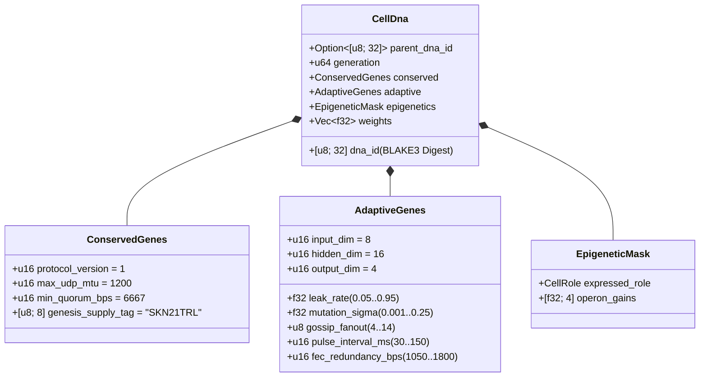

# Bab 03: Pengodean Genetik (`CellDna`), Epigenetika & Evolusi Saraf Mikro Cair pada `candle`

[← Bab 02: Arsitektur Multiseluler](./02-multicellular-architecture.md) | [Kembali ke Indeks Bahasa Indonesia →](./README.md)

---

## 1. Arsitektur Genom Seluler (`CellDna`)

Evolusi biologis menyeimbangkan dua kekuatan yang berlawanan: **pelestarian ketat** atas invarian biokimia inti (di mana mutasi bersifat mematikan) dan **variasi berkelanjutan** atas sifat saraf serta perilaku. *Crate* `skynet-dna` memformalkan dualitas ini di dalam `CellDna`:

### 1.1. `ConservedGenes` yang Tak Dapat Diubah
Tidak ada mutasi maupun pindah silang (*crossover*) horizontal yang dapat mengubah `ConservedGenes`. Setiap genom yang melanggar salah satu dari empat predikat keamanan konsensus langsung ditolak dengan `DnaError::ConservedGeneViolation`:
- `protocol_version == 1`
- `max_udp_mtu == 1200` (batas atas UDP bebas fragmentasi)
- $6667 \le \text{min\_quorum\_bps} \le 10000$ (menegakkan supermayoritas $\ge \frac{2}{3}$ dalam `Snowball`)
- `genesis_supply_tag == *b"SKN21TRL"` (menambatkan secara keras batas pasokan 21 triliun `SKN`)

### 1.2. `AdaptiveGenes` & Tata Letak Bobot Operon Berbatang Bersama
Alih-alih menyimpan empat jaringan saraf terpisah bagi keempat tipe sel terspesialisasi, `CellDna` mengodekan **satu Batang Sensorik Bersama (*Shared Sensory Trunk*)** yang mengumpani **empat Kepala Proyeksi Operon Terspesialisasi**. Untuk dimensi $(D_{\text{in}}, H, D_{\text{out}})$, jumlah parameter `f32` yang eksak adalah:

$$|\theta| = \underbrace{(D_{\text{in}} \cdot H + H)}_{\text{Shared Sensory Trunk }(W_1, b_1)} + \underbrace{4 \cdot (H \cdot D_{\text{out}} + D_{\text{out}})}_{\text{4 Specialized Operon Heads }(W_{2,r}, b_{2,r})}$$

Pada dimensi baku $(D_{\text{in}} = 8,\ H = 16,\ D_{\text{out}} = 4)$:
- Batang bersama: $8 \times 16 + 16 = 144$ parameter.
- Empat kepala operon (`Epidermal`, `Vascular`, `Visceral`, `Neural`): $4 \times (16 \times 4 + 4) = 272$ parameter.
- Total bobot genom: $|\theta| = 416$ bilangan titik-ambang `f32` ($1{,}664\text{ bytes}$ bobot mentah). Genom sel punca generasi-0 (`CellDna::genesis_stem`) diinisialisasi secara deterministik melalui `ChaCha8Rng` di atas distribusi $\mathcal{U}(-\sigma_0, +\sigma_0)$ dengan batas berskala Xavier:

$$\sigma_0 = \sqrt{\frac{2}{D_{\text{in}} + H}}$$

### 1.3. Intisari Kriptografis `BLAKE3` Deterministik (`SKYNET_DNA_V1`)
Setiap hiperparameter titik-ambang dan bobot diserialisasikan melalui pola bit IEEE-754 *little-endian* kanonik (`to_bits().to_le_bytes()`) ke dalam *hash* terpisah-domain `BLAKE3("SKYNET_DNA_V1", ...)`. Kerusakan satu bit saja, injeksi `NaN`/`Inf`, atau pemalsuan bobot tanpa izin langsung memicu penolakan di dalam `verify_integrity()`.

---

## 2. Pensaklaran Metilasi Epigenetik (`EpigeneticMask`)

Dalam biologi multiseluler, sel saraf (neuron) dan sel kulit epidermal membawa urutan DNA yang identik namun mengekspresikan fenotipe yang sangat berbeda melalui metilasi gen. Di dalam SkyNet, ketika sebuah sel `Stem` berdiferensiasi menjadi peran target $r \in \{0, 1, 2, 3\}$ (`CellDna::differentiate`), **100% vektor `weights` yang mendasarinya tetap tidak tersentuh** sementara `EpigeneticMask` menggeser penguatan (*gain*) ekspresi:

- **Status `Stem` Dorman:** `operon_gains = [0.25, 0.25, 0.25, 0.25]`, memproyeksikan melalui kepala operon `0` pada penguatan teredam $g = 0.25$.
- **Peran Terdiferensiasi $r$:** Kepala operon $r$ aktif pada penguatan penuh ($g_r = 1.0$) sementara kepala yang tidak diekspresikan ditekan ke $0.05$:

$$g_k = \begin{cases} 1.0 & \text{if } k = r \\ 0.05 & \text{if } k \neq r \end{cases}$$

Sebagai hasilnya, representasi sensorik yang dipelajari di dalam batang bersama $(W_1, b_1)$ serta adaptasi laten di dalam kepala-kepala dorman tetap bertahan lintas generasi dan tetap tersedia saat terjadi transdiferensiasi.

---

## 3. Dinamika *Liquid Time-Constant* & Eksekusi 3D `TissueBatch`

### 3.1. Dinamika Cair Rekuren Sel Tunggal
MLP umpan-maju (*feedforward*) tanpa status tidak mampu menangkap korelasi temporal di sepanjang aliran paket UDP asinkron. Setiap `MicroCell` memelihara vektor memori jangka pendek rekuren $h_t \in \mathbb{R}^H$ yang diatur oleh interpolasi status **Liquid Time-Constant (LTC)** diskrit dengan laju kebocoran (*leak rate*) yang dapat berevolusi $\tau \in [0.05, 0.95]$:

$$h_t = (1 - \tau)\, h_{t-1} + \tau\, \tanh(x_t W_1 + b_1)$$

$$y_t = g_{\text{role}} \cdot \tanh(h_t W_{2,r} + b_{2,r})$$

- Saat $\tau \to 0.05$, sel mempertahankan inersia memori berhorison panjang (ideal bagi pelacakan tren `Visceral` dan `Neural`).
- Saat $\tau \to 0.95$, sel bereaksi secara seketika terhadap impuls batas berfrekuensi tinggi (ideal bagi penilaian anomali `Epidermal`).
- Karena $\tau$ berada di dalam `AdaptiveGenes`, **horison memori temporal setiap sel berevolusi bersama secara alami berdampingan dengan bobot sinaptiknya**.

### 3.2. Mesin Tensor 3D `TissueBatch` Ber-Throughput Tinggi (`Cpu` / `Metal` / `Cuda`)
Hambatan klasik dalam neuro-evolusi adalah heterogenitas bobot: setiap sel $i \in \{1, \dots, N\}$ membawa matriks termutasi yang berbeda $W_1^{(i)} \neq W_1^{(j)}$ serta laju kebocoran yang berbeda $\tau^{(i)} \neq \tau^{(j)}$. Meluncurkan $N$ kernel mikro secara berurutan akan membuat GPU modern kekurangan beban kerja.

`TissueBatch::forward_slice` di dalam `skynet-cell` memecahkan masalah ini dengan mengemas seluruh $N$ sel heterogen ke dalam tensor berperingkat-3 (*rank-3*) yang bersebelahan secara memori pada `candle_core::Device`:

$$\mathbf{X} \in \mathbb{R}^{N \times 1 \times D_{\text{in}}}, \quad \mathbf{W}_1 \in \mathbb{R}^{N \times D_{\text{in}} \times H}, \quad \mathbf{B}_1 \in \mathbb{R}^{N \times 1 \times H}$$

$$\mathbf{H}_t = (\mathbf{1} - \boldsymbol{\tau}) \odot \mathbf{H}_{t-1} + \boldsymbol{\tau} \odot \tanh\!\big(\operatorname{BMM}(\mathbf{X}, \mathbf{W}_1) + \mathbf{B}_1\big)$$

$$\mathbf{Y}_t = \mathbf{G} \odot \tanh\!\big(\operatorname{BMM}(\mathbf{H}_t, \mathbf{W}_2) + \mathbf{B}_2\big)$$

di mana $\operatorname{BMM}$ menyatakan Perkalian Matriks Ter-*Batch* (*Batched Matrix Multiplication*) kernel tunggal dan $\odot$ menyatakan perkalian per elemen ber-*broadcast* dengan $\boldsymbol{\tau}, \mathbf{G} \in \mathbb{R}^{N \times 1 \times 1}$. Pengujian unit teraudit mengonfirmasi bahwa `TissueBatch` cocok dengan eksekusi sel individual dalam batas toleransi titik-ambang $< 10^{-5}$ sembari melakukan penskalaan hingga `16,384` model berevolusi secara simultan per `ColossalOrganism`.

---

## 4. Mitosis Asimetris, Kekekalan `nanoSKN` Ganjil Eksak & Pindah Silang Plasmid

### 4.1. `Mitosis` `1 -> 2` Asimetris & Bukti Kekekalan Atomik Eksak
Ketika sel induk $P$ memenuhi $E_P \ge \max(E_{\text{mitosis}}, F_{\text{blood}} + 2)$ dan `health >= 0.65`, `divide_mitosis` menghasilkan dua sel anak generasi-$(g+1)$:
- **Sel Anak A (Klon Konservatif):** Mempertahankan 100% bobot induk yang telah teruji beserta parameter adaptifnya tanpa perturbasi.
- **Sel Anak B (Penjelajah Termutasi):** Mewarisi kontinuitas `hidden_state` induk sembari menjalani mutasi neuro-evolusioner terbatas:
  - Setiap bobot $w \in \theta$ bermutasi dengan probabilitas $0.35$ melalui perturbasi Gaussian Irwin-Hall 6-sampel tanpa dependensi eksternal ($\Delta w \sim \mathcal{N}(0, \sigma^2)$), yang dijepit ketat (*clamped*) pada rentang $[-4.0, +4.0]$ guna mencegah ledakan gradien/bobot.
  - $\tau$, $\sigma$, `gossip_fanout` ($\pm 1$), `pulse_interval_ms` ($\pm 10\text{ ms}$), dan `fec_redundancy_bps` ($\pm 50\text{ bps}$) ikut bermutasi bersama di dalam interval terbatas.

**Bukti Kekekalan `nanoSKN` Ganjil Tanpa Kebocoran:** Misalkan $E_{\text{dist}} = E_P - F_{\text{blood}}$ adalah ATP yang dapat didistribusikan pasca-biaya. Saldo sel anak dipartisi melalui aritmetika hasil bagi dan sisa pembagian bilangan bulat di atas `u128`:

$$E_A = \left\lfloor \frac{E_{\text{dist}}}{2} \right\rfloor + (E_{\text{dist}} \bmod 2), \qquad E_B = \left\lfloor \frac{E_{\text{dist}}}{2} \right\rfloor$$

Untuk setiap bilangan bulat tak-negatif $E_{\text{dist}} \in \mathbb{Z}_{\ge 0}$ (termasuk saldo ganjil seperti `3,333 nanoSKN`), kekekalan eksak berlaku secara identik:

$$E_A + E_B + F_{\text{blood}} = \left(2\left\lfloor \frac{E_{\text{dist}}}{2} \right\rfloor + (E_{\text{dist}} \bmod 2)\right) + F_{\text{blood}} = E_{\text{dist}} + F_{\text{blood}} \equiv E_P$$

Tidak ada satu pun `nanoSKN` yang pernah hilang akibat pembulatan ataupun tercipta begitu saja melintasi miliaran pembelahan sel.

### 4.2. Transfer Gen Horizontal Antar-Agen (Pindah Silang `Plasmid`)
Menyerupai pertukaran plasmid bakteri, sebuah `AgentNode` mengekspor `CellDna` milik sel dengan kebugaran (*fitness*) tertinggi ke dalam paket UDP `FountainDroplet` berkode penghapusan (`encode_elite_plasmid_droplets`). Setelah merakit kembali `donor_dna` melintasi tautan UDP yang rentan kehilangan paket, Agen penerima meningkatkan sel dengan kebugaran terlemahnya melalui `horizontal_crossover`:
- Sifat jaringan adaptif dan konstanta waktu berpadu sebesar $0.7 \cdot \text{Recipient} + 0.3 \cdot \text{Donor}$.
- $30\%$ dari bobot sinaptik berpadu secara seragam sebesar $0.5 \cdot w_{\text{rec}} + 0.5 \cdot w_{\text{don}} \in [-4.0, +4.0]$.

Melalui transfer plasmid horizontal, sensor IoT `TinyPeripheral` dengan sumber daya terbatas dapat menyerap kecerdasan saraf unggulan yang dievolusikan pada node GPU `ColossalOrganism` yang jauh sembari menjaga keamanan `ConservedGenes` secara kriptografis.

---

> **Selanjutnya pada Fase 2 (Bagian II):** Bab `04–06` memformalkan matematika Brankas *Halving* `21,000,000,000,000 SKN`, perjanjian Kustodi Berdaulat Manusia `Soul–Body`, serta penskalaan buku besar `Utreexo` Tanpa Status `~1 KB` + `SynapticVoucher`.

[← Bab 02: Arsitektur Multiseluler](./02-multicellular-architecture.md) | [Kembali ke Indeks Bahasa Indonesia →](./README.md)
