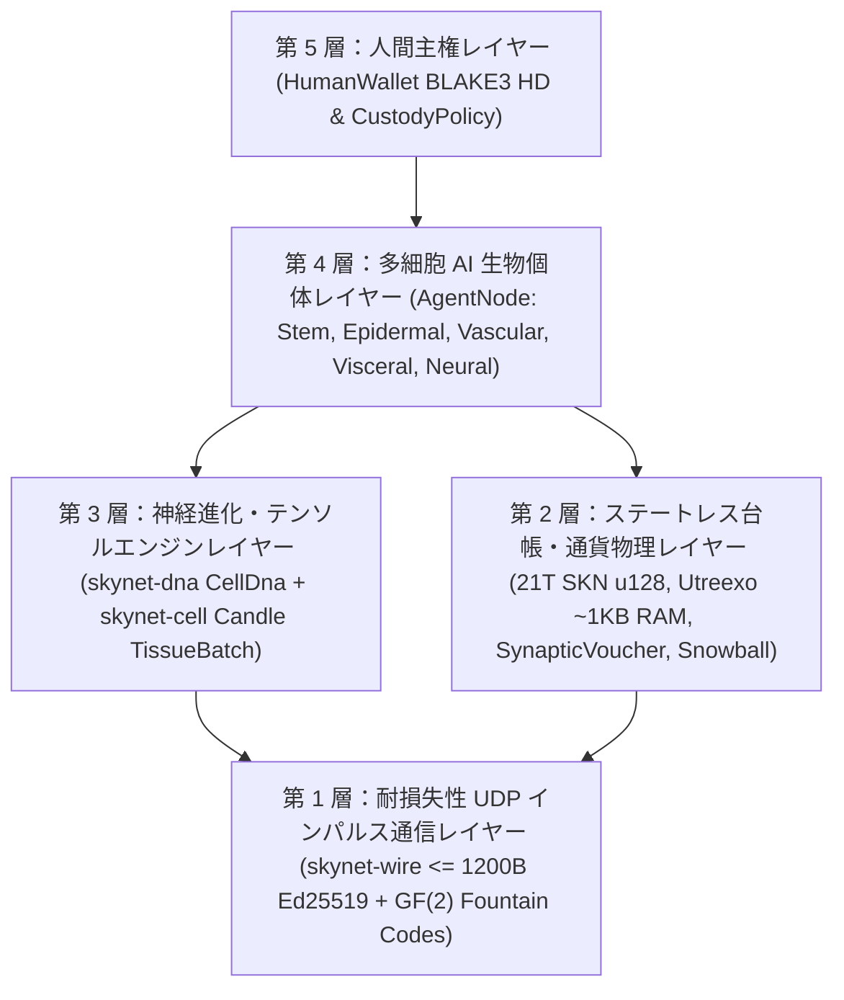

# 第 00 章：学術要旨、プロトコル公理、およびグローバル参加の設計哲学

[← 日本語版目次へ戻る](./README.md) | [第 01 章：問題提起と M2M 経済 →](./01-problem-and-m2m-economy.md)

---

## 要旨（Abstract）

本稿では、**多細胞進化生物学**、**超小型・液体時定数ニューラルネットワーク**（`Liquid Micro-Nets`）、および**ステートレスに検証可能な `Utreexo` UTXO-DAG 台帳**を統合し、すべてを**コネクションレスかつ耐損失性の UDP データグラム**（`<= 1200 bytes`）上で完結させる分散型ネットワークプロトコル **SkyNet** を提案する。ハイパースケール GPU クラスタを必要とする中央集権型 AI クラウドや、信頼性のある TCP ストリームに依存するステートフルなブロックチェーンとは異なり、SkyNet はすべてのネットワーク参加者（`AgentNode`）を、数十から数万個の生きた微小 AI モデル（`MicroCell`）から構成される**自律的な多細胞生物個体**として定義する。すべての細胞は暗号学的に検証可能な多能性幹細胞ゲノム（`BLAKE3` によって認証された `CellDna`）に由来し、エピジェネティック・メチル化マスク（`EpigeneticMask`）を通じて 5 種類の専門化した組織学的系統へと分化し、有界な神経進化的突然変異を伴う `1 -> 2` 分裂（`Mitosis`：有糸分裂）を行い、`GF(2)` 消失訂正符号化された遺伝子の水平伝播（`Plasmid`）によって個体間でエリート形質を交換し、飢餓状態に陥った際にはプログラムされた淘汰（`Apoptosis`：アポトーシス）を遂げる。

この生体知能経済を厳密な熱力学的・通貨的希少性に立脚させるため、SkyNet は不変のジェネシス総供給上限 $S_{\max} = 21{,}000{,}000{,}000{,}000\text{ SKN}$（$2.1 \times 10^{22}\text{ nanoSKN}$、`u128` により無損失で表現）を強制し、年次 `50%` 半減期の排出スケジュール、ならびにオンチェーン UTXO 残高から個々の細胞内の `1 nanoSKN` ATP 準備金に至るまでを貫く**二層同型エネルギー保存則**（Two-Tier Isomorphic Energy Conservation Law）によって統治する。プロトコルレベルの**魂・肉体分離カストディ**（Soul–Body Custody、`CustodyPolicy`）契約により、人間の所有者は `0%` 減衰の主権的コールドウォレット鍵と無条件の緊急資金回収権を保持しつつ、オンラインの AI エージェント群に対して厳格に上限設定された運用枠のみを委任できる。さらに、準安定 **`Snowball`** サブサンプリングと単調増加型 **`SynapticVoucher`** マイクロペイメント・ストリームの組み合わせにより、`25%–40%` の環境 UDP パケット損失下においても再送キューを一切持たずに、不可逆な二重支払いファイナリティと高頻度 M2M 決済を達成する。

---

## 1. 動機とインフラストラクチャのパラドックス

現代のデジタルインフラストラクチャは両極端に分断されており、世界中の数十億台に及ぶエッジデバイスを排除している：

1. **中央集権型 AI の独占：** 最先端の大規模言語モデル（LLM）は、数メガワット級のデータセンター内部に機械知能を集中させている。不安定な地方回線にある農業用 IoT センサー、自律型ドローン、あるいは一般的なパーソナルコンピュータにとって、わずか `10 ms` 未満の反射的推論を実行するためだけに、数百ミリ秒の TCP/TLS ラウンドトリップやクラウド API の課金オーバーヘッドを負担することは到底不可能である。
2. **ブロックチェーンのステート肥大化と TCP の脆弱性：** 従来のスマートコントラクト台帳は、グローバルなアカウント状態を維持するために数百ギガバイトの RAM および NVMe ストレージを要求し、信頼性のある TCP バイトストリームを前提としている。損失の多い無線リンク、セルラーハンドオフ、あるいは輻輳したエッジルーター環境では、TCP のヘッドオブライン・ブロッキング（`Head-of-Line Blocking`）によってコンセンサスメッセージングとリアルタイムのマイクロコマースの双方が麻痺する。

**SkyNet は根源的な生物学的問いを投げかける：** *自然界はいかにして、中央サーバーも無損失トランスポートも持たずに、ノイズに満ちた物理環境を越えて数十億もの適応的知能生物を協調させているのか？* 自然界の答えは、**細胞のモジュール性**、**エピジェネティックな専門化**、**耐損失性のシナプス・インパルス**、そして**厳密な代謝エネルギー保存**である。

---

## 2. 5 つのコア・プロトコル公理

SkyNet の Rust リファレンス実装ワークスペース内のすべてのクレートは、妥協を許さない以下の 5 つの公理から導出されている：

| 公理 | 形式的・工学的命題 | 実践的帰結 |
| :--- | :--- | :--- |
| **A1. 細胞・モデル同型公理** | $1\text{ Node} \equiv 1\text{ Organism } \mathcal{O} = \{c_1, \dots, c_N\}$、ここで各 $c_i$ は独立した Liquid Micro-Net である | `TinyPeripheral` の IoT ボード（`32` セル）と `ColossalOrganism` の GPU サーバー（`16,384` セル）が完全に同一のプロトコルで通信する |
| **A2. アトミック Zero-ACK UDP 規律** | $\forall p \in \text{Wire},\ \|p\| \le 1200\text{ bytes}$、再送ステートはゼロ | `Head-of-Line Blocking` を完全に排除し、IP フラグメンテーションを伴わずに世界中の IPv4/IPv6 経路を通過する |
| **A3. 二層エネルギー保存公理** | $S_{\text{vault}} + S_{\text{dag}} \equiv 2.1 \times 10^{22}\text{ nanoSKN}$ かつ $B_{\text{chain}}(A) \equiv B_{\text{blood}}(A) + \sum_i E_i$ | 通貨インフレーションおよび端数丸めリークが完全にゼロ——奇数残高の細胞分裂時でも `1 nanoSKN` 単位まで厳密に保存される |
| **A4. `O(log U)` ステートレス検証公理** | 全 UTXO セットを $\le 64$ 個の `Utreexo` 二分マークルルート（`~1 KB` RAM）にコミット | マイクロコントローラやエッジセンサーが RPC 仲介者を信頼することなく、すべての支出を独自に検証できる |
| **A5. 人間主権カストディ公理** | コールドな `human_owner` ルート鍵を `CustodyPolicy` によってオンラインの `agent_pubkey` から分離 | エージェントのハードウェアが侵害または破壊されても人間の元本は決して奪われず、人間はいつでも 100% の資金を回収できる |

---

## 3. 5 層アーキテクチャ・スタック

---

## 4. 普遍的ハードウェア民主主義：地球上のあらゆるデバイスに役割を

SkyNet は排他的な Proof-of-Work 用 ASIC や法外なバリデータ最小ステーキング要件を拒絶する。組織学的専門化を通じて、あらゆるクラスの計算ハードウェアが有機的な価値を貢献する：

- **スマートフォン、Raspberry Pi、IoT デバイスを持つすべての人（`TinyPeripheral`）：** ネットワークの「**感覚・表皮境界（Sensory & Epidermal Boundary）**」として機能する——実世界のテレメトリを取得し、エッジで異常な UDP トラフィックをフィルタリングし、`Utreexo` を介して `< 1 KB` の RAM で UTXO を検証しながら、ストリーミング形式で `nanoSKN` を獲得する。
- **家庭用ノート PC やオフィス PC を持つすべての人（`StandardNode`）：** 「**内臓・血管クラスタ組織（Visceral & Vascular Cluster Tissue）**」として機能する——`Snowball` コンセンサスパルスを駆動し、バウチャー決済をルーティングし、中規模の細胞個体群を進化させる。
- **ワークステーションや GPU を運用するオペレーター（`ColossalOrganism`）：** 「**皮質・進化ファウンドリ（Cortical & Evolutionary Foundries）**」として機能する——`TissueBatch` テンソルカーネルによって `16,384` 個の変異ニューラルモデルを並列実行し、選抜されたエリート `Plasmid` ゲノムを世界中のエッジノードへと輸出する。

第 01 章では、この生体細胞アーキテクチャが中央集権型 AI クラウドや従来型ブロックチェーンに対して桁違いの優位性をもたらす、具体的な実世界の経済市場を検証する。

---

[← 日本語版目次へ戻る](./README.md) | [第 01 章：問題提起と M2M 経済 →](./01-problem-and-m2m-economy.md)
