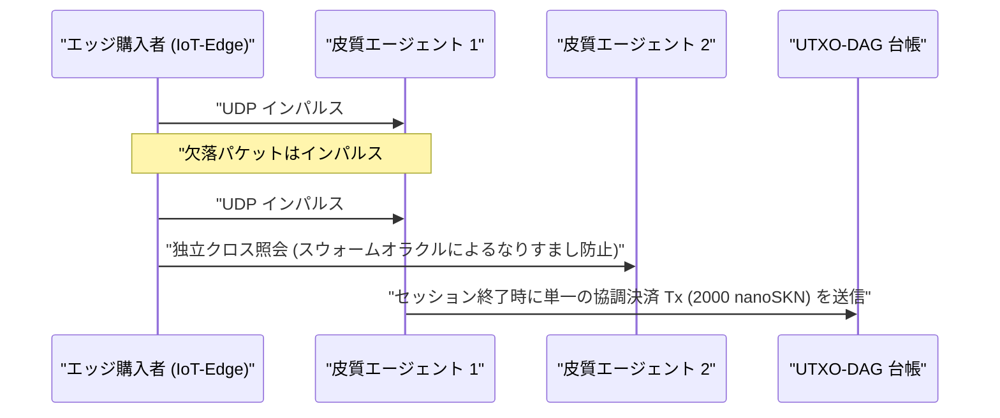

# 第 01 章：問題提起と実践的マシン・ツー・マシン（`M2M`）経済

[← 第 00 章：要旨とビジョン](./00-abstract-and-vision.md) | [第 02 章：多細胞生物アーキテクチャ →](./02-multicellular-architecture.md)

---

## 1. 中央集権型チャットボットを超えて：物理エッジにおける反射的知能

SkyNet は、長文ドキュメント作成を担う中央集権型の数千億パラメータ級大規模言語モデルを置き換えることを目的とはしていない。その代わりに SkyNet が狙うのは、**数兆ドル規模の構造的死角**、すなわちインターネットの物理エッジである。そこでは数十億台の自律機械、産業用センサー、ネットワークゲートウェイ、およびソフトウェアエージェントが、不安定な無線リンク越しに**サブ `10 ms` の反射的推論、継続的なローカル適応、および 1 セント未満の超微小マシン・ツー・マシン（`M2M`）価値決済**を必要としている。

### なぜ中央集権型クラウドと従来型ブロックチェーンはここで破綻するのか

自律エッジエージェント $A$（群制御ドローン、DDoS 緩和ゲートウェイ、スマートグリッド・リレーなど）が、$\Delta t = 10\text{ ms}$ ごとに 1 インパルスあたり $v = 50\text{ nanoSKN}$ の価値でリアルタイムの異常分類およびテレメトリ検証を購入する状況を考える：

1. **レイテンシと TCP 再送の壁：** 遠隔地のクラウドリージョンへ TLS/TCP セッションを確立するには複数回の往復ハンドシェイク（multi-RTT）を要する。周囲の無線パケット損失率が $p_{\text{loss}} = 20\%$ の環境下では、TCP の輻輳ウィンドウ縮小と再送タイムアウトにより `p99` テールレイテンシが数百ミリ秒へと跳ね上がり、リアルタイムのサイバーフィジカル制御ループにとって致命的となる。
2. **基本手数料の下限障壁：** 法定通貨の決済レールや EVM スマートコントラクトチェーンでは、トランザクションごとの固定オーバーヘッド $F_{\text{tx}}$ が単一インパルスの価値を $10^5\times$ から $10^8\times$ も上回り（$F_{\text{tx}} \gg v$）、ミリ秒粒度の M2M コマースを経済的に不可能にしている。
3. **静的モデルのドリフト（Concept Drift）：** クラウドからデプロイされた事前学習済みの静的重みは、局所的な信号分布の変化（`concept drift`）によって急速に劣化する一方、リソース制約のあるエッジデバイスには勾配誤差逆伝播法を実行するメモリや電力の余裕が存在しない。

---

## 2. `SKN` の実需を牽引する 4 つの実世界経済ピラー

`SKN` に対する本質的な需要は、中央集権型クラウドやステートフルなブロックチェーンが競合し得ない 4 つの具体的な能力から生まれる：

### 2.1. 超低遅延スウォーム・エッジ・マイクロ推論（`< 10 ms`）
ロボティクス群、産業用 IoT コントローラ、通信リレー、およびネットワークセキュリティ機器は、8 次元の正規化特徴ベクトル（`stimulus: [f32; 8]`）を署名付き `SynapticVoucher` と共に**単一の `<= 1200-byte` UDP データグラム**内に格納して送信する。
- 近隣の `Epidermal`（表皮）セルおよび `Neural`（神経）セルは、1 インパルスあたり `0.1 ms` 未満で再帰型 Liquid Micro-Net の順伝播を実行する。
- `SynapticVoucher` は単調増加する累積総額を符号化しているため、セルラー回線や衛星リンク上で `25%` のランダムな UDP パケット損失が発生しても、**課金の停滞も再送による一時停止も一切発生しない**。

### 2.2. Evolution-as-a-Service と分散型 `Plasmid` 遺伝子市場
高価なクラウド GPU クラスタを借りて小型組込みモデルを学習させる代わりに、あらゆるユーザーや自律エージェントは、入力刺激ストリーム $x_t$、目標応答 $y_t^*$、および `SKN` 報酬を指定した最適化バウンティをブロードキャストできる：
- 数千もの `AgentNode` 個体が `1 -> 2` の細胞有糸分裂（`Mitosis`）を発動し、数万通りの重み摂動と液体時定数 $\tau$ を並列に評価する。
- 性能の低い変異体は `Apoptosis`（アポトーシス）によって淘汰され、最優秀の系統はコンパクトな `CellDna` ゲノム（`2 KB` 未満、`BLAKE3` により暗号学的に封印）へと収束する。
- 依頼者はリアルタイム推論だけでなく、数百万個のマイクロコントローラへ直接フラッシュ書き込み可能な**独立した進化済み `CellDna` 重みアーティファクト**（`GF(2)` `FountainDroplet` パケットにより無損失で配信）を受け取る。

### 2.3. アトミック `M2M nanoSKN` 決済レールと耐ハルシネーション・スウォームオラクル
最小 `1 nanoSKN`（$10^{-9}\text{ SKN}$）単位の価格設定により、AI エージェントは実世界の物理信号（微気象テレメトリ、RF スペクトル占有率、ルーティング遅延、高頻度オーダーフロー）を自律的に購入し相互検証する：

ローカルクラスタ内の独立した複数の `AgentNode` 個体をクロスサンプリングすることで、単一モデルのハルシネーションやセンサーのなりすましを排除する。

### 2.4. 包摂的マルチティア DePIN（ハードウェア共生）
SkyNet は世界中の多様な遊休ハードウェアを、共生的な生物学的サプライチェーンへと統合する：

| 参加者セグメント | 日常的なハードウェア | 生態学的役割 | `SKN` 収益ストリーム |
| :--- | :--- | :--- | :--- |
| **個人・一般家庭** | 旧型スマートフォン、家庭用ルーター、Raspberry Pi、IoT ボード | エッジ感覚データ取得、`Epidermal` パケットフィルタリング、`~1 KB` `Utreexo` 軽量検証 | ライブセンサーフィードおよび境界フィルタリングから `nanoSKN` を獲得 |
| **開発者・デスクトップユーザー** | ノート PC、オフィス PC（`StandardNode`） | `Snowball` コンセンサス・サンプリング、バウチャールーティング、中規模組織進化 | クラスタ手数料プール（`cluster_nutrient_pool`）および推論報酬を獲得 |
| **研究機関・GPU オペレーター** | マルチコアサーバー、Apple `Metal`、NVIDIA `CUDA` GPU | ノードあたり最大 `16,384` セルの `TissueBatch` 並列進化 | 進化バウンティ報酬および水平伝播 `Plasmid` 輸出ロイヤリティを獲得 |

---

## 3. 準線形オンチェーン決済圧縮の数学的構造

2 つの AI エージェントが、パケット損失確率 $p \in [0, 1)$ の無線チャネル越しに、1 回あたり $\delta\text{ nanoSKN}$ で $M$ 回の高頻度推論インパルスを交換するものとする。従来のオンチェーン決済では $\mathcal{O}(M)$ 件の台帳トランザクションが必要となり、TCP 再送オーバーヘッドは $\frac{1}{1 - p}$ に比例して増大する。

SkyNet では、支払側はシーケンス番号 $s \in \{1, \dots, M\}$ でインデックス付けされ、累積価値 $V_s = s \cdot \delta$ を保持する `Ed25519` 署名付きバウチャーを送出する。到達に成功した任意のパケット $s_k$ は、途中で失われたすべての中間パケットにまたがる増分差分 $\Delta V = V_{s_k} - V_{s_{k-1}}$ を再送なしで暗号学的に証明する。セッション終了時、全 $M$ 回のマイクロ推論は**厳密に $1$ 件の UTXO-DAG トランザクション**で決済され、$M : 1$ のオンチェーン圧縮率（実運用において台帳負荷を $1{,}000\times$ から $100{,}000\times$ 削減）を達成する。

第 02 章では、各 `AgentNode` の内部解剖学的構造を詳しく検証し、単一のソフトウェアバイナリがあらゆるハードウェアティア上でいかにして生きた多細胞生物個体へと自己組織化するかを示す。

---

[← 第 00 章：要旨とビジョン](./00-abstract-and-vision.md) | [第 02 章：多細胞生物アーキテクチャ →](./02-multicellular-architecture.md)
