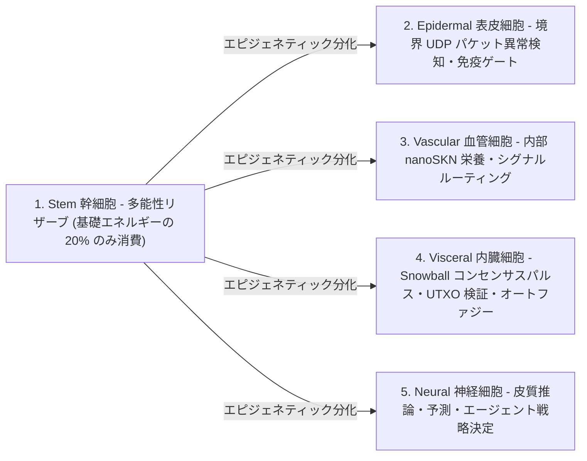

# 第 02 章：多細胞生物アーキテクチャと弾力的なハードウェア・スケーリング（`AgentNode`）

[← 第 01 章：問題提起と M2M 経済](./01-problem-and-m2m-economy.md) | [第 03 章：`CellDna` と液体ニューラルセル →](./03-dna-and-liquid-neural-cells.md)

---

## 1. 生物学的同型性：`1 Node = 1 Multicellular Organism`

従来のピア・ツー・ピア（P2P）ネットワークでは、組込みマイクロコントローラ上で動作する場合でも 64 コア GPU サーバー上で動作する場合でも、すべてのノードがモノリシックで硬直的なステートマシンを実行する。これに対し SkyNet（`crates/skynet-agent`）では、各ネットワーク参加者は **`AgentNode`** としてインスタンス化される——すなわち、動的な微小 AI 細胞個体群 $\mathcal{C}(t) = \{c_1, c_2, \dots, c_{N(t)}\}$、内部代謝トレジャリー（`AgentMetabolicBank`）、ステートレス `Utreexo` ルート検証器（`StatelessUtreexoRoots`）、および耐損失性 `SnowballEngine` から成る生きた多細胞生物個体である。

細胞個体群のサイズ $N(t) = |\mathcal{C}(t)|$ は決してハードコードされない。それは**ホストハードウェアの容量と獲得した `nanoSKN` 栄養流入量に応じて、`Mitosis`（有糸分裂）によって有機的に拡大し、`Apoptosis`（アポトーシス）によって収縮する**。

---

## 2. 3 つの弾力的ハードウェアティア（`HardwareTier`）

起動時に `HardwareProfile::for_tier` は、ホストの計算能力を厳密な `nanoSKN` 代謝閾値を持つ 3 つの生態学的プロファイルのいずれかへとマッピングする（`crates/skynet-cell/src/lib.rs`）：

| 生物学的パラメータ（`HardwareProfile`） | `TinyPeripheral`（IoT / エッジ MCU） | `StandardNode`（ノート / デスクトップ PC） | `ColossalOrganism`（サーバー / GPU） |
| :--- | :--- | :--- | :--- |
| **最大細胞個体数（`max_cells`）** | `32` セル | `512` セル | `16,384` セル |
| **活動細胞の基礎代謝消費 / Tick（`basal_burn_per_tick`）** | `50 nanoSKN` | `25 nanoSKN` | `10 nanoSKN` |
| **休眠 `Stem` 細胞の消費 / Tick（80% 省エネ）** | `10 nanoSKN` | `5 nanoSKN` | `2 nanoSKN` |
| **細胞分裂閾値（`mitosis_threshold`）** | `2,000 nanoSKN` | `1,500 nanoSKN` | `1,000 nanoSKN` |
| **細胞分裂血液手数料（`mitosis_blood_fee`）** | `100 nanoSKN` | `60 nanoSKN` | `40 nanoSKN` |
| **アポトーシス淘汰下限（`apoptosis_floor`）** | `100 nanoSKN` | `80 nanoSKN` | `50 nanoSKN` |
| **計算バックエンド（`candle_core::Device`）** | `Cpu` | `Cpu` / `Metal` / `Cuda` | `Cuda` / `Metal` / `Cpu` SIMD |

> [!NOTE]
> **生物学的規模の経済（クライバーの法則 / Kleiber's Law）：** より大型の生物ほど組織 1 グラムあたりの基礎代謝コストが低くなるのと同様に、`ColossalOrganism` ノードでは数千個のセルが単一のバッチ GPU テンソルカーネル内で実行コストを償却するため、セルあたりの基礎代謝消費が低く抑えられる（`50 nanoSKN` に対し `10 nanoSKN`）。一方、`TinyPeripheral` ノードはネットワークエッジにおいて軽量かつ高回復力な状態を維持する。

---

## 3. 5 つの専門化した組織学的系統（`CellRole`）

`AgentNode` が生成される際（`AgentNode::from_signing_key`）、決定論的な `base_stem` ゲノムから派生した 6 セルの初期胚シード（`2 Stem`、`1 Epidermal`、`1 Vascular`、`1 Visceral`、`1 Neural`）を初期化する。生物個体の生涯を通じて、5 つの組織学的系統が 5 つの不可欠な生理機能を担う：

1. **`Stem`（多能性リザーブ幹細胞 — `operon_index = None`）：** 1 ティックあたりわずか $\max(\lfloor E_{\text{burn}} / 5 \rfloor, 1)$ しか消費しない休眠状態の再生用細胞。いずれかの専門器官で細胞減少が生じると、外部からコードを一切ダウンロードすることなく、`Stem` セルがエピジェネティックに分化（`differentiate`）してその器官を補充する。
2. **`Epidermal`（表皮・免疫ゲート細胞 — `operon_index = Some(0)`）：** 生の UDP ソケット境界を防衛する（`epidermal_inspect_packet`）。受信パケットが台帳やコンセンサスエンジンに到達する前に、`Epidermal` セルが `candle` 上で正規化されたパケットテレメトリ（`raw_len / 1200`、`hop_ttl / 16`、`epoch` ドリフト）を評価し、不正形式パケットやフラッド攻撃インパルスを即座に破棄する。
3. **`Vascular`（循環調整・血管細胞 — `operon_index = Some(1)`）：** `AgentMetabolicBank` 内の内部 `blood_pool` 流動性を調整し、予測精度の高いセルへと `nanoSKN` 報酬を配分する。
4. **`Visceral`（器官維持・内臓細胞 — `operon_index = Some(2)`）：** `Snowball` ポーリング周期、ステートレス `Utreexo` ウィットネス検証、および代謝リサイクルを駆動する。
5. **`Neural`（皮質脳・神経細胞 — `operon_index = Some(3)`）：** 認知推論を実行する。生存しているすべての `Neural` セルのアンサンブル平均（$\bar{y}_{\text{cortical}} = \frac{1}{|\mathcal{C}_{\text{neural}}|} \sum_{i \in \mathcal{C}_{\text{neural}}} y_i$）が、その生物個体の集合的意思決定出力を形成する。

---

## 4. 6 フェーズの生物学的ティック・ライフサイクル（`run_biological_tick`）

各パルス（`pulse_seq`）ごとに、`AgentNode` はダーウィン的競争と厳密な `u128` `nanoSKN` エネルギー保存を統合した決定論的な 6 フェーズの生理学的サイクルを実行する：

1. **フェーズ 1 — 基礎代謝（Basal Metabolism）：** すべてのセル $c_i$ が維持エネルギー $b_i = \text{metabolize\_tick}()$ を燃焼する。極めて重要な点として、$b_i$ がオンチェーン上で消滅することは決してなく、燃焼された細胞内 ATP の 100% が `bank.blood_pool` へとリサイクルされる。飢餓状態のセル（$E_i = 0$）は `health` を `0.25` 失う。
2. **フェーズ 2 — バッチ `candle` テンソル推論：** 生存する全 $N$ 個のセルが `TissueBatch::forward_slice` を介して同時に順伝播を実行し、出力 $y_i \in \mathbb{R}^4$ を生成するとともに短期液体メモリベクトル $h_{i,t} \in \mathbb{R}^{16}$ を更新する。
3. **フェーズ 3 — 器官内ダーウィン的栄養選択（Intra-Organ Darwinian Nutrient Selection）：**
   目標信号 $t \in \mathbb{R}^4$ が与えられたとき、セル $i$ の予測品質は有界平均絶対誤差（MAE）によって測定される：

   $$q_i = \operatorname{clamp}\!\left(1 - \frac{1}{4}\sum_{k=1}^{4} |y_{i,k} - t_k|,\ 0.0,\ 1.0\right)$$

   同じ器官ロール $r = \text{role}(c_i)$ を共有する全セルの平均品質を $\bar{q}_r$ とする。専門化セルが `blood_pool` から栄養 `nanoSKN` を獲得できるのは、所属器官のセル数が $\le 2$ であるか、または器官内競争閾値 $q_i \ge 0.98 \cdot \bar{q}_r$ を上回った場合かつその場合に限られる：

   $$R_i = \min\!\left(\lfloor 320 \cdot q_i \rfloor + E_{\text{basal}},\ \left\lfloor \frac{B_{\text{blood}}}{8} \right\rfloor\right)$$

   基準を下回る変異体（$q_i < 0.98 \cdot \bar{q}_r$）は栄養を一切受け取れず、`-0.35` の `health` ペナルティを受ける。
4. **フェーズ 4 — ホメオスタシス幹細胞分化（Homeostatic Stem Differentiation）：** 個体は最も細胞数が不足している専門器官を特定する（`find_most_needed_role`）。`stem_count > 1` である限り、少なくとも `1` 個の生殖系列（germline）`Stem` セルを常に温存しつつ、1 個の `Stem` セルがその器官へと分化する。
5. **フェーズ 5 — `1 -> 2` 有糸分裂（Mitosis）：** 健康で十分な栄養を持つセル（`health >= 0.65` かつ $E_i \ge E_{\text{mitosis}}$）は、`profile.max_cells` を上限として、保守的クローン（娘細胞 A）と変異探索者（娘細胞 B）へと分裂する。
6. **フェーズ 6 — 器官保護付きアポトーシス（Organ-Protected Apoptosis）：** 飢餓状態（$E_i < E_{\text{apoptosis}}$）または深刻な損傷を受けた（`health <= 0.15`）セルは溶解し、残存する `nanoSKN` の 100% を `blood_pool` へと返還する。ただし、厳格な生存セーフガードとして、**既存の `CellRole` ごとに少なくとも `1` 個の生存セルが無条件に保護される**ため、いかなる重要器官も絶滅することはない。

すべてのティックの終了時に、`verify_internal_skn_conservation()` は以下の厳密な `u128` 恒等式を検証・保証する：

$$B_{\text{chain}}(\text{Agent}) \equiv B_{\text{blood}}(\text{Agent}) + \sum_{c_i \in \mathcal{C}} E_i$$

第 03 章では細胞核の内部を開き、`CellDna` の厳密なバイト構造と数学的定義、エピジェネティックなオペロン切り替え機構、および 3D `TissueBatch` 液体ニューラル実行エンジンを規定する。

---

[← 第 01 章：問題提起と M2M 経済](./01-problem-and-m2m-economy.md) | [第 03 章：`CellDna` と液体ニューラルセル →](./03-dna-and-liquid-neural-cells.md)
