# 第 03 章：遺伝子符号化（`CellDna`）、エピジェネティクス、および `candle` 上での液体マイクロニューラル進化

[← 第 02 章：多細胞生物アーキテクチャ](./02-multicellular-architecture.md) | [日本語版目次へ戻る →](./README.md)

---

## 1. 細胞ゲノム・アーキテクチャ（`CellDna`）

生物学的進化は、相反する 2 つの力の均衡の上に成り立っている。すなわち、突然変異が致死的となる中核的生化学不変量の**厳格な保存**と、神経的・行動的形質の**継続的な変異**である。`skynet-dna` クレートは、この二重性を `CellDna` 構造体として形式化している：

```mermaid
classDiagram
    class CellDna {
        +[u8; 32] dna_id (BLAKE3 Digest)
        +Option~[u8; 32]~ parent_dna_id
        +u64 generation
        +ConservedGenes conserved
        +AdaptiveGenes adaptive
        +EpigeneticMask epigenetics
        +Vec~f32~ weights
    }
    class ConservedGenes {
        +u16 protocol_version = 1
        +u16 max_udp_mtu = 1200
        +u16 min_quorum_bps = 6667
        +[u8; 8] genesis_supply_tag = "SKN21TRL"
    }
    class AdaptiveGenes {
        +u16 input_dim = 8
        +u16 hidden_dim = 16
        +u16 output_dim = 4
        +f32 leak_rate (0.05..0.95)
        +f32 mutation_sigma (0.001..0.25)
        +u8 gossip_fanout (4..14)
        +u16 pulse_interval_ms (30..150)
        +u16 fec_redundancy_bps (1050..1800)
    }
    class EpigeneticMask {
        +CellRole expressed_role
        +[f32; 4] operon_gains
    }
    CellDna *-- ConservedGenes
    CellDna *-- AdaptiveGenes
    CellDna *-- EpigeneticMask
```

### 1.1. 不変の保存遺伝子（`ConservedGenes`）
いかなる突然変異も水平交差も、`ConservedGenes` を変更することはできない。以下の 4 つのコンセンサス安全性述語のいずれかに違反するゲノムは、`DnaError::ConservedGeneViolation` によって即座に拒絶される：
- `protocol_version == 1`
- `max_udp_mtu == 1200`（フラグメンテーションを発生させない UDP ペイロード上限）
- $6667 \le \text{min\_quorum\_bps} \le 10000$（`Snowball` における $\ge \frac{2}{3}$ の絶対多数クォーラムを強制）
- `genesis_supply_tag == *b"SKN21TRL"`（21兆 `SKN` の総供給上限をハードアンカー）

### 1.2. 適応遺伝子（`AdaptiveGenes`）と共有幹オペロン重みレイアウト
4 種類の専門化セルタイプに対して無関係な 4 つのニューラルネットワークを個別に保持するのではなく、`CellDna` は **1 つの共有感覚幹**（Shared Sensory Trunk）から **4 つの専門化オペロン射影ヘッド**（Specialized Operon Projection Heads）へと特徴量を供給する構造を符号化する。次元 $(D_{\text{in}}, H, D_{\text{out}})$ に対する厳密な `f32` パラメータ総数は次式で与えられる：

$$|\theta| = \underbrace{(D_{\text{in}} \cdot H + H)}_{\text{Shared Sensory Trunk }(W_1, b_1)} + \underbrace{4 \cdot (H \cdot D_{\text{out}} + D_{\text{out}})}_{\text{4 Specialized Operon Heads }(W_{2,r}, b_{2,r})}$$

デフォルト次元 $(D_{\text{in}} = 8,\ H = 16,\ D_{\text{out}} = 4)$ の場合：
- 共有感覚幹：$8 \times 16 + 16 = 144$ パラメータ。
- 4 つのオペロンヘッド（`Epidermal`、`Vascular`、`Visceral`、`Neural`）：$4 \times (16 \times 4 + 4) = 272$ パラメータ。
- ゲノム総重み数：$|\theta| = 416$ 個の `f32` 浮動小数点数（生の重みデータとして $1{,}664\text{ bytes}$）。第 0 世代の幹細胞ゲノム（`CellDna::genesis_stem`）は、以下の Xavier スケーリング境界を用いた一様分布 $\mathcal{U}(-\sigma_0, +\sigma_0)$ 上で `ChaCha8Rng` により決定論的に初期化される：

$$\sigma_0 = \sqrt{\frac{2}{D_{\text{in}} + H}}$$

### 1.3. 決定論的 `BLAKE3` 暗号学的ダイジェスト（`SKYNET_DNA_V1`）
すべての浮動小数点ハイパーパラメータおよび重みは、正規リトルエンディアン IEEE-754 ビットパターン（`to_bits().to_le_bytes()`）としてシリアライズされ、ドメイン分離された `BLAKE3("SKYNET_DNA_V1", ...)` ハッシュへと入力される。わずか 1 ビットの破損、`NaN`/`Inf` の混入、あるいは不正な重み改ざんがあっても、`verify_integrity()` において即座に検知・拒絶される。

---

## 2. エピジェネティック・メチル化スイッチング（`EpigeneticMask`）

多細胞生物学において、ニューロンと表皮細胞は完全に同一の DNA 塩基配列を持ちながら、遺伝子メチル化によって全く異なる表現型を発現する。SkyNet において、`Stem` セルが対象ロール $r \in \{0, 1, 2, 3\}$ へと分化する際（`CellDna::differentiate`）、**基底の `weights` ベクトルは 100% 無変更のまま保持され**、`EpigeneticMask` が発現ゲインのみをシフトさせる：

- **休眠 `Stem` 状態：** `operon_gains = [0.25, 0.25, 0.25, 0.25]` となり、減衰ゲイン $g = 0.25$ でオペロンヘッド `0` を介して射影する。
- **分化後の専門ロール $r$：** オペロンヘッド $r$ が最大ゲイン（$g_r = 1.0$）で活性化し、非発現ヘッドは $0.05$ に抑制される：

$$g_k = \begin{cases} 1.0 & \text{if } k = r \\ 0.05 & \text{if } k \neq r \end{cases}$$

この結果、共有感覚幹 $(W_1, b_1)$ で獲得された感覚表現や休眠ヘッド内の潜在的適応形質は世代を超えて温存され、分化転換（transdifferentiation）の際にも即座に再利用可能となる。

---

## 3. 液体時定数ダイナミクスと 3D `TissueBatch` テンソル実行

### 3.1. 単一セルの再帰型液体ダイナミクス
ステートレスな順伝播型 MLP では、非同期な UDP パケットストリームにまたがる時間的相関を捉えることができない。各 `MicroCell` は、進化可能なリーク率 $\tau \in [0.05, 0.95]$ を持つ離散**液体時定数**（Liquid Time-Constant, LTC）状態補間によって制御される再帰的短期記憶ベクトル $h_t \in \mathbb{R}^H$ を保持する：

$$h_t = (1 - \tau)\, h_{t-1} + \tau\, \tanh(x_t W_1 + b_1)$$

$$y_t = g_{\text{role}} \cdot \tanh(h_t W_{2,r} + b_{2,r})$$

- $\tau \to 0.05$ に近づくほど、セルは長期的な記憶慣性を維持する（`Visceral` や `Neural` における長期トレンド追跡に最適）。
- $\tau \to 0.95$ に近づくほど、セルは高頻度の境界インパルスに対して瞬時に反応する（`Epidermal` における異常スコアリングに最適）。
- $\tau$ は `AdaptiveGenes` 内に格納されているため、**各セルの時間的記憶ホライズンはシナプス重みと共に自然に共進化する**。

### 3.2. 高スループット 3D `TissueBatch` テンソルエンジン（`Cpu` / `Metal` / `Cuda`）
神経進化における古典的なボトルネックは重みの異質性（heterogeneity）である。すなわち、すべてのセル $i \in \{1, \dots, N\}$ が互いに異なる変異行列 $W_1^{(i)} \neq W_1^{(j)}$ と異なるリーク率 $\tau^{(i)} \neq \tau^{(j)}$ を保持しているため、$N$ 回の逐次マイクロカーネルを起動すれば最新の GPU は深刻な演算飢餓に陥る。

`skynet-cell` の `TissueBatch::forward_slice` は、全 $N$ 個の異種セルを `candle_core::Device` 上の連続した 3 階テンソル（rank-3 tensors）へとパッキングすることでこの問題を解決する：

$$\mathbf{X} \in \mathbb{R}^{N \times 1 \times D_{\text{in}}}, \quad \mathbf{W}_1 \in \mathbb{R}^{N \times D_{\text{in}} \times H}, \quad \mathbf{B}_1 \in \mathbb{R}^{N \times 1 \times H}$$

$$\mathbf{H}_t = (\mathbf{1} - \boldsymbol{\tau}) \odot \mathbf{H}_{t-1} + \boldsymbol{\tau} \odot \tanh\!\big(\operatorname{BMM}(\mathbf{X}, \mathbf{W}_1) + \mathbf{B}_1\big)$$

$$\mathbf{Y}_t = \mathbf{G} \odot \tanh\!\big(\operatorname{BMM}(\mathbf{H}_t, \mathbf{W}_2) + \mathbf{B}_2\big)$$

ここで $\operatorname{BMM}$ は単一カーネルのバッチ行列積（Batched Matrix Multiplication）、$\odot$ は $\boldsymbol{\tau}, \mathbf{G} \in \mathbb{R}^{N \times 1 \times 1}$ とのブロードキャスト要素積を表す。監査済みユニットテストにより、`TissueBatch` は個別セル実行と $< 10^{-5}$ 未満の浮動小数点許容誤差で一致しつつ、`ColossalOrganism` あたり最大 `16,384` 個の進化モデルを同時並列実行できることが実証されている。

---

## 4. 非対称有糸分裂、奇数 `nanoSKN` の厳密保存証明、およびプラスミド交差

### 4.1. 非対称 `1 -> 2` 有糸分裂（`Mitosis`）とアトミックエネルギー保存の証明
親セル $P$ が $E_P \ge \max(E_{\text{mitosis}}, F_{\text{blood}} + 2)$ かつ `health >= 0.65` を満たすとき、`divide_mitosis` は第 $(g+1)$ 世代の 2 つの娘細胞を生成する：
- **娘細胞 A（保守的クローン / Conservative Clone）：** 実証済みの親の重みおよび適応パラメータを摂動なしで 100% そのまま継承する。
- **娘細胞 B（変異探索者 / Mutated Explorer）：** 親の `hidden_state` の連続性を継承しつつ、有界な神経進化的突然変異を受ける：
  - 各重み $w \in \theta$ は確率 $0.35$ で、外部依存ゼロの 6 サンプル Irwin-Hall ガウス摂動（$\Delta w \sim \mathcal{N}(0, \sigma^2)$）により変異し、勾配・重み爆発を防ぐため $[-4.0, +4.0]$ に厳密にクランプされる。
  - $\tau$、$\sigma$、`gossip_fanout`（$\pm 1$）、`pulse_interval_ms`（$\pm 10\text{ ms}$）、および `fec_redundancy_bps`（$\pm 50\text{ bps}$）も有界区間内で共変異する。

**ゼロリーク奇数 `nanoSKN` 保存の証明：** 手数料控除後の分配可能 ATP を $E_{\text{dist}} = E_P - F_{\text{blood}}$ とする。娘細胞の残高は `u128` 上の整数の商・剰余演算によって分割される：

$$E_A = \left\lfloor \frac{E_{\text{dist}}}{2} \right\rfloor + (E_{\text{dist}} \bmod 2), \qquad E_B = \left\lfloor \frac{E_{\text{dist}}}{2} \right\rfloor$$

任意の非負整数 $E_{\text{dist}} \in \mathbb{Z}_{\ge 0}$（`3,333 nanoSKN` のような奇数残高を含む）に対して、以下の厳密保存恒等式が恒等的に成立する：

$$E_A + E_B + F_{\text{blood}} = \left(2\left\lfloor \frac{E_{\text{dist}}}{2} \right\rfloor + (E_{\text{dist}} \bmod 2)\right) + F_{\text{blood}} = E_{\text{dist}} + F_{\text{blood}} \equiv E_P$$

何十億回の細胞分裂を経ても、端数丸めによって `1 nanoSKN` たりとも失われることはなく、また無から新規発行されることもない。

### 4.2. エージェント間水平伝播（`Plasmid` 交差）
細菌のプラスミド交換にならい、`AgentNode` は最も適応度の高いセルの `CellDna` を消失訂正符号化された UDP `FountainDroplet` パケットとしてエクスポートする（`encode_elite_plasmid_droplets`）。損失のある UDP リンク越しに `donor_dna` を再構成した受信側エージェントは、`horizontal_crossover` を介して自個体内で最も適応度の低いセルをアップグレードする：
- 適応的ネットワーキング特性および時定数形質は、$0.7 \cdot \text{Recipient} + 0.3 \cdot \text{Donor}$ の比率でブレンドされる。
- シナプス重みの $30\%$ が一様に選択され、$0.5 \cdot w_{\text{rec}} + 0.5 \cdot w_{\text{don}} \in [-4.0, +4.0]$ としてブレンドされる。

この水平プラスミド伝達を通じて、リソース制約の厳しい `TinyPeripheral` IoT センサーであっても、`ConservedGenes` の暗号学的安全性を完全に維持したまま、遠隔地の GPU `ColossalOrganism` ノード上で進化したエリート神経知能を吸収することができる。

---

> **次フェーズ予告（フェーズ 2 / 第 II 部）：** 第 `04–06` 章では、`21,000,000,000,000 SKN` 半減期ヴォールトの数理モデル、`Soul–Body`（魂・肉体分離）人間主権カストディ契約、および `~1 KB` ステートレス `Utreexo` + `SynapticVoucher` 台帳スケーリングを定式化する。

[← 第 02 章：多細胞生物アーキテクチャ](./02-multicellular-architecture.md) | [日本語版目次へ戻る →](./README.md)
