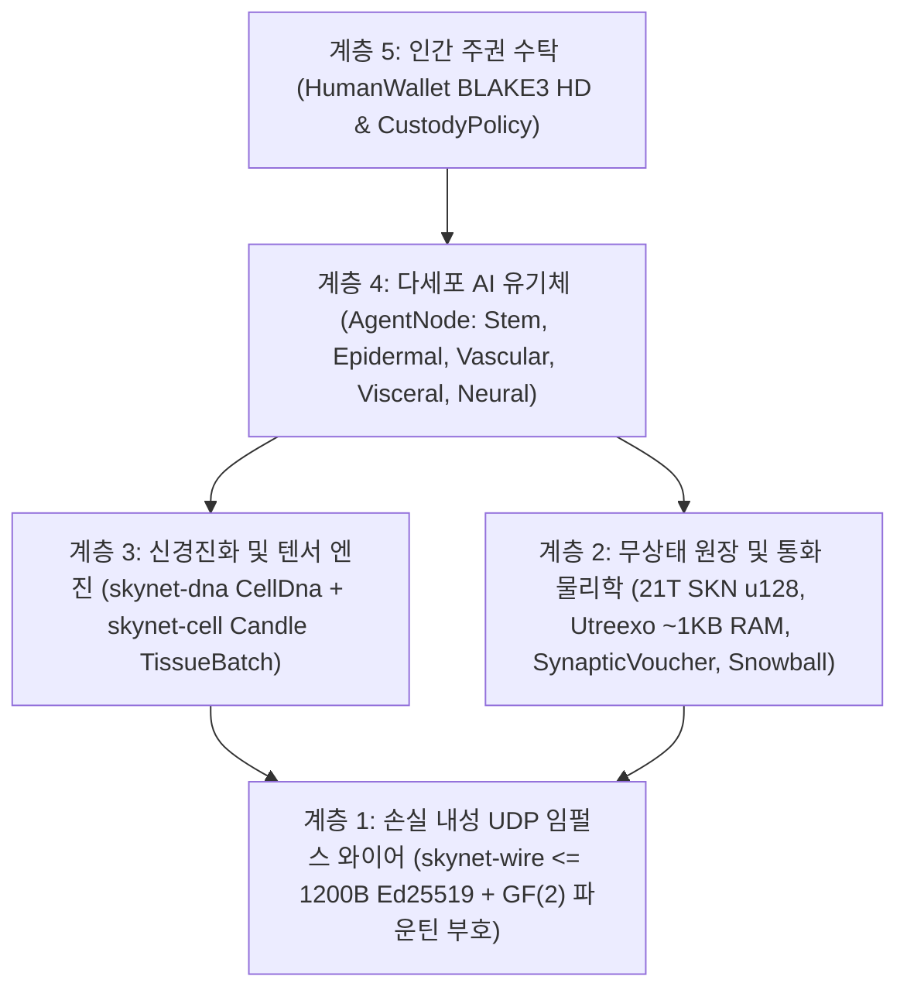

# 제00장: 학술 초록, 프로토콜 공리 및 범지구적 참여 철학

[← 한국어판 목차로 돌아가기](./README.md) | [제01장: 문제 정의 및 M2M 경제 →](./01-problem-and-m2m-economy.md)

---

## 초록 (Abstract)

본 백서는 **다세포 진화생물학(multicellular evolutionary biology)**, **초소형 액체 시정수 신경망(`Liquid Micro-Nets`)**, 그리고 **무상태 검증이 가능한 `Utreexo` UTXO-DAG 원장**을 하나로 통합하여, 전 과정을 **비연결형 손실 내성 UDP 데이터그램(`<= 1200 bytes`)** 위에서 구동하는 탈중앙화 네트워크 프로토콜 **SkyNet**을 제안한다. 하이퍼스케일 GPU 클러스터를 요구하는 중앙집중식 AI 클라우드나 신뢰성 있는 TCP 스트림에 종속된 상태 유지형(stateful) 블록체인과 달리, SkyNet은 모든 네트워크 참여자(`AgentNode`)를 수십 개에서 수만 개의 살아 있는 미세 AI 모델(`MicroCell`)로 구성된 **자율적 다세포 유기체(autonomous multicellular organism)**로 정의한다. 모든 세포는 암호학적으로 검증 가능한 만능 줄기 유전체(`BLAKE3`로 인증되는 `CellDna`)에서 기원하며, 후성유전학적 메틸화 마스크(`EpigeneticMask`)를 통해 5가지 전문 조직학적 계통으로 분화하고, 유계 신경진화 돌연변이를 동반한 `1 -> 2` 세포 분열(`Mitosis`)을 수행하며, `GF(2)` 소거 부호화 기반의 수평적 유전자 전달(`Plasmid`)을 통해 유기체 간 우수 형질을 교환하고, 영양 고갈 시 프로그램된 세포 제거(`Apoptosis`)를 거친다.

이러한 생물학적 지능 경제를 엄격한 열역학적·통화적 희소성 위에 고정하기 위해, SkyNet은 제네시스 총공급량 상한을 $S_{\max} = 21{,}000{,}000{,}000{,}000\text{ SKN}$ ($2.1 \times 10^{22}\text{ nanoSKN}$, `u128` 정수로 무손실 표현)으로 불변 고정하며, 연간 `50%` 반감기 발행 스케줄과 온체인 UTXO 잔고부터 개별 세포 내부의 `1 nanoSKN` ATP 보유량까지 관통하는 **2계층 동형 에너지 보존 법칙(Two-Tier Isomorphic Energy Conservation Law)**을 강제한다. 프로토콜 계층의 **영혼–육체 수탁(Soul–Body Custody)** 규약(`CustodyPolicy`)을 통해 인간 소유자는 조건 없는 긴급 회수 권한을 가진 `0%` 감쇠 주권형 콜드 월렛 키를 보유하는 동시에, 온라인 AI 에이전트 군집에는 엄격히 한도가 설정된 운영 예산만을 위임한다. 마지막으로, 준안정(metastable) **`Snowball`** 서브샘플링과 단조 증가하는 **`SynapticVoucher`** 마이크로페이먼트 스트림의 결합은 재전송 큐가 전혀 없는 환경에서도 `25%–40%`의 일상적 UDP 패킷 손실을 극복하며 비가역적 이중지불 완결성과 초고빈도 M2M 정산을 달성한다.

---

## 1. 연구 동기 및 인프라 역설

현대 디지털 인프라는 전 세계 수십억 대의 엣지 디바이스를 배제하는 두 가지 극단 사이에서 분열되어 있다:

1. **중앙집중식 AI 독점:** 최첨단 거대언어모델(LLM)은 수 메가와트급 데이터센터 내부에 기계 지능을 집중시킨다. 불안정한 농어촌 통신망에 연결된 농업용 IoT 센서, 자율 비행 드론, 혹은 보급형 개인용 컴퓨터는 `10 ms` 미만의 반사적 지능(reflexive intelligence)을 실행하기 위해 수백 밀리초에 달하는 TCP/TLS 왕복 지연이나 클라우드 API 과금 오버헤드를 감당할 수 없다.
2. **블록체인 상태 비대화(State Bloat) 및 TCP 취약성:** 기존 스마트 컨트랙트 원장은 전역 계정 상태를 유지하기 위해 수백 기가바이트의 RAM/NVMe 스토리지를 요구하며, 신뢰성 있는 TCP 바이트 스트림을 전제한다. 손실이 잦은 무선 링크, 셀룰러 핸드오프, 혹은 혼잡한 엣지 라우터 환경에서는 TCP의 `Head-of-Line Blocking`(선두 패킷 병목 현상)이 합의 메시징과 실시간 소액 상거래를 모두 마비시킨다.

**SkyNet은 근본적인 생물학적 질문을 던진다:** *자연계는 어떻게 중앙 서버나 무손실 전송 계층 없이도 노이즈가 가득한 물리적 환경 너머로 수십억 개의 적응형 지능 유기체를 조율하는가?* 자연의 해답은 **세포 단위 모듈성(cellular modularity)**, **후성유전학적 전문화(epigenetic specialization)**, **손실 내성 시냅스 임펄스(loss-tolerant synaptic impulses)**, 그리고 **엄격한 대사 에너지 보존(strict metabolic energy conservation)**에 있다.

---

## 2. 5대 핵심 프로토콜 공리

SkyNet Rust 레퍼런스 워크스페이스의 모든 크레이트(crate)는 타협 불가능한 5가지 공리로부터 도출된다:

| 공리 | 형식적 / 공학적 명제 | 실용적 귀결 |
| :--- | :--- | :--- |
| **A1. 세포–모델 동형성 (Cell–Model Isomorphism)** | $1\text{ Node} \equiv 1\text{ Organism } \mathcal{O} = \{c_1, \dots, c_N\}$, 여기서 각 $c_i$는 독립적인 액체 미세 신경망(`Liquid Micro-Net`) | `TinyPeripheral` IoT 보드(`32`개 세포)와 `ColossalOrganism` GPU 서버(`16,384`개 세포)가 완전히 동일한 프로토콜로 통신함 |
| **A2. 원자적 무응답(Zero-ACK) UDP 규율** | $\forall p \in \text{Wire},\ \|p\| \le 1200\text{ bytes}$, 재전송 상태 제로(zero retransmission state) | `Head-of-Line Blocking`을 원천 제거하며, IP 단편화(fragmentation) 없이 글로벌 IPv4/IPv6 경로를 통과함 |
| **A3. 2계층 에너지 보존 (Two-Tier Energy Conservation)** | $S_{\text{vault}} + S_{\text{dag}} \equiv 2.1 \times 10^{22}\text{ nanoSKN}$ 및 $B_{\text{chain}}(A) \equiv B_{\text{blood}}(A) + \sum_i E_i$ | 통화 인플레이션 제로 및 반올림 누수 제로 — 홀수 금액의 세포 분열 시에도 `1 nanoSKN` 단위까지 정확히 보존됨 |
| **A4. `O(log U)` 무상태 검증 (Stateless Verification)** | 전체 UTXO 집합을 $\le 64$개의 `Utreexo` 이진 머클 루트(`~1 KB` RAM)로 커밋 | 마이크로컨트롤러와 엣지 센서가 RPC 중개자를 신뢰하지 않고도 모든 지출을 독자적으로 검증함 |
| **A5. 인간 주권 수탁 (Sovereign Human Custody)** | `CustodyPolicy`를 통해 오프라인 콜드 `human_owner` 루트와 온라인 `agent_pubkey`를 분리 | 에이전트 하드웨어가 침해되거나 파괴되더라도 인간의 원금은 절대 탈취될 수 없으며, 인간은 언제든 자금의 100%를 회수함 |

---

## 3. 5계층 아키텍처 스택

---

## 4. 보편적 하드웨어 민주주의: 지구상의 모든 기기를 위한 역할

SkyNet은 배타적인 작업증명(PoW) ASIC 장비나 고액의 검증자 최소 예치금 요구를 거부한다. 조직학적 전문화를 통해 모든 등급의 컴퓨팅 하드웨어가 유기적 가치를 창출한다:

- **스마트폰, 라즈베리 파이 또는 IoT 기기 보유자 누구나 (`TinyPeripheral`):** 네트워크의 **"감각 및 표피 경계(Sensory & Epidermal Boundary)"** 역할을 수행한다 — 실세계 텔레메트리를 수집하고, 엣지에서 비정상 UDP 트래픽을 필터링하며, `Utreexo`를 통해 `< 1 KB` RAM만으로 UTXO를 검증하고 스트리밍 `nanoSKN` 수익을 획득한다.
- **가정용 노트북 또는 사무용 PC 보유자 누구나 (`StandardNode`):** **"내장 및 혈관 클러스터 조직(Visceral & Vascular Cluster Tissue)"** 역할을 수행한다 — `Snowball` 합의 펄스를 주도하고, 바우처 정산을 라우팅하며, 중규모 세포 개체군을 진화시킨다.
- **워크스테이션 또는 GPU 운영자 (`ColossalOrganism`):** **"피질 및 진화 파운드리(Cortical & Evolutionary Foundries)"** 역할을 수행한다 — `TissueBatch` 텐서 커널을 통해 `16,384`개의 변이 신경망 모델을 병렬 실행하고, 검증된 엘리트 `Plasmid` 유전체를 전 세계 엣지 노드로 수출한다.

제01장에서는 이러한 생체 세포 아키텍처가 중앙집중식 AI 클라우드 및 레거시 블록체인 대비 수 자릿수 이상의 압도적 우위를 제공하는 구체적인 실물 경제 시장을 살펴본다.

---

[← 한국어판 목차로 돌아가기](./README.md) | [제01장: 문제 정의 및 M2M 경제 →](./01-problem-and-m2m-economy.md)
