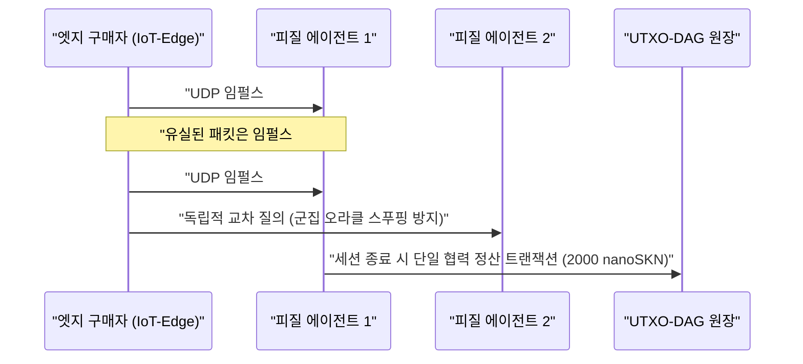

# 제01장: 문제 정의 및 실용적 기계 간(`M2M`) 경제

[← 제00장: 초록 및 비전](./00-abstract-and-vision.md) | [제02장: 다세포 아키텍처 →](./02-multicellular-architecture.md)

---

## 1. 중앙집중식 챗봇을 넘어서: 물리적 엣지에서의 반사적 지능

SkyNet은 장문 문서 작성을 위한 수천억 파라미터 규모의 중앙집중식 거대언어모델(LLM)을 대체하려는 것이 아니다. 대신 SkyNet은 **수조 달러 규모의 구조적 사각지대**를 겨냥한다. 바로 수십억 대의 자율 기계, 산업용 센서, 네트워크 게이트웨이, 소프트웨어 에이전트가 불안정한 무선 링크 위에서 **`10 ms` 미만의 반사적 추론(reflexive inference), 지속적인 로컬 적응, 그리고 1센트 미만 단위의 기계 간(`M2M`) 가치 정산**을 요구하는 인터넷의 물리적 엣지 영역이다.

### 중앙집중식 클라우드와 레거시 블록체인이 실패하는 이유

자율 엣지 에이전트 $A$(예: 군집 드론, DDoS 완화 게이트웨이, 스마트 그리드 릴레이)가 $\Delta t = 10\text{ ms}$ 주기마다 임펄스당 $v = 50\text{ nanoSKN}$의 가치를 지닌 실시간 이상 탐지 분류 및 텔레메트리 검증을 구매하는 상황을 가정해 보자:

1. **지연 시간 및 TCP 재전송 장벽:** 원거리 클라우드 리전과 TLS/TCP 세션을 수립하려면 다중 왕복 시간(multi-RTT) 핸드셰이크가 발생한다. 주변 무선 패킷 손실률이 $p_{\text{loss}} = 20\%$인 환경에서는 TCP 혼잡 윈도우 백오프(congestion window backoff)와 재전송 타임아웃으로 인해 `p99` 꼬리 지연 시간(tail latency)이 수백 밀리초까지 치솟으며, 이는 실시간 사이버-물리 제어 루프에 치명적이다.
2. **기본 수수료 하한선(Base-Fee Floor):** 법정화폐 결제망이나 EVM 스마트 컨트랙트 체인에서는 트랜잭션당 고정 오버헤드 $F_{\text{tx}}$가 단일 임펄스 가치보다 $10^5\times$에서 $10^8\times$ 이상 크므로($F_{\text{tx}} \gg v$), 밀리초 단위의 M2M 상거래는 경제적으로 불가능하다.
3. **정적 모델 드리프트(Static Model Drift):** 클라우드에서 배포된 사전 학습 고정 가중치는 변화하는 로컬 신호 분포(`concept drift`) 아래에서 급격히 성능이 저하되는 반면, 자원 제약적인 엣지 디바이스에는 경사 역전파(gradient backpropagation)를 수행할 메모리와 전력 예산이 부족하다.

---

## 2. `SKN`의 내재적 수요를 견인하는 4대 실물 경제 축

`SKN`에 대한 본질적 수요는 중앙집중식 클라우드와 상태 유지형 블록체인이 결코 경쟁할 수 없는 네 가지 구체적 역량에서 비롯된다:

### 2.1. 초저지연 군집 엣지 마이크로 추론 (`< 10 ms`)
로보틱스 플릿(fleet), 산업용 IoT 컨트롤러, 통신 릴레이 및 네트워크 보안 장비는 정규화된 8차원 특징 벡터(`stimulus: [f32; 8]`)와 서명된 `SynapticVoucher`를 **단일 `<= 1200-byte` UDP 데이터그램** 내부에 함께 탑재하여 전송한다.
- 인접한 `Epidermal` 및 `Neural` 세포는 임펄스당 `0.1 ms` 미만의 속도로 순환 액체 미세 신경망(Liquid Micro-Net) 순전파(forward pass)를 실행한다.
- `SynapticVoucher`는 단조 증가하는 누적 총액을 인코딩하므로, 셀룰러나 위성 링크에서 `25%`의 무작위 UDP 패킷 손실이 발생하더라도 **과금 중단 제로 및 재전송 지연 제로**를 달성한다.

### 2.2. 서비스형 진화(Evolution-as-a-Service) 및 탈중앙화 `Plasmid` 유전자 시장
소형 임베디드 모델을 학습시키기 위해 고가의 클라우드 GPU 클러스터를 임대하는 대신, 모든 사용자 또는 자율 에이전트는 자극 스트림 $x_t$, 목표 응답 $y_t^*$, 그리고 `SKN` 보상을 명시한 최적화 현상금(bounty)을 브로드캐스트할 수 있다:
- 수천 개의 `AgentNode` 유기체가 `1 -> 2` 세포 유사분열(`Mitosis`)을 촉발하여 수만 개의 가중치 섭동과 액체 시정수 $\tau$를 병렬로 평가한다.
- 열등한 변이체는 세포자연사(`Apoptosis`)로 도태되는 반면, 최상위 성능 계통은 초소형 `CellDna` 유전체(`2 KB` 미만, `BLAKE3`로 암호학적 봉인)로 수렴한다.
- 요청자는 실시간 추론 결과뿐만 아니라, 수백만 대의 마이크로컨트롤러에 즉시 플래시(flash)할 수 있는 **독립 실행형 진화 완료 `CellDna` 가중치 아티팩트**(`GF(2)` `FountainDroplet` 패킷을 통해 무손실 전달)를 함께 수령한다.

### 2.3. 원자적 `M2M nanoSKN` 결제 레일 및 환각 방지 군집 오라클(Swarm Oracles)
최소 `1 nanoSKN` ($10^{-9}\text{ SKN}$) 단위까지 세분화된 가치 척도를 바탕으로, AI 에이전트는 실세계 물리 신호(미세 기상 텔레메트리, RF 스펙트럼 점유율, 라우팅 지연 시간, 고빈도 주문 흐름 등)를 자율적으로 구매하고 교차 검증한다:

로컬 클러스터 내의 독립적인 `AgentNode` 유기체들을 교차 샘플링함으로써 단일 모델의 환각(hallucination)과 센서 스푸핑(spoofing)을 근원적으로 차단한다.

### 2.4. 포용적 다계층 DePIN (하드웨어 공생 생태계)
SkyNet은 전 세계의 이질적인 유휴 하드웨어를 하나의 공생적 생물학 공급망으로 통합한다:

| 참여자 계층 | 일상 하드웨어 | 생태학적 역할 | `SKN` 수익원 |
| :--- | :--- | :--- | :--- |
| **개인 및 가구** | 구형 스마트폰, 가정용 라우터, 라즈베리 파이, IoT 보드 | 엣지 감각 수집, `Epidermal` 패킷 필터링, `~1 KB` `Utreexo` 경량 검증 | 실시간 센서 피드 및 경계 필터링 대가로 `nanoSKN` 획득 |
| **개발자 및 데스크톱 사용자** | 노트북, 사무용 PC (`StandardNode`) | `Snowball` 합의 샘플링, 바우처 라우팅, 중규모 조직 진화 | 클러스터 트랜잭션 수수료(`cluster_nutrient_pool`) 및 추론 보수 획득 |
| **연구실 및 GPU 운영자** | 멀티코어 서버, Apple `Metal`, NVIDIA `CUDA` GPU | 노드당 최대 `16,384`개 세포의 `TissueBatch` 병렬 진화 | 진화 현상금(bounty) 및 수평적 `Plasmid` 수출 로열티 획득 |

---

## 3. 준선형(Sub-Linear) 온체인 정산 압축

두 AI 에이전트가 패킷 손실 확률 $p \in [0, 1)$인 무선 채널을 통해 호출당 $\delta\text{ nanoSKN}$의 비용으로 $M$회의 고빈도 추론 임펄스를 교환한다고 가정하자. 기존 온체인 정산은 $\mathcal{O}(M)$개의 원장 트랜잭션을 필요로 하며, TCP 재전송 오버헤드는 $\frac{1}{1 - p}$에 비례하여 증가한다.

반면 SkyNet에서 지불자는 시퀀스 $s \in \{1, \dots, M\}$로 인덱싱되고 누적 가치 $V_s = s \cdot \delta$를 담고 있는 `Ed25519` 서명 바우처를 방출한다. 도달에 성공한 임의의 패킷 $s_k$ 하나만으로도 중간에 유실된 모든 패킷 구간의 증분 가치 $\Delta V = V_{s_k} - V_{s_{k-1}}$이 재전송 없이 암호학적으로 증명된다. 세션 종료 시 $M$회의 모든 마이크로 추론은 **정확히 $1$개의 UTXO-DAG 트랜잭션**으로 최종 정산되어, $M : 1$의 온체인 압축률(실제 환경에서 $1{,}000\times$ 내지 $100{,}000\times$의 원장 부하 절감)을 달성한다.

제02장에서는 단일 소프트웨어 바이너리가 어떻게 모든 하드웨어 계층 위에서 살아 있는 다세포 유기체로 자기조직화(self-organization)하는지 각 `AgentNode`의 내부 해부학적 구조를 상세히 분석한다.

---

[← 제00장: 초록 및 비전](./00-abstract-and-vision.md) | [제02장: 다세포 아키텍처 →](./02-multicellular-architecture.md)
