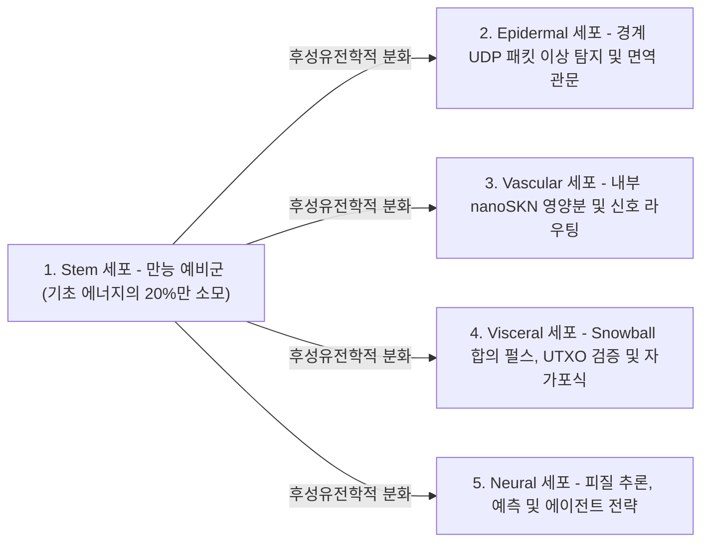

# 제02장: 다세포 유기체 아키텍처 및 탄력적 하드웨어 스케일링 (`AgentNode`)

[← 제01장: 문제 정의 및 M2M 경제](./01-problem-and-m2m-economy.md) | [제03장: `CellDna` 및 액체 신경 세포 →](./03-dna-and-liquid-neural-cells.md)

---

## 1. 생물학적 동형성: `1 Node = 1 Multicellular Organism`

기존 피어투피어(P2P) 네트워크에서는 노드가 임베디드 마이크로컨트롤러에서 실행되든 64코어 GPU 서버에서 실행되든 관계없이 획일적이고 경직된 단일(monolithic) 상태 머신을 실행한다. 반면 SkyNet(`crates/skynet-agent`)에서는 모든 네트워크 참여자가 **`AgentNode`**라는 살아 있는 다세포 유기체로 인스턴스화된다. 각 `AgentNode`는 동적 미세 AI 세포 개체군 $\mathcal{C}(t) = \{c_1, c_2, \dots, c_{N(t)}\}$, 내부 대사 금고(`AgentMetabolicBank`), 무상태 `Utreexo` 루트 검증기(`StatelessUtreexoRoots`), 그리고 손실 내성 `SnowballEngine`으로 구성된다.

세포 개체군 크기 $N(t) = |\mathcal{C}(t)|$는 결코 하드코딩되지 않으며, **호스트 하드웨어 용량과 벌어들인 `nanoSKN` 영양분 유입량에 따라 `Mitosis`(유사분열)를 통해 유기적으로 팽창하고 `Apoptosis`(세포자연사)를 통해 수축한다.**

---

## 2. 3단계 탄력적 하드웨어 계층 (`HardwareTier`)

구동 시점에 `HardwareProfile::for_tier`는 호스트의 연산 용량을 정확한 `nanoSKN` 대사 임계치가 정의된 세 가지 생태학적 프로파일 중 하나로 매핑한다(`crates/skynet-cell/src/lib.rs`):

| 생물학적 파라미터 (`HardwareProfile`) | `TinyPeripheral` (IoT / 엣지 MCU) | `StandardNode` (노트북 / 데스크톱 PC) | `ColossalOrganism` (서버 / GPU) |
| :--- | :--- | :--- | :--- |
| **최대 세포 개체수 (`max_cells`)** | `32`개 세포 | `512`개 세포 | `16,384`개 세포 |
| **활성 기초 대사 소모량 / 틱 (`basal_burn_per_tick`)** | `50 nanoSKN` | `25 nanoSKN` | `10 nanoSKN` |
| **휴면 `Stem` 소모량 / 틱 (80% 절감)** | `10 nanoSKN` | `5 nanoSKN` | `2 nanoSKN` |
| **세포 분열 임계치 (`mitosis_threshold`)** | `2,000 nanoSKN` | `1,500 nanoSKN` | `1,000 nanoSKN` |
| **분열 혈액 수수료 (`mitosis_blood_fee`)** | `100 nanoSKN` | `60 nanoSKN` | `40 nanoSKN` |
| **세포 사멸 하한선 (`apoptosis_floor`)** | `100 nanoSKN` | `80 nanoSKN` | `50 nanoSKN` |
| **연산 백엔드 (`candle_core::Device`)** | `Cpu` | `Cpu` / `Metal` / `Cuda` | `Cuda` / `Metal` / `Cpu` SIMD |

> [!NOTE]
> **생물학적 규모의 경제 (클라이버의 법칙, Kleiber's Law):** 거대한 생물 유기체일수록 조직 1그램당 대사 에너지 비용이 낮아지는 자연 법칙과 마찬가지로, `ColossalOrganism` 노드는 수천 개의 세포가 단일 배치 GPU 텐서 커널 내에서 실행 비용을 상각(amortize)하므로 세포당 기초 대사 소모량이 더 낮게 책정되는 반면(`10 nanoSKN` 대 `50 nanoSKN`), `TinyPeripheral` 노드는 네트워크 최전선 엣지에서 가볍고 강인한 생존성을 유지한다.

---

## 3. 5가지 전문 조직학적 계통 (`CellRole`)

`AgentNode`가 최초 생성될 때(`AgentNode::from_signing_key`), 결정론적 `base_stem` 유전체로부터 파생된 6개의 배아 세포 씨앗(`2 Stem`, `1 Epidermal`, `1 Vascular`, `1 Visceral`, `1 Neural`)을 초기화한다. 유기체의 전 생애주기에 걸쳐 5가지 조직학적 계통은 다음과 같은 필수 생리 기능을 수행한다:

1. **`Stem` (만능 예비군 — `operon_index = None`):** 틱당 $\max(\lfloor E_{\text{burn}} / 5 \rfloor, 1)$만을 소모하는 휴면 재생 세포이다. 특정 전문 기관에 세포 손실이 발생할 때마다, `Stem` 세포는 외부 코드 다운로드 없이 후성유전학적 분화(`differentiate`)를 거쳐 해당 기관을 즉각 보충한다.
2. **`Epidermal` (표피 및 면역 관문 — `operon_index = Some(0)`):** 원시 UDP 소켓의 최전선을 방어한다(`epidermal_inspect_packet`). 수신 패킷이 원장이나 합의 엔진에 도달하기 전에, `Epidermal` 세포는 `candle` 위에서 정규화된 패킷 텔레메트리(`raw_len / 1200`, `hop_ttl / 16`, `epoch` 드리프트)를 평가하여 기형 패킷이나 플러딩(flood) 공격 임펄스를 즉시 폐기한다.
3. **`Vascular` (순환 조절자 — `operon_index = Some(1)`):** `AgentMetabolicBank` 내부의 `blood_pool` 유동성을 조절하여 높은 정확도를 보이는 세포들에게 `nanoSKN` 보상을 집중 공급한다.
4. **`Visceral` (내장 기관 유지보수 — `operon_index = Some(2)`):** `Snowball` 폴링 주기 조율, 무상태 `Utreexo` 증인(witness) 검증 및 대사 에너지 재활용을 관장한다.
5. **`Neural` (피질 두뇌 — `operon_index = Some(3)`):** 고차원 인지 추론을 수행한다. 살아 있는 모든 `Neural` 세포 출력의 앙상블 평균($\bar{y}_{\text{cortical}} = \frac{1}{|\mathcal{C}_{\text{neural}}|} \sum_{i \in \mathcal{C}_{\text{neural}}} y_i$)이 유기체의 집단 의사결정 출력을 형성한다.

---

## 4. 6단계 생물학적 틱 생애주기 (`run_biological_tick`)

매 펄스(`pulse_seq`)마다 `AgentNode`는 다윈주의적 적자생존 경쟁과 엄밀한 `u128` `nanoSKN` 보존 법칙을 결합한 결정론적 6단계 생리 주기를 실행한다:

1. **1단계 — 기초 대사 (Basal Metabolism):** 모든 세포 $c_i$는 유지 에너지 $b_i = \text{metabolize\_tick}()$를 연소한다. 핵심적으로 $b_i$는 온체인에서 소각되어 사라지지 않으며, 연소된 세포 내 ATP의 100%가 유기체의 `bank.blood_pool`로 재순환된다. 영양분이 고갈된 세포($E_i = 0$)는 `0.25`의 `health`(건강도)를 잃는다.
2. **2단계 — 배치 `candle` 텐서 추론 (Batched Tensor Inference):** 살아 있는 모든 $N$개 세포가 `TissueBatch::forward_slice`를 통해 동시에 실행되어 출력 $y_i \in \mathbb{R}^4$를 생성하고 단기 액체 메모리 벡터 $h_{i,t} \in \mathbb{R}^{16}$를 갱신한다.
3. **3단계 — 기관 내 다윈주의적 영양 선택 (Intra-Organ Darwinian Nutrient Selection):**
   목표 신호 $t \in \mathbb{R}^4$가 주어졌을 때, 세포 $i$의 예측 품질은 유계 평균 절대 오차(MAE)를 통해 측정된다:

   $$q_i = \operatorname{clamp}\!\left(1 - \frac{1}{4}\sum_{k=1}^{4} |y_{i,k} - t_k|,\ 0.0,\ 1.0\right)$$

   동일한 기관 역할 $r = \text{role}(c_i)$을 공유하는 모든 세포의 평균 품질을 $\bar{q}_r$이라 하자. 전문화된 세포는 소속 기관의 세포 수가 $\le 2$개이거나 기관 내 경쟁 임계치 $q_i \ge 0.98 \cdot \bar{q}_r$을 상회할 때 그리고 오직 그럴 때에만 `blood_pool`로부터 영양분 `nanoSKN`을 보상받는다:

   $$R_i = \min\!\left(\lfloor 320 \cdot q_i \rfloor + E_{\text{basal}},\ \left\lfloor \frac{B_{\text{blood}}}{8} \right\rfloor\right)$$

   성능이 미달하는 변이체($q_i < 0.98 \cdot \bar{q}_r$)는 영양분을 전혀 받지 못하며 `-0.35`의 `health` 페널티를 부과받는다.
4. **4단계 — 항상성 줄기세포 분화 (Homeostatic Stem Differentiation):** 유기체는 가장 세포 수가 부족한 전문 기관을 식별한다(`find_most_needed_role`). `stem_count > 1`일 때마다 최소 `1`개의 생식계열(germline) `Stem` 세포를 항상 보존하면서 `Stem` 세포 하나를 해당 기관으로 분화시킨다.
5. **5단계 — `1 -> 2` 유사분열 (`Mitosis`):** 건강하고 영양분이 충분한 세포(`health >= 0.65` 및 $E_i \ge E_{\text{mitosis}}$)는 `profile.max_cells` 한도 내에서 보수적 복제본(딸세포 A)과 변이 탐색자(딸세포 B)로 분열한다.
6. **6단계 — 기관 보호형 세포자연사 (`Apoptosis`):** 기아 상태($E_i < E_{\text{apoptosis}}$)에 빠졌거나 치명적 손상을 입은(`health <= 0.15`) 세포는 용해되어 잔여 `nanoSKN`의 100%를 `blood_pool`로 반환한다. 단, 엄격한 생존 안전장치가 적용되어 **기존에 존재하는 각 `CellRole`당 최소 `1`개의 살아 있는 세포는 무조건 보존**되므로 필수 생명 기관이 멸종하는 일은 결코 발생하지 않는다.

모든 틱이 종료될 때마다 `verify_internal_skn_conservation()`이 다음의 엄밀한 `u128` 항등식을 검증한다:

$$B_{\text{chain}}(\text{Agent}) \equiv B_{\text{blood}}(\text{Agent}) + \sum_{c_i \in \mathcal{C}} E_i$$

제03장에서는 세포핵 내부로 들어가 `CellDna`의 정확한 바이트 및 수학적 구조, 후성유전학적 오페론 스위칭, 그리고 3차원 `TissueBatch` 액체 신경망 실행 메커니즘을 규명한다.

---

[← 제01장: 문제 정의 및 M2M 경제](./01-problem-and-m2m-economy.md) | [제03장: `CellDna` 및 액체 신경 세포 →](./03-dna-and-liquid-neural-cells.md)
