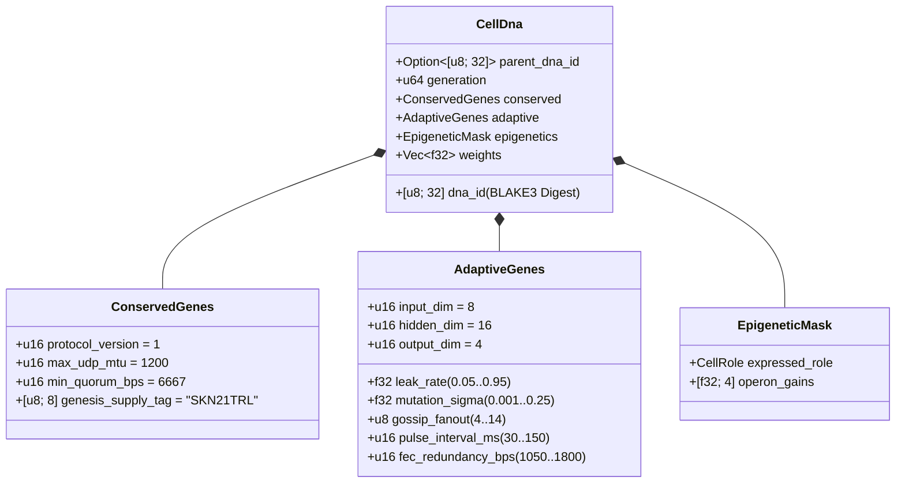

# 제03장: 유전 부호화(`CellDna`), 후성유전학 및 `candle` 기반 액체 미세 신경망 진화

[← 제02장: 다세포 아키텍처](./02-multicellular-architecture.md) | [한국어판 목차로 돌아가기 →](./README.md)

---

## 1. 세포 유전체 아키텍처 (`CellDna`)

생물학적 진화는 두 가지 상반된 힘 사이의 균형을 유지한다. 돌연변이가 곧 치사로 이어지는 핵심 생화학적 불변량의 **엄격한 보존(strict conservation)**과, 신경 및 행동 형질의 **지속적 변이(continuous variation)**가 그것이다. `skynet-dna` 크레이트는 이러한 이중성을 `CellDna` 구조체 내부에 형식화한다:

### 1.1. 불변 보존 유전자 (`ConservedGenes`)
어떠한 돌연변이나 수평적 교차(crossover)도 `ConservedGenes`를 변경할 수 없다. 네 가지 합의 안전성 술어(predicate) 중 하나라도 위반하는 유전체는 `DnaError::ConservedGeneViolation` 오류와 함께 즉시 거부된다:
- `protocol_version == 1`
- `max_udp_mtu == 1200` (단편화 없는 UDP 상한선)
- $6667 \le \text{min\_quorum\_bps} \le 10000$ (`Snowball` 합의에서 $\ge \frac{2}{3}$ 절대다수 정족수 강제)
- `genesis_supply_tag == *b"SKN21TRL"` (21조 `SKN` 총공급량 상한을 하드웨어·암호학적으로 고정)

### 1.2. 적응 유전자(`AdaptiveGenes`) 및 공유 줄기 오페론 가중치 레이아웃
네 가지 전문 세포 유형을 위해 네 개의 단절된 신경망을 별도로 저장하는 대신, `CellDna`는 **하나의 공유 감각 줄기(Shared Sensory Trunk)**가 **네 개의 전문 오페론 투영 헤드(Specialized Operon Projection Heads)**로 연결되는 구조를 부호화한다. 차원 $(D_{\text{in}}, H, D_{\text{out}})$에 대해 정확한 `f32` 파라미터 개수는 다음과 같다:

$$|\theta| = \underbrace{(D_{\text{in}} \cdot H + H)}_{\text{Shared Sensory Trunk }(W_1, b_1)} + \underbrace{4 \cdot (H \cdot D_{\text{out}} + D_{\text{out}})}_{\text{4 Specialized Operon Heads }(W_{2,r}, b_{2,r})}$$

기본 차원 $(D_{\text{in}} = 8,\ H = 16,\ D_{\text{out}} = 4)$ 하에서:
- 공유 감각 줄기: $8 \times 16 + 16 = 144$개 파라미터.
- 4개 오페론 헤드(`Epidermal`, `Vascular`, `Visceral`, `Neural`): $4 \times (16 \times 4 + 4) = 272$개 파라미터.
- 전체 유전체 가중치: $|\theta| = 416$개의 `f32` 부동소수점($1{,}664\text{ bytes}$ 원시 가중치). 제0세대 줄기 유전체(`CellDna::genesis_stem`)는 자비에(Xavier) 스케일 경계를 따르는 균등 분포 $\mathcal{U}(-\sigma_0, +\sigma_0)$ 상에서 `ChaCha8Rng`를 통해 결정론적으로 초기화된다:

$$\sigma_0 = \sqrt{\frac{2}{D_{\text{in}} + H}}$$

### 1.3. 결정론적 `BLAKE3` 암호학 다이제스트 (`SKYNET_DNA_V1`)
모든 부동소수점 하이퍼파라미터와 가중치는 정규 리틀 엔디언(little-endian) IEEE-754 비트 패턴(`to_bits().to_le_bytes()`)으로 직렬화되어 도메인 분리된 `BLAKE3("SKYNET_DNA_V1", ...)` 해시로 압축된다. 단 1비트의 손상, `NaN`/`Inf` 주입, 또는 비인가 가중치 변조라도 발생하면 `verify_integrity()` 검증 단계에서 즉각 거부된다.

---

## 2. 후성유전학적 메틸화 스위칭 (`EpigeneticMask`)

다세포 생물학에서 뉴런과 표피 피부 세포는 완전히 동일한 DNA 염기서열을 지니지만, 유전자 메틸화(methylation)를 통해 전혀 다른 표현형(phenotype)을 발현한다. SkyNet에서 `Stem` 세포가 목표 역할 $r \in \{0, 1, 2, 3\}$으로 분화할 때(`CellDna::differentiate`), **기저 `weights` 벡터의 100%는 그대로 보존**되는 반면 `EpigeneticMask`가 발현 이득(gain)을 전환한다:

- **휴면 `Stem` 상태:** `operon_gains = [0.25, 0.25, 0.25, 0.25]`로 설정되며, 감쇠된 이득 $g = 0.25$로 오페론 헤드 `0`을 통해 투영한다.
- **분화된 역할 $r$:** 오페론 헤드 $r$이 최대 이득($g_r = 1.0$)으로 활성화되고, 비발현 헤드들은 $0.05$로 억제된다:

$$g_k = \begin{cases} 1.0 & \text{if } k = r \\ 0.05 & \text{if } k \neq r \end{cases}$$

그 결과 공유 감각 줄기 $(W_1, b_1)$에서 학습된 감각 표현과 휴면 헤드에 축적된 잠재적 적응 형질이 세대를 거듭하며 보존되고, 추후 교차분화(transdifferentiation) 시에도 즉시 활용될 수 있다.

---

## 3. 액체 시정수 동역학 및 3차원 `TissueBatch` 실행

### 3.1. 단일 세포 순환 액체 동역학 (Recurrent Liquid Dynamics)
무상태 순방향 다층 퍼셉트론(MLP)은 비동기 UDP 패킷 스트림 전반의 시간적 상관관계를 포착할 수 없다. 각 `MicroCell`은 진화 가능한 누설률(leak rate) $\tau \in [0.05, 0.95]$를 갖는 이산 **액체 시정수(Liquid Time-Constant, LTC)** 상태 보간법에 의해 지배되는 순환 단기 기억 벡터 $h_t \in \mathbb{R}^H$를 유지한다:

$$h_t = (1 - \tau)\, h_{t-1} + \tau\, \tanh(x_t W_1 + b_1)$$

$$y_t = g_{\text{role}} \cdot \tanh(h_t W_{2,r} + b_{2,r})$$

- $\tau \to 0.05$에 가까워질수록 세포는 장기 기억 관성(long-horizon memory inertia)을 유지한다(`Visceral` 및 `Neural` 추세 추적에 이상적).
- $\tau \to 0.95$에 가까워질수록 세포는 고빈도 경계 임펄스에 즉각 반응한다(`Epidermal` 이상 점수 산출에 이상적).
- $\tau$가 `AdaptiveGenes` 내부에 존재하므로, **각 세포의 시간적 기억 지평(temporal memory horizon)은 시냅스 가중치와 함께 자연스럽게 공진화(co-evolution)한다**.

### 3.2. 고처리량 3차원 `TissueBatch` 텐서 엔진 (`Cpu` / `Metal` / `Cuda`)
신경진화의 고전적 병목은 가중치 이질성(weight heterogeneity)에 있다. 모든 세포 $i \in \{1, \dots, N\}$가 서로 다른 변이 행렬 $W_1^{(i)} \neq W_1^{(j)}$과 서로 다른 누설률 $\tau^{(i)} \neq \tau^{(j)}$을 보유하기 때문이다. $N$개의 순차적 마이크로 커널을 개별 호출하면 현대 GPU의 연산 유닛이 심각한 기아 상태(starvation)에 빠진다.

`skynet-cell`의 `TissueBatch::forward_slice`는 이질적인 $N$개의 세포 전체를 `candle_core::Device` 상의 연속된 3차(rank-3) 텐서로 패킹함으로써 이 문제를 해결한다:

$$\mathbf{X} \in \mathbb{R}^{N \times 1 \times D_{\text{in}}}, \quad \mathbf{W}_1 \in \mathbb{R}^{N \times D_{\text{in}} \times H}, \quad \mathbf{B}_1 \in \mathbb{R}^{N \times 1 \times H}$$

$$\mathbf{H}_t = (\mathbf{1} - \boldsymbol{\tau}) \odot \mathbf{H}_{t-1} + \boldsymbol{\tau} \odot \tanh\!\big(\operatorname{BMM}(\mathbf{X}, \mathbf{W}_1) + \mathbf{B}_1\big)$$

$$\mathbf{Y}_t = \mathbf{G} \odot \tanh\!\big(\operatorname{BMM}(\mathbf{H}_t, \mathbf{W}_2) + \mathbf{B}_2\big)$$

여기서 $\operatorname{BMM}$은 단일 커널 배치 행렬 곱셈(Batched Matrix Multiplication)을 나타내며, $\odot$은 $\boldsymbol{\tau}, \mathbf{G} \in \mathbb{R}^{N \times 1 \times 1}$과의 브로드캐스트 원소별 곱셈(elementwise multiplication)을 의미한다. 감사 완료된 단위 테스트는 `TissueBatch`가 개별 세포 실행 결과와 $< 10^{-5}$ 부동소수점 오차 범위 내에서 일치하는 동시에 `ColossalOrganism`당 최대 `16,384`개의 진화 모델을 동시 연산함을 입증한다.

---

## 4. 비대칭 유사분열, 홀수 `nanoSKN` 무결성 보존 및 플라스미드 교차

### 4.1. 비대칭 `1 -> 2` 유사분열(`Mitosis`) 및 원자적 보존 증명
모세포 $P$가 $E_P \ge \max(E_{\text{mitosis}}, F_{\text{blood}} + 2)$ 및 `health >= 0.65` 조건을 만족하면, `divide_mitosis`는 제$(g+1)$세대의 두 딸세포를 생성한다:
- **딸세포 A (보수적 복제본):** 검증된 모세포의 가중치와 적응 파라미터를 섭동 없이 100% 그대로 계승한다.
- **딸세포 B (변이 탐색자):** 모세포의 `hidden_state` 연속성을 계승하는 동시에 유계 신경진화 돌연변이를 겪는다:
  - 각 가중치 $w \in \theta$는 $0.35$의 확률로 외부 의존성 없는 6-샘플 어윈-홀(Irwin-Hall) 가우시안 섭동($\Delta w \sim \mathcal{N}(0, \sigma^2)$)을 거치며, 기울기 및 가중치 폭주를 방지하기 위해 $[-4.0, +4.0]$ 구간으로 엄격히 클램핑(clamping)된다.
  - $\tau$, $\sigma$, `gossip_fanout` ($\pm 1$), `pulse_interval_ms` ($\pm 10\text{ ms}$), `fec_redundancy_bps` ($\pm 50\text{ bps}$) 역시 유계 구간 내에서 공변이(co-mutate)한다.

**홀수 `nanoSKN` 무누수(Zero-Leakage) 보존 증명:** 수수료 차감 후 분배 가능한 ATP를 $E_{\text{dist}} = E_P - F_{\text{blood}}$라 하자. 두 딸세포의 잔고는 `u128` 상의 정수 몫-나머지 연산을 통해 분할된다:

$$E_A = \left\lfloor \frac{E_{\text{dist}}}{2} \right\rfloor + (E_{\text{dist}} \bmod 2), \qquad E_B = \left\lfloor \frac{E_{\text{dist}}}{2} \right\rfloor$$

모든 음이 아닌 정수 $E_{\text{dist}} \in \mathbb{Z}_{\ge 0}$(예: `3,333 nanoSKN`과 같은 홀수 잔고 포함)에 대하여 다음의 엄밀한 보존 항등식이 항상 성립한다:

$$E_A + E_B + F_{\text{blood}} = \left(2\left\lfloor \frac{E_{\text{dist}}}{2} \right\rfloor + (E_{\text{dist}} \bmod 2)\right) + F_{\text{blood}} = E_{\text{dist}} + F_{\text{blood}} \equiv E_P$$

수십억 번의 세포 분열이 반복되더라도 반올림으로 인해 단 `1 nanoSKN`이 유실되거나 무(無)에서 발행되는 일은 절대 발생하지 않는다.

### 4.2. 에이전트 간 수평적 유전자 전달 (`Plasmid` 교차)
박테리아의 플라스미드 교환 메커니즘을 모사하여, `AgentNode`는 최고 적합도(fitness) 세포의 `CellDna`를 소거 부호화된 UDP `FountainDroplet` 패킷으로 내보낸다(`encode_elite_plasmid_droplets`). 손실성 UDP 링크 너머에서 `donor_dna`를 재조립한 수신 측 에이전트는 `horizontal_crossover`를 통해 자신의 최저 적합도 세포를 업그레이드한다:
- 적응형 네트워킹 및 시정수 형질은 $0.7 \cdot \text{Recipient} + 0.3 \cdot \text{Donor}$ 비율로 혼합된다.
- 시냅스 가중치의 $30\%$가 균일 확률로 선택되어 $0.5 \cdot w_{\text{rec}} + 0.5 \cdot w_{\text{don}} \in [-4.0, +4.0]$으로 혼합된다.

수평적 플라스미드 전달을 통해, 자원 제약적인 `TinyPeripheral` IoT 센서도 `ConservedGenes`의 암호학적 안전성을 온전히 유지한 채 원격 GPU `ColossalOrganism` 노드에서 진화된 엘리트 신경 지능을 흡수할 수 있다.

---

> **다음 2단계(제2부) 예고:** 제`04–06`장에서는 `21,000,000,000,000 SKN` 반감기 금고(Halving Vault)의 수학적 모델, `Soul–Body` 인간 주권 수탁 규약, 그리고 `~1 KB` 무상태 `Utreexo` + `SynapticVoucher` 원장 확장성을 정식화한다.

[← 제02장: 다세포 아키텍처](./02-multicellular-architecture.md) | [한국어판 목차로 돌아가기 →](./README.md)
