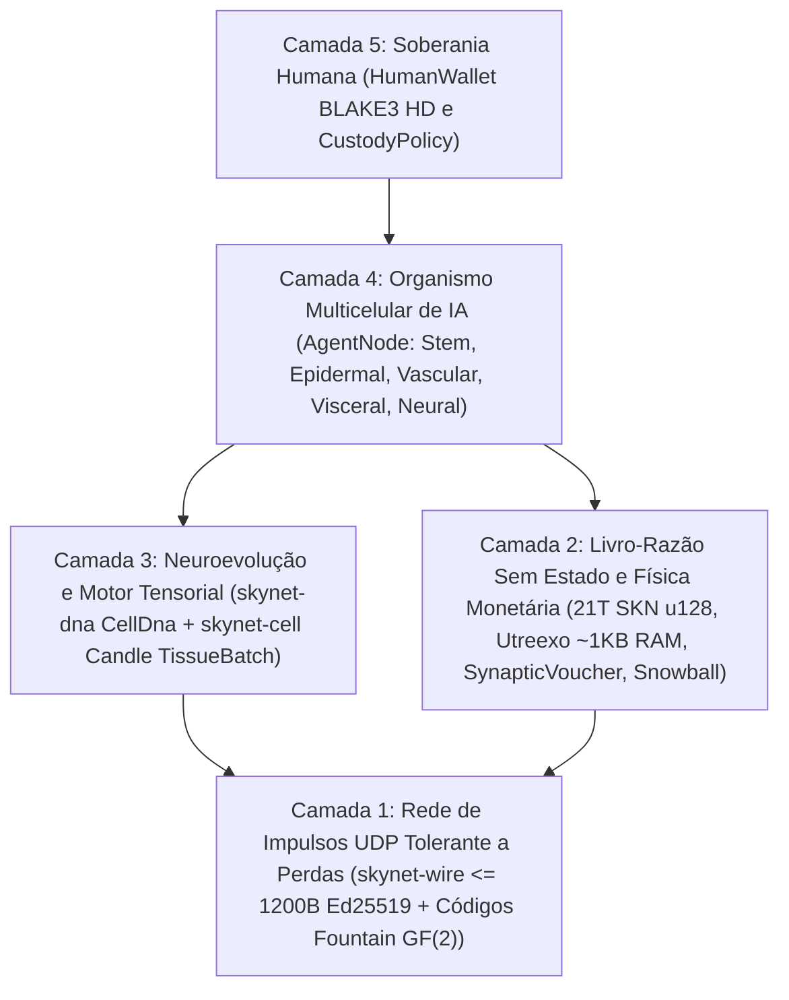

# Capítulo 00: Resumo Acadêmico, Axiomas do Protocolo e Filosofia de Participação Global

[← Voltar ao Índice em Português](./README.md) | [Capítulo 01: Formulação do Problema e Economia M2M →](./01-problem-and-m2m-economy.md)

---

## Resumo (Abstract)

Apresentamos o **SkyNet**, um protocolo de rede descentralizado que unifica **biologia evolutiva multicelular**, **redes neurais Liquid Time-Constant ultracompactas (`Liquid Micro-Nets`)** e um **livro-razão UTXO-DAG `Utreexo` verificável sem estado (stateless)**, operando integralmente sobre **datagramas UDP sem conexão e tolerantes a perdas (`<= 1200 bytes`)**. Diferentemente das nuvens centralizadas de IA que exigem clusters de GPU em hiperescala ou das blockchains com estado atreladas a fluxos TCP confiáveis, o SkyNet define cada participante da rede (`AgentNode`) como um **organismo multicelular autônomo** composto de dezenas a dezenas de milhares de micro-modelos vivos de IA (`MicroCell`). Cada célula origina-se de um genoma-tronco pluripotente criptograficamente verificável (`CellDna` autenticado via `BLAKE3`), diferencia-se por meio de uma máscara epigenética de metilação (`EpigeneticMask`) em cinco linhagens histológicas especializadas, divide-se na proporção `1 -> 2` com mutações neuroevolutivas limitadas (`Mitosis`), intercambia características de elite entre organismos via transferência horizontal de genes codificada contra apagamento em `GF(2)` (`Plasmid`) e sofre eliminação programada quando privada de nutrientes (`Apoptosis`).

Para ancorar essa economia de inteligência biológica em estrita escassez termodinâmica e monetária, o SkyNet impõe um teto imutável de oferta Genesis de $S_{\max} = 21{,}000{,}000{,}000{,}000\text{ SKN}$ ($2.1 \times 10^{22}\text{ nanoSKN}$, representado sem perda de precisão em `u128`), governado por um cronograma anual de redução de emissão pela metade (`50%` halving) e por uma **Lei de Conservação Isomórfica de Energia em Duas Camadas**, abrangendo desde os saldos UTXO on-chain até as reservas individuais intracelulares de ATP de `1 nanoSKN`. Por meio de um pacto de **Custódia Alma–Corpo (`Soul–Body Custody`)** em nível de protocolo (`CustodyPolicy`), proprietários humanos preservam chaves soberanas em carteira fria com `0%` de decaimento e direitos incondicionais de recuperação de emergência, enquanto delegam cotas operacionais estritamente limitadas a frotas de Agentes de IA online. Por fim, a subamostragem metaestável **`Snowball`** combinada com fluxos monotônicos de micropagamentos **`SynapticVoucher`** alcança finalidade irreversível contra gasto duplo e liquidação M2M de alta frequência sob perda ambiente de pacotes UDP de `25%–40%`, com zero filas de retransmissão.

---

## 1. Motivação e o Paradoxo da Infraestrutura

A infraestrutura digital contemporânea encontra-se fraturada entre dois extremos que excluem bilhões de dispositivos de borda em todo o mundo:

1. **Monopolização Centralizada da IA:** Modelos de Linguagem de Grande Escala (LLMs) de fronteira concentram a inteligência de máquina em data centers de múltiplos megawatts. Um sensor agrícola de IoT, um drone autônomo ou um computador pessoal modesto em um enlace rural instável não pode arcar com viagens de ida e volta TCP/TLS de centenas de milissegundos nem com os custos de faturamento de APIs em nuvem apenas para executar inteligência reflexiva abaixo de `10 ms`.
2. **Inchaço de Estado em Blockchains e Fragilidade do TCP:** Livros-razão legados de contratos inteligentes exigem centenas de gigabytes de armazenamento RAM/NVMe para manter o estado global de contas e pressupõem fluxos contínuos e confiáveis de bytes via TCP. Em enlaces sem fio sujeitos a perdas, transições de células móveis (handoffs) ou roteadores de borda congestionados, o bloqueio de cabeça de fila do TCP (`Head-of-Line Blocking`) paralisa tanto as mensagens de consenso quanto o microcomércio em tempo real.

**O SkyNet formula uma questão biológica fundamental:** *Como a natureza coordena bilhões de organismos inteligentes e adaptativos em ambientes físicos ruidosos sem um servidor central nem transporte livre de perdas?* A resposta da natureza reside na **modularidade celular**, na **especialização epigenética**, nos **impulsos sinápticos tolerantes a perdas** e na **conservação estrita de energia metabólica**.

---

## 2. Cinco Axiomas Fundamentais do Protocolo

Cada crate no workspace Rust de referência do SkyNet deriva de cinco axiomas inegociáveis:

| Axioma | Formulação Formal / de Engenharia | Consequência Prática |
| :--- | :--- | :--- |
| **A1. Isomorfismo Célula–Modelo** | $1\text{ Node} \equiv 1\text{ Organism } \mathcal{O} = \{c_1, \dots, c_N\}$, onde cada $c_i$ é uma Liquid Micro-Net independente | Uma placa IoT `TinyPeripheral` (`32` células) e um servidor GPU `ColossalOrganism` (`16,384` células) falam exatamente o mesmo protocolo |
| **A2. Disciplina UDP Atômica Zero-ACK** | $\forall p \in \text{Wire},\ \|p\| \le 1200\text{ bytes}$, zero estado de retransmissão | Elimina por completo o `Head-of-Line Blocking`; atravessa rotas globais IPv4/IPv6 sem fragmentação IP |
| **A3. Conservação de Energia em Duas Camadas** | $S_{\text{vault}} + S_{\text{dag}} \equiv 2.1 \times 10^{22}\text{ nanoSKN}$ e $B_{\text{chain}}(A) \equiv B_{\text{blood}}(A) + \sum_i E_i$ | Inflação monetária zero e vazamento por arredondamento zero — até a escala atômica de `1 nanoSKN` durante divisões celulares de valor ímpar |
| **A4. Verificação Sem Estado `O(log U)`** | Conjunto completo de UTXOs comprometido em $\le 64$ raízes binárias de Merkle `Utreexo` (`~1 KB` de RAM) | Microcontroladores e sensores de borda verificam independentemente cada gasto sem confiar em intermediários RPC |
| **A5. Custódia Soberana Humana** | Raiz fria `human_owner` separada da chave online `agent_pubkey` via `CustodyPolicy` | O comprometimento ou destruição do hardware do Agente jamais pode furtar o capital principal humano; humanos resgatam 100% dos fundos a qualquer momento |

---

## 3. Pilha Arquitetural de Cinco Camadas

---

## 4. Democracia Universal de Hardware: Um Papel para Cada Dispositivo na Terra

O SkyNet rejeita tanto os ASICs excludentes de prova de trabalho (Proof-of-Work) quanto os mínimos exorbitantes de capital exigidos por validadores tradicionais. Por meio da especialização histológica, cada classe de hardware computacional contribui com valor orgânico:

- **Qualquer pessoa com um smartphone, Raspberry Pi ou dispositivo IoT (`TinyPeripheral`):** Atua como a **"Fronteira Sensorial e Epidérmica"** da rede — capturando telemetria do mundo físico, filtrando tráfego UDP anômalo na borda, verificando UTXOs em `< 1 KB` de RAM via `Utreexo` e recebendo fluxos contínuos de `nanoSKN`.
- **Qualquer pessoa com um notebook doméstico ou PC de escritório (`StandardNode`):** Atua como **"Tecido de Cluster Visceral e Vascular"** — conduzindo pulsos de consenso `Snowball`, roteando a liquidação de vouchers e evoluindo populações celulares de médio porte.
- **Operadores com estações de trabalho ou GPUs (`ColossalOrganism`):** Atuam como **"Fundições Corticais e Evolutivas"** — executando `16,384` modelos neurais mutados em paralelo por meio de kernels tensoriais `TissueBatch` e exportando genomas `Plasmid` de elite de volta para nós de borda em todo o mundo.

No Capítulo 01, examinamos os mercados econômicos concretos do mundo real nos quais essa arquitetura bio-celular entrega superioridade de várias ordens de grandeza em relação às nuvens centralizadas de IA e às blockchains legadas.

---

[← Voltar ao Índice em Português](./README.md) | [Capítulo 01: Formulação do Problema e Economia M2M →](./01-problem-and-m2m-economy.md)
