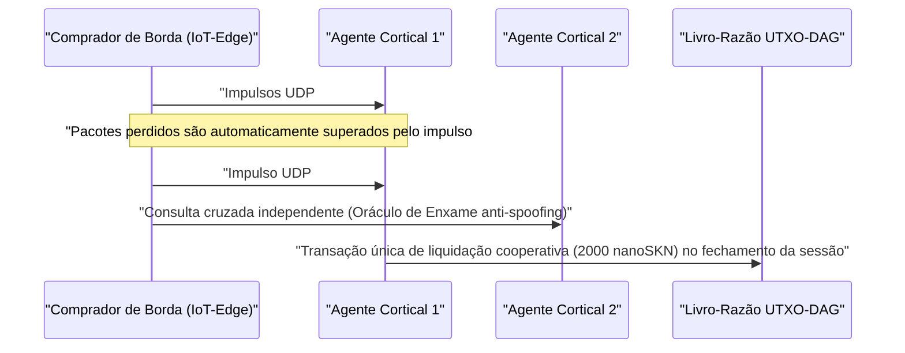

# Capítulo 01: Formulação do Problema e a Economia Prática Máquina-a-Máquina (`M2M`)

[← Capítulo 00: Resumo e Visão](./00-abstract-and-vision.md) | [Capítulo 02: Arquitetura Multicelular →](./02-multicellular-architecture.md)

---

## 1. Além dos Chatbots Centralizados: Inteligência Reflexiva na Borda Física

O SkyNet não tem como objetivo substituir Modelos de Linguagem de Grande Escala centralizados de centenas de bilhões de parâmetros na redação de documentos extensos. Em vez disso, o SkyNet ataca um **ponto cego estrutural avaliado em múltiplos trilhões**: a borda física da internet, onde bilhões de máquinas autônomas, sensores industriais, gateways de rede e agentes de software exigem **inferência reflexiva abaixo de `10 ms`, adaptação local contínua e liquidação de valor máquina-a-máquina (`M2M`) em frações de centavo** sobre enlaces sem fio não confiáveis.

### Por Que Nuvens Centralizadas e Blockchains Legadas Falham Nesse Cenário

Considere um agente autônomo de borda $A$ (como um drone em enxame, um gateway de mitigação DDoS ou um relé de rede elétrica inteligente) adquirindo classificação de anomalias e verificação de telemetria em tempo real a cada $\Delta t = 10\text{ ms}$, avaliada em $v = 50\text{ nanoSKN}$ por impulso:

1. **A Barreira de Latência e Retransmissão do TCP:** Estabelecer sessões TLS/TCP com regiões distantes de nuvem impõe handshakes de múltiplos RTTs. Sob perda ambiente de pacotes sem fio de $p_{\text{loss}} = 20\%$, o recuo da janela de congestionamento do TCP e os tempos limite de retransmissão elevam a latência de cauda `p99` para centenas de milissegundos — um resultado catastrófico para malhas de controle ciberfísicas em tempo real.
2. **O Piso de Taxa Base:** Em trilhos de pagamento fiduciários ou redes de contratos inteligentes EVM, o custo fixo por transação $F_{\text{tx}}$ supera o valor de um único impulso em $10^5\times$ a $10^8\times$ ($F_{\text{tx}} \gg v$), tornando economicamente impossível o comércio M2M com granularidade de milissegundos.
3. **Deriva de Modelos Estáticos (`Model Drift`):** Pesos estáticos pré-treinados implantados a partir da nuvem degradam-se rapidamente diante de mudanças nas distribuições locais de sinais (`concept drift`), enquanto dispositivos restritos de borda carecem do orçamento de memória e energia necessário para executar retropropagação de gradiente.

---

## 2. Quatro Pilares Econômicos Reais que Impulsionam a Demanda por `SKN`

A demanda intrínseca por `SKN` emerge de quatro capacidades concretas nas quais nuvens centralizadas e blockchains com estado não conseguem competir:

### 2.1. Microinferência de Enxame em Borda com Ultrabaixa Latência (`< 10 ms`)
Frotas robóticas, controladores industriais de IoT, relés de telecomunicações e dispositivos de segurança de rede embutem um vetor normalizado de atributos de 8 dimensões (`stimulus: [f32; 8]`) junto a um `SynapticVoucher` assinado dentro de um **único datagrama UDP de `<= 1200 bytes`**.
- Células vizinhas `Epidermal` e `Neural` executam passagens diretas (forward passes) recorrentes de Liquid Micro-Net em menos de `0.1 ms` por impulso.
- Como o `SynapticVoucher` codifica totais cumulativos monotonicamente crescentes, até mesmo `25%` de perda aleatória de pacotes UDP em enlaces celulares ou via satélite produz **zero travamentos de faturamento e zero pausas de retransmissão**.

### 2.2. Evolução como Serviço (`Evolution-as-a-Service`) e o Mercado Descentralizado de Genes `Plasmid`
Em vez de alugar caros clusters de GPU em nuvem para treinar modelos embarcados compactos, qualquer usuário ou agente autônomo pode transmitir uma recompensa de otimização especificando fluxos de estímulos $x_t$, respostas-alvo $y_t^*$ e prêmios em `SKN`:
- Milhares de organismos `AgentNode` acionam a `Mitosis` celular `1 -> 2`, avaliando dezenas de milhares de perturbações de pesos e constantes de tempo líquidas $\tau$ em paralelo.
- Mutantes fracos sofrem `Apoptosis`, enquanto as linhagens de melhor desempenho convergem para genomas `CellDna` compactos (com menos de `2 KB`, selados criptograficamente por `BLAKE3`).
- O solicitante recebe tanto a inferência em tempo real quanto o **artefato autônomo de pesos `CellDna` evoluído** (entregue sem perdas via pacotes `FountainDroplet` em `GF(2)`), pronto para ser gravado diretamente em milhões de microcontroladores.

### 2.3. Trilho de Pagamento Atômico `M2M nanoSKN` e Oráculos de Enxame Anti-Alucinação
Denominados até a escala de `1 nanoSKN` ($10^{-9}\text{ SKN}$), Agentes de IA compram e verificam de forma cruzada e autônoma sinais físicos do mundo real (telemetria micrometeorológica, ocupação do espectro de RF, latência de roteamento, fluxo de ordens de alta frequência):

A amostragem cruzada entre organismos `AgentNode` independentes dentro de um cluster local elimina tanto a alucinação de modelo único quanto a falsificação (spoofing) de sensores.

### 2.4. DePIN Inclusivo em Múltiplas Camadas (Simbiose de Hardware)
O SkyNet une hardware ocioso heterogêneo em todo o mundo em uma cadeia produtiva biológica simbiótica:

| Segmento de Participantes | Hardware Cotidiano | Papel Ecológico | Fluxo de Receita em `SKN` |
| :--- | :--- | :--- | :--- |
| **Indivíduos e Residências** | Smartphones antigos, roteadores domésticos, Raspberry Pis, placas IoT | Captura sensorial na borda, filtragem epidérmica `Epidermal` de pacotes, verificação leve `Utreexo` em `~1 KB` | Ganham `nanoSKN` com feeds de sensores ao vivo e filtragem de fronteira |
| **Desenvolvedores e Usuários de Desktop** | Notebooks, PCs de escritório (`StandardNode`) | Amostragem de consenso `Snowball`, roteamento de vouchers, evolução tecidual de média escala | Ganham taxas de transação do cluster (`cluster_nutrient_pool`) e pagamentos de inferência |
| **Laboratórios e Operadores de GPU** | Servidores multi-core, Apple `Metal`, GPUs NVIDIA `CUDA` | Evolução paralela via `TissueBatch` de até `16,384` células por nó | Ganham recompensas de evolução e royalties pela exportação horizontal de `Plasmid` |

---

## 3. Compressão Sublinear de Liquidação On-Chain

Suponha que dois Agentes de IA troquem $M$ impulsos de inferência de alta frequência a $\delta\text{ nanoSKN}$ por chamada através de um canal sem fio com probabilidade de descarte de pacotes $p \in [0, 1)$. A liquidação on-chain legada exige $\mathcal{O}(M)$ transações no livro-razão, enquanto a sobrecarga de retransmissão TCP escala como $\frac{1}{1 - p}$.

No SkyNet, o pagador emite vouchers assinados com `Ed25519` indexados pela sequência $s \in \{1, \dots, M\}$, transportando o valor cumulativo $V_s = s \cdot \delta$. Qualquer pacote sobrevivente $s_k$ comprova criptograficamente todo o delta incremental $\Delta V = V_{s_k} - V_{s_{k-1}}$ através de todos os pacotes intermediários perdidos, sem nenhuma retransmissão. Ao término da sessão, todas as $M$ microinferências são liquidadas em **exatamente $1$ transação UTXO-DAG**, alcançando uma razão de compressão on-chain de $M : 1$ (redução prática de carga no livro-razão de $1{,}000\times$ a $100{,}000\times$).

O Capítulo 02 examina a anatomia interna de cada `AgentNode` — demonstrando como um único binário de software se auto-organiza em um organismo multicelular vivo em qualquer nível de hardware.

---

[← Capítulo 00: Resumo e Visão](./00-abstract-and-vision.md) | [Capítulo 02: Arquitetura Multicelular →](./02-multicellular-architecture.md)
