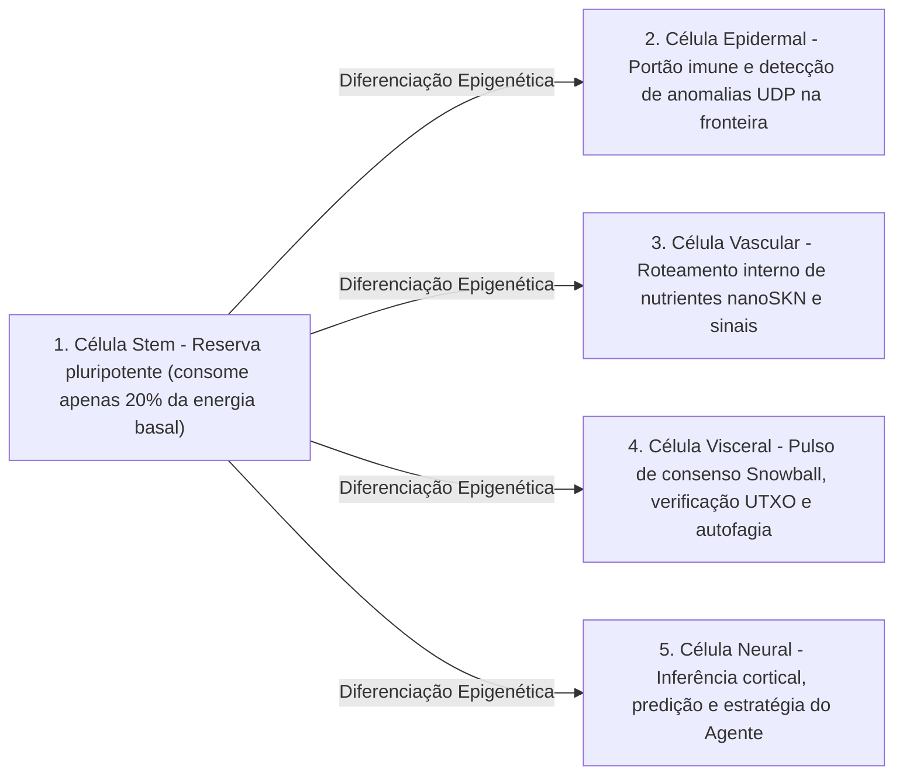

# Capítulo 02: Arquitetura de Organismo Multicelular e Escalabilidade Elástica de Hardware (`AgentNode`)

[← Capítulo 01: Formulação do Problema e Economia M2M](./01-problem-and-m2m-economy.md) | [Capítulo 03: `CellDna` e Células Neurais Líquidas →](./03-dna-and-liquid-neural-cells.md)

---

## 1. Isomorfismo Biológico: `1 Nó = 1 Organismo Multicelular`

Em redes peer-to-peer convencionais, cada nó executa uma máquina de estados monolítica e rígida, independentemente de rodar em um microcontrolador embarcado ou em um servidor GPU de 64 núcleos. No SkyNet (`crates/skynet-agent`), cada participante da rede é instanciado como um **`AgentNode`** — um organismo multicelular vivo composto por uma população dinâmica de microcélulas de IA $\mathcal{C}(t) = \{c_1, c_2, \dots, c_{N(t)}\}$, uma tesouraria metabólica interna (`AgentMetabolicBank`), um verificador de raízes `Utreexo` sem estado (`StatelessUtreexoRoots`) e um motor `SnowballEngine` tolerante a perdas.

O tamanho da população celular $N(t) = |\mathcal{C}(t)|$ jamais é fixado no código; ele **se expande via `Mitosis` e se contrai via `Apoptosis` de forma orgânica, conforme a capacidade de hardware do hospedeiro e o influxo de nutrientes `nanoSKN` conquistados**.

---

## 2. Três Níveis Elásticos de Hardware (`HardwareTier`)

Na inicialização, `HardwareProfile::for_tier` mapeia a capacidade do hospedeiro em um dos três perfis ecológicos com limiares metabólicos exatos em `nanoSKN` (`crates/skynet-cell/src/lib.rs`):

| Parâmetro Biológico (`HardwareProfile`) | `TinyPeripheral` (IoT / MCU de Borda) | `StandardNode` (Notebook / PC de Mesa) | `ColossalOrganism` (Servidor / GPU) |
| :--- | :--- | :--- | :--- |
| **População Celular Máxima (`max_cells`)** | `32` células | `512` células | `16,384` células |
| **Queima Basal Ativa / Tick (`basal_burn_per_tick`)** | `50 nanoSKN` | `25 nanoSKN` | `10 nanoSKN` |
| **Queima `Stem` Dormente / Tick (80% de economia)** | `10 nanoSKN` | `5 nanoSKN` | `2 nanoSKN` |
| **Limiar de Divisão (`mitosis_threshold`)** | `2,000 nanoSKN` | `1,500 nanoSKN` | `1,000 nanoSKN` |
| **Taxa Sanguínea de Divisão (`mitosis_blood_fee`)** | `100 nanoSKN` | `60 nanoSKN` | `40 nanoSKN` |
| **Piso de Eliminação (`apoptosis_floor`)** | `100 nanoSKN` | `80 nanoSKN` | `50 nanoSKN` |
| **Backend de Computação (`candle_core::Device`)** | `Cpu` | `Cpu` / `Metal` / `Cuda` | `Cuda` / `Metal` / `Cpu` SIMD |

> [!NOTE]
> **Economias de Escala Biológicas (Lei de Kleiber):** Assim como organismos biológicos maiores apresentam menor custo metabólico por grama de tecido, nós `ColossalOrganism` incorrem em menor queima basal por célula (`10 nanoSKN` contra `50 nanoSKN`) porque milhares de células amortizam a execução dentro de um único kernel tensorial em lote na GPU, enquanto nós `TinyPeripheral` permanecem enxutos e resilientes na borda da rede.

---

## 3. Cinco Linhagens Histológicas Especializadas (`CellRole`)

Quando um `AgentNode` nasce (`AgentNode::from_signing_key`), ele inicializa uma semente embrionária de 6 células (`2 Stem`, `1 Epidermal`, `1 Vascular`, `1 Visceral`, `1 Neural`) derivada de um genoma determinístico `base_stem`. Ao longo de toda a vida do organismo, cinco linhagens histológicas cumprem cinco funções fisiológicas essenciais:

1. **`Stem` (Reserva Pluripotente — `operon_index = None`):** Células regenerativas dormentes que consomem apenas $\max(\lfloor E_{\text{burn}} / 5 \rfloor, 1)$ por tick. Sempre que qualquer órgão especializado sofre desgaste, uma célula `Stem` diferencia-se epigeneticamente (`differentiate`) para recompor o tecido sem necessidade de downloads externos de código.
2. **`Epidermal` (Pele e Portão Imunológico — `operon_index = Some(0)`):** Protege o socket UDP bruto (`epidermal_inspect_packet`). Antes que qualquer pacote recebido alcance o livro-razão ou o motor de consenso, uma célula `Epidermal` avalia a telemetria normalizada do pacote (`raw_len / 1200`, `hop_ttl / 16`, desvio de `epoch`) em `candle` para descartar impulsos malformados ou ataques de inundação (flood).
3. **`Vascular` (Regulador Circulatório — `operon_index = Some(1)`):** Regula a liquidez interna do `blood_pool` dentro do `AgentMetabolicBank`, canalizando recompensas em `nanoSKN` para as células de maior acurácia.
4. **`Visceral` (Manutenção de Órgãos — `operon_index = Some(2)`):** Conduz a cadência de amostragem do `Snowball`, a verificação sem estado de testemunhas `Utreexo` e a reciclagem metabólica.
5. **`Neural` (Cérebro Cortical — `operon_index = Some(3)`):** Executa a inferência cognitiva; a média do conjunto (ensemble) entre todas as células `Neural` vivas ($\bar{y}_{\text{cortical}} = \frac{1}{|\mathcal{C}_{\text{neural}}|} \sum_{i \in \mathcal{C}_{\text{neural}}} y_i$) forma a saída de decisão coletiva do organismo.

---

## 4. O Ciclo Fisiológico de Seis Fases por Tick (`run_biological_tick`)

A cada pulso (`pulse_seq`), o `AgentNode` executa um ciclo fisiológico determinístico de seis fases que une competição darwiniana à conservação exata de `nanoSKN` em `u128`:

1. **Fase 1 — Metabolismo Basal:** Cada célula $c_i$ queima energia de manutenção $b_i = \text{metabolize\_tick}()$. Crucialmente, $b_i$ jamais é destruído on-chain; 100% do ATP intracelular queimado retorna reciclado para `bank.blood_pool`. Células famintas ($E_i = 0$) perdem `0.25` de `health`.
2. **Fase 2 — Inferência Tensorial em Lote no `candle`:** Todas as $N$ células vivas executam simultaneamente via `TissueBatch::forward_slice`, produzindo saídas $y_i \in \mathbb{R}^4$ e atualizando vetores recorrentes de memória líquida de curto prazo $h_{i,t} \in \mathbb{R}^{16}$.
3. **Fase 3 — Seleção Darwiniana Intra-Órgão de Nutrientes:**
   Dado o sinal-alvo $t \in \mathbb{R}^4$, a qualidade preditiva da célula $i$ é medida pelo Erro Absoluto Médio limitado:

   $$q_i = \operatorname{clamp}\!\left(1 - \frac{1}{4}\sum_{k=1}^{4} |y_{i,k} - t_k|,\ 0.0,\ 1.0\right)$$

   Seja $\bar{q}_r$ a qualidade média entre todas as células que compartilham o papel orgânico $r = \text{role}(c_i)$. Uma célula especializada recebe nutrientes `nanoSKN` do `blood_pool` se, e somente se, seu órgão possuir $\le 2$ células ou ela superar o limiar de competitividade intra-órgão $q_i \ge 0.98 \cdot \bar{q}_r$:

   $$R_i = \min\!\left(\lfloor 320 \cdot q_i \rfloor + E_{\text{basal}},\ \left\lfloor \frac{B_{\text{blood}}}{8} \right\rfloor\right)$$

   Mutantes de baixo desempenho ($q_i < 0.98 \cdot \bar{q}_r$) recebem zero nutrientes e sofrem uma penalidade de `-0.35` em `health`.
4. **Fase 4 — Diferenciação Homeostática de Células `Stem`:** O organismo identifica seu órgão especializado com menor população relativa (`find_most_needed_role`). Sempre que `stem_count > 1`, uma célula `Stem` diferencia-se nesse órgão, preservando incondicionalmente ao menos `1` célula germinativa `Stem`.
5. **Fase 5 — `Mitosis` `1 -> 2`:** Células saudáveis e bem nutridas (`health >= 0.65` e $E_i \ge E_{\text{mitosis}}$) dividem-se em um clone conservador (Filha A) e uma exploradora mutada (Filha B) até o limite `profile.max_cells`.
6. **Fase 6 — `Apoptosis` com Proteção de Órgão:** Células famintas ($E_i < E_{\text{apoptosis}}$) ou criticamente danificadas (`health <= 0.15`) dissolvem-se e devolvem 100% de seu `nanoSKN` remanescente ao `blood_pool` — sujeitas a uma estrita salvaguarda de sobrevivência: **ao menos `1` célula viva para cada `CellRole` existente é incondicionalmente preservada**, de modo que nenhum órgão vital jamais seja extinto.

Ao encerramento de cada tick, `verify_internal_skn_conservation()` verifica por asserção a identidade exata em `u128`:

$$B_{\text{chain}}(\text{Agent}) \equiv B_{\text{blood}}(\text{Agent}) + \sum_{c_i \in \mathcal{C}} E_i$$

O Capítulo 03 abre o núcleo celular para especificar a estrutura exata em bytes e a formulação matemática de `CellDna`, o chaveamento epigenético de operons e a execução neural líquida 3D via `TissueBatch`.

---

[← Capítulo 01: Formulação do Problema e Economia M2M](./01-problem-and-m2m-economy.md) | [Capítulo 03: `CellDna` e Células Neurais Líquidas →](./03-dna-and-liquid-neural-cells.md)
