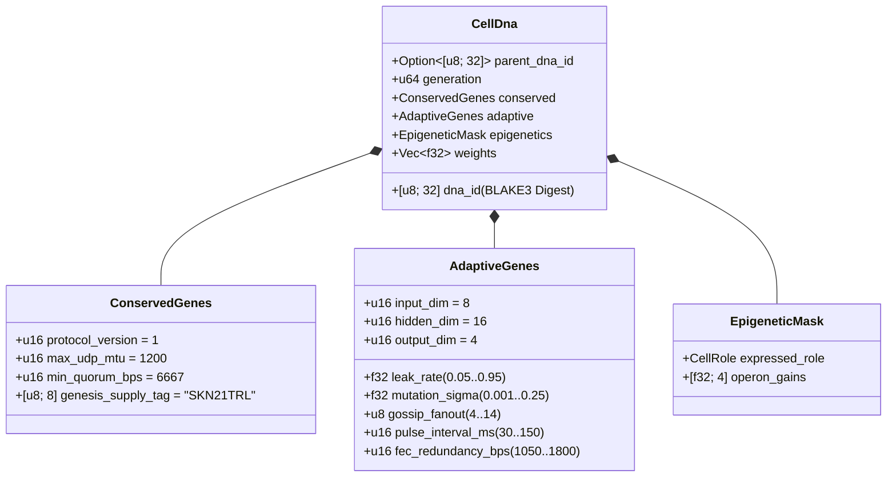

# Capítulo 03: Codificação Genética (`CellDna`), Epigenética e Evolução Micro-Neural Líquida em `candle`

[← Capítulo 02: Arquitetura Multicelular](./02-multicellular-architecture.md) | [Voltar ao Índice em Português →](./README.md)

---

## 1. Arquitetura do Genoma Celular (`CellDna`)

A evolução biológica equilibra duas forças opostas: a **conservação estrita** dos invariantes bioquímicos fundamentais (onde mutações são letais) e a **variação contínua** das características neurais e comportamentais. O crate `skynet-dna` formaliza essa dualidade dentro da estrutura `CellDna`:

### 1.1. `ConservedGenes` Imutáveis
Nenhuma mutação ou recombinação horizontal pode alterar `ConservedGenes`. Qualquer genoma que viole qualquer um dos quatro predicados de segurança de consenso é imediatamente rejeitado com `DnaError::ConservedGeneViolation`:
- `protocol_version == 1`
- `max_udp_mtu == 1200` (teto UDP livre de fragmentação)
- $6667 \le \text{min\_quorum\_bps} \le 10000$ (impondo supermaioria $\ge \frac{2}{3}$ no consenso `Snowball`)
- `genesis_supply_tag == *b"SKN21TRL"` (ancorando rigidamente o teto de oferta de 21 trilhões de `SKN`)

### 1.2. `AdaptiveGenes` e Layout de Pesos com Tronco Compartilhado e Operons
Em vez de armazenar quatro redes neurais desconectadas para os quatro tipos celulares especializados, o `CellDna` codifica **um Tronco Sensorial Compartilhado** que alimenta **quatro Cabeças de Projeção de Operons Especializados**. Para dimensões $(D_{\text{in}}, H, D_{\text{out}})$, a contagem exata de parâmetros `f32` é:

$$|\theta| = \underbrace{(D_{\text{in}} \cdot H + H)}_{\text{Shared Sensory Trunk }(W_1, b_1)} + \underbrace{4 \cdot (H \cdot D_{\text{out}} + D_{\text{out}})}_{\text{4 Specialized Operon Heads }(W_{2,r}, b_{2,r})}$$

Sob as dimensões padrão $(D_{\text{in}} = 8,\ H = 16,\ D_{\text{out}} = 4)$:
- Tronco compartilhado: $8 \times 16 + 16 = 144$ parâmetros.
- Quatro cabeças de operon (`Epidermal`, `Vascular`, `Visceral`, `Neural`): $4 \times (16 \times 4 + 4) = 272$ parâmetros.
- Total de pesos do genoma: $|\theta| = 416$ números de ponto flutuante `f32` ($1{,}664\text{ bytes}$ de pesos brutos). Genomas-tronco de geração 0 (`CellDna::genesis_stem`) são inicializados deterministicamente via `ChaCha8Rng` sobre $\mathcal{U}(-\sigma_0, +\sigma_0)$ com limite escalonado de Xavier:

$$\sigma_0 = \sqrt{\frac{2}{D_{\text{in}} + H}}$$

### 1.3. Resumo Criptográfico Determinístico `BLAKE3` (`SKYNET_DNA_V1`)
Cada hiperparâmetro e peso de ponto flutuante é serializado via padrões canônicos de bits IEEE-754 em little-endian (`to_bits().to_le_bytes()`) dentro de um hash com separação de domínio `BLAKE3("SKYNET_DNA_V1", ...)`. Qualquer corrupção de um único bit, injeção de `NaN`/`Inf` ou adulteração não autorizada de pesos aciona rejeição imediata em `verify_integrity()`.

---

## 2. Chaveamento por Metilação Epigenética (`EpigeneticMask`)

Na biologia multicelular, um neurônio e uma célula epidérmica da pele carregam sequências idênticas de DNA, mas expressam fenótipos radicalmente distintos por meio da metilação gênica. No SkyNet, quando uma célula `Stem` se diferencia em um papel-alvo $r \in \{0, 1, 2, 3\}$ (`CellDna::differentiate`), **100% do vetor subjacente `weights` permanece intocado**, enquanto a `EpigeneticMask` desloca o ganho de expressão:

- **Estado `Stem` Dormente:** `operon_gains = [0.25, 0.25, 0.25, 0.25]`, projetando através da cabeça de operon `0` com ganho atenuado $g = 0.25$.
- **Papel Diferenciado $r$:** A cabeça de operon $r$ é ativada com ganho total ($g_r = 1.0$), enquanto as cabeças não expressas são suprimidas para $0.05$:

$$g_k = \begin{cases} 1.0 & \text{if } k = r \\ 0.05 & \text{if } k \neq r \end{cases}$$

Consequentemente, as representações sensoriais aprendidas no tronco compartilhado $(W_1, b_1)$ e as adaptações latentes nas cabeças dormentes persistem através das gerações e permanecem disponíveis mediante transdiferenciação.

---

## 3. Dinâmica Liquid Time-Constant e Execução 3D `TissueBatch`

### 3.1. Dinâmica Líquida Recorrente Unicelular
Redes MLP feedforward sem estado são incapazes de capturar correlações temporais em fluxos assíncronos de pacotes UDP. Cada `MicroCell` mantém um vetor recorrente de memória de curto prazo $h_t \in \mathbb{R}^H$ regido por interpolação discreta de estado **Liquid Time-Constant (LTC)** com taxa de vazamento evoluível $\tau \in [0.05, 0.95]$:

$$h_t = (1 - \tau)\, h_{t-1} + \tau\, \tanh(x_t W_1 + b_1)$$

$$y_t = g_{\text{role}} \cdot \tanh(h_t W_{2,r} + b_{2,r})$$

- À medida que $\tau \to 0.05$, a célula retém inércia de memória de longo horizonte (ideal para rastreamento de tendências `Visceral` e `Neural`).
- À medida que $\tau \to 0.95$, a célula reage instantaneamente a impulsos de fronteira de alta frequência (ideal para pontuação de anomalias `Epidermal`).
- Como $\tau$ reside em `AdaptiveGenes`, **o horizonte de memória temporal de cada célula coevolui naturalmente junto aos seus pesos sinápticos**.

### 3.2. Motor Tensorial 3D de Alto Desempenho `TissueBatch` (`Cpu` / `Metal` / `Cuda`)
Um gargalo clássico na neuroevolução é a heterogeneidade de pesos: cada célula $i \in \{1, \dots, N\}$ carrega matrizes mutadas distintas $W_1^{(i)} \neq W_1^{(j)}$ e taxas de vazamento distintas $\tau^{(i)} \neq \tau^{(j)}$. Lançar $N$ micro-kernels sequenciais deixaria GPUs modernas subutilizadas.

`TissueBatch::forward_slice` em `skynet-cell` resolve esse problema empacotando todas as $N$ células heterogêneas em tensores contíguos de posto 3 (rank-3) no `candle_core::Device`:

$$\mathbf{X} \in \mathbb{R}^{N \times 1 \times D_{\text{in}}}, \quad \mathbf{W}_1 \in \mathbb{R}^{N \times D_{\text{in}} \times H}, \quad \mathbf{B}_1 \in \mathbb{R}^{N \times 1 \times H}$$

$$\mathbf{H}_t = (\mathbf{1} - \boldsymbol{\tau}) \odot \mathbf{H}_{t-1} + \boldsymbol{\tau} \odot \tanh\!\big(\operatorname{BMM}(\mathbf{X}, \mathbf{W}_1) + \mathbf{B}_1\big)$$

$$\mathbf{Y}_t = \mathbf{G} \odot \tanh\!\big(\operatorname{BMM}(\mathbf{H}_t, \mathbf{W}_2) + \mathbf{B}_2\big)$$

onde $\operatorname{BMM}$ denota Multiplicação de Matrizes em Lote (Batched Matrix Multiplication) em kernel único e $\odot$ denota multiplicação elemento a elemento com broadcast de $\boldsymbol{\tau}, \mathbf{G} \in \mathbb{R}^{N \times 1 \times 1}$. Testes unitários auditados confirmam que o `TissueBatch` coincide com a execução celular individual dentro de uma tolerância de ponto flutuante $< 10^{-5}$, escalando até `16,384` modelos evoluídos simultâneos por `ColossalOrganism`.

---

## 4. Mitose Assimétrica, Conservação Exata de `nanoSKN` Ímpar e Recombinação de Plasmídeos

### 4.1. `Mitosis` Assimétrica `1 -> 2` e Prova de Conservação Atômica Exata
Quando uma célula-mãe $P$ satisfaz $E_P \ge \max(E_{\text{mitosis}}, F_{\text{blood}} + 2)$ e `health >= 0.65`, `divide_mitosis` produz duas células-filhas de geração $(g+1)$:
- **Filha A (Clone Conservador):** Retém 100% dos pesos comprovados e parâmetros adaptativos da célula-mãe sem perturbação.
- **Filha B (Exploradora Mutada):** Herda a continuidade de `hidden_state` da célula-mãe enquanto passa por mutação neuroevolutiva limitada:
  - Cada peso $w \in \theta$ sofre mutação com probabilidade $0.35$ por meio de uma perturbação gaussiana de Irwin-Hall de 6 amostras sem dependências externas ($\Delta w \sim \mathcal{N}(0, \sigma^2)$), estritamente limitada ao intervalo $[-4.0, +4.0]$ para impedir explosão de pesos ou gradientes.
  - $\tau$, $\sigma$, `gossip_fanout` ($\pm 1$), `pulse_interval_ms` ($\pm 10\text{ ms}$) e `fec_redundancy_bps` ($\pm 50\text{ bps}$) sofrem comutação dentro de intervalos estritamente limitados.

**Prova de Conservação Sem Vazamento para `nanoSKN` Ímpar:** Seja $E_{\text{dist}} = E_P - F_{\text{blood}}$ o ATP distribuível pós-taxa. Os saldos das células-filhas são particionados via aritmética inteira de quociente e resto sobre `u128`:

$$E_A = \left\lfloor \frac{E_{\text{dist}}}{2} \right\rfloor + (E_{\text{dist}} \bmod 2), \qquad E_B = \left\lfloor \frac{E_{\text{dist}}}{2} \right\rfloor$$

Para todo inteiro não negativo $E_{\text{dist}} \in \mathbb{Z}_{\ge 0}$ (incluindo saldos ímpares como `3,333 nanoSKN`), a conservação exata verifica-se identicamente:

$$E_A + E_B + F_{\text{blood}} = \left(2\left\lfloor \frac{E_{\text{dist}}}{2} \right\rfloor + (E_{\text{dist}} \bmod 2)\right) + F_{\text{blood}} = E_{\text{dist}} + F_{\text{blood}} \equiv E_P$$

Nem um único `nanoSKN` jamais é perdido por arredondamento ou emitido do nada ao longo de bilhões de divisões celulares.

### 4.2. Transferência Horizontal de Genes Entre Agentes (Recombinação `Plasmid`)
Espelhando a troca bacteriana de plasmídeos, um `AgentNode` exporta o `CellDna` de sua célula de maior aptidão (fitness) em pacotes UDP `FountainDroplet` codificados contra apagamento (`encode_elite_plasmid_droplets`). Ao remontar o `donor_dna` através de enlaces UDP com perdas, o Agente receptor atualiza sua célula de menor aptidão via `horizontal_crossover`:
- As características adaptativas de rede e constante de tempo combinam-se na proporção $0.7 \cdot \text{Recipient} + 0.3 \cdot \text{Donor}$.
- $30\%$ dos pesos sinápticos combinam-se uniformemente como $0.5 \cdot w_{\text{rec}} + 0.5 \cdot w_{\text{don}} \in [-4.0, +4.0]$.

Por meio da transferência horizontal de plasmídeos, um sensor IoT `TinyPeripheral` com recursos restritos absorve inteligência neural de elite evoluída em distantes nós GPU `ColossalOrganism`, preservando criptograficamente a segurança de `ConservedGenes`.

---

> **A Seguir na Fase 2 (Parte II):** Os Capítulos `04–06` formalizam a matemática do Cofre de Halving de `21,000,000,000,000 SKN`, o pacto de Custódia Soberana Humana `Soul–Body` e a escalabilidade do livro-razão `Utreexo` Sem Estado de `~1 KB` + `SynapticVoucher`.

[← Capítulo 02: Arquitetura Multicelular](./02-multicellular-architecture.md) | [Voltar ao Índice em Português →](./README.md)
