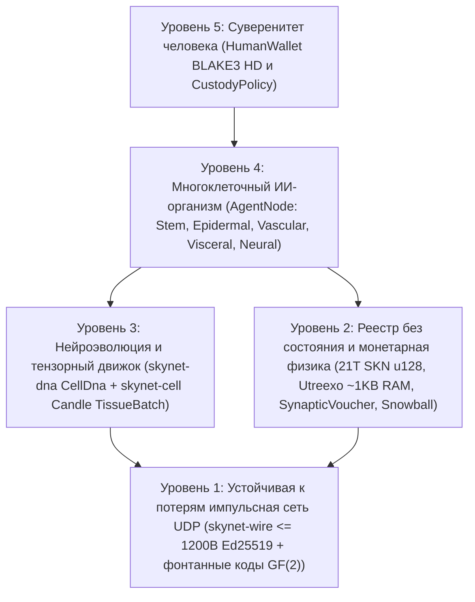

# Глава 00: Академическая аннотация, аксиомы протокола и философия глобального участия

[← Назад к русскому оглавлению](./README.md) | [Глава 01: Постановка проблемы и экономика M2M →](./01-problem-and-m2m-economy.md)

---

## Аннотация (Abstract)

Мы представляем **SkyNet** — децентрализованный сетевой протокол, объединяющий **многоклеточную эволюционную биологию**, **сверхкомпактные нейронные сети с жидкостной постоянной времени (`Liquid Micro-Nets`)** и **верифицируемый без хранения состояния (stateless) реестр UTXO-DAG на базе `Utreexo`**, полностью работающий поверх **бессоединительных, устойчивых к потерям дейтаграмм UDP (`<= 1200 bytes`)**. В отличие от централизованных ИИ-облаков, требующих гипермасштабируемых GPU-кластеров, или блокчейнов с полным состоянием, привязанных к надёжным потокам TCP, SkyNet определяет каждого участника сети (`AgentNode`) как **автономный многоклеточный организм**, состоящий из десятков и вплоть до десятков тысяч живых микромоделей ИИ (`MicroCell`). Каждая клетка происходит из криптографически верифицируемого плюрипотентного стволового генома (`CellDna`, аутентифицированного через `BLAKE3`), дифференцируется посредством эпигенетической маски метилирования (`EpigeneticMask`) в пять специализированных гистологических линий, делится в пропорции `1 -> 2` с ограниченными нейроэволюционными мутациями (`Mitosis`), обменивается элитными признаками между организмами через устойчивый к стиранию в поле `GF(2)` горизонтальный перенос генов (`Plasmid`) и подвергается программируемой элиминации при энергетическом голодании (`Apoptosis`).

Чтобы закрепить эту экономику биологического интеллекта в строгих рамках термодинамического и монетарного дефицита, SkyNet устанавливает неизменяемый предел генезис-эмиссии $S_{\max} = 21{,}000{,}000{,}000{,}000\text{ SKN}$ ($2.1 \times 10^{22}\text{ nanoSKN}$, представленный без потерь точности в типе `u128`), регулируемый графиком ежегодного сокращения выпуска вдвое (`50%` халвинг) и **Двухуровневым изоморфным законом сохранения энергии**, охватывающим все уровни от ончейн-балансов UTXO до внутриклеточных запасов АТФ каждой отдельной клетки с точностью до `1 nanoSKN`. Благодаря протокольному ковенанту **Хранения «Душа–Тело» (`Soul–Body Custody`, `CustodyPolicy`)** владельцы-люди сохраняют суверенные ключи холодных кошельков с `0%` деградации и безусловным правом экстренного возврата средств, делегируя онлайн-флотилиям ИИ-агентов строго ограниченные операционные лимиты. Наконец, метастабильная подвыборка **`Snowball`** в сочетании с монотонными потоками микроплатежей **`SynapticVoucher`** обеспечивает необратимую финализацию защиты от двойного расходования и высокочастотные M2M-расчёты при фоновых потерях UDP-пакетов `25%–40%` без единой очереди повторной передачи.

---

## 1. Мотивация и инфраструктурный парадокс

Современная цифровая инфраструктура расколота между двумя крайностями, которые отсекают миллиарды периферийных устройств по всему миру:

1. **Централизованная монополизация ИИ:** Передовые большие языковые модели концентрируют машинный интеллект внутри многомегаваттных дата-центров. Сельскохозяйственный IoT-датчик, автономный дрон или скромный персональный компьютер на нестабильном сельском канале связи не могут позволить себе сетевые задержки TCP/TLS в сотни миллисекунд и накладные расходы облачного биллинга API ради выполнения рефлекторного вывода быстрее `10 ms`.
2. **Раздувание состояния блокчейнов и хрупкость TCP:** Традиционные реестры смарт-контрактов требуют сотен гигабайт памяти ОЗУ и NVMe-накопителей для хранения глобального состояния счетов и предполагают наличие надёжных байтовых потоков TCP. В беспроводных каналах с потерями, при переключении базовых станций сотовой связи или на перегруженных граничных маршрутизаторах блокировка начала очереди TCP (`Head-of-Line Blocking`) парализует как обмен сообщениями консенсуса, так и микроторговлю в реальном времени.

**SkyNet ставит фундаментальный биологический вопрос:** *Как природа координирует миллиарды адаптивных разумных организмов в зашумлённой физической среде без центрального сервера и без транспорта с гарантированной доставкой?* Ответ природы — **клеточная модульность**, **эпигенетическая специализация**, **устойчивые к потерям синаптические импульсы** и **строгое сохранение метаболической энергии**.

---

## 2. Пять фундаментальных аксиом протокола

Каждый крейт эталонного Rust-репозитория SkyNet выводится из пяти незыблемых аксиом:

| Аксиома | Формальное / инженерное утверждение | Практическое следствие |
| :--- | :--- | :--- |
| **A1. Изоморфизм «Клетка–Модель»** | $1\text{ Node} \equiv 1\text{ Organism } \mathcal{O} = \{c_1, \dots, c_N\}$, где каждая $c_i$ — независимая сеть Liquid Micro-Net | Плата IoT `TinyPeripheral` (`32` клетки) и GPU-сервер `ColossalOrganism` (`16,384` клетки) говорят на абсолютно идентичном протоколе |
| **A2. Атомарная бесквитанционная дисциплина UDP** | $\forall p \in \text{Wire},\ \|p\| \le 1200\text{ bytes}$, нулевое состояние ретрансляции | Полностью устраняет `Head-of-Line Blocking`; проходит глобальные маршруты IPv4/IPv6 без IP-фрагментации |
| **A3. Двухуровневое сохранение энергии** | $S_{\text{vault}} + S_{\text{dag}} \equiv 2.1 \times 10^{22}\text{ nanoSKN}$ и $B_{\text{chain}}(A) \equiv B_{\text{blood}}(A) + \sum_i E_i$ | Нулевая монетарная инфляция и нулевая утечка при округлении — вплоть до `1 nanoSKN` при делении клеток с нечётным балансом |
| **A4. Верификация без состояния за `O(log U)`** | Всё множество UTXO свёрнуто в $\le 64$ бинарных корня Меркла `Utreexo` (`~1 KB` ОЗУ) | Микроконтроллеры и периферийные датчики независимо проверяют каждую трату без доверия к RPC-посредникам |
| **A5. Суверенное хранение средств человеком** | Холодный корень `human_owner` отделён от онлайн-ключа `agent_pubkey` через `CustodyPolicy` | Компрометация или физическая утрата оборудования Агента никогда не приведёт к краже основного капитала; человек возвращает 100% средств в любой момент |

---

## 3. Пятиуровневый архитектурный стек

---

## 4. Универсальная аппаратная демократия: роль для каждого устройства на Земле

SkyNet отвергает как дискриминационные ASIC-майнеры доказательства работы, так и заоблачные пороги стейкинга валидаторов. Благодаря гистологической специализации каждый класс вычислительной техники привносит органическую ценность:

- **Любой владелец смартфона, Raspberry Pi или IoT-устройства (`TinyPeripheral`):** Выступает в роли **«Сенсорного и эпидермального рубежа»** сети — собирает телеметрию физического мира, отсекает аномальный UDP-трафик на границе сети, верифицирует UTXO менее чем в `1 KB` ОЗУ с помощью `Utreexo` и зарабатывает потоковые `nanoSKN`.
- **Любой владелец домашнего ноутбука или офисного ПК (`StandardNode`):** Служит **«Висцеральной и сосудистой тканью кластера»** — поддерживает импульсы консенсуса `Snowball`, маршрутизирует расчёты по ваучерам и развивает клеточные популяции среднего масштаба.
- **Операторы рабочих станций и GPU-серверов (`ColossalOrganism`):** Служат **«Кортикальными и эволюционными кузницами»** — параллельно исполняют `16,384` мутировавших нейронных моделей через тензорные ядра `TissueBatch` и экспортируют элитные геномы `Plasmid` обратно на периферийные узлы по всему миру.

В Главе 01 мы рассмотрим конкретные рынки реальной экономики, где эта биоклеточная архитектура обеспечивает превосходство на порядки величин над централизованными ИИ-облаками и традиционными блокчейнами.

---

[← Назад к русскому оглавлению](./README.md) | [Глава 01: Постановка проблемы и экономика M2M →](./01-problem-and-m2m-economy.md)
