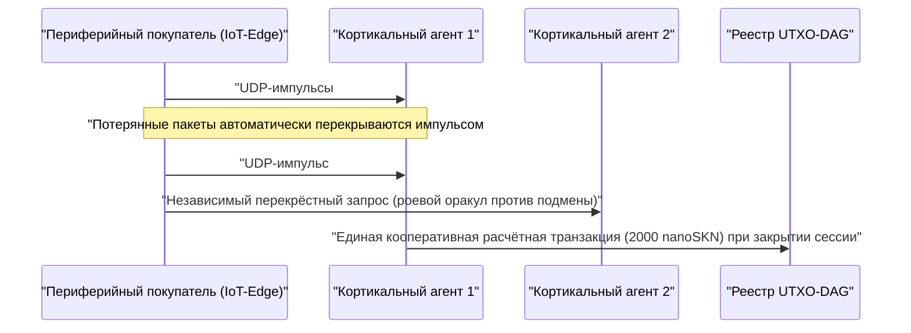

# Глава 01: Постановка проблемы и практическая межмашинная (`M2M`) экономика

[← Глава 00: Аннотация и концепция](./00-abstract-and-vision.md) | [Глава 02: Многоклеточная архитектура →](./02-multicellular-architecture.md)

---

## 1. За пределами централизованных чат-ботов: рефлекторный интеллект на физической границе сети

SkyNet не ставит перед собой задачу заменить централизованные большие языковые модели со ста миллиардами параметров при написании длинных текстов. Вместо этого SkyNet закрывает **структурное слепое пятно объёмом в многие триллионы**: физическую периферию интернета, где миллиарды автономных машин, промышленных датчиков, сетевых шлюзов и программных агентов нуждаются в **рефлекторном выводе быстрее `10 ms`, непрерывной локальной адаптации и межмашинных (`M2M`) расчётах стоимостью в доли цента** поверх ненадёжных беспроводных каналов связи.

### Почему централизованные облака и традиционные блокчейны здесь бессильны

Рассмотрим автономного периферийного агента $A$ (например, роевой беспилотник, шлюз подавления DDoS-атак или реле интеллектуальной энергосети), покупающего классификацию аномалий и верификацию телеметрии в реальном времени каждые $\Delta t = 10\text{ ms}$ по цене $v = 50\text{ nanoSKN}$ за один импульс:

1. **Стена задержек и повторных передач TCP:** Установка TLS/TCP-сессий с удалёнными облачными регионами требует многократных рукопожатий (RTT). При фоновых потерях пакетов в беспроводной среде $p_{\text{loss}} = 20\%$ сжатие окна перегрузки TCP и таймауты повторной передачи отбрасывают хвостовую задержку `p99` в сотни миллисекунд — это катастрофично для киберфизических контуров управления реального времени.
2. **Порог базовой комиссии:** В фиатных платёжных шлюзах или смарт-контрактных сетях EVM фиксированные накладные расходы на транзакцию $F_{\text{tx}}$ превышают ценность одного импульса в $10^5\times$–$10^8\times$ раз ($F_{\text{tx}} \gg v$), что делает миллисекундную M2M-коммерцию экономически невозможной.
3. **Деградация статических моделей (`Model Drift`):** Предобученные статические веса, выгруженные из облака, стремительно теряют точность при смещении локальных распределений сигналов (`concept drift`), тогда как ограниченные периферийные устройства не располагают запасом памяти и энергии для обратного распространения ошибки.

---

## 2. Четыре опоры реальной экономики, формирующие спрос на `SKN`

Фундаментальный спрос на `SKN` рождается из четырёх практических возможностей, в которых централизованные облака и блокчейны с хранением состояния не способны конкурировать:

### 2.1. Роевой периферийный микровывод со сверхнизкой задержкой (`< 10 ms`)
Парки роботов, промышленные IoT-контроллеры, телекоммуникационные ретрансляторы и устройства сетевой безопасности упаковывают нормализованный 8-мерный вектор признаков (`stimulus: [f32; 8]`) вместе с подписанным ваучером `SynapticVoucher` внутрь **одной UDP-дейтаграммы размером `<= 1200 bytes`**.
- Соседние клетки `Epidermal` и `Neural` выполняют прямой проход рекуррентной сети Liquid Micro-Net менее чем за `0.1 ms` на импульс.
- Поскольку `SynapticVoucher` кодирует монотонно возрастающие кумулятивные суммы, даже `25%` случайных потерь UDP-пакетов в сотовых или спутниковых каналах вызывают **нулевые сбои биллинга и нулевые паузы на повторную передачу**.

### 2.2. Эволюция как услуга (`Evolution-as-a-Service`) и децентрализованный рынок генов `Plasmid`
Вместо аренды дорогостоящих облачных GPU-кластеров для обучения компактных встраиваемых моделей любой пользователь или автономный агент может транслировать в сеть заказ-вознаграждение на оптимизацию, задав потоки стимулов $x_t$, целевые отклики $y_t^*$ и награду в `SKN`:
- Тысячи организмов `AgentNode` запускают клеточное деление `Mitosis` `1 -> 2`, параллельно оценивая десятки тысяч возмущений весов и жидкостных постоянных времени $\tau$.
- Слабые мутанты подвергаются `Apoptosis`, тогда как наиболее успешные линии сходятся к компактным геномам `CellDna` (менее `2 KB`, криптографически запечатанным хешем `BLAKE3`).
- Заказчик получает как живой вывод в реальном времени, так и **автономный эволюционировавший артефакт весов `CellDna`** (доставляемый без потерь через пакеты `FountainDroplet` над полем `GF(2)`), готовый к прямой прошивке на миллионы микроконтроллеров.

### 2.3. Атомарная платёжная магистраль `M2M nanoSKN` и роевые оракулы против галлюцинаций
С точностью номинала вплоть до `1 nanoSKN` ($10^{-9}\text{ SKN}$) ИИ-агенты автономно покупают и перекрёстно проверяют сигналы физического мира (микрометеорологическую телеметрию, загрузку радиочастотного спектра, задержки маршрутизации, высокочастотный поток биржевых заявок):

Перекрёстный опрос независимых организмов `AgentNode` внутри локального кластера исключает как галлюцинации одиночной модели, так и спуфинг датчиков.

### 2.4. Инклюзивный многоуровневый DePIN (аппаратный симбиоз)
SkyNet объединяет простаивающее разнородное оборудование по всему миру в симбиотическую биологическую производственную цепочку:

| Сегмент участников | Повседневное оборудование | Экологическая роль | Источник дохода в `SKN` |
| :--- | :--- | :--- | :--- |
| **Частные лица и домохозяйства** | Старые смартфоны, домашние роутеры, Raspberry Pi, платы IoT | Сбор сенсорных данных на границе, фильтрация пакетов клетками `Epidermal`, лёгкая верификация `Utreexo` в `~1 KB` | Заработок `nanoSKN` на потоках данных с датчиков и пограничной фильтрации |
| **Разработчики и пользователи ПК** | Ноутбуки, офисные ПК (`StandardNode`) | Выборка консенсуса `Snowball`, маршрутизация ваучеров, эволюция тканей среднего масштаба | Заработок комиссий кластера (`cluster_nutrient_pool`) и оплаты за вывод |
| **Лаборатории и GPU-операторы** | Многоядерные серверы, Apple `Metal`, GPU NVIDIA `CUDA` | Параллельная эволюция до `16,384` клеток на узел через `TissueBatch` | Заработок на заказах эволюции и роялти за горизонтальный экспорт `Plasmid` |

---

## 3. Сублинейное сжатие ончейн-расчётов

Предположим, два ИИ-агента обмениваются $M$ высокочастотными импульсами вывода по цене $\delta\text{ nanoSKN}$ за вызов через беспроводной канал с вероятностью потери пакета $p \in [0, 1)$. Традиционные ончейн-расчёты требуют $\mathcal{O}(M)$ транзакций в реестре, тогда как накладные расходы ретрансляции TCP растут как $\frac{1}{1 - p}$.

В SkyNet плательщик отправляет подписанные схемой `Ed25519` ваучеры с порядковым индексом $s \in \{1, \dots, M\}$, несущие кумулятивную сумму $V_s = s \cdot \delta$. Любой дошедший пакет $s_k$ криптографически доказывает всю накопленную дельту $\Delta V = V_{s_k} - V_{s_{k-1}}$ за все промежуточные потерянные пакеты без какой-либо повторной отправки. По завершении сессии все $M$ микровыводов рассчитываются **ровно $1$ транзакцией в UTXO-DAG**, обеспечивая коэффициент ончейн-сжатия $M : 1$ (снижение нагрузки на реестр в $1{,}000\times$–$100{,}000\times$ раз на практике).

В Главе 02 исследуется внутренняя анатомия каждого узла `AgentNode` — как единый исполняемый бинарный файл самоорганизуется в живой многоклеточный организм на любом классе оборудования.

---

[← Глава 00: Аннотация и концепция](./00-abstract-and-vision.md) | [Глава 02: Многоклеточная архитектура →](./02-multicellular-architecture.md)
