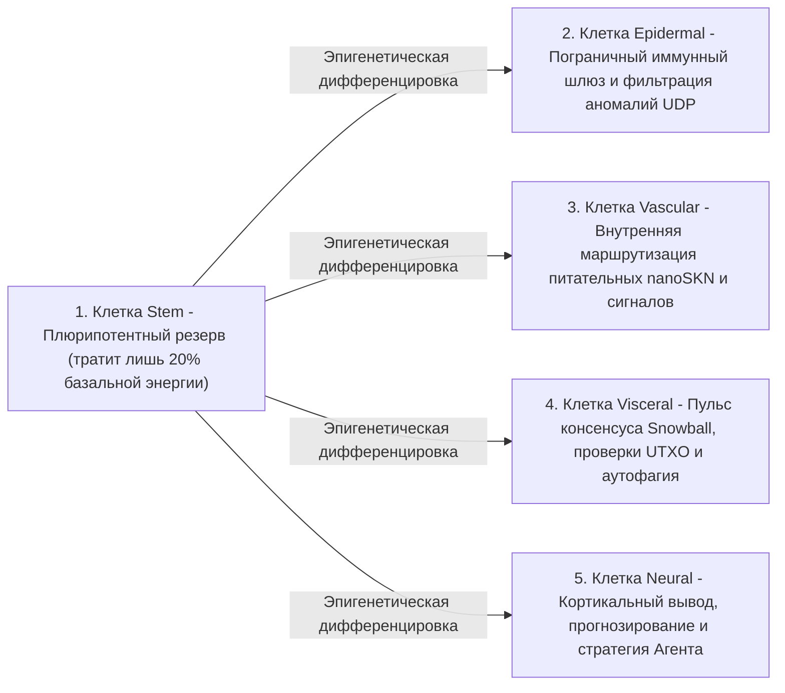

# Глава 02: Архитектура многоклеточного организма и эластичное масштабирование оборудования (`AgentNode`)

[← Глава 01: Постановка проблемы и экономика M2M](./01-problem-and-m2m-economy.md) | [Глава 03: `CellDna` и жидкостные нейронные клетки →](./03-dna-and-liquid-neural-cells.md)

---

## 1. Биологический изоморфизм: `1 Узел = 1 Многоклеточный Организм`

В традиционных одноранговых (peer-to-peer) сетях каждый узел исполняет монолитный жёсткий конечный автомат независимо от того, запущен ли он на встраиваемом микроконтроллере или на 64-ядерном GPU-сервере. В SkyNet (`crates/skynet-agent`) каждый участник сети инстанцируется как **`AgentNode`** — живой многоклеточный организм, включающий динамическую популяцию микроклеток ИИ $\mathcal{C}(t) = \{c_1, c_2, \dots, c_{N(t)}\}$, внутреннее метаболическое казначейство (`AgentMetabolicBank`), верификатор корней `Utreexo` без хранения состояния (`StatelessUtreexoRoots`) и устойчивый к потерям движок консенсуса `SnowballEngine`.

Численность клеточной популяции $N(t) = |\mathcal{C}(t)|$ никогда не задаётся жёстко; она **органически расширяется посредством `Mitosis` и сжимается посредством `Apoptosis` в соответствии с вычислительной мощностью хоста и притоком заработанных питательных веществ `nanoSKN`**.

---

## 2. Три эластичных аппаратных уровня (`HardwareTier`)

При запуске метод `HardwareProfile::for_tier` сопоставляет возможности оборудования с одним из трёх экологических профилей и точными метаболическими порогами в `nanoSKN` (`crates/skynet-cell/src/lib.rs`):

| Биологический параметр (`HardwareProfile`) | `TinyPeripheral` (IoT / периферийный MCU) | `StandardNode` (Ноутбук / настольный ПК) | `ColossalOrganism` (Сервер / GPU) |
| :--- | :--- | :--- | :--- |
| **Максимальная популяция клеток (`max_cells`)** | `32` клетки | `512` клеток | `16,384` клетки |
| **Активный базальный расход / такт (`basal_burn_per_tick`)** | `50 nanoSKN` | `25 nanoSKN` | `10 nanoSKN` |
| **Расход покоящейся клетки `Stem` / такт (экономия 80%)** | `10 nanoSKN` | `5 nanoSKN` | `2 nanoSKN` |
| **Порог деления (`mitosis_threshold`)** | `2,000 nanoSKN` | `1,500 nanoSKN` | `1,000 nanoSKN` |
| **Кровяной сбор за деление (`mitosis_blood_fee`)** | `100 nanoSKN` | `60 nanoSKN` | `40 nanoSKN` |
| **Порог элиминации (`apoptosis_floor`)** | `100 nanoSKN` | `80 nanoSKN` | `50 nanoSKN` |
| **Вычислительный бэкенд (`candle_core::Device`)** | `Cpu` | `Cpu` / `Metal` / `Cuda` | `Cuda` / `Metal` / `Cpu` SIMD |

> [!NOTE]
> **Биологическая экономия на масштабе (закон Клейбера):** Подобно тому как более крупные биологические организмы характеризуются меньшими удельными затратами метаболизма на грамм ткани, узлы `ColossalOrganism` несут меньший базальный расход на одну клетку (`10 nanoSKN` против `50 nanoSKN`), поскольку тысячи клеток амортизируют вычисления внутри единого пакетного тензорного ядра на GPU, тогда как узлы `TinyPeripheral` остаются компактными и живучими на периферии сети.

---

## 3. Пять специализированных гистологических линий (`CellRole`)

При зарождении узла `AgentNode` (`AgentNode::from_signing_key`) он инициализирует эмбриональное ядро из 6 клеток (`2 Stem`, `1 Epidermal`, `1 Vascular`, `1 Visceral`, `1 Neural`), порождённых от детерминированного генома `base_stem`. На протяжении всей жизни организма пять гистологических линий выполняют пять важнейших физиологических функций:

1. **`Stem` (Плюрипотентный резерв — `operon_index = None`):** Покоящиеся регенеративные клетки, потребляющие лишь $\max(\lfloor E_{\text{burn}} / 5 \rfloor, 1)$ за такт. Всякий раз, когда любой специализированный орган истощается, клетка `Stem` проходит эпигенетическую дифференцировку (`differentiate`), восполняя ткань без загрузки внешнего кода.
2. **`Epidermal` (Кожный покров и иммунный шлюз — `operon_index = Some(0)`):** Охраняет необработанный UDP-сокет (`epidermal_inspect_packet`). Прежде чем любой входящий пакет попадёт в реестр или движок консенсуса, клетка `Epidermal` оценивает нормализованную телеметрию пакета (`raw_len / 1200`, `hop_ttl / 16`, расхождение `epoch`) на `candle`, отбрасывая повреждённые пакеты и флуд-импульсы.
3. **`Vascular` (Сосудистый регулятор — `operon_index = Some(1)`):** Регулирует внутреннюю ликвидность пула `blood_pool` внутри `AgentMetabolicBank`, направляя вознаграждения `nanoSKN` наиболее точным клеткам.
4. **`Visceral` (Поддержание внутренних органов — `operon_index = Some(2)`):** Управляет частотой опроса `Snowball`, верификацией свидетельств `Utreexo` без хранения состояния и метаболической переработкой ресурсов.
5. **`Neural` (Кортикальный мозг — `operon_index = Some(3)`):** Выполняет когнитивный вывод; среднее по ансамблю всех живых клеток `Neural` ($\bar{y}_{\text{cortical}} = \frac{1}{|\mathcal{C}_{\text{neural}}|} \sum_{i \in \mathcal{C}_{\text{neural}}} y_i$) формирует коллективное решение организма.

---

## 4. Шестифазный жизненный цикл биологического такта (`run_biological_tick`)

На каждом пульсе (`pulse_seq`) узел `AgentNode` исполняет детерминированный шестифазный физиологический цикл, соединяющий дарвиновский отбор со строгим сохранением `nanoSKN` в арифметике `u128`:

1. **Фаза 1 — Базальный метаболизм:** Каждая клетка $c_i$ расходует энергию поддержания жизнедеятельности $b_i = \text{metabolize\_tick}()$. Принципиально важно, что $b_i$ никогда не сжигается безвозвратно в ончейне: 100% израсходованного внутриклеточного АТФ возвращается обратно в `bank.blood_pool`. Голодающие клетки ($E_i = 0$) теряют `0.25` показателя `health`.
2. **Фаза 2 — Пакетный тензорный вывод на `candle`:** Все $N$ живых клеток выполняются одновременно через `TissueBatch::forward_slice`, формируя выходные векторы $y_i \in \mathbb{R}^4$ и обновляя векторы кратковременной жидкостной памяти $h_{i,t} \in \mathbb{R}^{16}$.
3. **Фаза 3 — Внутриорганный дарвиновский отбор при распределении питания:**
   При заданном целевом сигнале $t \in \mathbb{R}^4$ качество прогноза клетки $i$ оценивается через ограниченную среднюю абсолютную ошибку (MAE):

   $$q_i = \operatorname{clamp}\!\left(1 - \frac{1}{4}\sum_{k=1}^{4} |y_{i,k} - t_k|,\ 0.0,\ 1.0\right)$$

   Пусть $\bar{q}_r$ — среднее качество по всем клеткам, разделяющим органную роль $r = \text{role}(c_i)$. Специализированная клетка получает питательные `nanoSKN` из `blood_pool` тогда и только тогда, когда в её органе насчитывается $\le 2$ клеток либо она преодолевает порог внутриорганной конкурентоспособности $q_i \ge 0.98 \cdot \bar{q}_r$:

   $$R_i = \min\!\left(\lfloor 320 \cdot q_i \rfloor + E_{\text{basal}},\ \left\lfloor \frac{B_{\text{blood}}}{8} \right\rfloor\right)$$

   Отстающие мутанты ($q_i < 0.98 \cdot \bar{q}_r$) не получают питания и несут штраф `-0.35` к здоровью `health`.
4. **Фаза 4 — Гомеостатическая дифференцировка клеток `Stem`:** Организм определяет наиболее малочисленный специализированный орган (`find_most_needed_role`). Если `stem_count > 1`, одна стволовая клетка `Stem` дифференцируется в этот орган при безусловном сохранении как минимум `1` зародышевой клетки `Stem`.
5. **Фаза 5 — Деление `Mitosis` `1 -> 2`:** Здоровые, обеспеченные энергией клетки (`health >= 0.65` и $E_i \ge E_{\text{mitosis}}$) делятся на консервативный клон (Дочь A) и мутировавшего исследователя (Дочь B) вплоть до предела `profile.max_cells`.
6. **Фаза 6 — Защищённый по органам `Apoptosis`:** Истощённые ($E_i < E_{\text{apoptosis}}$) или критически повреждённые (`health <= 0.15`) клетки растворяются и возвращают 100% оставшихся у них `nanoSKN` обратно в `blood_pool` — при соблюдении жёсткого предохранителя выживаемости: **безусловно сохраняется не менее `1` живой клетки каждого существующего типа `CellRole`**, чтобы ни один жизненно важный орган никогда не вымер.

В завершение каждого такта функция `verify_internal_skn_conservation()` проверяет точное тождество в типе `u128`:

$$B_{\text{chain}}(\text{Agent}) \equiv B_{\text{blood}}(\text{Agent}) + \sum_{c_i \in \mathcal{C}} E_i$$

Глава 03 открывает клеточное ядро и детально описывает побайтовую и математическую структуру `CellDna`, эпигенетическое переключение оперонов и трёхмерное пакетное исполнение жидкостных нейросетей в `TissueBatch`.

---

[← Глава 01: Постановка проблемы и экономика M2M](./01-problem-and-m2m-economy.md) | [Глава 03: `CellDna` и жидкостные нейронные клетки →](./03-dna-and-liquid-neural-cells.md)
