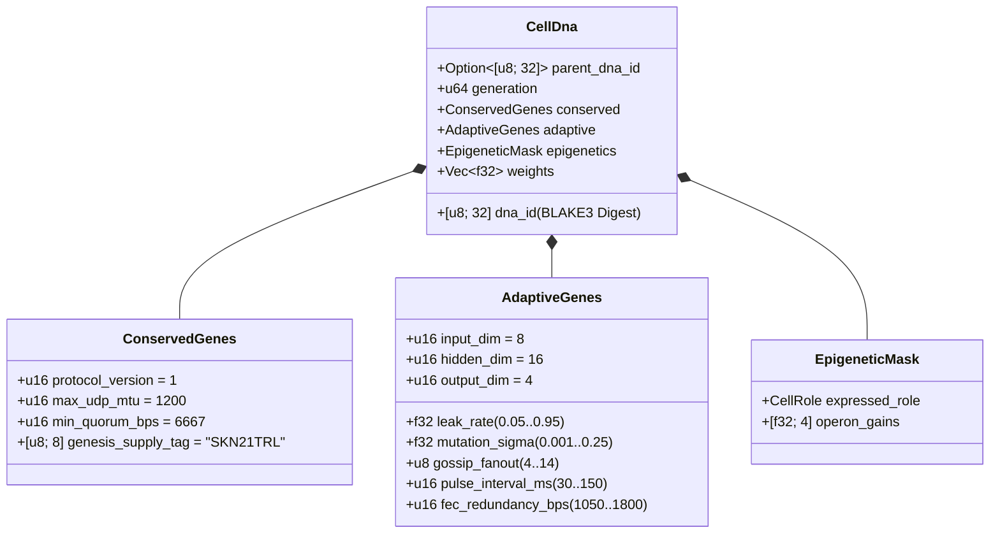

# Глава 03: Генетическое кодирование (`CellDna`), эпигенетика и жидкостная микронейронная эволюция на `candle`

[← Глава 02: Многоклеточная архитектура](./02-multicellular-architecture.md) | [Назад к русскому оглавлению →](./README.md)

---

## 1. Архитектура клеточного генома (`CellDna`)

Биологическая эволюция удерживает равновесие между двумя противоположными силами: **строгой консервацией** базовых биохимических инвариантов (мутации в которых летальны) и **непрерывной изменчивостью** нейронных и поведенческих признаков. Крейт `skynet-dna` формализует эту двойственность в структуре `CellDna`:

### 1.1. Неизменяемые консервативные гены (`ConservedGenes`)
Ни одна мутация и ни один горизонтальный кроссинговер не способны изменить `ConservedGenes`. Любой геном, нарушающий хотя бы один из четырёх предикатов безопасности консенсуса, немедленно отвергается с ошибкой `DnaError::ConservedGeneViolation`:
- `protocol_version == 1`
- `max_udp_mtu == 1200` (потолок размера UDP-дейтаграммы без фрагментации)
- $6667 \le \text{min\_quorum\_bps} \le 10000$ (гарантия квалифицированного большинства $\ge \frac{2}{3}$ в `Snowball`)
- `genesis_supply_tag == *b"SKN21TRL"` (жёсткая фиксация потолка эмиссии в 21 триллион `SKN`)

### 1.2. Адаптивные гены (`AdaptiveGenes`) и архитектура весов с общим стволом и оперонами
Вместо хранения четырёх разрозненных нейросетей для четырёх специализированных типов клеток `CellDna` кодирует **один общий сенсорный ствол**, питающий **четыре специализированные проекционные головы оперонов**. Для размерностей $(D_{\text{in}}, H, D_{\text{out}})$ точное число параметров типа `f32` составляет:

$$|\theta| = \underbrace{(D_{\text{in}} \cdot H + H)}_{\text{Shared Sensory Trunk }(W_1, b_1)} + \underbrace{4 \cdot (H \cdot D_{\text{out}} + D_{\text{out}})}_{\text{4 Specialized Operon Heads }(W_{2,r}, b_{2,r})}$$

При размерностях по умолчанию $(D_{\text{in}} = 8,\ H = 16,\ D_{\text{out}} = 4)$:
- Общий сенсорный ствол: $8 \times 16 + 16 = 144$ параметра.
- Четыре головы оперонов (`Epidermal`, `Vascular`, `Visceral`, `Neural`): $4 \times (16 \times 4 + 4) = 272$ параметра.
- Суммарный объём весов генома: $|\theta| = 416$ чисел `f32` ($1{,}664\text{ bytes}$ чистых весов). Стволовые геномы нулевого поколения (`CellDna::genesis_stem`) детерминированно инициализируются генератором `ChaCha8Rng` из равномерного распределения $\mathcal{U}(-\sigma_0, +\sigma_0)$ с границей масштабирования Ксавье:

$$\sigma_0 = \sqrt{\frac{2}{D_{\text{in}} + H}}$$

### 1.3. Детерминированный криптографический дайджест `BLAKE3` (`SKYNET_DNA_V1`)
Каждый вещественный гиперпараметр и вес сериализуется в каноническое побитовое представление IEEE-754 с порядком байтов little-endian (`to_bits().to_le_bytes()`) и хешируется функцией `BLAKE3("SKYNET_DNA_V1", ...)` с разделением доменов. Любое искажение хотя бы одного бита, инъекция `NaN`/`Inf` или несанкционированная подмена весов приводят к мгновенному отклонению генома при проверке `verify_integrity()`.

---

## 2. Эпигенетическое переключение метилированием (`EpigeneticMask`)

В многоклеточной биологии нейрон и клетка эпидермиса кожи несут абсолютно идентичные последовательности ДНК, но экспрессируют радикально различные фенотипы за счёт метилирования генов. В SkyNet при дифференцировке клетки `Stem` в целевую роль $r \in \{0, 1, 2, 3\}$ (`CellDna::differentiate`) **100% нижележащего вектора `weights` остаётся нетронутым**, а маска `EpigeneticMask` лишь переключает коэффициенты усиления экспрессии:

- **Покоящееся состояние `Stem`:** `operon_gains = [0.25, 0.25, 0.25, 0.25]`, проекция идёт через голову оперона `0` с ослабленным коэффициентом усиления $g = 0.25$.
- **Дифференцированная роль $r$:** Голова оперона $r$ активируется на полную мощность ($g_r = 1.0$), а неэкспрессируемые головы подавляются до уровня $0.05$:

$$g_k = \begin{cases} 1.0 & \text{if } k = r \\ 0.05 & \text{if } k \neq r \end{cases}$$

Благодаря этому сенсорные представления, накопленные в общем стволе $(W_1, b_1)$, и латентные адаптации в подавленных головах сохраняются из поколения в поколение и остаются доступными при трансдифференцировке.

---

## 3. Динамика жидкостной постоянной времени и трёхмерное исполнение `TissueBatch`

### 3.1. Одноклеточная рекуррентная жидкостная динамика
Обычные многослойные персептроны прямого распространения без памяти не способны улавливать временные корреляции в асинхронных потоках UDP-пакетов. Каждая клетка `MicroCell` поддерживает вектор рекуррентной кратковременной памяти $h_t \in \mathbb{R}^H$, управляемый дискретной интерполяцией состояния **Liquid Time-Constant (LTC)** с эволюционирующим коэффициентом утечки $\tau \in [0.05, 0.95]$:

$$h_t = (1 - \tau)\, h_{t-1} + \tau\, \tanh(x_t W_1 + b_1)$$

$$y_t = g_{\text{role}} \cdot \tanh(h_t W_{2,r} + b_{2,r})$$

- При $\tau \to 0.05$ клетка сохраняет инерцию долгосрочной памяти (идеально для отслеживания трендов клетками `Visceral` и `Neural`).
- При $\tau \to 0.95$ клетка мгновенно реагирует на высокочастотные пограничные импульсы (идеально для оценки аномалий клетками `Epidermal`).
- Поскольку $\tau$ входит в состав `AdaptiveGenes`, **временной горизонт памяти каждой клетки естественным образом коэволюционирует вместе с её синаптическими весами**.

### 3.2. Высокопроизводительный трёхмерный тензорный движок `TissueBatch` (`Cpu` / `Metal` / `Cuda`)
Классическое узкое место нейроэволюции — гетерогенность весов: каждая клетка $i \in \{1, \dots, N\}$ несёт собственные мутировавшие матрицы $W_1^{(i)} \neq W_1^{(j)}$ и собственные коэффициенты утечки $\tau^{(i)} \neq \tau^{(j)}$. Последовательный запуск $N$ микроядер привёл бы к простою современных GPU.

Метод `TissueBatch::forward_slice` в крейте `skynet-cell` решает эту задачу, упаковывая все $N$ разнородных клеток в непрерывные тензоры 3-го ранга на устройстве `candle_core::Device`:

$$\mathbf{X} \in \mathbb{R}^{N \times 1 \times D_{\text{in}}}, \quad \mathbf{W}_1 \in \mathbb{R}^{N \times D_{\text{in}} \times H}, \quad \mathbf{B}_1 \in \mathbb{R}^{N \times 1 \times H}$$

$$\mathbf{H}_t = (\mathbf{1} - \boldsymbol{\tau}) \odot \mathbf{H}_{t-1} + \boldsymbol{\tau} \odot \tanh\!\big(\operatorname{BMM}(\mathbf{X}, \mathbf{W}_1) + \mathbf{B}_1\big)$$

$$\mathbf{Y}_t = \mathbf{G} \odot \tanh\!\big(\operatorname{BMM}(\mathbf{H}_t, \mathbf{W}_2) + \mathbf{B}_2\big)$$

где $\operatorname{BMM}$ обозначает пакетное матричное умножение (Batched Matrix Multiplication) внутри единого вычислительного ядра, а $\odot$ — поэлементное умножение с трансляцией размерностей (broadcasting) для $\boldsymbol{\tau}, \mathbf{G} \in \mathbb{R}^{N \times 1 \times 1}$. Аудированные модульные тесты подтверждают совпадение результатов `TissueBatch` с индивидуальным клеточным расчётом в пределах погрешности плавающей запятой $< 10^{-5}$ при масштабировании вплоть до `16,384` одновременно эволюционирующих моделей на один узел `ColossalOrganism`.

---

## 4. Асимметричный митоз, точное сохранение нечётных `nanoSKN` и плазмидный кроссинговер

### 4.1. Асимметричное деление `Mitosis` `1 -> 2` и доказательство точного атомарного сохранения
Когда родительская клетка $P$ удовлетворяет условиям $E_P \ge \max(E_{\text{mitosis}}, F_{\text{blood}} + 2)$ и `health >= 0.65`, вызов `divide_mitosis` порождает две дочерние клетки поколения $(g+1)$:
- **Дочь A (Консервативный клон):** На 100% сохраняет проверенные родительские веса и адаптивные параметры без возмущений.
- **Дочь B (Мутировавший исследователь):** Наследует непрерывность вектора `hidden_state` родителя, подвергаясь ограниченной нейроэволюционной мутации:
  - Каждый вес $w \in \theta$ мутирует с вероятностью $0.35$ через не требующее внешних зависимостей 6-выборочное гауссово возмущение Ирвина–Холла ($\Delta w \sim \mathcal{N}(0, \sigma^2)$), строго усечённое диапазоном $[-4.0, +4.0]$ для предотвращения взрыва весов и градиентов.
  - Параметры $\tau$, $\sigma$, `gossip_fanout` ($\pm 1$), `pulse_interval_ms` ($\pm 10\text{ ms}$) и `fec_redundancy_bps` ($\pm 50\text{ bps}$) ко-мутируют в строго ограниченных интервалах.

**Доказательство безошибочного сохранения при нечётных балансах `nanoSKN`:** Пусть $E_{\text{dist}} = E_P - F_{\text{blood}}$ — распределяемый остаток АТФ после уплаты кровяного сбора. Балансы дочерних клеток разделяются посредством целочисленного деления с остатком в типе `u128`:

$$E_A = \left\lfloor \frac{E_{\text{dist}}}{2} \right\rfloor + (E_{\text{dist}} \bmod 2), \qquad E_B = \left\lfloor \frac{E_{\text{dist}}}{2} \right\rfloor$$

Для любого целого неотрицательного $E_{\text{dist}} \in \mathbb{Z}_{\ge 0}$ (включая нечётные балансы, например `3,333 nanoSKN`) тождество сохранения выполняется абсолютно точно:

$$E_A + E_B + F_{\text{blood}} = \left(2\left\lfloor \frac{E_{\text{dist}}}{2} \right\rfloor + (E_{\text{dist}} \bmod 2)\right) + F_{\text{blood}} = E_{\text{dist}} + F_{\text{blood}} \equiv E_P$$

Ни один `nanoSKN` никогда не теряется из-за округления и не возникает из воздуха на протяжении миллиардов делений клеток.

### 4.2. Межагентный горизонтальный перенос генов (кроссинговер `Plasmid`)
Подобно обмену бактериальными плазмидами, узел `AgentNode` экспортирует геном `CellDna` своей наиболее приспособленной клетки в пакеты UDP `FountainDroplet` со стирающим кодированием (`encode_elite_plasmid_droplets`). Собрав `donor_dna` через подверженный потерям UDP-канал, принимающий Агент модернизирует свою наименее приспособленную клетку методом `horizontal_crossover`:
- Адаптивные сетевые признаки и постоянная времени смешиваются в пропорции $0.7 \cdot \text{Recipient} + 0.3 \cdot \text{Donor}$.
- $30\%$ синаптических весов равномерно усредняются как $0.5 \cdot w_{\text{rec}} + 0.5 \cdot w_{\text{don}} \in [-4.0, +4.0]$.

Благодаря горизонтальному переносу плазмид ограниченный в ресурсах IoT-датчик `TinyPeripheral` впитывает элитный нейронный интеллект, выведенный на удалённых GPU-узлах `ColossalOrganism`, криптографически сохраняя неприкосновенность инвариантов `ConservedGenes`.

---

> **Далее в Фазе 2 (Часть II):** Главы `04–06` формализуют математику Хранилища халвинга на `21,000,000,000,000 SKN`, ковенант суверенного человеческого хранения средств `Soul–Body` и масштабирование реестра без состояния `Utreexo` объёмом `~1 KB` + каналов `SynapticVoucher`.

[← Глава 02: Многоклеточная архитектура](./02-multicellular-architecture.md) | [Назад к русскому оглавлению →](./README.md)
